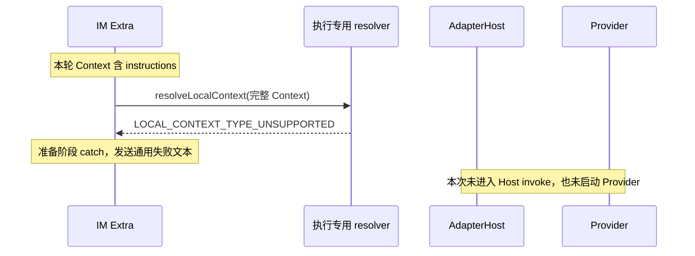

# IM 预置指令准备失败的排查与架构经验

本记录沉淀已核对的故障和用户确认的责任边界。修复仍处于[规划阶段](../../tasks/unify-execution-and-simplify-instructions/brief.md)，不表示产品代码已修改或真实 IM 场景已通过。

## 已知现象与证据

用户在 Work App 配置 Octo 通道、执行 adapter、目录和默认提示词后，IM 收到“本轮输入或执行配置准备失败，尚未发起执行”。Bot 显示在线绿点，但没有独立错误卡片。用户反馈同类 CLI daemon 用法未遇到问题。

在本仓 `feat/open-source-github`、`fed4244` 基线及当时工作树中，核对到 Octo / WeCom Extra 均先调用执行 resolver，构造内部请求，再转回公开输入交给 Host。Host 的 `prepareInvokeInput()` 已经有执行解析和完整 Context 分流逻辑。

使用本仓已构建的 Octo dispatcher、当前协议合法的 instructions Context 和本地会话参数，局部调用 `createImInvocation()` 得到：

```text
LOCAL_CONTEXT_TYPE_UNSUPPORTED: octo.control/instructions
```

这次复现没有启动 Provider、执行工具或发送 IM 消息。它确认了一个足以导致用户现象的准备缺陷；没有对用户当时运行进程、SDK 构建版本和原始输入进行完整重放，不能声称现场所有失败都已归因。

## 故障链



完整 Context 合法，不意味着所有子解析器都接受其中全部类型。`octo.control/instructions` 属于系统指令通道，执行 resolver 只负责执行参数。错误发生在 IM Extra 把两种责任混合的地方，不能将它解释为 Provider 不支持系统提示词。

## 坑与处理原则

| 坑 | 后果 | 后续处理原则 |
| --- | --- | --- |
| 把“读取 adapter”扩大为“提前解析整个执行计划” | Extra 和 Host 各准备一次，接纳范围、默认值和错误时机可能不一致 | Extra 读取选择服务于业务判断；内部执行解析归 Host |
| 将完整 Context 直接交给执行专用 resolver | 合法系统指令在 Provider 启动前被拒绝 | Host 在共享准备流程中分流执行配置，完整 Context 保留给统一渲染 |
| 只在 Extra 过滤掉 instructions | 眼前报错可能消失，但内部请求往返和两套准备仍保留 | 删除 Extra 的内部请求构造，直接提交公开 InvokeInput |
| catch 只返回通用失败文本 | 实际阶段和原因丢失，用户无法区分准备失败与模型失败 | 接入既有失败投影，展示安全原因、公开码及诊断关联，明确是否已执行 |
| 用 Bot 绿点判断任务结果 | 连接在线被误读为模型执行正常 | 连接、执行接纳、Provider 终态和消息投递分别按证据报告 |
| 从“CLI 成功、SDK 失败”推导两套正确实现 | 可能忽略实际代码、配置、输入或构建差异 | 对齐仓库路径、提交、包解析、dist 和运行进程，再比较等价调用 |
| 把静默系统指令当普通逐轮 Context | 长提示词在每轮重复发送，语义和消耗都改变 | 保留独立 instructions 通道，新 Provider 会话初始化，续聊不重复注入 |
| 用 source 标签表达权限 | 文本分类和实际授权混淆，协议分支增多 | 按用户决定删除 source；权限仍在真实身份、配置写入和 mandatory 边界校验 |

## 已确认的架构结论

1. 宿主已在本机持有的业务配置，在发起本轮调用时组装，不要求为了读取提示词再经过 CLI 或其他业务代理。配置加载、刷新、持久化仍由宿主决定。
2. IM Extra 可以读取执行 adapter，用于既有输入限制、环境或重试策略；它不因此获得 Host 的执行解析职责。对公开输入的业务校验与执行配置解析是两件事。
3. 所有入口通过公开 `InvokeInput` 进入 Host。Host 共享流程调用 `prepareInvokeInput()`，内部再调用 `resolveLocalContext()`，随后交给所选 Provider Adapter。
4. 业务每轮提供什么 Context 与 Provider 何时初始化系统指令分开。instructions 新 Provider 会话注入，正常续聊不重复；普通业务 Context 按本轮显式输入处理。
5. 恢复失败后退回新会话时，只能使用本次调用显式冻结的必要指令和背景；不按 sessionId 从隐藏缓存补齐。修改系统指令的生效由业务显式新建或 reset 决定。
6. instructions entries 目标结构仅为 `{ text: string }[]`，严格按原顺序 `join("\n")`。删除 source、不兼容旧数据是本次明确决策，不是所有后续协议变更的默认政策，也不是删除数据库的授权。
7. CLI 和 SDK 共享执行机制，宿主各自决定 Adapter 加载集合。要求全 Adapter 的宿主显式装配全部所需模块，不通过复制 CLI 默认清单继承选择。

更新后的[责任矩阵与目标调用图](../../guides/im-agent-invocation-boundary.md#执行准备与系统指令调用视图)作为后续设计入口；具体协议和全 Adapter 验收见[任务简报](../../tasks/unify-execution-and-simplify-instructions/brief.md)及[验收清单](../../tasks/unify-execution-and-simplify-instructions/acceptance.md)。

## 调试顺序

1. 确认实际运行仓库、submodule 提交或本地 link 解析位置、构建产物和进程。源码改动后必须确认新产物确实被加载，不能只看编辑器中的代码。
2. 确认失败阶段：业务输入准备、Host 接纳与准备、Provider 调用、结果投递。不得因 IM 收到一条失败回复就认定 Provider 已执行。
3. 使用脱敏的最小公开输入验证协议，再检查最先违反合同的模块。复现材料不得含 Token；诊断只记录定位所需的安全信息。
4. 在同一版本上对齐 CLI 和 SDK 的输入、默认值、Provider binding 与执行环境。验证机制一致，同时保留入口合法的业务差异。
5. 验证新会话、续聊、显式 reset 及既有 fresh fallback，再验证错误展示和连接状态。把安装/认证缺失、mock 通过和真实 Provider 通过分开记录。

## 同类错误的补充排查

用户进一步要求排查同一句准备失败文案背后的其他原因，以及相邻的错误被吞场景。以下在本仓已构建模块中隔离执行：替换传输层启动/关闭、拦截规则 API 的 fetch，实际运行 Channel 编排和 dispatcher；没有访问线上接口、启动 Provider 或写入用户数据。故障注入用于验证分支行为，不代表用户现场发生了每一种错误。

### 同一句准备失败文案

Octo 的 `#turn` 在准备阶段包含环境读取、Context 构建、内部请求构造、图片准备和会话快照保存。catch 丢弃实际原因，只记录 `IM_CONTEXT_PREPARATION_FAILED`。非图片消息在以下隔离场景中均返回同一句通用文案，`host.invoke` 调用数和展示初始化次数均为 0，连接仍在线且连接 error 为空：

| 复现场景 | dispatcher 或准备环节的实际错误 |
| --- | --- |
| 当前协议合法的系统指令项 | `LOCAL_CONTEXT_TYPE_UNSUPPORTED: octo.control/instructions` |
| 当前协议合法的 Runtime 路由项 | `LOCAL_CONTEXT_TYPE_UNSUPPORTED: octo.runtime/selection` |
| 任务 workspace 不同于 IM Agent 固定目录 | `IM_AGENT_WORKDIR_FIXED` |
| 相同 namespace/name 重复出现 | `CONTEXT_KEY_DUPLICATED` |
| 本轮 Context 超过字节预算 | `CONTEXT_BUDGET_EXCEEDED` |
| Context 构建抛错 | 注入 `IM_RULE_PROTOCOL_INVALID`，同样被统一 catch 覆盖 |
| 会话 occurrence 快照保存抛错 | 注入 `IM_SESSION_ENTRY_TOO_LARGE`，同样被统一 catch 覆盖 |

直接 dispatcher 还复现了非法 MCP 配置触发 `CONTEXT_SCHEMA_INVALID`；源码路径表明该错误也落入同一个准备 catch。规则读取单独验证：群规则 HTTP 403 向上抛错，404 记录缺失并继续。因此“没有群规则”与“无权限读取群规则”不能按同一种失败处理。Context 自动补充键冲突、连接在准备期间被替换和默认目录创建失败也位于同一 catch 范围；这些具体外部条件本轮只做源码核对。

`octo.runtime/selection` 在共享 `prepareInvokeInput()` 中可合法通过。Extra 提前解析完整 Context 的问题因此不只影响 instructions；应删除重复准备，而非只给某一种类型加特例。

WeCom 已隔离复现 instructions 和 Runtime selection 得到相同通用文案且未调用 Host。WeCom 的 `#diagnostic()` 还会将 `IM_CONTEXT_PREPARATION_FAILED` 写入连接 error，尽管 connected 保持 true；Octo 当前没有这项污染。

### 相邻的无回复与阶段误判

| 故障注入或真实本地拒绝 | Octo 当前结果 | WeCom 当前结果 |
| --- | --- | --- |
| session store 的 read 抛错 | 只记录 `IM_SESSION_STORE_FAILED`，没有用户回复，未调用 Host | 相同，且任务诊断进入连接 error |
| `beginPresentation()` 抛错 | 尚未调用 Host，却回复“执行结果未知”，记录 `IM_EXECUTION_RESULT_UNKNOWN` | 展示初始化位于执行 try 外，落入 `IM_TURN_FAILED`，没有用户回复 |
| Host 没有注册 codex | 实际 Host 明确拒绝 `unknown adapter: codex`；Channel 抹掉原因，改报“执行结果未知” | 同样改报结果未知，且进入连接 error |

最后一项使用实际空 AdapterHost 验证拒绝，没有调用任何 Provider。未知结果适用于无法确认是否执行的断流等情况；不能覆盖已有明确未执行证据的 Host 拒绝。真实断流仍须保留结果未知，不得为改善展示一律改成未执行。

这些发现补充到[验收清单](../../tasks/unify-execution-and-simplify-instructions/acceptance.md)。修复需同时处理统一执行准备、错误原因保留、展示故障隔离及失败阶段；仅删除 source 或修复单个 instructions 特例不能完成本任务。

## 本轮验证范围

已完成源码核对和本地纯准备路径复现；没有进行 Provider 或 IM 功能联调。功能修复、全 Adapter 验证和消费者升级仍待实施。

文档检查结果：本次 diff 的空白检查通过，`context.yaml` 的规则 ID 与来源文件校验通过。首次全库检查遇到其他日志改造删除 `host-log.ts` 后的两处旧引用，位置为 `tasks/gateway-august-feature-assessment/assessment.md` 和 `tasks/runtime-hourly-log-retention/brief.md`；本任务未修改这些并行工作。补充排查后的工作树再次运行 `uv run --with pyyaml python .octospec/scripts/lint.py` 已通过：168 个 OKF 单元、20 条规则、1353 个本地文件链接。该结果仅证明文档检查通过，不代表功能修复完成。
