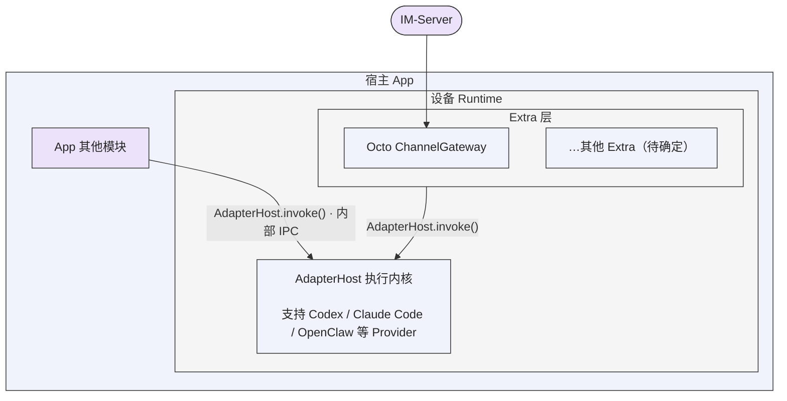

# Octo Runtime 基础架构

## 设备与虚拟身份的最新澄清

2026-10-15 用户进一步确认：实体设备提供执行资源，Runtime 是设备上的虚拟标识；多个 runtimeId 可以引用同一 machineId，并由业务插件分别登记给个人或组织。Extra 属于设备 Host，不属于某个虚拟 Runtime/profile。下文将“运行时设备”与“稳定 Runtime 身份”合并叙述的部分不再作为身份归属依据。目标结构、原定义问题、profile 收敛和迁移验收见 [设备与虚拟 Runtime 决策](../tasks/device-virtual-runtime-boundary/brief.md)。这项澄清尚未完成代码改造，现有身份与配置不得自动重置。

Octo Runtime 的项目边界是一个**运行时设备**：本地存在、具有稳定 Runtime 身份，并提供执行 Agent 的统一内核 `AdapterHost`。设备是否接入外部系统、是否加载 Extra、是否在线，分别描述接入状态，不决定本地 Runtime 是否存在。

宿主应用通过内部 IPC 使用执行内核。外部系统通过 Extra 插件建立连接、下发执行请求并接收结果。两种入口使用同一个执行内核。

## 架构图

宿主 App 包含 App 其他模块和设备 Runtime；设备 Runtime 内包含上方的 Extra 层与下方的 AdapterHost 执行内核。IM-Server 位于宿主 App 外，通过 ChannelGateway 接入；Extra 与 App 其他模块都调用同一个 `AdapterHost.invoke()`。图中箭头表示请求进入方向，交互事件与结果沿对应调用链返回。

图表示责任边界，不规定每个方框都对应一个独立进程。Extra 位于设备宿主上，不挂靠单个 Runtime/profile；插件内部的账号、连接数量与路由由插件管理。“其他 Extra”是待确定扩展的占位，不表示已有实现。

## 按责任归属修复问题

2026-10-16 架构决策：从业务意图、协议合同和模块职责出发确定修复位置。谁负责产生某项数据或行为，谁就负责使其符合合同；发现发送端生成协议有误，应修复发送端，不得让接收端通过猜测正文、补造业务意图或放宽准入来掩盖问题。执行此约束的目的是保持一份明确的协议和清晰的模块责任，不以“尽量能用”为由在不同层叠加补偿逻辑。

- 生产方负责正确生成协议字段，传输方按合同完整传递，消费方校验并执行已明确表达的语义。沿链路定位最先违反合同的位置，在责任模块修复，并验证生产到消费的链路；不得仅因下游更容易修改就把责任转移到下游。
- 消费方必须处理缺失、无效及无权限输入，但只能按合同拒绝、忽略或返回真实状态。不得把普通业务内容提升为身份、权限、触发条件或控制指令，也不得伪造成功。可选辅助信息缺失时按既定合同继续业务，不等于补造该信息。
- 协议已明确约定的格式转换、可选字段默认值、重试和兼容属于各自责任；不能把这些机制扩展为对其他模块缺陷的通用兜底。新增兼容需求必须有具体使用方、适用协议与责任归属，按实际影响决策，不因旧项目存在类似代码就复制，不自行增加猜测式回退、配置开关或预留能力。
- 设计和评审先回答：真实业务需求是什么、合同由谁产生和消费、哪一段违反合同、在责任模块修复后还需要哪些下游改动。若下游改动只是为了掩盖上游错误，应删除该设计并回到问题来源；不得把“旧实现曾如此处理”当作需求或合理性的证明。

IM mention 是具体应用：发送端负责将有效点名操作或发送前标记转换为真实 `payload.mention`，接收端只按元数据判断。发送端漏填字段，应修复发送端；接收端不从 `@名字`、`@[uid:name]`、Markdown 报告或代码示例中猜测调用意图。支持协议中的 `mention.ais` 是正常消费显式 AI 广播，不是为缺失字段兜底。决策依据及取舍见[记录](../journal/shared/2026-10-16-contract-responsibility-decision.md)。

## 三个基础边界

### 运行时设备

HostApp 安装并初始化 Runtime 后，本地执行对象及其身份即存在。外部断线、停用 Extra 或普通重启不删除本地身份。本地身份存在、本地执行就绪、Provider 可用及外部连接健康是不同状态，分别按真实证据报告。

本架构调整此前将 Runtime 定义为依赖线上服务才成立的对象的思路。设备上的执行内核启动后，运行时设备本体就已客观存在；本地启动和执行不以登录线上服务、云端登记、IM 建联或对外共享为前置条件。线上服务可以记录该设备的接入关系和可见状态，但不负责赋予设备本体“是否存在”的事实。

与外部 IM 交互、将本地执行能力共享给其他用户或系统，都是在设备本体之上按需加载的 Extra 能力。共享插件可以依赖自己的线上服务，并处理登记、授权、在线状态、远程请求及结果回传；这些依赖属于该插件。停用共享或撤销线上登记只改变对外可访问性，不销毁本地设备，也不阻止宿主通过内部 IPC 使用执行内核。具体共享访问方案仍待确定。

当前实现由 daemon SDK 管理本地 Home、Runtime/profile 身份、生命周期及内部 IPC，并管理共享 AdapterHost。一个 Home 可以承载多个 Runtime/profile，共享执行内核。Home 级 `machine_id` 是安装分组标识，不是硬件指纹、认证凭据或跨产品全局设备身份。详见 [本地存在与接入边界](runtime-lifecycle.md)。

### 统一执行内核 AdapterHost

AdapterHost 接收已准备的 Agent 执行请求，通过 Provider Adapter 调用对应 Provider，并输出执行事件、交互请求和真实终态。内核统一处理执行、交互响应及取消；具体 Provider 的协议差异由 Adapter 处理。

Agent 定义、业务任务、会话历史及 Provider session binding 由业务调用方管理。AdapterHost 执行调用方提供的请求，不维护业务 Agent 注册中心，也不决定业务背景。

#### IM Agent 与通用 invoke 不得混淆

2026-10-16 明确：Channel Gateway 管理长期 IM Agent 的固定工作目录、频道会话映射、reset、历史输入及消息投递；`AdapterHost.invoke` 只承接调用方确定的本次执行配置、输入和 Provider 会话。两层共用执行内核，不表示共享业务职责。Host 的单次执行可以显式续接 Provider 会话，不等于每次新建 Agent 或目录。

IM Agent 固定 workdir、reset 只切会话是架构决策，不是待开发功能。Host 的目录配置能力不能推出 IM 需要每 session 一个新目录；IM 的固定目录策略也不得限制所有通用调用方必须使用同一个目录。不得从业务 sessionId 或 Provider sessionId 自动推导目录生命周期、历史采集、身份凭据或投递策略。通用协议与 Provider 的必要校验继续执行。

固定目录的归属是 IM 后台配置对应的 Agent，不是每次任务。该 Agent 的所有任务均在其固定目录执行，任务级 workdir、workspace Context、频道切换、新 session 和 reset 均不得改变这个目录。只有显式修改 Agent 配置才属于目录配置变更，不得把任务参数当作 Agent 配置更新。其他通用 invoke 调用方按自身合同选择目录，不受这项 IM 策略限制。

后续设计、实现与评审必须先声明需求属于业务入口、通用执行合同还是 Provider 限制，再确定修改边界；不能将一层的需求无条件扩大到另一层。责任矩阵、源码入口与典型误判见 [IM Agent 与 invoke 边界](../guides/im-agent-invocation-boundary.md)。

业务标签及其匹配也由业务方管理。自有 `metadata.capabilities`、执行计划 `required_capabilities` 和整个 `ExecutionTarget` / AbilityProvider 预留合同已删除；不另建能力注册或分发体系。Host 保留协议转发和执行生命周期职责，执行模式、审批、输入及来源按真实执行支持校验，详见 [Adapter 元数据](adapter-metadata.md)。

当前 AdapterHost 运行在独立子进程中，daemon 负责启动和管理它。SDK、内部 IPC 和 Extra 都复用该内核，不为每种外部系统另建执行内核。

可执行 app 只保留 `apps/cli` 与 `apps/daemon`。AdapterHost 的子进程入口统一使用 `@mininglamp-oss/octo-runtime-adapter-host/runner`，不再维护 `apps/adapter-host` 启动壳。独立进程边界与独立 workspace 包是两件事：daemon 必须继续通过 stdio RPC 调用 Host，不得将 Provider Adapter 内联到 daemon 进程。CLI daemon 和 SDK 必须解析同一个 package runner；宿主显式指定的 Host 入口覆盖仍然有效。

这次目录收敛必须保留 `octo-runtime` 的现有命令、参数和执行行为。构建、测试及单一 npm 发行物必须携带 runner 与 Adapter 生产依赖，不得再依赖旧 app 路径。更新程序后使用原 Home、身份、profile 和配置，不为入口迁移重新初始化 Runtime。验收范围见 [移除 Host app 任务](../tasks/remove-adapter-host-app/brief.md)。

#### Adapter 加载集合的归属

CLI 的第三方追加目标为：专属默认 JSON 集合，加 `<home>/extra_adapters.json` 第三方清单；按 type 去重，已有则忽略外部项，不加载其模块。客户无需源码即可开发独立 Adapter，公开类型与工具通过单一 npm 包提供。SDK 产品不自动读取此 CLI 文件。追加加载及 `/adapter` 入口尚未实施，见[装配任务](../tasks/adapter-composition-ownership/brief.md)；已实施的 `/extra` 与 `/protocol` 入口及其验证边界见[第三方插件合同](../tasks/public-plugin-contracts/brief.md)。

CLI 与客户产品的 SDK 嵌入代码各自决定加载哪些 Adapter。各自使用 JSON、TS 或直接写代码均可；SDK 是产品内部嵌入实现，不独立发包，也不要求终端用户另行装配。框架支持的全部 Adapter 不等于产品本次加载集合，Host 只加载显式选择，不自行扩充。Provider 的安装仍由 HostApp 决定。

通用执行层共享加载与校验机制，不共享产品默认全量清单。SDK 不得通过构建复制 CLI 清单而继承 CLI 的选择。生产依赖、依赖裁剪及最终包体由宿主 App 自行管理，Runtime 只要求选中模块可解析，不承诺产物只包含选中项，也不替客户调整依赖树。独立 Host 子进程与共同 runner 保留。

此改造必须同步对接文档，并提供使用真实接口的完整加载示例。示例与加载关键实现必须用中文代码注释说明选择的用途、责任来源、字段、路径解析、子进程传递、失败与重启行为；只给一段无注释调用代码不满足交付要求。

这是 2026-10-15 确认的目标约束，尚未实施。当前根清单、SDK 构建复制和 Host 全量依赖仍存在；变更步骤、迁移影响、失败行为及验收见 [Adapter 装配归属方案](../tasks/adapter-composition-ownership/brief.md)。

### Extra 外部接入插件

每个 Extra 负责自己与外部系统的连接启动、认证、请求接收、业务路由、执行交互和结果投递。外部系统下发的请求由 Extra 转为统一执行请求，交给共享 AdapterHost；执行事件和结果由 Extra 按外部系统协议回传。

框架提供插件加载、停止信号、资源清理和注入的执行能力。插件内部的长连接、重连策略、账号状态、授权及可靠投递属于插件业务实现。HostApp 决定安装和启用哪些插件；没有 Extra 也可以通过内部 IPC 执行 Agent。详见 [Extra 插件合同](extras.md)。

Extra 必须保持这一责任边界：宿主编排“卸载 → 修改并保存完整配置 → 使用最新配置加载”，不要求通用 loader 或插件承担逐 Bot 原地更新。各实例必须可查询内部状态，默认 `{}`，插件以同步回调提供自己定义的 JSON，宿主解释业务含义；框架只负责调用转发。独立卸载和重载不能连带影响其他 Extra 或重启共享执行内核。沿用当前函数式入口与 `onDispose`，不重建卸载接口。当前工作树已收敛动态配置和业务 RPC，实施状态与原因见 [责任边界决策](../tasks/extra-responsibility-boundary/brief.md)。

| 插件方向 | 状态 | 边界 |
| --- | --- | --- |
| `channel-gateway` | 已确定；当前有独立包及 Extra 入口 | 处理 Octo IM 建联、消息触发、会话交互及结果投递，复用 AdapterHost |
| 设备 Agent 共享访问 Extra | 待确定 | 按需将本地执行能力共享给外部用户或系统，处理接入、授权、请求下发与结果回传；不作为设备本体存在的前置条件，具体协议与包名待确定 |
| 其他 Extra | 待确定 | 按具体外部系统或业务接入需求扩展 |

图中的插件仅作架构示例。当前还有独立的 `extra-channel-wecom` 和 `extra-sse-demo` 包，以各包实际合同为准。旧 `worker-access` 已退出当前 workspace，不作为已完成的设备 Agent 访问方案。

## 保持的执行约束

- 更新不默认采用破坏性切换，也不统一排除兼容或迁移方案；按具体需求评估宿主、SDK、Adapter、Extra 与已安装 Runtime 的影响。历史方案中的删库或状态重置授权不延续至后续任务；既有 Runtime 身份、Home、profile、配置与运行状态的删除或重新初始化须有当前任务的明确目标与授权。
- Runtime、Provider 及运行依赖的安装方案由 HostApp 决定。执行层探测到缺失或版本不符时返回明确状态，不自行下载或安装。
- Run 使用 `schema_version=7`，Context 使用 `octo.context-envelope/v3`，版本独立。业务发起方决定每轮模型上下文的内容、顺序和发送时机；空上下文及显式重复均有效。
- 必要执行配置独立解析校验，不注入模型文本。Host 只按 namespace/name 白名单保序渲染本轮业务项，不从历史、sessionId 或上下文 hash 补齐、合并、去重或省略。
- Provider session 存在不保证恢复成功。reset、新会话或恢复失败后，由业务方决定并重新提供必要背景，执行层报告真实结果。
- 源事件流为有界流，不等于持久会话历史或可靠投递队列。调用方或 Extra 按自身业务要求保存历史及处理投递；接收请求和取消请求的回执不等于执行终态。
- 外部接入必须在实际合同边界校验身份、权限及适用的租约、fencing；这些要求不把外部登记变成本地 Runtime 存在或本地调用的前置条件。
- 凭据留在受保护的宿主或插件配置中，不进入 renderer、模型文本、公开日志或命令行参数。Provider workdir 是工作目录，不是操作系统隔离边界。

实现与接入细节见 [接入指南](../../INTEGRATION.md)、[部署说明](../../DEPLOYMENTS.md) 和 [Context 输入合同](context-input.md)。历史决策与撤回理由见 [架构演进](../journal/shared/architecture-evolution.md)。
