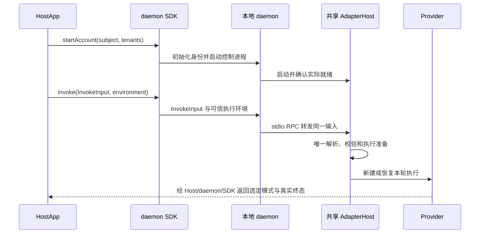

# 本地执行与传输

公共入口为 `invoke(input, environment)`，其中 input 是 [InvokeInput](invoke-input.md)。本地 environment 支持取消 signal，以及渠道工具所需的独立 executionEnvOverrides；详见 [环境合同](environment.md)。SDK、RPC 和 CLI playboard 转发原输入，只有 Host 解析执行配置。内部 `invokeFrames(input, environment)` 返回同一执行的完整源帧，不再接受 adapterType/request/options 三参数，不另行准备执行。

本地调用不要求 Worker 注册、Human Token 或 IM 连接。HostApp 预先决定并准备 Provider 的安装与认证。

## 本地客户端信任

遵循[基础架构的同账号互信约束](architecture.md#本地信任边界同一操作系统账号内互信)：同一操作系统账号内、能够访问实例本地 IPC 的客户端互信，daemon 不额外识别宿主 APP 身份，不要求 APP 注册、共享 Token 或逐应用授权。多个 Home 不构成同账号客户端之间的安全隔离。

Runtime 保持本地端点的操作系统访问权限；现有 POSIX socket 使用 0600，该事实不代表 Windows Pipe 使用同一权限机制。正常的同账号调用不产生专用鉴权错误或错误卡片。连接失败、权限不足及超时沿既有错误路径返回，由宿主负责展示。

本地信任不省略请求协议、执行权限及审批校验，也不代替 Extra 对远程业务请求的认证授权。上述约束是当前本地 app-server 合同，不新增产品代码或 IPC 协议字段。

## 传输边界

CLI `playboard` 也经过 daemon：启动本次临时 daemon，经 UDS/Pipe 执行，daemon 通过 stdio `AdapterHostRpcClient` 调用自己的 Host。它不直接启动 Host，不复用常驻 daemon，不单独装配 OpenClaw。统一 CLI 启动编排选择 profile 并准备 Provider；临时执行跳过 Extra 加载及渠道工具环境同步。socket、PID 和执行账本使用独立临时目录，Home/profile 的配置与身份保留。决策与验收见 [Playboard 改造](../tasks/playboard-daemon-execution/brief.md)。

| 边界 | 当前实现 |
| --- | --- |
| CLI 普通控制请求 | UDS / Windows Pipe 的单行 JSON 请求，响应使用 JSON-RPC 形状 |
| SDK 到 daemon 的执行与订阅 | JSON-RPC 2.0 请求、响应和 notification |
| daemon 到 AdapterHost | stdio NDJSON JSON-RPC 2.0 |
| Host 到 Provider | Adapter 管理的子进程、SDK 或认证原生连接 |
| Extra 到外部系统 | 插件自身的传输、认证和投递合同 |

`agent_run.invoke` 和 `agent_run.subscribe` 强制 JSON-RPC 2.0；不能把 CLI 普通控制路径的简化编码推广为所有 IPC 的合同。流式 notification 包含源身份、连续序号与完整 HostFrame。

执行 RPC 的 params 使用 `input`，不再传 `adapter_type / adapterType + request + options`。signal 不进入 params，客户端将 abort 映射为 cancel；服务端为本次 invocation 维护 AbortController，覆盖 ACK 在途取消和传输关闭。仅有必要的可信 executionEnvOverrides 以独立环境字段传输，不注入模型。CLI / Playboard / Work App 验证入口见[统一调用任务](../tasks/unify-invoke-transport/brief.md)。

## 接纳、续流与终态

- invoke、cancel、respond 的命令回执只证明相应操作被接纳，不证明 Provider 完成或已退出。
- 断流后用原 `run_id + stream_id + after_seq` 订阅；游标表示最后连续收到的位置。重新订阅不选择新模式，不重新 invoke，不重试业务副作用。
- Host 缓冲有界源帧，不提供 durable outbox、逐事件 ACK 或重启后完整历史。过期、源变化和窗口缺口明确失败。
- Provider 终态、应用保存完成和 IM 投递成功是不同事实。断开订阅本身不等于取消执行。

## 外部系统

当前仓库不提供 Worker WS 接入工厂或远端 native 入口。Extra 可接收外部请求并调用共享 Host；请求者身份、租户/owner 作用域、远程授权、业务幂等及可靠投递由拥有该业务的系统实现。

本地 Runtime ID 不是远程授权凭据，HTTP/SSE 演示也不证明已实现跨节点调度、租约或 fencing。已识别身份、权限及适用的执行合同仍必须校验。

## 核对入口

[SDK 类型](../../packages/octo-runtime-daemon/src/runtime/types.ts)、[daemon server](../../packages/octo-runtime-daemon/src/server.ts)、[Host RPC](../../packages/octo-runtime-adapter-host/src/rpc.ts)、[HostRunService](../../packages/octo-runtime-adapter-host/src/host-run-service.ts)、[续流](../../packages/octo-runtime-daemon/src/runtime/run-stream.ts)。

测试入口：[host-run-service.test.js](../../test/host-run-service.test.js)、[embedded-invoke.test.js](../../test/embedded-invoke.test.js)。容量与历史边界见 [纯执行约束](stateless-execution.md)，输出选择见 [输出协议](output-protocol.md)。
