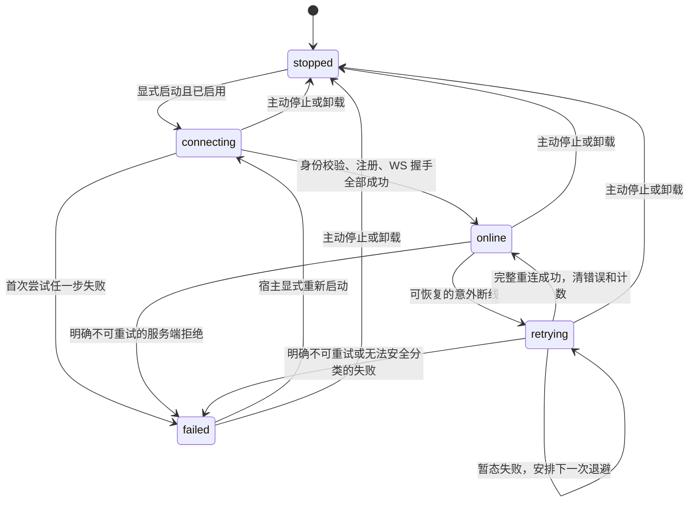

# Channel Gateway Bot 连接状态机与断线恢复

## 需求与实施状态

状态：2026-10-16 已实施并完成自动化与 im-test/CDP 验收，详见[交付记录](../../journal/shared/2026-10-16-channel-connection-state-machine-delivery.md)。实际 MacBook 合盖/唤醒尚未执行，整体标记 implemented-partially-validated。下表“当前源码基线”保留改造前事实，不代表改造后仍存在该行为。

用户确认的业务目标：首次 start 是一次连接尝试，第一次注册或连接失败即失败，不能自动进入恢复循环。只有本次启动周期中完整上线成功后，才允许因断网、MacBook 合盖等异常断线自动恢复。每次断线的等待依次为 5、10、20、30 秒，此后保持 30 秒；每次完整重连成功后计数清零。Bot 异常期间必须为非健康状态，恢复成功后自动恢复健康并清除连接错误。

本计划将前述状态机落实为 Bot 内部合同。仅 `online` 表示健康，不新增字面量 `ok`。状态使用有限枚举，具体错误码通过现有 `error` 字段返回，不能只显示笼统失败而丢掉真实原因。

## 当前源码基线与缺口

| 位置 | 当前事实 | 本次需要改变或保留的行为 |
| --- | --- | --- |
| `application/im-channel.ts` 的 `#connect` | 首次失败也会进入退避；缺凭据会定时重读；鉴权失败另有状态 | 拆开首次启动与上线后恢复；首次任何连接失败都终止自动尝试 |
| `#connect` 开头 | 每次尝试都把 state 写成 connecting | 恢复等待和恢复连接全过程保持 retrying，避免退回首次启动语义 |
| `#scheduleReconnect` | 已有 5/10/20/30 秒上限，成功后归零 | 保留间隔，限定启用条件，补齐每轮断线、取消和竞争测试 |
| `transport/wukong.ts` | 注册失败只保留 HTTP 状态；握手保留数字 reason；断开帧未保留 reason | 保留可验证的服务端错误证据，按真实合同识别占用和不可重试错误 |
| `transport/channel.ts` | 断开回调统一变成 IM_DISCONNECTED | 将真实分类传给业务状态机，避免占用或鉴权错误被当成网络错误 |
| `ImRuntime.status` | 输出 state、error、connected；连接和业务诊断共用 `#error` | 连接错误与任务/卡片/投递诊断分开，防止互相覆盖 |
| `extra.ts` | onStatus 返回 bots；配置错误保留 config_error；按 Bot 隔离 | 保持状态查询和有效 Bot 隔离，Bot 失败不伪装成 Extra 加载失败 |
| Work App | main 透传 state/error；renderer 3 秒轮询，只对 online 标正常 | 接入 failed 文案与兼容展示，验证异常和恢复可见 |

源码依据：[状态和重试](../../../packages/octo-runtime-extra-channel-gateway/src/application/im-channel.ts)、[传输](../../../packages/octo-runtime-extra-channel-gateway/src/transport/wukong.ts)、[连接编排](../../../packages/octo-runtime-extra-channel-gateway/src/transport/channel.ts)、[状态类型](../../../packages/octo-runtime-extra-channel-gateway/src/contracts.ts)、[Extra 入口](../../../packages/octo-runtime-extra-channel-gateway/src/extra.ts)。这是当前工作树核查，不代表正在运行或线上部署的版本。

## 责任与改动范围

- Channel Gateway Extra 拥有每个 Bot 的连接状态、错误分类、恢复策略和计时器。传输层报告事实，业务层决定是否恢复。
- Extra loader、daemon 和 Host 仅转交插件状态及停止信号，不解释 Bot 状态、不增加通用重连策略。`loaded` 只表示插件加载完成，不代表任一 Bot 上线。
- SDK/CLI 和 Work App 读取同一 Bot 状态，不各自推导健康或自行重连。保留唯一 preload 桥和 main 凭据边界。
- 本次针对 Octo channel-gateway，不自动修改独立 WeCom Extra。共享类型如被其他入口引用，必须核对编译和调用影响。
- 不改变 Run=7、Context=v3，不改 Worker 协议或增加 Runtime 能力门槛。没有协议变更时不要求部署 Worker。
- 连接恢复不重跑 Agent、不重放旧消息、不改变 session/reset 语义、不新增持久化。已有执行和投递继续按原合同报告真实结果，不能因为 Bot 回到 online 声称旧回复已送达。
- 保留现有 Home、profile、Runtime 身份、凭据及用户配置。宿主配置变更仍按卸载、保存完整配置、加载办理，不新建 Bot 专用重试 RPC。

## 状态合同

| state | 含义 | connected | error | 自动连接行为 |
| --- | --- | --- | --- | --- |
| stopped | 未启动、禁用或主动停止 | false | null | 无 |
| connecting | 本次启动周期的首次连接正在进行 | false | null | 仅当前一次尝试 |
| online | 身份校验、注册及 WS 握手全部成功 | true | null | 仅维持连接和心跳 |
| retrying | 曾上线，当前已断线，正在等待或尝试恢复 | false | 最近一次连接异常码 | 按恢复退避执行 |
| failed | 首次失败或恢复遇到不可重试错误 | false | 最后一个真实连接错误码 | 无，等宿主显式重新启动 |

沿用 wire 字段 `state`、`error`、`connected`，不另建同义的 `errorCode`。`config_error` 继续表示 Extra 在创建 Bot 之前的配置校验失败，不属于五态连接机器。`waiting_credentials` 和 `authentication_failed` 不再由新的 Octo 连接流程输出：缺凭据、鉴权失败分别变为 `failed + 原错误码`。宿主可保留旧状态的读取文案，避免读到旧进程时展示失效；新代码不再靠这些旧状态轮询凭据。

每个 Bot 单独保存状态和恢复计数，不能跨 Bot 或 Extra 实例共享。连接健康不能依据进程存活、注册成功、TCP 打开或模型调用成功推导。

### 状态机图

### 事件与副作用

| 当前状态 / 事件 | 目标状态 | 必须完成的动作 |
| --- | --- | --- |
| stopped / start，enabled=false | stopped | 不读取凭据，不发网络请求，不启动定时器 |
| stopped 或 failed / 显式 start | connecting | 创建新启动代次，清连接错误、恢复资格和计数，只发起一次尝试 |
| connecting / 首次失败 | failed | 保存错误，终止该连接并回收资源，保证零重连定时器 |
| connecting / 完整成功 | online | 获得本启动周期的自动恢复资格，清错误，计数归零 |
| online / 暂态断线 | retrying | 检测到断线后立即标异常，保存原因，回收旧连接，安排 5 秒后尝试 |
| retrying / 到时 | retrying | 消费唯一的定时器并发起唯一连接尝试，保持非健康状态 |
| retrying / 暂态失败 | retrying | 保存最新错误；失败和资源清理完成后安排下一档等待 |
| retrying / 完整成功 | online | 清连接错误、取消残余定时器、计数归零 |
| online 或 retrying / 明确不可重试错误 | failed | 保存原因、撤销恢复资格、终止连接和等待 |
| 任意运行状态 / close、卸载或宿主 abort | stopped | 先撤销代次与计时器，取消在途连接，清连接错误，等待资源释放 |
| 任意状态 / 过期连接回调 | 不变 | 丢弃，不写状态、不调度、不接纳消息 |

重复 start 在 connecting 时共享同一个在途结果，在 online/retrying 时不新建连接、不跳过退避。failed 后的显式重新启动从首次尝试规则开始；普通状态查询永不触发连接。公开宿主仍使用 Extra 卸载/重载触发重新启动，内部 start 能力不扩展为新的业务 RPC。

`start()` 完成表示本 Bot 的首次尝试已完成，不表示成功；本次保留现有每 Bot 失败可查询、其余 Bot 继续启动的约定。状态查询应保留该 Bot 的 failed 记录。不得把连接失败抛到配置错误分支而转换成 config_error，也不得让一个 Bot 连接失败导致整个 Extra 不可查询。

### 完整成功与断线检测

完整成功必须同时满足：当前启动/连接代次仍有效，凭据及 Space/机器人身份验证通过，注册返回机器人身份匹配，WuKong WS 握手成功且连接尚未关闭。尚在握手、正在关闭或被取消的连接不得写 online。

“立即异常”指连接层检测到异常时立即改变内部状态，不承诺在物理断网瞬间就已获知。当前实现 25 秒心跳、90 秒无包终止；本次保留参数并测清其检测边界。合盖期间 JavaScript 不运行，唤醒后发现超时应先转 retrying；不承诺休眠期间计时器准点执行。

断开事件发生在握手成功与启动 Promise 完成之间时，也必须满足以上守卫：不能先处理断线后被迟到的成功覆盖成 online。用连接代次、有效连接标记与串行转换保证这一点。

## 恢复退避与错误分类

恢复等待固定为 `min(5000 * 2^n, 30000)` ms，n 从 0 开始并在达到上限后饱和，不无限增大计数。首轮断线后依次等待 5、10、20、30、30 秒。等待从上一次失败和必要清理完成后开始，连接请求耗时不算等待；不并发发起、不补发休眠期间错过的多次尝试。本次不引入随机抖动或用户配置以改变已确认的间隔。

每次完整成功都归零；例如 `online → 断线 → 等5s → 失败 → 等10s → 成功 → online → 再断线 → 等5s`。仅凭据获取、鉴权通过、注册成功、收到心跳或任务输出均不能清零。进程重启或 Extra 重载是新的启动周期，不能沿用旧的恢复资格。

| 证据 | 首次启动 | 曾上线后的恢复 |
| --- | --- | --- |
| 缺凭据、token 格式错误、文件权限错误、身份或租户不匹配 | failed，不轮询凭据 | failed，停止重试 |
| 已确认的 401/403、Bot 占用、撤销授权、终端握手拒绝 | failed | failed，不能互相争抢连接 |
| 网络超时、连接重置、暂态 DNS/连接失败、心跳超时、异常传输关闭 | failed | retrying |
| 已确认可恢复的服务端 5xx | failed | retrying |
| 注册/认证 429 | failed | 仅按真实服务端限流合同恢复；等待至少为当前退避和 Retry-After 的较大值 |
| 无法识别的握手拒绝、非法协议、非预期响应结构 | failed | failed，保留原因，不凭未知错误无限重试 |
| 主动停止、卸载、被新代次替换的 abort | stopped 或保持新代次状态 | 不作为网络异常重试 |

429 的服务端等待是对固定退避的协议约束，不修改退避档位；等待期间仍可取消。必须先确认注册接口是否返回有效 Retry-After；不得套用模型或投递重试预算。一般 WS 异常关闭属于可恢复传输故障，但已解码的明确终端 reason 优先。

### 服务端错误证据与重复 Bot 连接

2026-10-16 已在 im-test 用专用 Bot 验证：相同 token 的第二次注册和握手成功，旧连接收到 reason=12，随后为 failed / IM_SERVER_DISCONNECTED_12。此环境采用踢旧连接行为，不提供“拒绝第二个客户端”的证据。reason 数字原样保留；该样本不证明所有 reason=12 均由重复连接造成，也不证明其他环境或未来版本采用相同策略。

传输层需保留 HTTP status、白名单业务 code、已解码的协议 reason、错误发生阶段及是否主动终止。内部使用有类型的错误证据，不解析任意 message 文案猜测是否占用。状态仍输出安全的稳定错误码；未知数字 reason 可保留其现有稳定编码，不能冒充已识别的占用。

注册失败不再直接丢掉全部响应语义：按已确认 schema、有界读取并只提取允许的 code；响应正文、token、im_token、WS URL 查询参数和未过滤的服务端消息不进入状态或日志。若服务端没有占用证据，记录“未提供”，只能按实际错误分类，不能承诺客户端已防止跨机器抢占。服务端合同缺失只阻塞“占用识别”验收，其余状态机任务仍可实施；服务端能力修改另行确定。

## 并发、停止与诊断一致性

1. 每个 Bot 同时最多一个有效连接尝试和一个恢复等待。回调和 Promise 完成均核对启动/连接代次，重复 close/error/断开通知只消费一次。
2. 主动停止先把状态设为 stopped，撤销恢复资格、清等待并 abort 在途鉴权、注册和握手。清理导致的 close 回调不能重新安排连接。close 保持幂等，等待在途 Promise 退出后再完成卸载。
3. 失败和切换前清理 socket、心跳、挂起 send、监听器和该连接的后台轮询。清理失败保留真实诊断，不能在旧资源仍不确定时再建立重叠连接。
4. `state` 与 `connected` 从同一连接状态快照派生；仅 online 为 true，不透传旧 connector 的 true 覆盖当前状态。failed 和 stopped 无恢复定时器。
5. 将连接错误从当前共用 `#error` 中独立出来；`error` 专用于当前连接异常。业务诊断继续走现有 onDiagnostic 等通道；若确需查询诊断，仅增加独立、有界且脱敏的字段，不使 Provider/卡片/投递失败改变连接 state。
6. 失败期间的业务诊断不能覆盖连接原因，旧连接诊断不能污染新连接。online 的 error 为 null，不以清除连接错误冒充清除了业务失败。
7. 多 Bot 各自恢复和停止；Bot A 的失败或成功不得重置 Bot B 的计数或取消其连接。整个 Extra 卸载才停止该实例全部 Bot。

## 开发里程碑

### M1：冻结合同与可验证错误证据

- [x] 对照本计划和当前源码确认五态、字段及旧状态的消费位置；记录受影响的导出类型、CLI 状态、SDK、Work App 和测试。
- [x] 核对服务端 register/握手/断开行为，在 im-test 获取 401 及重复连接 reason=12 脱敏样本；建立暂态与终端分类，不为未知 reason 或未确认业务正文编造映射。
- [x] 定义插件内部状态转换事件及连接错误结构，沿用现有 ImRuntime/GatewayTransport 边界；仅在实质降低重复时增加小型内部模块，不引入通用状态机框架或依赖。
- [x] 明确连接成功/关闭竞争、清理失败及 start 返回语义，再实施后续步骤。

交付：冻结后的转换表、错误映射与对应测试案例；占用证据未确认的项目保持待验，不伪造已支持。

### M2：传输证据与 Bot 状态机

- [x] 在 `transport/wukong.ts` 保留注册 HTTP 状态、握手及断开数字原因；将结构化错误沿 `transport/channel.ts` 传给 ImRuntime。实测为第二连接成功、旧连接 reason=12，不读取未确认业务正文。
- [x] 在 `contracts.ts` 更新 Octo 连接状态类型；在 `application/im-channel.ts` 集中处理状态转换，隔离连接错误与业务诊断。
- [x] 首次 start 仅尝试一次；移除首次失败、缺凭据和鉴权失败后的自动等待，保持失败 Bot 可查询。
- [x] 曾上线后按固定退避恢复，成功归零；恢复过程始终 retrying；明确终端错误停止。
- [x] 加上单连接、单定时器及代次守卫，覆盖重复事件、停止/卸载、迟到结果、重启和禁用 Bot。
- [x] 核对 `lifecycle/manager.ts`、`extra.ts` 及保留的 daemon module 入口，确保其观察同一状态行为，配置错误与连接失败不混淆。

交付：状态机及传输测试通过，自动化能够从 Extra onStatus 观察到 failed/retrying/online，而非只测内部变量。

### M3：宿主与文档接入

- [x] Work App main 保持透传 Bot 状态和错误；renderer 增加 failed 对应文案，保留旧状态读取兼容。只用 online 标健康，3 秒轮询读取恢复状态，窗口处于后台仍刷新，不新增第二套重连。
- [x] 核对内置 Runtime 产物更新路径，构建并重启受影响的真实应用，让验证使用新代码；不重新初始化 Runtime 或修改用户 Bot 配置。
- [x] 更新 Channel Gateway README、宿主接入说明及 channel 规则，区分“Extra 已加载”与“Bot 已上线”，说明首次失败需显式重新启动。规则描述须明确实施状态，开发完成前不得写成已支持。
- [x] 检查既有缺凭据、鉴权失败断言和宿主状态映射，按新合同更新；保留其他 Extra 行为。

交付：CLI/SDK/Work App 状态语义一致，正常连接和异常提示均可观察。

### M4：回归与 im-test 验收

- [x] 完成下述自动化矩阵及检查命令，记录实际执行结果；真实环境未触发的 429/5xx 和休眠边界按自动化范围记录。
- [x] 用专用 Bot 在 im-test 验证首次失败、断网恢复、二次断网、主动停止和多 Bot 隔离。
- [x] 在真实 Work App renderer 中用 CDP 检查状态、错误和恢复显示，抓取底层状态及异常；UI 为 3 秒轮询，非状态推送。
- [x] journal 写明源码/构建版本、时间、环境、测试 Bot 的非敏感标识、实际时序与未覆盖项目；区分真实服务端行为和本地受控故障注入。
- [ ] 在实际 MacBook 上执行合盖/唤醒，记录休眠、断线检测和恢复时序。当前未做，不用可控时钟或断开代理替代这项证据。

交付：可复查的验证记录；任一未测项目明确标记，不以 mock 结果或旧验收记录代替。

## 自动化验收矩阵

优先复用 Node test、现有本地 HTTP/WS fixture 与可控时钟，避免长时间真实等待。新增 `test/im-connection-state-machine.test.js` 集中覆盖状态转换；补充现有协议与卸载测试，不用真实模型验证网络状态机。

| 编号 | 输入或故障 | 必须断言 |
| --- | --- | --- |
| A01 | 首次成功及 enabled=false | 成功只在握手后 online；禁用无请求、stopped |
| A02 | 首次缺凭据、鉴权失败、注册失败、网络超时、握手拒绝 | failed + 真实 error；推进时钟超过多轮退避仍只有一次尝试、零恢复等待 |
| A03 | 已上线后断线，多次暂态失败 | 立即 retrying/false；等待依次 5/10/20/30/30 秒，恢复尝试时不变 connecting |
| A04 | 仅注册成功但 WS 失败 | 仍 retrying、不清零；下一次使用下一档等待 |
| A05 | 恢复成功后再次断线 | online/null/true；再次从 5 秒开始，重复两个周期 |
| A06 | 已识别占用、撤权、终端 reason；未知协议拒绝 | failed，停止恢复；错误映射不凭文案或任意 HTTP 状态猜测 |
| A07 | 等待中停止、鉴权/注册/握手中停止、宿主 abort | stopped/null/false；后续无网络尝试，资源被释放 |
| A08 | 重复 close/error、握手成功后立即关闭、旧代次迟到成功/失败 | 不重叠尝试、不复活、不出现已关闭却 online |
| A09 | 重复 start、failed 后显式重启、Extra 重载 | 同代次不重复请求；新周期清资格和计数，首次失败仍不重试 |
| A10 | 两个 Bot 一成一败、仅一个断线 | 失败记录存在；有效 Bot 可用；计数、状态和资源相互独立 |
| A11 | online 时 Provider/卡片/投递诊断，retrying 时旧诊断 | 连接状态与错误不被污染；恢复清连接错误不吞业务诊断 |
| A12 | Extra 状态查询与配置错误 | bots 状态可观察，loaded 不等于 online；config_error 与 failed 可区分 |
| A13 | 异常断线、显式终端断开及注册错误 | 协议原因完整传递；有界错误解析，输出不含 token/敏感 URL/响应正文 |
| A14 | 休眠后过期计时器、429 等待、连续失败很久 | 不集中补发、不并行；计数饱和；合法服务端等待及取消生效 |
| A15 | 清理失败、卸载失败、挂起 send 和心跳 | 无重叠新连接；失败有诊断；卸载不假报成功、不残留重试 |

Runtime 检查：`pnpm build`、`pnpm typecheck`、`pnpm lint`、`pnpm lint:names` 及 `pnpm test`。开发迭代可先 build 后执行 `node --test test/im-connection-state-machine.test.js test/im-runtime.test.js test/im-protocol.test.js test/im-extra-disposal.test.js`；新增文件实现后再运行该命令。跨入口和状态合同变更最终运行全量测试。

Work App 按其仓库脚本执行 tsc/vitest/build，并通过 CDP 检查真实 renderer。知识文件运行 `uv run --with pyyaml python .octospec/scripts/lint.py`，同时检查本次 diff 和链接。

## 线上测试环境验收步骤

环境固定 `https://im-test.deepminer.com.cn/`。使用当前受保护凭据和专用测试 Bot；不要拿正在服务的 Bot 故意制造占用或断线，不把凭据输出到终端记录、知识文件或截图。

1. 启动失败：用专用 Bot 的受控无效凭据或故障接入，确认初次失败即可查询 failed/error，至少观察 35 秒无后台注册重试。网络黑洞超时等完整矩阵由自动化覆盖，线上记录实际采用的故障方式。
2. 建联：使用有效测试凭据建立真实 WS，CLI/SDK 查询 online/error=null，Work App CDP 读到对应 Bot 正常状态；不能仅用 /register 200 代替。
3. 断线恢复：仅对该测试连接阻断网络或关闭 socket，观察从已检测断线开始的 retrying/false；保持故障观察 5/10/20/30/30 秒档位，再恢复网络并确认完整上线。若使用本地代理阻断访问 im-test，明确标记为本地故障注入。
4. 二次断线：在重连成功后再次阻断，确认首档为 5 秒，而非沿用 30 秒。补充 MacBook 合盖/唤醒验证，区分休眠、断线检测延迟、重试等待及请求耗时。
5. 停止：在等待恢复及在途连接期间分别卸载测试 Extra，确认状态/生命周期符合合同且无继续请求；不重启或停用其他用户现有实例。
6. 重复连接：两个测试客户端使用同一专用 Bot，分别记录注册 HTTP 结果、握手 reason、旧连接断开 reason。按真实证据验证终端错误停止；服务端未提供明确拒绝时记录限制，不宣称已实现跨机器单连接锁。
7. 恢复后的真实收发：向专用 Bot 发一条受控测试消息并核对单次回复；需要模型时使用已明确配置的测试引擎，记录实际覆盖范围。两 Bot 隔离测试同时检查另一 Bot 持续可用。

## 完成标准与依赖

M1 至 M4 验收项完成后才可标记 implemented-and-validated。若占用合同或合盖实测缺失，分别记录部分完成与待验项，不阻止已经证实的首次失败/网络恢复能力交付，但整体任务不得标记全部完成。

与[限流重试对齐](../channel-rate-limit-retry/brief.md)及[Codex 长任务恢复](../im-long-running-retry/brief.md)只共享责任边界：本计划重建 IM 连接，不消费 Provider 执行重试预算，不因重连再次 invoke。与[Extra 启动诊断](../extra-startup-diagnostics/brief.md)共用状态查询，不另建业务 RPC。
