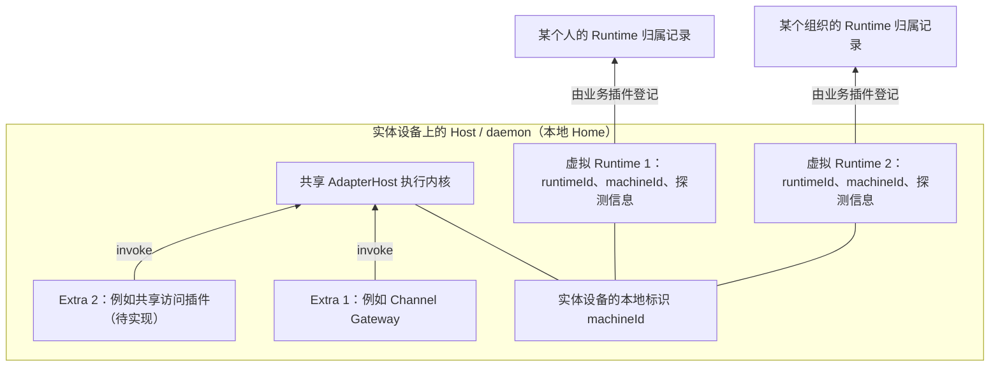

# 实体设备、虚拟 Runtime 与 Extra 归属澄清

## 目标与状态

本文依据 2026-10-15 用户提供的架构图和本轮讨论。核心决策是：**实体设备提供执行能力，Runtime 是该设备上的虚拟标识，Extra 装配在设备宿主上；虚拟标识可以通过业务插件登记给某个人或某个组织。**

本次交付为设计澄清文档，不修改产品代码，不迁移或重新初始化现有身份、Home、profile、配置与运行状态。下文区分目标合同与当前实现；现有源码不能因本文发布而视为已经完成改造。本文取代旧文档中将设备本体与单个 Runtime/profile 等同的定义，不撤销身份保护、权限校验或真实执行结果要求。

## 目标结构

图中的注册箭头表示虚拟身份与外部个人／组织的业务关联，不表示每个虚拟身份都有自己的进程、执行内核或 Channel Gateway。登记、授权与请求路由由相应业务插件处理。图中多个 Extra 均在设备宿主上；共享插件只是可选方向，当前没有完整交付。

用户图中的“实体设备”表达执行资源所在的位置。当前 `machine_id` 是 Home 级安装分组标识，并非硬件指纹。本文不把同一物理电脑的多个 Home 自动合并，也不承诺重装或更换 Home 后仍得到相同 machineId。若以后需要跨 Home 的硬件身份，应另行定义其来源和生命周期。

## 术语与责任

| 对象 | 含义与责任 | 不由该对象保证的事情 |
| --- | --- | --- |
| 实体设备 | 实际运行 daemon、Host、Adapter 和工具的设备，提供本地执行资源 | 云端登记、个人或组织归属不决定设备是否存在 |
| Host / Home | 宿主装配及本地状态范围；当前一个 Home 的 daemon 管理共享执行内核和 Extra | 不自动代表整台电脑上的所有应用和 Home |
| machineId | 关联设备安装实例的标识，虚拟 Runtime 可以引用同一标识 | 不是授权凭据或硬件隔离证明 |
| runtimeId | 设备上的虚拟 Runtime 身份，用于业务识别、登记和路由 | 不代表独占设备、独立进程或独立资源池 |
| 归属记录 | 某个 Runtime 与个人／组织的业务关系，由对应接入业务维护 | 仅知道 runtimeId 不等于有权执行 |
| 探测信息 | 设备或 Provider 在探测时的能力和可用性快照，可随虚拟身份上报 | 不表示实时就绪、已认证或本次执行必定成功 |
| Extra | 设备 Host 上的业务插件，管理自身连接、认证、授权、路由和投递 | 不必隶属于某个 Runtime/profile |
| AdapterHost | 接收已准备输入，代理执行、交互、取消并清理本轮资源 | 不分配个人／组织归属，不管理业务历史或长期 Session |
| profile | 当前实现中的命名配置／身份目录选择机制 | 不是设备、租户权限或插件归属的天然边界 |

## 之前哪些定义有问题

下表定位本轮核对到的旧定义。规则中的现状说明仍可用于理解当前代码，不能继续据此扩展错误的架构关系。

| 原定义或推论 | 问题与影响 | 本次修正 |
| --- | --- | --- |
| 基础架构将项目定义为“本地存在、具有稳定 Runtime 身份”的运行时设备 | 容易将一个 runtimeId 等同于设备本体，并推导出更换虚拟身份就是更换设备 | 设备与虚拟 Runtime 分别定义；设备承载零个或多个业务虚拟身份，不以对外登记为本地执行前置条件 |
| 本地身份规则以 profile 内有合法 runtimeId 作为 Runtime 初始化事实 | 只能说明该虚拟身份已初始化，不能证明设备或执行内核存在、就绪 | 分别报告设备安装标识、虚拟身份、本地 IPC、Host 和 Provider 状态 |
| SDK 按 subject／tenant 生成 profile，被文档当成固定架构 | 将当前 SDK 的组织方式提升为所有宿主必选模型，渠道也容易被迫选择租户 profile | 这是现有实现安排；个人／组织归属由业务接入决定，不要求所有入口创建 profile |
| 使用 personal／team profile 解释个人与团队共享 | 容易把身份归属、凭据目录、执行隔离和插件生命周期绑定在一起 | 共享插件可以管理多个虚拟 Runtime 的登记与授权；profile 名称本身不提供隔离或授权 |
| 将 Channel Gateway 的连接健康与某个虚拟 Runtime 身份关联 | Gateway 是设备上的独立业务入口；虚拟 Runtime 文件错误并不能直接证明 IM 断线 | Gateway 按自己的 Bot 认证和连接报告健康，不要求选择或登记虚拟 Runtime |
| Extra 配置位于 default/extra，被理解成属于 default profile | 目录名称掩盖了 Host 级存储事实，导致 --profile 是否生效不清楚 | Extra 的配置、加载、卸载和查询都按 Host 与插件名称定位 |
| S1 以本地身份重建直接推导设备或外部接入故障，列为发布 P1 | 将虚拟身份风险扩大成未经证实的设备／Gateway 故障 | 撤回该 P1 发布阻断定性；保留字段校验和已有文件被覆盖的事实，按真实身份消费者重新评估 |

相关旧定义位于 [基础架构](../../rules/architecture.md)、[本地身份规则](../../rules/runtime-lifecycle.md)、[Extra 规则](../../rules/extras.md)；原始复现见 [Alpha 评审](../../journal/shared/2026-10-15-alpha-code-review.md)。

## Extra 与 Channel 的目标合同

1. Extra 的实例范围是一个 Host 下的插件名称。同名插件当前只加载一次；多个 Bot、连接或虚拟 Runtime 映射由插件内部管理。
2. `extraset`、Extra 加载／卸载／状态、Channel Bot 配置不按 profile 分区。调用者只需选择 Host/Home 和插件名称，不必关心虚拟 Runtime 身份。
3. 显式传入无意义的 `--profile` 时，命令应报参数不适用，避免静默忽略造成“已隔离到某个身份”的误解。当前 `extraset` 已拒绝该参数；其他入口须在实施时逐一核对。
4. Channel Gateway 使用自身 Bot 凭据建立连接并调用共享 Host。它不因虚拟 Runtime 的数量变化而复制实例，也不因某个虚拟 Runtime 被撤销归属而自动停用。
5. 共享插件可以读取或维护一组虚拟身份，将不同身份登记给不同个人／组织，并校验每次请求的授权。不能仅凭 runtimeId 或 machineId 放行请求。
6. 虚拟身份的撤销或归属变化只影响对应业务关系。若需取消其在途执行，由业务插件明确定位并取消；不得顺带卸载其他 Extra 或停止公共执行内核。
7. 多个虚拟 Runtime 共享本地资源。若业务要求凭据、目录、并发配额或操作系统隔离，必须提供独立的具体机制，不能以不同 runtimeId/profile 宣称已隔离。

## --profile 还需要保留吗

**Extra 和设备执行入口不需要依赖 profile；是否保留它作为虚拟身份的命名选择器，是另一项 API 决策。** 直接用 runtimeId 足以选择身份时，无需再强加 profile。本文不新增身份管理 CLI，也不宣称已经删除现有参数。

当前 profile 同时承担身份路径与部分 Provider 连接配置选择。后续应拆开这两种用途：

| 用途 | 目标处理 | 当前实施边界 |
| --- | --- | --- |
| Extra 配置与生命周期 | Host/Home + 插件名称 | 当前固定读写 `<home>/default/extra/<name>/config.json`；目标归属已明确，目录迁移未做 |
| 虚拟身份选择 | runtimeId；必要时保留业务命名别名 | 现有身份仍保存在 profile 目录；是否保留别名和具体 API 待实施设计 |
| Provider 连接选择 | 显式 Provider 连接配置，与虚拟身份分别表达 | OpenClaw 连接配置当前仍引用 profileRoot；不能直接删除 profile 参数及文件 |
| 个人／组织归属 | 相应插件的登记、授权和路由配置 | 共享插件的协议、存储与 API 待定义，不新增核心层强制租户模型 |

因此，后续不能只从帮助文本里删除 `--profile`，也不能继续把它保留为所有命令都适用的全局开关。先盘点实际消费者，再按命令归属收敛参数。

## 具体修改路径与保护要求

| 范围 | 后续工作 |
| --- | --- |
| 架构、生命周期与 Extra 文档 | 统一使用本文对象定义，区分目标合同、现有 profile 实现和共享插件的待实现部分 |
| CLI main / state / extras | 逐命令划定 --profile 适用范围；Extra 使用 Host 级位置；设计现有 default/extra 数据的保留迁移，避免新旧声明重复加载 |
| daemon 启动与 SDK 生命周期 | 分开设备 Host 启停、虚拟身份管理、账号／租户业务装配；核对 startAccount 等现有调用者，再确定 API 迁移 |
| OpenClaw 与其他 Provider 配置 | 把 Provider 连接选择从虚拟身份选择中分离，保留现有连接、认证材料及工作区 |
| 虚拟身份读取 | 校验非空对象和 runtimeId 字符串等实际字段；区分文件缺失、JSON null、字段无效和有效身份，不在读取失败时覆盖现有状态 |
| 共享访问插件 | 按需另立任务定义身份登记、个人／组织授权、撤销、路由与脱敏状态；不把未实现接口加入当前使用教程 |

`runtimeId` 是虚拟标识，不意味着已有标识可以任意重置。已有引用仍可能依赖该值；当前授权只允许写本文档，不能删除、重新生成或覆盖现有身份。标识的自动生成时机、显式销毁与归属转移合同需要在对应实现任务中确定。

不修改 Run=7 和 Context=v3，不将业务归属信息自动注入模型上下文。Session ID 与 Runtime ID 分别表达会话关联和虚拟身份，不相互替代。

## 后续实施验收

以下是目标验收，本次未执行产品测试。

| 场景 | 通过条件 |
| --- | --- |
| 不登记任何虚拟身份，仅运行本地 Host | 宿主能调用已准备的执行请求，本地健康不要求云端登记 |
| 同一 Home 下有两个虚拟身份，分别归属个人与组织 | 关联同一 machineId；不会因此重复启动执行内核或 Channel |
| 配置和加载 Channel Extra | 不要求 profile 或虚拟 runtimeId；连接健康来自真实 Bot 认证与连接 |
| 对不适用的 Extra 命令传入 --profile | 明确报参数不适用，不静默写入或查询另一配置范围 |
| 撤销一个虚拟身份的对外授权 | 被撤销入口不能继续越权执行，其他身份、Extra 和本地执行不受连带影响 |
| 两个虚拟身份调用不同 Provider 连接 | 连接选择明确，凭据按实际执行合同隔离，不由 profile 名称暗示隔离 |
| 迁移已有 profile 和 default/extra | 原有 runtimeId、Provider 配置及声明保留；同一 Extra 不重复加载，失败不重置 Home |
| 身份文件为 null、缺少 ID 或数字 ID | 返回明确的身份数据错误，不覆盖文件，不把虚拟身份错误报告成实体设备消失或 Gateway 断线 |
| 真实接入验证 | 连接 im-test，分别取得本地执行、Channel 连接、身份登记／授权的证据；未实现的共享插件不标记通过 |

## 本次文档验收

交付包含本说明、实际阅读清单、规则入口提示与评审定性修正。检查 Markdown 链接和 OKF 元数据，并将结果写入 journal。本次不构建、不重启服务，也不触及真实设备状态。
