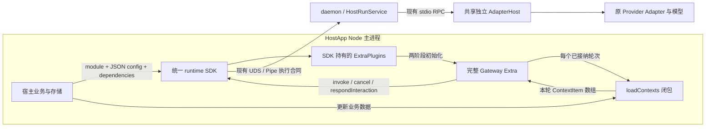

# SDK 内部实现附录

状态：本地 SDK 已实施并通过自动化；第三方 App 与真实 IM 接入未验证，见[交付记录](../../journal/shared/2026-10-17-sdk-host-extra-contexts.md)。本文件供 SDK 实现者核对内部接线；宿主接入者先看[完整操作流程](brief.md#宿主完整操作流程)，无需按本附录搭建任何对象。H 表示 HostApp Node 主进程，D 表示 daemon runner，K 表示独立 AdapterHost。进程内 SDK 容器属于 SDK 实现，宿主不取得容器或插件内部对象。

## 装配与执行关系

事件、交互和终态沿原链返回 Extra，由 Extra 完成卡片和投递。函数引用只保存在 H，不进入 session JSON、descriptor、IPC、日志或模型 Context。只有函数返回的本轮材料和正常执行输入跨执行边界。

## 逐段数据与实现证据

| 流程 | 输入与处理方 | 输出及失败合同 | 本地实现与待验范围 |
| --- | --- | --- | --- |
| D01 模块进入 SDK | HostApp 提交模块对象、JSON config、独立函数依赖 | SDK 校验声明名和唯一装配位置，冻结配置与依赖引用 | 三参数重载、本地 loader、配置快照与冲突测试通过 |
| D02 初始化 | SDK loader 注入 signal、log、执行端口及登记方法；调用模块再 await initializer | loaded 只表示初始化完成；失败先 abort 并回收已登记资源 | 已连接账号代次；初始化失败和取消测试通过 |
| D03 消息准入 | Extra 接收真实消息、权限检查、去重和排队 | 被过滤、控制消息和未轮到的排队任务不提前读取业务数据 | 沿既有 Channel 合同；本轮未进行真实 SDK IM 验证 |
| D04 业务读取 | Extra 在任务准备时调用 loadContexts(botSnapshot, { signal }) | 数组或 Promise；抛错、非法值、超时或满额使准备失败，不 invoke | SDK 测试覆盖同步/异步返回，卸载与 stop 已连接父信号 |
| D05 快照形成 | Channel 校验并合并静态和动态项，追加真实渠道材料 | Context v3、保序整项覆盖、自有快照；Provider 重试不重新采集 | 沿既有合并逻辑；新增 SDK 测试验证逐轮新值进入独立 Host |
| D06 执行进入 daemon | SDK 执行端口捕获本次 active account、generation、socket、输入身份与 environment | 沿现有 invoke 源流；executionEnvOverrides 与 signal 保留独立语义 | 专用端口、身份映射、环境覆盖和所属实例取消测试通过 |
| D07 结果返回 | daemon 返回回执、源帧、控制事实与真实终态；SDK 保留模式/顺序/身份 | Extra 消费 CanonicalEvent；不得裁剪 payload 或将断流写成成功 | 新端口的 canonical/native 自动化通过，原恢复测试通过 |
| D08 取消与回答 | Extra 按 invocationId 调 cancel/respondInteraction；SDK 定位原 runId 与 generation | 调用原账号连接；取消接纳不等于退出，回答不产生新 Run | 所属实例交互映射、ACK 在途取消及身份冲突测试通过 |
| D09 投递和状态 | Extra 负责真实 IM 投递、连接及公开自定义状态 | 投递失败与模型终态分开；SDK 合并生命周期状态不解释 Bot 内部结构 | 状态合并与健康轮询测试通过，复用现有日志；真实投递另验 |
| D10 释放 | SDK 协调 unload/stop，Extra 关闭内部资源；清理执行端口活动登记 | 仅取消所属调用，真实清理完成后释放闭包；失败阻止同名替换 | unload/quit/账号切换/租户重配/进程退出/清理失败自动化通过 |

## 执行端口必须由 SDK 封装

SDK 内部适配 ExtraAdapterHost，包含 invoke、cancel、respondInteraction，并接通既有可选 list。宿主不提交这些端口，也不把 SDK 的内部账户句柄传给插件。invoke 复用现有 InputInvoke 的 native/canonical 合同和 daemon 源流；不重新解析执行配置，不改变 Codex 或 Provider。

一次调用在启动时冻结 active account/generation、runId 与 invocationId。必要身份由现有 identifyInvokeInput 等工具一次确定；不得让 SDK 与 daemon 各自生成不同身份。活动映射必须先于执行流消费和控制请求可达建立；显式身份重复或冲突沿既有合同拒绝。不能将 invocationId 当 runId 直接调用 cancelRun。

取消覆盖准备阶段、执行尚未接纳、回执在途、执行中和交互等待：准备阶段由本轮 signal 终止回调；执行阶段按原身份取消，不因暂未收到回执而漏取消，不无限重试。交互响应只能回到原 invocation；已终止、未知或旧代次请求明确失败，不选择当前新账号补发。沿用现有源流恢复，不重新 invoke 模型或工具。

活动映射按所属 Extra 和 generation 隔离，并在终态/异常/取消/iterator.return/卸载收尾释放；没有终态的断流不伪造成功。映射只跟踪实际活动操作，不按历史 session 累积；新建内部等待队列或放宽原有执行容量必须另行说明依据。SDK 不替 Channel 持有聊天历史。

## 生命周期矩阵

以下为 SDK 生命周期合同，本地实现与证据见[现状评估](assessment.md)；实际 App 与 IM 场景另验。这些场景由 SDK 统一管理，不增加宿主操作步骤。

| 触发 | SDK / loader 的处理 | 完成与失败的可观察结果 |
| --- | --- | --- |
| Runtime 未启动或 Host 未就绪时 load | 拒绝；不加载插件资源，不隐式安装或启动 | 明确未加载；不能返回 loaded |
| 正常 load | 预留名字和代次，捕获 JSON 快照及函数引用，装配端口，await initializer | 状态按 loading → loaded；业务连接结果查自定义状态 |
| 初始化失败或加载中 unload | 立即 abort，撤销排队旧 load，逆序清理已登记资源 | 沿既有 5 秒清理宽限；成功后允许重载，失败保留阻塞状态 |
| 已加载实例重复 load | 检查主进程与 runner 的同名记录 | 拒绝，不能出现第二组 Bot 连接 |
| 正常 unload | 先禁止本实例新操作并 abort，再等待内部清理及所属调用收尾 | 同名 unload 等待同一过程；不停止共享 Host、daemon 或其他 Extra |
| 修改配置或更换函数引用 | await unload 成功，再以完整新声明和函数重新 load | 旧函数不再被新任务调用；清理失败不能强行覆盖 |
| 仅业务数据更新 | 不执行生命周期操作 | 下一轮重新读取，当前轮快照不变 |
| stop / quit / reconfigure | 立即撤销旧加载并 abort 本地 Extra，尝试所有清理；随后继续关闭自己拥有的 runner | 不因一个 disposer 失败跳过其他清理；最终返回真实失败，不假报全部释放 |
| logout / account-switch / 租户重配 | 在旧代次失效时立即中止旧实例和控制通道；完整清理后才允许新代次装配 | 旧函数不自动带到新账号；宿主重新提交配置/函数。清理失败阻止新账号插件装配 |
| 同身份重复 startAccount | 按现有幂等就绪检查处理 | 健康时不重复加载，不改变已有函数引用 |
| runner 意外退出或确认不可达 | 旧执行端口失效，停止本地 Extra 接收新任务并清理，报告状态 | 不自动重跑旧 Run；恢复后由宿主重新 load，不把旧闭包暗中复活 |
| runner 内部 AdapterHost 暂时不可用/重启 | 沿现有 Host 就绪和源流失败合同处理，禁止对新 Host 重放已执行操作 | 外部连接在线不等于执行可用；恢复不重建第二个内核 |
| 同进程回调不合作，清理超时 | 保留失败事实和阻塞代次，尝试其余清理与 runner 停止 | 进程退出不能被用于宣称主进程 Promise 已停止；不允许绕过阻塞重载 |

本地和 runner 装配共享声明名空间。SDK 启动 options.extras、运行时 descriptor load、新 module load、状态轮询和重启恢复都必须经过同一位置判定；卸载成功后切换位置时移除旧位置的可恢复声明。无须向宿主增加 location 参数或逐 Bot 控制。

全局串行队列不能使 abort 排在等待初始化之后；本地与远端的立即中止入口必须先发生，再等待串行收尾。旧 generation 的异步完成不得覆盖新 health、Provider binding 或状态。SDK 对新 loader 的实例引用、函数引用、监听器和映射必须有释放路径。

ExtraPlugins.close() 之后不能重新加载。SDK 须为新活动代次创建可用的容器；旧代次清理失败的阻塞记录不得随新建容器丢失。不能通过换一个容器绕过尚未退出的主进程回调。

## 状态、日志与资源边界

SDK 的 extraStatus()、extraStatus(name) 和 health/onHealth 必须同时包含本地与远端 Extra，按唯一声明名选择来源；runner 健康轮询不得把本地状态覆盖为空。无需新增插件业务状态协议；自定义状态仍为公开 JSON 快照，SDK 不解释其内部字段。

本地 Extra 使用 SDK 注入的现有 RuntimeLog，绑定真实 extra_type；关闭日志提供 no-op，启用沿同一显式目录、白名单与最近三个实际文件策略。内核日志仍由原执行链产生；禁止通过转储 loadContexts 参数、回调结果或函数错误正文补日志。

复用现有 loader 的 64 个声明/在途加载边界；两装配位置合计口径须在 SDK 准入时明确，不能各放 64 后对外宣称原额度。复用动态回调默认 5000ms、8 个真实在途及现有结果预算。超时未 settle 的 Promise 继续占额，不增加 SDK 的第二层动态队列或 lastContexts 缓存。重载和 stop 的保留堆验收包含函数、状态回调、AbortSignal 监听器和控制映射。

宿主函数属于受信任的同进程代码。同步计算会占用宿主 Node 事件循环；Promise 和超时计时器不能抢占死循环。业务回调须采用有限的同步取值或可取消异步 IO，本方案不引入业务函数 Worker、沙箱或跨进程代理来改变该责任边界。
