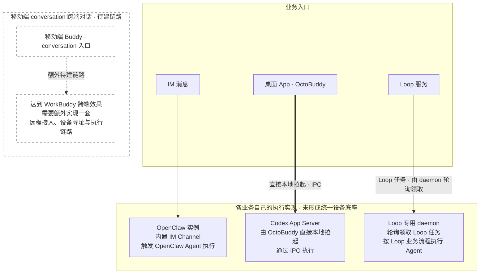
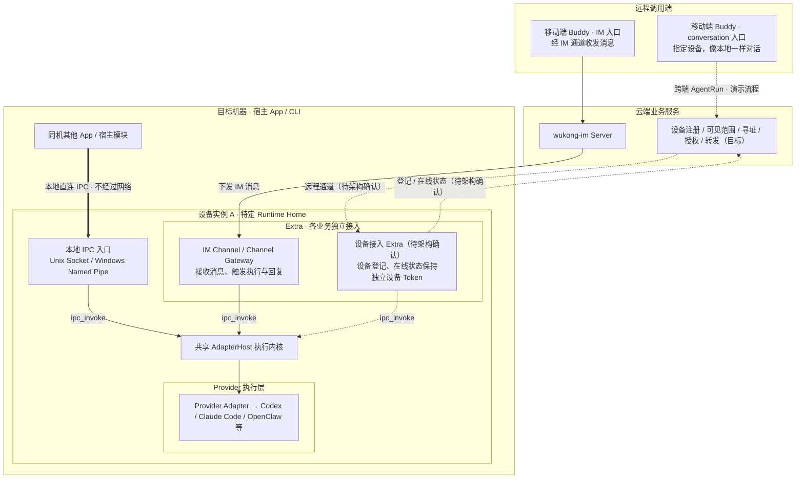
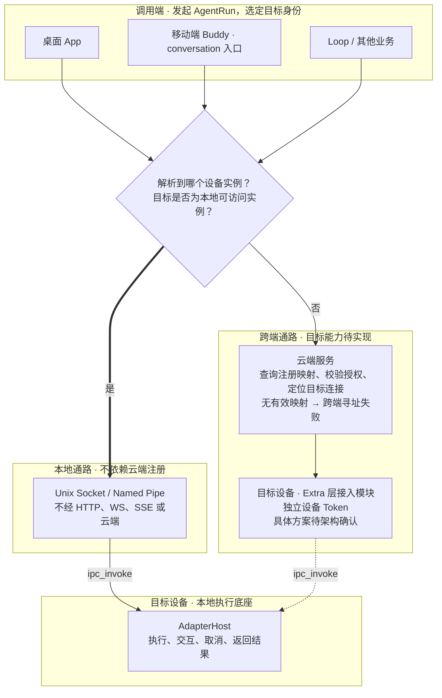

# Octo Runtime：为什么统一「设备」

**设备是某台机器上，由一个特定 Home 目录承载的本地执行实例。统一设备，就是让业务先确定「在哪个实例执行」，再决定「怎么连过去」：本地直接 IPC，异地经云端下发。**

**三个核心目标，共用同一个设备执行内核：**

1. **本地调用：** 本机应用通过本地 IPC 调用设备执行任务，不经过网络。
2. **IM 通道：** 移动端等客户端经 wukong-im Server 收发消息，IM Channel 接收下发消息，触发设备执行并通过通道回复。
3. **可选线上接入：** 将设备注册为线上可用，让移动端 WorkBuddy 通过 conversation 入口指定设备，像桌面本地对话一样发起 AgentRun 并接收结果。

本地设备独立存在。线上注册是可选能力，具体接入方案待架构确认；远程服务不直接连接执行内核。

同一台电脑上的 `/data/octo-a` 和 `/data/octo-b` 可以承载两个设备实例；`/data/project` 这样的普通工作目录本身不构成设备。设备由 Home 中的身份、配置，以及启动后的 daemon / AdapterHost 共同承载，重启进程不等于换设备。

本文用于讲解。强制合同统一维护在[基础架构规则](.octospec/rules/architecture.md)；图中「目标」不表示代码已全部实现。

## 1. 之前：各入口各自执行，没有统一设备寻址

旧架构有三套独立执行链路：IM 内连 OpenClaw Channel，桌面 OctoBuddy 本地启动 Codex App Server 并直接 IPC，Loop 使用带应用业务逻辑的专用 daemon 轮询执行。移动端除 IM 入口外，conversation 跨端对话还需额外实现一套接入链路：

**三条链路都能触发 Agent 执行，桌面也已有直接 IPC；缺少的是跨业务共用的设备身份、寻址和调用机制。** IM 的执行位置藏在 Bot / Channel 连接里，桌面只连自己拉起的 Codex App Server，Loop 只认自己的任务模型。移动端要在 IM 入口之外提供像桌面一样的 conversation 跨端对话，还需要额外实现一套远程接入、设备寻址与执行链路。

### 为什么旧 Loop daemon 也不算这里的设备

**首要原因是缺少普适性。统一设备应当是多个业务共用的执行底座；旧 Loop daemon 写入了大量 Loop 应用业务逻辑，导致其他业务几乎无法直接统一使用。** IM、Buddy 或其他应用要复用它，必须先拆解或适应 Loop 的业务模型，接入成本随业务耦合一起增加。

**最直接的例子：Buddy 或 IM 想复用旧 Loop daemon 发起一次 AgentRun，必须先把调用转换成 Loop 的调用模型，再经 Loop 云端服务，由本机 daemon 轮询领取后执行。即使调用方与目标执行实例都在本机，请求也要绕云端一圈，不满足核心目标 1：本地直接 IPC，不经过网络。** 统一设备要让 Loop、IM、Buddy 分别接入同一执行内核，各自的业务转换留在各自入口；本地调用可直接 IPC。

**Loop daemon 是 Loop 中专家执行业务任务的专用执行程序。** 它负责轮询、领取 Loop 任务，并按 Loop 的业务流程执行。

另一个典型耦合是：**旧 Runtime 绑定 `workspace_id`，按 Workspace 登记副本。** 用户在多个 Workspace 中有权限时，同一本地执行资源可能对应多份 Runtime 登记，设备模型因此跟着 Loop 的 Workspace 权限关系变化。

**设备身份、业务归属和访问权限混在了一起，就难以统一声明这个设备属于个人、组织还是项目。** 统一设备应保持稳定的本地身份，云端登记再单独声明个人、组织或项目归属，由业务接入管理相应权限。

新架构把这些应用业务放在各自的 Extra / 云端服务中，设备内核只提供共用执行能力。**判断是否普适，就看新增业务能否通过 Extra 或 SDK 接入，而无需让设备内核理解该业务的对象、状态和流程。**

**有一个叫 Device 的云端记录，不等于有一个可被多业务统一寻址、在本地直接调用的执行实例。**

旧实现依据：[README](../../octo-daemon-old/README.md)、[启动与同步](../../octo-daemon-old/internal/app/start.go)、[Loop 专用协议](../../octo-daemon-old/internal/gateway/client.go)、[历史 Workspace 登记模型](../../octo-daemon-old/docs/trd/01-octo-daemon-overall-design.md)。

## 2. 目标：一个设备底座，多种业务入口

**设备底座负责本地执行，Extra 负责接入业务。** Loop、IM、Buddy 可以使用同一内核，不再各自造一套执行服务。关闭某个业务入口不会因此销毁设备身份；没有云端连接，也可以使用已就绪的本地执行入口。

**上述架构图中的设备注册上线细节，以及移动端跨端调用 AgentRun 的流程逻辑，仅供参考和演示。相关模块当前待实现，具体生产级架构方案待确定。**

本演示暂按 Extra 层的独立设备接入模块表达设备登记与在线状态保持，并以独立设备 Token 示意接入。远程服务连接接入模块，再由本地接入层调用执行内核。

**远端服务不会直接连接 AdapterHost 执行内核。**

模块划分、Token 合同及远程调用接线均不作为已确定的生产方案。

### 本地存在与云端可见是两件事

**设备初始化后就在本地客观存在；云端注册只决定它能否按业务规则被看见、被跨端寻址，不负责让设备本体成立。**

| 情况 | 本地内核与 IPC | 移动端等跨端调用 |
| --- | --- | --- |
| 未注册、注册失败或登记失效 | 已就绪的本地执行照常运行 | 缺少有效目标映射时寻址失败 |
| 已注册，但调用者无权查看或执行 | 本地执行不因此停止 | 按可见范围及权限拒绝 |
| 已注册、有权限且目标连接可用 | 本地仍直接 IPC | 经云端定位目标连接并下发 AgentRun |

注册成功也不等于设备当前在线或本次执行必定成功。云端登记失败不能被解释为本地设备不存在，更不能因此停止或重建设备内核。

## 3. 执行时：先寻址，本地直连，异地转发

下图演示统一寻址的调用关系。设备线上注册及移动端跨端调用 AgentRun 的流程逻辑仅供参考，具体生产级架构方案待确定。寻址由调用方及业务接入完成，AdapterHost 负责接到请求后的执行。

这里的「本地」是**目标设备实例在本机且其 IPC 可访问**，不能只比较电脑名称，也不能仅凭同机就把不同 Home 当成同一设备。SSE 是服务端到客户端的事件流，请求与回答仍需 HTTP 等配套通道；WS/SSE 是远程接入的传输选择。

跨端调用在设备侧经 Extra 层接入，远程服务不直连执行内核。独立设备 Token 属于该接入方案，不作为普通本地 IPC 调用的云端前置条件；其格式、签发与生命周期待架构确认。

确定性寻址的含义是：**选定 A，就只向 A 发起；A 离线或无权访问时，明确返回失败或由业务决定等待，不悄悄改投 B。** 寻址标识不代替授权。图中的 IPC / 远程通道描述调用链，不表示模型服务或工具执行也完全离线；输出与交互沿对应链路返回。

## 4. 统一设备支持哪些业务入口

移动端 Buddy 有两种入口：**IM 入口经 wukong-im Server 和 IM Channel 收发消息；conversation 入口像桌面本地对话一样，由应用发起 AgentRun，在选定设备上执行并接收结果。** 两者共用执行内核，各自保留入口与会话逻辑。

| 业务场景 | 旧方式与缺口 | 统一设备的目标价值 |
| --- | --- | --- |
| 移动端 Buddy · IM 对话 | 经 IM 消息触发，旧执行链与 OpenClaw Channel 耦合 | 移动端继续经 IM 通道对话，Channel 通过 ipc_invoke 复用设备内核及其 Provider |
| 移动端 Buddy · conversation 跨端对话（可选目标） | 要获得类似桌面本地的对话体验，需额外构建远程接入与设备寻址链路 | 应用在 conversation 中指定设备并发起 AgentRun，经云端和设备接入模块在目标设备执行；具体生产架构待确定 |
| 本机 App 共用执行能力 | 桌面已有 IPC，但只连自己拉起的 Codex App Server，缺少共用设备发现与寻址 | 发现目标在本地后直接 IPC，同机其他 App 也可使用该设备底座 |
| 多个场景复用同一底座 | IM 耦合 OpenClaw Channel；复用旧 Loop daemon 又要求将调用转换成 Loop 模型 | IM、Loop、Buddy 各管业务，通过独立 Extra 或本地 IPC 共用 AdapterHost，无需先成为 Loop 调用 |
| 云端接入失败仍可本地执行 | 旧 Loop daemon 启动依赖云端 Device 凭据 | 注册与可见性由 Extra / 云端管理，失败只影响对应跨端寻址和访问，不影响本地内核 |

**价值落在两件事上：任务能准确找到执行实例；找到本地实例就直接 IPC。业务入口可以增加，执行底座保持统一。**

当前已有本地 Home / 身份、daemon SDK、IPC、共享 AdapterHost 和 Channel Gateway。设备登记与在线状态保持模块、远程接入及云端寻址的具体架构仍待确认，本地/远端自动选择与移动端定向 AgentRun 也未完成验收。见[本地执行现状](.octospec/rules/local-execution.md)和[身份迁移边界](.octospec/tasks/device-virtual-runtime-boundary/brief.md)。

现有的 `webui-extra` 插件提供类似 OpenClaw 的 WebUI 能力，**仅用于本地服务调试，不用于实际生产环境。**

已有内置 Extra 插件的具体使用方式，请参考 [CLI 使用手册](CLI_USAGE_GUIDE.md)。
