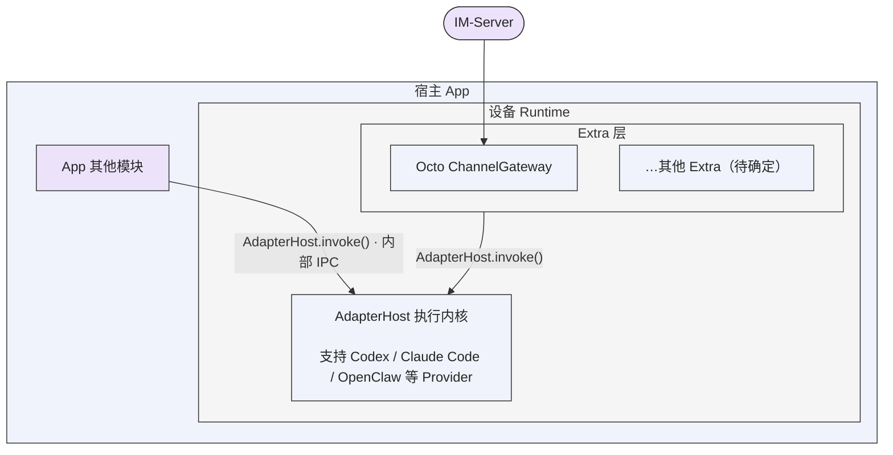

# Octo Runtime 基础架构

Octo Runtime 的项目边界是一个**运行时设备**：本地存在、具有稳定 Runtime 身份，并提供执行 Agent 的统一内核 `AdapterHost`。设备是否接入外部系统、是否加载 Extra、是否在线，分别描述接入状态，不决定本地 Runtime 是否存在。

宿主应用通过内部 IPC 使用执行内核。外部系统通过 Extra 插件建立连接、下发执行请求并接收结果。两种入口使用同一个执行内核。

## 架构图

宿主 App 包含 App 其他模块和设备 Runtime；设备 Runtime 内包含上方的 Extra 层与下方的 AdapterHost 执行内核。IM-Server 位于宿主 App 外，通过 ChannelGateway 接入；Extra 与 App 其他模块都调用同一个 `AdapterHost.invoke()`。图中箭头表示请求进入方向，交互事件与结果沿对应调用链返回。

图表示责任边界，不规定每个方框都对应一个独立进程。Extra 位于设备宿主上，不挂靠单个 Runtime/profile；插件内部的账号、连接数量与路由由插件管理。“其他 Extra”是待确定扩展的占位，不表示已有实现。

## 三个基础边界

### 运行时设备

HostApp 安装并初始化 Runtime 后，本地执行对象及其身份即存在。外部断线、停用 Extra 或普通重启不删除本地身份。本地身份存在、本地执行就绪、Provider 可用及外部连接健康是不同状态，分别按真实证据报告。

本架构调整此前将 Runtime 定义为依赖线上服务才成立的对象的思路。设备上的执行内核启动后，运行时设备本体就已客观存在；本地启动和执行不以登录线上服务、云端登记、IM 建联或对外共享为前置条件。线上服务可以记录该设备的接入关系和可见状态，但不负责赋予设备本体“是否存在”的事实。

与外部 IM 交互、将本地执行能力共享给其他用户或系统，都是在设备本体之上按需加载的 Extra 能力。共享插件可以依赖自己的线上服务，并处理登记、授权、在线状态、远程请求及结果回传；这些依赖属于该插件。停用共享或撤销线上登记只改变对外可访问性，不销毁本地设备，也不阻止宿主通过内部 IPC 使用执行内核。具体共享访问方案仍待确定。

当前实现由 daemon SDK 管理本地 Home、Runtime/profile 身份、生命周期及内部 IPC，并管理共享 AdapterHost。一个 Home 可以承载多个 Runtime/profile，共享执行内核。Home 级 `machine_id` 是安装分组标识，不是硬件指纹、认证凭据或跨产品全局设备身份。详见 [本地存在与接入边界](docs/runtime-local-and-online-contract.md)。

### 统一执行内核 AdapterHost

AdapterHost 接收已准备的 Agent 执行请求，通过 Provider Adapter 调用对应 Provider，并输出执行事件、交互请求和真实终态。内核统一处理执行、交互响应及取消；具体 Provider 的协议差异由 Adapter 处理。

Agent 定义、业务任务、会话历史及 Provider session binding 由业务调用方管理。AdapterHost 执行调用方提供的请求，不维护业务 Agent 注册中心，也不决定业务背景。

当前 AdapterHost 运行在独立子进程中，daemon 负责启动和管理它。SDK、内部 IPC 和 Extra 都复用该内核，不为每种外部系统另建执行内核。

### Extra 外部接入插件

每个 Extra 负责自己与外部系统的连接启动、认证、请求接收、业务路由、执行交互和结果投递。外部系统下发的请求由 Extra 转为统一执行请求，交给共享 AdapterHost；执行事件和结果由 Extra 按外部系统协议回传。

框架提供插件加载、停止信号、资源清理和注入的执行能力。插件内部的长连接、重连策略、账号状态、授权及可靠投递属于插件业务实现。HostApp 决定安装和启用哪些插件；没有 Extra 也可以通过内部 IPC 执行 Agent。详见 [Extra 插件合同](docs/extra-plugins.md)。

| 插件方向 | 状态 | 边界 |
| --- | --- | --- |
| `channel-gateway` | 已确定；当前有独立包及 Extra 入口 | 处理 Octo IM 建联、消息触发、会话交互及结果投递，复用 AdapterHost |
| 设备 Agent 共享访问 Extra | 待确定 | 按需将本地执行能力共享给外部用户或系统，处理接入、授权、请求下发与结果回传；不作为设备本体存在的前置条件，具体协议与包名待确定 |
| 其他 Extra | 待确定 | 按具体外部系统或业务接入需求扩展 |

图中的插件仅作架构示例。当前还有独立的 `extra-channel-wecom` 和 `extra-sse-demo` 包，以各包实际合同为准。旧 `worker-access` 已退出当前 workspace，不作为已完成的设备 Agent 访问方案。

## 保持的执行约束

- Runtime、Provider 及运行依赖的安装方案由 HostApp 决定。执行层探测到缺失或版本不符时返回明确状态，不自行下载或安装。
- Run 使用 `schema_version=7`，Context 使用 `octo.context-envelope/v3`，版本独立。业务发起方决定每轮模型上下文的内容、顺序和发送时机；空上下文及显式重复均有效。
- 必要执行配置独立解析校验，不注入模型文本。Host 只按 namespace/name 白名单保序渲染本轮业务项，不从历史、sessionId 或上下文 hash 补齐、合并、去重或省略。
- Provider session 存在不保证恢复成功。reset、新会话或恢复失败后，由业务方决定并重新提供必要背景，执行层报告真实结果。
- 源事件流为有界流，不等于持久会话历史或可靠投递队列。调用方或 Extra 按自身业务要求保存历史及处理投递；接收请求和取消请求的回执不等于执行终态。
- 外部接入必须在实际合同边界校验身份、权限及适用的租约、fencing；这些要求不把外部登记变成本地 Runtime 存在或本地调用的前置条件。
- 凭据留在受保护的宿主或插件配置中，不进入 renderer、模型文本、公开日志或命令行参数。Provider workdir 是工作目录，不是操作系统隔离边界。

实现与接入细节见 [Integration](INTEGRATION.md)、[Deployment](DEPLOYMENTS.md)、[Context 注入约束](docs/context-llm-injection.md) 和 [Context IPD-SE](../docs/event-context-rendering-ipd-se.md)。
