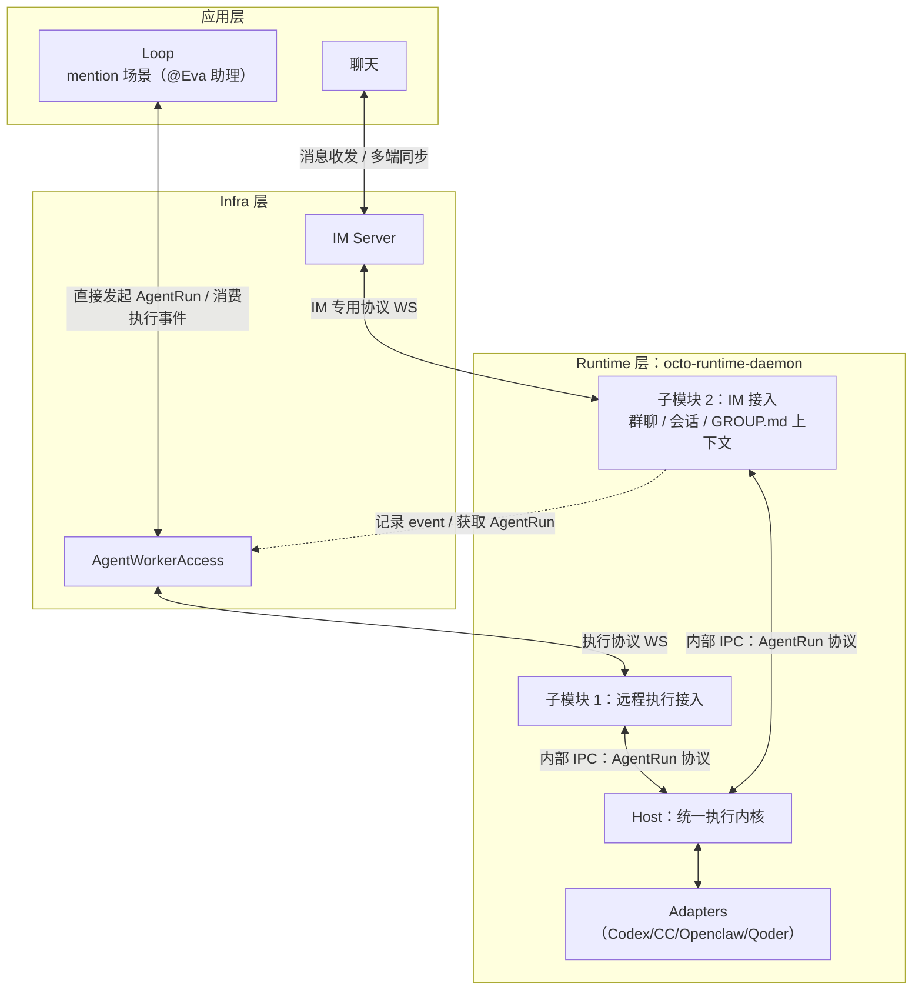

# Octo Harness

Octo Harness 是 provider-neutral 的本地 Agent Runtime。现有 `octo-harness` CLI 管理 Daemon；Daemon 装配接入模块并管理共享 adapter-host。Worker、IM 和本地助理的执行最终都使用同一套 `InvokeRequest` / `CanonicalEvent` 和 Host IPC，不为不同业务创建另一套 provider 执行器。

## 基础架构

下图定义模块边界。`octo-runtime-daemon` 是图中的运行时角色名称，实际沿用本仓库的 `octo-harness-daemon` 和 CLI，不另建 Runtime 项目。Worker 与 IM 接入已拆为独立包。当前 IM 实现私聊单轮执行、会话复用和重置；群聊、GROUP.md 及云端 Event 登记仍属后续范围。



图中的 AgentRun IPC 是执行语义；现有底层接口为 `AdapterHostRpc`，通过 stdio NDJSON JSON-RPC 传输 `invoke`、`cancel`、`interaction.respond`，返回 `invoke.event` / `invoke.done`。接入层先校验并转换为 `InvokeRequest`，再调用 Daemon 注入的共享 Host 客户端。Daemon 对外的 UDS / Windows Pipe 控制接口与这条内部 Host IPC 是两层不同的传输。

当前本地链路为 `IM Server WS → octo-harness-channel-im → AdapterHostRpc → adapter-host → Adapter`，最终文本通过 IM WS 一次回发。IM 包本地分配 eventId/runId，使用固定 Context v3、发起人元数据与 fullAccess；不调用旧 `octo-agent-access`，不等待 Worker 下发或 SSE。图中到 AgentWorkerAccess 的虚线是可选业务登记目标，当前不执行。远程执行仍由 Worker 接入包处理。本地助理同样通过 Host IPC 执行；外部业务可订阅本地源事件流。

## 模块责任边界

| 模块 | 负责 | 不负责 |
|---|---|---|
| [CLI](apps/cli/README.md) | 现有命令入口、Home/profile、服务启动停止、诊断 | IM 协议、provider 执行实现 |
| [Daemon 启动器](apps/daemon/README.md) | 配置解析、启动与信号转发 | Worker WS 业务实现 |
| [Daemon 包](packages/octo-harness-daemon/README.md) | 接入模块装配、共享 Host 生命周期、本地 IPC、观测和本地执行调度 | IM 会话和消息投递、Worker 传输实现 |
| [Worker 接入](packages/octo-harness-worker-access/README.md) | 注册、Worker WS、重连、命令校验、远端准备回执、执行事件回传 | 拉起第二个 Host、IM Server WS |
| [IM 接入](packages/octo-harness-channel-im/README.md) | bf_token 注册、IM WS、私聊会话、/session、/reset、最终文本回发 | 直接调用 provider、独立 Daemon、聊天 SQLite 的隐式引入 |
| [Adapter Host](packages/octo-harness-adapter-host/README.md) | 统一 IPC、invocation 生命周期、调用和取消、标准事件 | 消息来源、群聊规则、Worker 注册 |
| [Context Builder](packages/octo-harness-context-builder/README.md) | 上下文构造；Node 子入口提供本地准备、编译、压缩 | Worker HTTP 回执、IM 投递、Run 创建 |
| [Core](packages/octo-harness-core/README.md) | 本地 AgentSession/AgentRun 状态与通用执行引擎 | IM/Loop 业务模型、WS 接入 |
| [Protocol](packages/octo-harness-protocol/README.md) | InvokeRequest、CanonicalEvent、Context 和校验合同 | 网络连接、进程和业务存储 |
| [Embedded](packages/octo-harness-embedded/README.md) | 宿主 SDK、运行时接入、生命周期和本地 IPC 桥 | IM 业务实现、provider 协议分支 |
| [Cross Service](packages/octo-harness-cross-service/README.md) | OS 用户级服务管理 | Run 调度、连接协议 |
| [Adapters / SDK / ACP](packages/README.md) | provider 协议转换、进程与 transport 工具 | Worker/IM 连接和业务决策 |

一个 Harness Home 管理一个 Daemon 和 adapter-host，多 profile 共享 Host。新入口复用现有 CLI、Home 和服务管理，不按 Codex 会话或工作目录另起一套默认运行时。当前 Embedded Home 可按 appId 隔离，不能把不同 Home 宣称为已自动合并的全局单实例。

当前 Run 固定为 `schema_version=7`，Context 固定为 `octo.context-envelope/v3`，不增加旧协议回退。技能、插件、MCP 的安装与配置由本地宿主或原生 Runtime 管理。凭据不进入模型输入。旧 Channel context、聊天 SQLite 和相关业务实现已移出；参考快照位于同级 `octo-channel-design-reference/`，不参与构建。源执行事件使用有界内存窗口，不等待 durable ACK。

## 代码结构

```text
apps/
  cli/                             现有运维 CLI
  daemon/                          启动与配置入口
  adapter-host/                    Host 进程入口
packages/
  octo-harness-daemon/              模块装配、本地 IPC、共享 Host 生命周期
  octo-harness-worker-access/       Worker WS 接入与远端执行编排
  octo-harness-channel-im/                  IM 专用 WS、私聊会话与结果回发
  octo-harness-adapter-host/        共享执行 Host + NDJSON RPC
  octo-harness-context-builder/     通用上下文构造与 Node 准备工具
  octo-harness-core/                本地执行状态与引擎
  octo-harness-protocol/            统一执行和 Context 合同
  octo-harness-embedded/            宿主集成 SDK
  octo-harness-adapter-*/           provider adapters 与共享 SDK
  octo-harness-acp-client/          ACP transport
  octo-harness-cross-service/       原生用户服务管理
```

每个模块的责任边界见对应 README；完整包索引见 [packages](packages/README.md)，可执行入口见 [apps](apps/README.md)。

## 一键安装

面向最终用户的入口按平台拆分。两个位置参数固定为 `server-url`、`enrollment-token`；token 是短期、单次使用的设备 enrollment grant，不是 Human Session、`bf_` Bot key 或永久 Runtime Bearer token。

程序与运行状态刻意分离。CLI 走 npm 全局安装，Harness Home 不保存程序版本：

| 平台 | CLI / package | Harness Home |
|---|---|---|
| macOS / Linux | `npm install -g @mininglamp-oss/octo-harness`；shim 位于 `<npm prefix -g>/bin/octo-harness` | `~/.octo-harness/` |
| Windows | `npm install -g @mininglamp-oss/octo-harness`；shim 位于 `<npm prefix -g>\octo-harness.cmd` | `%LOCALAPPDATA%\OctoHarness\` |

安装器会验证全局 shim，并在需要时自动把 npm global bin 加入 macOS/Linux shell profile 或 Windows 当前用户 PATH，所以安装后可直接用 `octo-harness` 调试。Harness Home 只保存 profile、`runtime_id`、设备凭证、本地状态、PID/socket 和日志。`octo-harness daemon uninstall` 会停止并真实删除原生用户服务定义，但保留这些数据；卸载 npm package 也不会删除 Harness Home。当前 CLI 不提供 purge 数据命令。

### macOS / Linux

```bash
curl -fsSL https://im-test.deepminer.com.cn/octo-harness/install.sh \
  | sh -s -- \
      "https://im-test.deepminer.com.cn" \
      "octo_enroll_REPLACE_WITH_ONE_TIME_TOKEN"
```

### Windows PowerShell

```powershell
& ([scriptblock]::Create((irm https://im-test.deepminer.com.cn/octo-harness/install.ps1))) `
  "https://im-test.deepminer.com.cn" `
  "octo_enroll_REPLACE_WITH_ONE_TIME_TOKEN"
```

命令成功后应达到以下状态：

1. 检查 Node.js 24+ 与 npm；macOS/Linux 可用已有 Homebrew 安装 `node@24`，Windows 可用已有 `winget` 安装当前 Node LTS。Linux 不会自动使用 `sudo` 或添加第三方软件源。
2. stable 默认执行 `npm install -g @mininglamp-oss/octo-harness@latest`，beta 对应 npm `beta` tag，并确保 CLI shim 可从 PATH 直接调用。
3. 同版本 CLI 的 `login` 从 stdin 消费一次性 token，只创建或对账选中 profile 唯一的永久 `runtime_id` 与设备凭证。
4. 安装器显式调用 `daemon install`，通过用户级原生管理器安装自启动：macOS LaunchAgent、Linux systemd user service、Windows 当前用户 Task Scheduler；service definition 使用绝对 Node 与 daemon 入口路径，不依赖 shell PATH。
5. 安装器再调用 `daemon start --wait-online`；CLI 分别等待本地 IPC Ready 和云端 Runtime Online，任一步失败都返回非零。
6. 重跑时先取得 Home 与 npm prefix 安装锁；若旧 CLI 已存在，先执行 `login --prepare-update` drain/stop，再更新 npm package，最后由新 CLI 依次执行 login、install、start。npm 更新或更新后的流程失败会尝试 `login --recover-update` 恢复 service；全过程不创建第二个 Runtime，也不覆盖已有身份和已有本地状态。已有 identity 时可省略 token 重跑。

把 token 直接放在位置参数里最适合 Web 页面生成“复制即安装”的一次性命令，但它会进入 shell/PowerShell 历史。更安全的人工安装方式是省略第二个参数，安装器会从 TTY/SecureString 隐藏读取 token：

```bash
curl -fsSL https://im-test.deepminer.com.cn/octo-harness/install.sh \
  | sh -s -- "https://im-test.deepminer.com.cn"
```

```powershell
& ([scriptblock]::Create((irm https://im-test.deepminer.com.cn/octo-harness/install.ps1))) `
  "https://im-test.deepminer.com.cn"
```

安装器源码、npm 发布合同、PATH 与提权边界见 [installers](installers/README.md)。它们是 stage-0，只负责 Node/npm 检查、全局安装和调用 `octo-harness login`；凭证、service 与 readiness 状态机留在 TypeScript CLI，并通过 `@mininglamp-oss/octo-harness-cross-service` 操作原生用户服务。

客户端闭环已由 `login`、受保护的 profile、用户级 service 和 online readiness 组成；公开安装前仍需发布 npm package、部署安装脚本，并在 ingress 暴露 Agent Worker 的 enrollment/register/WSS 路由。

## 源码开发与验证

要求 Node.js 24+。真实 provider 还要求对应 CLI 已安装并完成认证。

```bash
pnpm install
pnpm build
pnpm typecheck
pnpm lint
pnpm test
```

测试使用 fake provider 和临时 SQLite，不调用真实模型。

新增或修改代码后，使用 Prettier 格式化本次改动的文件，再检查格式。例如：

```bash
pnpm format 'packages/octo-harness-channel-im/src/**/*.ts' test/im-runtime.test.js
pnpm format:check 'packages/octo-harness-channel-im/src/**/*.ts' test/im-runtime.test.js
```

`format` 和 `format:check` 均需传入文件或 glob；格式化不替代类型检查、ESLint 和测试。

## ZCode GUI Adapter

`zcode-gui` adapter 不连接或注入已运行的 Electron GUI，而是直接启动 ZCode Desktop 随附的
`zcode.cjs app-server --stdio`。从 [ZCode 官方安装页](https://zcode.z.ai/cn/docs/install)
下载并安装桌面应用，随后完成一次 ZCode CLI 登录和模型配置：

```bash
# macOS 默认安装位置
node /Applications/ZCode.app/Contents/Resources/glm/zcode.cjs --version
node /Applications/ZCode.app/Contents/Resources/glm/zcode.cjs login

# PATH 上已安装 zcode 时
zcode --version
zcode login
```

adapter 按 `ZCODE_BIN`、PATH、平台默认桌面安装目录的顺序发现 CLI。非标准位置需要把绝对路径
写入 daemon service 的环境，而不只是当前交互 shell：

```bash
export ZCODE_BIN=/absolute/path/to/zcode.cjs
pnpm cli adapter probe zcode-gui
```

ZCode CLI 的模型 provider 配置位于 `~/.zcode/cli/config.json`，应由 `zcode login` 维护，
不要从 GUI 配置手工复制或提交 API key。Agent revision 使用 `adapter_type: "zcode-gui"`，
并可配置：

```json
{
  "permissionMode": "build",
  "autoApprove": false,
  "providerOptions": {
    "appServerRequestTimeoutMs": 30000
  }
}
```

默认工具授权 fail-closed。只有显式设置 `autoApprove: true`、
`dangerouslyBypassPermissions: true` 或 `permissionMode: "yolo"` 才会自动允许 ZCode 工具请求。
adapter 不感知 `octo-auth`；Human/Runtime 身份与 AgentRun 授权由 Agent Worker 完成，daemon 只消费
既有 WSS Runtime 协议下发的已授权命令。完整协议、进程与安全边界见
[ZCode GUI Adapter](packages/octo-harness-adapter-zcode-gui/README.md)。

## 启动 Runtime

源码调试也先走 enrollment。下面示例让 Octo Human 身份由测试环境验证，同时把 Runtime 注册到本机 Agent Worker；一次性 token 通过 stdin 传递：

```bash
printf '%s\n' 'octo_enroll_REPLACE_WITH_ONE_TIME_TOKEN' | pnpm cli -- \
  --home "$PWD/.tmp/harness-home" login \
  --server-url https://im-test.deepminer.com.cn \
  --agent-work-url http://127.0.0.1:8092 \
  --enroll-token-stdin

pnpm daemon -- --home "$PWD/.tmp/harness-home"
```

The daemon reads each profile's `octo_runtime_` credential from its protected file. Worker derives the Runtime identity, Space, and owner subject from that credential. Harness persists only the connection fields it needs (`runtime_id`, `credential_id`, optional `octo_space_id`, and the protected credential); ownership and creator fields remain server-side authorization and audit data. Each profile has a distinct Runtime identity; all profiles share `<home>/machine.json`, whose `machine_id` is only an untrusted installation grouping label. One Home runs one daemon and adapter-host. Mutually untrusted users must use separate OS accounts. See [Runtime owners and provider discovery](docs/runtime-owner-provider-contract.md) for enrollment authorization and adapter object fields.

本地运维命令：

```bash
pnpm cli status
pnpm cli adapter list
pnpm cli adapter probe codex
pnpm cli agent-session list
pnpm cli agent-run list
```

启动前设置 `OCTO_RUNTIME_DEBUG=1`，Host 日志会直接追加到 `$OCTO_HARNESS_HOME/logs/adapter-host.log`（Home 默认 `~/.octo-harness`）。默认关闭；没有内存观测队列、Provider I/O 采集或 Inspect 服务。

## 会话恢复

Harness 永远不生成业务 `session_key`。上游业务服务按统一规则生成：

- IM 群：`v1/<platform>/<endpoint_id>/group/<group_id>`
- IM 私聊：`v1/<platform>/<endpoint_id>/dm/<user_id>`
- Loop Task：`v1/task/<task_id>`
- AutoPilot 单次节点：`v1/execution/<execution_id>/node/<node_instance_id>`
- AutoPilot 长期节点：`v1/plan/<plan_id>/node/<node_id>`
- Webhook subject：`v1/hook/<endpoint_id>/subject/<subject_id>`
- Buddy conversation：`v1/workspace/<workspace_id>/conversation/<conversation_id>`

Provider 返回的 Codex thread ID、Claude session UUID 或 OpenCode session ID 存在 Worker 的 `AgentSession.provider_session` 中。下一次 `run.start` 将它放入 `InvokeRequest.providerSession.sessionId`；该字段对 Worker 与 Harness 都是 opaque。`/reset` 由 Worker 增加 session generation/provider epoch 并清空 provider session，下一轮 provider 创建新的 thread/session。

## 进一步阅读

- [Architecture](docs/01-architecture.md)
- [Module And Transport Flow](docs/02-module-and-transport-flow.md)
- [Prompt And Workdir](docs/04-prompt-and-workdir.md)
- [Provider Adapters](docs/05-provider-adapters.md)
- [OpenClaw External Agent Binding](docs/15-openclaw-external-agent-binding-design.md)
- [Transport And Multi-node](docs/09-transport-and-multinode.md)
- [Agent Worker Runtime](docs/13-agent-work-runtime.md)
