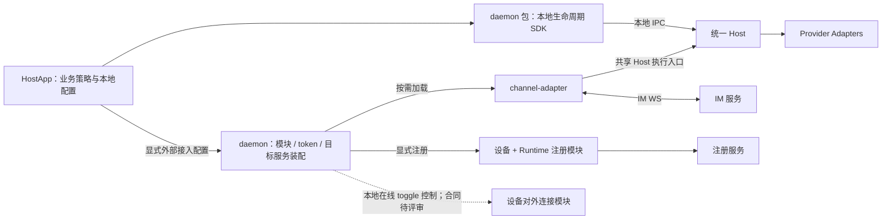

# Octo Harness

Octo Harness 是 provider-neutral 的本地 Agent Runtime。本地接入使用 `HostApp → daemon 包的 SDK → IPC → Host → Adapter`。本地 Runtime ID 在初始化时生成并保存；Host socket 就绪即为本地启动成功。云端注册和对外连接由宿主显式控制，不是本地运行的前置条件。

`octo-harness-embedded` 独立包已移除，其本地生命周期与 IPC API 收入 `octo-harness-daemon`。daemon 包不依赖 worker-access 或 channel-im；客户可以只部署 daemon 及其本地执行依赖。标准产品由 HostApp 另行携带可选连接包，通过模块配置显式启动。当前 SDK 的本地控制进程仍使用 daemon server；下面记录的最终对外进程职责和在线 toggle 按各自里程碑验收，不能从本次包合并推断已经全部实现。

## 设计原则与实施状态

2026-10-14：统一原则及事实判定见 [Runtime 本地存在与按需在线合同](docs/runtime-local-and-online-contract.md)。设备存在、本地初始化、本地就绪、注册、允许在线、实际连接及执行完成分别判断。云端登记不决定本地存在；access 最终链路仍待评审。

`octo-harness-daemon` 是对外交互子模块的装配层。宿主指定是否启用模块、凭据来源及目标服务，daemon 按配置动态加载模块并管理连接；各入口复用同一个 Host。纯本地启动不激活对外模块；当前 SDK 的本地控制进程仍由 daemon 包 server 承载。导入 SDK 或接入 package 本身不激活 WS，也不发起注册。

设备／Runtime 注册由显式操作触发，access 的已确认职责仅为注册。设备持续在线所需的 WS、heartbeat、关闭及失效合同仍待评审；不得把现有 `worker-access` 包的全部职责直接等同于最终 access 定义。

待实施的 Work App 设备管理要求：提供本地持久化的“允许当前设备在线”toggle。关闭时不加载设备连接模块，已有设备连接停止；本地 Host 继续执行。重启按已保存的用户选择恢复配置，登录或 Host 启动不能自行开启。设备连接和 IM channel-adapter 分别启用，注册 ACK、设备在线、频道在线和本地就绪分别报告。

CLI 要提供显式 IM 频道配置入口，保存 channel 类型、目录／执行 Context、Bot 凭据引用与启用状态，再由 daemon 启动已启用频道。设备／Runtime 注册是独立命令，候选名称为 `octo-harness devices register`；最终参数待冻结。上述命令是目标入口，不表示当前命令树已全部交付。频道配置不隐式注册设备，注册不隐式开启全部连接。

业务方决定五元组和本轮 Context，应用 defaults 并检查 mandatory。SDK、daemon、注册模块、通用连接层和 Host 不读取 Agent 业务配置。启动、注册和本地调用没有 Agent prepare／ensure／默认创建流程。详见 [需求与验收基线](../docs/local-runtime-ipc-on-demand-ipd-se.md)。

## Context 方案设计约束

Event 发起方必须完成 awareness 采集、材料选择、指引编写和 Context 构造，并随 Event 保存同一份协议快照。后续 Run 与 Host 沿用其内容和顺序，重投不得重新采集业务状态。

每轮模型上下文完全由业务发起方决定：selection、项目背景、任务状态或 extra 均非框架必填项。业务方可以首次发送必要背景，续聊无变化时传空，有变化时仅发送本轮需要的项，也可以显式重复发送。必要的 adapter 等执行配置仍按执行合同及 defaults/mandatory 校验，不注入 LLM 上下文块。

底层只转发、渲染本轮数据，不按 `sessionId`、run 序号或 hash 缓存、补齐、合并、去重或省略模型上下文。两个不同 Event 显式发送相同 item 时均须传递；原 Event 幂等重投仍复用原快照。`sessionId` 存在不保证 resume 成功；reset、新建 Provider 会话或恢复失败后，业务方负责重新提供所需背景，底层返回真实结果，不自动补背景。

worker-access 必须校验并转发模型上下文，不得追加场景指引、预取任务材料或调用模型摘要。执行配置解析、身份与授权校验、工作区和图片准备、租约、会话及取消仍由对应执行模块负责。

Host 必须通过单一纯函数，将可注入 item 按固定开始/结束标记及 `contexts` / `context-item` 外层标记拼接。item 内部使用换行纯文本 `指引: ...`、`数据: ...`，不添加子标签、不做 XML 实体转义，也不要求严格 XML。执行配置不注入模型上下文块；合法 `extra.*` item 的指引和 payload 完整注入，不增加逐业务 Compiler、Resolver 或字段投影配置。

Host renderer 只匹配白名单 pattern：`extra.*/*`、`octo.content/inline`、`octo.content/references`。renderer 不校验业务字段、不查处理器、不检查场景材料、不解引用、不压缩。接纳边界仍处理协议格式和执行权限；必要 adapter 等执行配置独立解析。Compiler/Pipeline、材料预取与摘要、扩展字段投影及编译回执已删除，不保留旧路径或兼容升级。

详细设计见 [Event Context 与 Host 固定渲染：IPD-SE 基线](../docs/event-context-rendering-ipd-se.md)，验证状态见 [里程碑记录](docs/context-rendering-milestones.md)。Run 7 / Context v3 保持不变；传输字段沿用 `context` / `effective_context`，其中 `items` 是本轮列表，渲染文本使用 `contexts` 外层标记。

## 基础架构

以下为目标拓扑；注册与设备连接的最终 access 合同待架构评审。



Host IPC 承载 invoke、取消、审批／问答答复和执行事件。daemon 使用 Host 提供的执行入口；业务来源不同不产生第二套 Provider 执行器。Context v3 的内容和顺序由业务发起方确定，通用连接层只校验和转发。关闭某个对外模块不得停止仍供本地 IPC 使用的 Host。

## 模块责任边界

| 模块 | 负责 | 不负责 |
|---|---|---|
| [CLI](apps/cli/README.md) | 现有命令入口、Home/profile、服务启动停止、诊断 | IM 协议、provider 执行实现 |
| [Daemon 启动器](apps/daemon/README.md) | 配置解析、启动与信号转发 | Worker WS 业务实现 |
| [Daemon 包](packages/octo-harness-daemon/README.md) | 本地生命周期 SDK、IPC 与共享 Host；按宿主配置动态装配可选连接模块 | 决定宿主启用哪些模块、依赖 worker-access、处理业务 Context、另建 Host 执行器 |
| [Worker 接入](packages/octo-harness-worker-access/README.md) | 现有包包含注册、Worker WS 和远程执行；最终拆分与设备连接合同待评审 | 将现有全部能力当作已批准的 access 职责、默认激活、拉起第二个 Host |
| [IM 接入](packages/octo-harness-channel-im/README.md) | bf_token 注册、IM WS、私聊会话、/session、/reset、最终文本回发 | 直接调用 provider、独立 Daemon、聊天 SQLite 的隐式引入 |
| [Adapter Host](packages/octo-harness-adapter-host/README.md) | 统一 IPC、invocation 生命周期、调用和取消、标准事件 | 消息来源、群聊规则、Worker 注册 |
| [Context Builder](packages/octo-harness-context-builder/README.md) | 发起侧可选上下文构造工具 | 执行编译、材料预取与压缩、Run 创建 |
| [Core](packages/octo-harness-core/README.md) | 本地 AgentSession/AgentRun 状态与通用执行引擎 | IM/Loop 业务模型、WS 接入 |
| [Protocol](packages/octo-harness-protocol/README.md) | InvokeRequest、CanonicalEvent、Context 和校验合同 | 网络连接、进程和业务存储 |
| [Cross Service](packages/octo-harness-cross-service/README.md) | OS 用户级服务管理 | Run 调度、连接协议 |
| [Adapters / SDK / ACP](packages/README.md) | provider 协议转换、进程与 transport 工具 | Worker/IM 连接和业务决策 |

当前一个 SDK 账号的多个 profile 共享 Host；是否激活对外模块由 HostApp 决定。本地控制进程与对外专用进程的进一步拆分另行验收。新入口复用现有 CLI、Home 和服务管理，不按 Codex 会话或工作目录另起一套默认运行时。当前 app-owned Home 可按 appId 隔离，不能把不同 Home 宣称为已自动合并的全局单实例。

当前 Run 固定为 `schema_version=7`，Context 固定为 `octo.context-envelope/v3`，不增加旧协议回退。技能、插件及 MCP 程序的安装与更新由 HostApp 管理；本轮 MCP 连接配置通过 `octo.execution/mcp` 传入，由 adapter 转换，见 [Run MCP 合同](docs/25-run-mcp-context.md)。凭据不进入模型输入。旧 Channel context、聊天 SQLite 和相关业务实现已移出；参考快照位于同级 `octo-channel-design-reference/`，不参与构建。源执行事件使用有界内存窗口，不等待 durable ACK。

## 代码结构

```text
apps/
  cli/                             现有运维 CLI
  daemon/                          启动与配置入口
  adapter-host/                    Host 进程入口
packages/
  octo-harness-daemon/              本地生命周期 SDK、IPC、可选模块装配
  octo-harness-worker-access/       现有 Worker 接入；最终职责拆分待评审
  octo-harness-channel-im/          IM 专用 WS、私聊会话与结果回发
  octo-harness-adapter-host/        共享执行 Host + NDJSON RPC
  octo-harness-context-builder/     发起侧上下文构造工具
  octo-harness-core/                本地执行状态与引擎
  octo-harness-protocol/            统一执行和 Context 合同
  octo-harness-adapter-*/           provider adapters 与共享 SDK
  octo-harness-acp-client/          ACP transport
  octo-harness-cross-service/       原生用户服务管理
```

每个模块的责任边界见对应 README；完整包索引见 [packages](packages/README.md)，可执行入口见 [apps](apps/README.md)。

## 一键安装

本节保留现有安装器的操作说明，尚待按最终架构期望改造。其 enrollment、自启动和 `--wait-online` 流程不是本地 Host 的启动合同。目标要求安装、本地启动、频道启用与设备注册分别控制；不得从安装成功推断设备在线。

面向最终用户的入口按平台拆分。两个位置参数固定为 `server-url`、`enrollment-token`；token 是短期、单次使用的设备 enrollment grant，不是 Human Session、`bf_` Bot key 或永久 Runtime Bearer token。

程序与运行状态刻意分离。CLI 走 npm 全局安装，Harness Home 不保存程序版本：

| 平台 | CLI / package | Harness Home |
|---|---|---|
| macOS / Linux | `npm install -g @mininglamp-oss/octo-harness`；shim 位于 `<npm prefix -g>/bin/octo-harness` | `~/.octo-harness/` |
| Windows | `npm install -g @mininglamp-oss/octo-harness`；shim 位于 `<npm prefix -g>\octo-harness.cmd` | `%LOCALAPPDATA%\OctoHarness\` |

安装器会验证全局 shim，并在需要时自动把 npm global bin 加入 macOS/Linux shell profile 或 Windows 当前用户 PATH，所以安装后可直接用 `octo-harness` 调试。Harness Home 只保存 profile、`runtime_id`、设备凭证、本地状态、PID/socket 和日志。`octo-harness daemon uninstall` 会停止并真实删除原生用户服务定义，但保留这些数据；卸载 npm package 也不会删除 Harness Home。当前 CLI 不提供 purge 数据命令。

### macOS / Linux

```bash
curl -fsSL https://im-test.deepminer.com.cn/octo-harness/install.sh \
  | sh -s -- \
      "https://im-test.deepminer.com.cn" \
      "octo_enroll_REPLACE_WITH_ONE_TIME_TOKEN"
```

### Windows PowerShell

```powershell
& ([scriptblock]::Create((irm https://im-test.deepminer.com.cn/octo-harness/install.ps1))) `
  "https://im-test.deepminer.com.cn" `
  "octo_enroll_REPLACE_WITH_ONE_TIME_TOKEN"
```

命令成功后应达到以下状态：

1. 检查 Node.js 24+ 与 npm；macOS/Linux 可用已有 Homebrew 安装 `node@24`，Windows 可用已有 `winget` 安装当前 Node LTS。Linux 不会自动使用 `sudo` 或添加第三方软件源。
2. stable 默认执行 `npm install -g @mininglamp-oss/octo-harness@latest`，beta 对应 npm `beta` tag，并确保 CLI shim 可从 PATH 直接调用。
3. 同版本 CLI 的 `login` 从 stdin 消费一次性 token，只创建或对账选中 profile 唯一的永久 `runtime_id` 与设备凭证。
4. 安装器显式调用 `daemon install`，通过用户级原生管理器安装自启动：macOS LaunchAgent、Linux systemd user service、Windows 当前用户 Task Scheduler；service definition 使用绝对 Node 与 daemon 入口路径，不依赖 shell PATH。
5. 安装器再调用 `daemon start --wait-online`；CLI 分别等待本地 IPC Ready 和云端 Runtime Online，任一步失败都返回非零。
6. 重跑时先取得 Home 与 npm prefix 安装锁；若旧 CLI 已存在，先执行 `login --prepare-update` drain/stop，再更新 npm package，最后由新 CLI 依次执行 login、install、start。npm 更新或更新后的流程失败会尝试 `login --recover-update` 恢复 service；全过程不创建第二个 Runtime，也不覆盖已有身份和已有本地状态。已有 identity 时可省略 token 重跑。

把 token 直接放在位置参数里最适合 Web 页面生成“复制即安装”的一次性命令，但它会进入 shell/PowerShell 历史。更安全的人工安装方式是省略第二个参数，安装器会从 TTY/SecureString 隐藏读取 token：

```bash
curl -fsSL https://im-test.deepminer.com.cn/octo-harness/install.sh \
  | sh -s -- "https://im-test.deepminer.com.cn"
```

```powershell
& ([scriptblock]::Create((irm https://im-test.deepminer.com.cn/octo-harness/install.ps1))) `
  "https://im-test.deepminer.com.cn"
```

安装器源码、npm 发布合同、PATH 与提权边界见 [installers](installers/README.md)。它们是 stage-0，只负责 Node/npm 检查、全局安装和调用 `octo-harness login`；凭证、service 与 readiness 状态机留在 TypeScript CLI，并通过 `@mininglamp-oss/octo-harness-cross-service` 操作原生用户服务。

客户端闭环已由 `login`、受保护的 profile、用户级 service 和 online readiness 组成；公开安装前仍需发布 npm package、部署安装脚本，并在 ingress 暴露 Agent Worker 的 enrollment/register/WSS 路由。

## 源码开发与验证

要求 Node.js 24+。真实 provider 还要求对应 CLI 已安装并完成认证。

```bash
pnpm install
pnpm build
pnpm typecheck
pnpm lint
pnpm test
```

测试使用 fake provider 和临时 SQLite，不调用真实模型。

新增或修改代码后，使用 Prettier 格式化本次改动的文件，再检查格式。例如：

```bash
pnpm format 'packages/octo-harness-channel-im/src/**/*.ts' test/im-runtime.test.js
pnpm format:check 'packages/octo-harness-channel-im/src/**/*.ts' test/im-runtime.test.js
```

`format` 和 `format:check` 均需传入文件或 glob；格式化不替代类型检查、ESLint 和测试。

## ZCode GUI Adapter

`zcode-gui` adapter 不连接或注入已运行的 Electron GUI，而是直接启动 ZCode Desktop 随附的
`zcode.cjs app-server --stdio`。从 [ZCode 官方安装页](https://zcode.z.ai/cn/docs/install)
下载并安装桌面应用，随后完成一次 ZCode CLI 登录和模型配置：

```bash
# macOS 默认安装位置
node /Applications/ZCode.app/Contents/Resources/glm/zcode.cjs --version
node /Applications/ZCode.app/Contents/Resources/glm/zcode.cjs login

# PATH 上已安装 zcode 时
zcode --version
zcode login
```

adapter 按 `ZCODE_BIN`、PATH、平台默认桌面安装目录的顺序发现 CLI。非标准位置需要把绝对路径
写入 daemon service 的环境，而不只是当前交互 shell：

```bash
export ZCODE_BIN=/absolute/path/to/zcode.cjs
pnpm cli adapter probe zcode-gui
```

ZCode CLI 的模型 provider 配置位于 `~/.zcode/cli/config.json`，应由 `zcode login` 维护，
不要从 GUI 配置手工复制或提交 API key。Agent revision 使用 `adapter_type: "zcode-gui"`，
并可配置：

```json
{
  "permissionMode": "build",
  "autoApprove": false,
  "providerOptions": {
    "appServerRequestTimeoutMs": 30000
  }
}
```

默认工具授权 fail-closed。只有显式设置 `autoApprove: true`、
`dangerouslyBypassPermissions: true` 或 `permissionMode: "yolo"` 才会自动允许 ZCode 工具请求。
adapter 不感知 `octo-auth`；Human/Runtime 身份与 AgentRun 授权由 Agent Worker 完成，daemon 只消费
既有 WSS Runtime 协议下发的已授权命令。完整协议、进程与安全边界见
[ZCode GUI Adapter](packages/octo-harness-adapter-zcode-gui/README.md)。

## 启动 Runtime

源码调试也先走 enrollment。下面示例让 Octo Human 身份由测试环境验证，同时把 Runtime 注册到本机 Agent Worker；一次性 token 通过 stdin 传递：

```bash
printf '%s\n' 'octo_enroll_REPLACE_WITH_ONE_TIME_TOKEN' | pnpm cli -- \
  --home "$PWD/.tmp/harness-home" login \
  --server-url https://im-test.deepminer.com.cn \
  --agent-work-url http://127.0.0.1:8092 \
  --enroll-token-stdin

pnpm daemon -- --home "$PWD/.tmp/harness-home"
```

The daemon reads each profile's `octo_runtime_` credential from its protected file. Worker derives the Runtime identity, Space, and owner subject from that credential. Harness persists only the connection fields it needs (`runtime_id`, `credential_id`, optional `octo_space_id`, and the protected credential); ownership and creator fields remain server-side authorization and audit data. Each profile has a distinct Runtime identity; all profiles share `<home>/machine.json`, whose `machine_id` is only an untrusted installation grouping label. One Home runs one daemon and adapter-host. Mutually untrusted users must use separate OS accounts. See [Runtime owners and provider discovery](docs/runtime-owner-provider-contract.md) for enrollment authorization and adapter object fields.

本地运维命令：

```bash
pnpm cli status
pnpm cli adapter list
pnpm cli adapter probe codex
pnpm cli agent-session list
pnpm cli agent-run list
```

启动前设置 `OCTO_RUNTIME_DEBUG=1`，Host 日志会直接追加到 `$OCTO_HARNESS_HOME/logs/adapter-host.log`（Home 默认 `~/.octo-harness`）。默认关闭；没有内存观测队列、Provider I/O 采集或 Inspect 服务。

## 会话恢复

Harness 永远不生成业务 `session_key`。上游业务服务按统一规则生成：

- IM 群：`v1/<platform>/<endpoint_id>/group/<group_id>`
- IM 私聊：`v1/<platform>/<endpoint_id>/dm/<user_id>`
- Loop Task：`v1/task/<task_id>`
- AutoPilot 单次节点：`v1/execution/<execution_id>/node/<node_instance_id>`
- AutoPilot 长期节点：`v1/plan/<plan_id>/node/<node_id>`
- Webhook subject：`v1/hook/<endpoint_id>/subject/<subject_id>`
- Buddy conversation：`v1/workspace/<workspace_id>/conversation/<conversation_id>`

Provider 返回的 Codex thread ID、Claude session UUID 或 OpenCode session ID 存在 Worker 的 `AgentSession.provider_session` 中。下一次 `run.start` 将它放入 `InvokeRequest.providerSession.sessionId`；该字段对 Worker 与 Harness 都是 opaque。`/reset` 由 Worker 增加 session generation/provider epoch 并清空 provider session，下一轮 provider 创建新的 thread/session。

## 进一步阅读

- [Event Context 与 Host 固定渲染：IPD-SE 设计基线](../docs/event-context-rendering-ipd-se.md)
- [业务会话、执行 Session 与本地 Reset：IPD-SE 实施与验证](docs/session-ownership-reset-ipd-se.md)
- [Architecture](docs/01-architecture.md)
- [Module And Transport Flow](docs/02-module-and-transport-flow.md)
- [Prompt And Workdir](docs/04-prompt-and-workdir.md)
- [Provider Adapters](docs/05-provider-adapters.md)
- [Runtime 与 OpenClaw 连接统一合同](docs/15-openclaw-external-agent-binding-design.md)
- [Transport And Multi-node](docs/09-transport-and-multinode.md)
- [Agent Worker Runtime](docs/13-agent-work-runtime.md)
