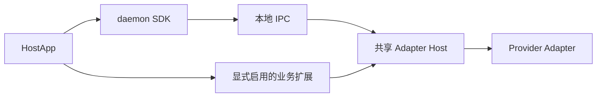

# Octo Runtime 架构

Runtime 提供本地执行能力。HostApp 决定安装、发行物、账号范围和业务扩展；daemon SDK 管理本地身份、进程与 IPC；Adapter Host 调用 Provider 并回传事件。

本地调用不要求 Worker 注册、Human Token 或 IM 连接。当前仓库已移除 `worker-access` 包，不能再按旧文档启用 Worker 注册、心跳或远程执行模块。外部注册和远程授权不由本地身份或 IPC 就绪证明。

## 职责

| 领域 | 责任组件 |
| --- | --- |
| 业务身份、目标、输入、defaults／mandatory、本轮 Context | 业务发起方 |
| Runtime 及依赖安装、版本、发行物和扩展启用 | HostApp |
| 本地身份、账号／租户隔离、进程监督和 IPC | daemon SDK |
| Invocation、原生会话结果、交互、取消及输出流 | Adapter Host／Adapter |
| 聊天历史、完整事件、Provider binding 和结果投递 | 消费应用或业务扩展 |

Core 只导出本地执行配置解析，不再提供业务引擎、FIFO 或 SQLite。嵌入式本地 API 位于 daemon 包，不再使用独立 embedded 包。

## Context 与执行

Run 保持 7，Context 保持 `octo.context-envelope/v3`。业务方决定每轮背景、选区、引用及 `extra.*` 的内容、顺序和发送时机。空模型 Context 有效；不同 Event 显式重复的 item 均须传递。

Host 只按白名单保序渲染本轮模型数据，不缓存、补齐、去重、预取或摘要。执行配置不进入模型文本，可信控制指令走独立通道。Provider session 是实际执行返回的 opaque 数据，不保证 resume 成功；新会话所需背景由业务方重新提供。见 [注入规则](context-llm-injection.md)。

## 扩展与状态

extras 是可选业务入口，加载合同见 [Extras](extra-plugins.md)。Octo 与 WeCom 位于各自的 `extra-channel-*` 包；其业务会话和投递状态不属于通用 Host 的历史存储。

默认 invoke 返回 native HostFrame；canonical 消费者显式选择模式。Host 的 ACK、真实终态和业务保存分别判断。源窗口有界，重启或窗口覆盖后不能承诺完整重放，更不能自动重执行。见 [传输流程](02-module-and-transport-flow.md)和[模式合同](27-native-canonical-protocol-contract.md)。
