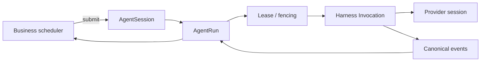

# Octo Harness 目标架构

Octo Harness 是 Agent Worker 的执行节点，不是业务调度器。统一模型只有 `AgentSession -> AgentRun -> Invocation -> CanonicalEvent`。

## 权威边界

| 领域 | 权威组件 |
|---|---|
| Agent 定义与 revision | Agent Worker |
| AgentSession、provider resume、reset generation | Agent Worker |
| AgentRun、lease、fencing、执行状态 | Agent Worker |
| Loop Task/Attempt/父子关系/调度 | Loop service |
| IM occurrence、conversation address、delivery | Channel Gateway |
| AutoPilot schedule/misfire | AutoPilot service |
| Webhook endpoint/filter/event | Webhook service |
| Provider process、invocation、native event translation | Octo Harness |
| Skill、Plugin、MCP、Connector 安装与配置 | 本地用户或原生 Runtime |
| OKF 业务记忆 | Loop service |

Harness 不能根据输入猜测“这是 Chat 还是 Task”，也不能创建业务 Task。上游只提交 namespace、Agent、session key、trigger occurrence 与输入。

Harness 不接收云端插件包、安装路径、启动命令或 MCP 配置。适配器直接调用已经完成本地配置的原生 Runtime；Harness 不替用户修改插件配置。工作目录准备仍由 Harness 执行，但不创建插件物化目录或工具 CLI 包装器。

业务服务提交的 `tool_authorizations` 只声明服务主体、允许操作和对象范围。Worker 根据 Run 身份、租约与 fencing 签发短期授权；Runtime 从独立授权接口获取凭据。平台材料读取与产物归档的地址来自本地 `business_service_bindings`，其他授权通过宿主接收器交给本地已配置的工具。授权不进入 Context 编译结果或模型输入。

本地连接只消费 Harness 实现的具体操作，不消费整个服务主体的授权。同一 Loop 主体仍有知识或业务动作授权时，Runtime 必须将剩余操作交给本地接收器；接收器缺失时拒绝 Run，不以已配置业务连接作为授权已交付的证据。

## 统一对象



- `AgentSession`：`(namespace, agent_id, session_key)` 唯一，保存 generation 与 opaque provider session。
- `AgentRun`：一次可排队、执行、取消并进入终态的执行；同一 session 内按 run number/FIFO 串行。
- `Invocation`：Harness 本地一次 provider 调用。重派或失败恢复可能产生新的 invocation，但不会改变业务对象语义。
- `ProviderSession`：Codex thread、Claude UUID、OpenCode session 等 provider 私有恢复数据。
- `TriggerOccurrenceID`：上游一次触发事实的稳定 ID。重复提交相同请求返回原 Run；同 ID 不同 payload 必须冲突。

## 状态

Worker 的完整状态机为：

```text
queued -> leased -> running -> interacting -> cancelling
   \          \         \           \          \
    +----------------------------------> completed | failed | cancelled | expired
```

Harness canonical terminal 映射：

| Harness event | AgentRun terminal |
|---|---|
| `run.finished` | `completed` |
| `run.error` | `failed` |
| `run.stopped` | `cancelled` |

Task 的业务状态不能复制 AgentRun 状态。Loop 可把 Run 完成投影为待审核，IM 可把完成结果投递到群聊，两者都不改变 Run 终态。

## Reset 与恢复

`POST /v1/agent_session/reset` 由 Worker 执行：

1. 校验 expected generation。
2. 增加 generation、provider epoch 和 context epoch。
3. 清空 `provider_session`。
4. 取消旧 generation 中尚未开始的 Run；按参数请求取消 active Run。
5. 按 trigger occurrence 保存 reset receipt，使重试返回同一结果。

下一次 `run.start` 不带 provider session，provider 创建新 thread/session；Harness 从 `session.update` 收到新值并回传 Worker。外部 `--resume` 参数始终来自 Worker 的 AgentSession，不来自 IM、Loop 或 Harness 自行拼接。

## Reference Core

`packages/octo-harness-core` 保留单机 reference profile，用于 adapter 合同测试。它只有 Agent、AgentSession、AgentRun 和 EventEnvelope；生产接入时 Worker 数据库仍是唯一权威。
