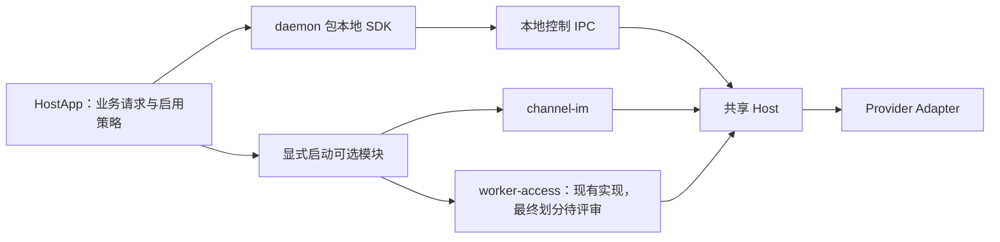

# Octo Runtime 架构

日期：2026-10-14。统一原则见 [Runtime 本地存在与按需在线合同](runtime-local-and-online-contract.md)，实现证据见 [包解耦验证](validation/daemon-package-modules-2026-10-14.md)。

## 本地执行是独立能力

设备客观存在。Runtime 经 HostApp 安装并初始化后即有稳定本地身份，不以 Worker 登记或 online 为存在条件。本地就绪、云端注册、允许在线、实际连接和执行完成分别判断。

原 embedded 独立包已删除，本地 SDK 合入 daemon；daemon 不依赖 Worker／IM 包。当前 SDK 的本地子进程仍使用 daemon server。按需的是对外模块激活；对外专用进程的物理拆分另行验收。

## 权威边界

| 领域 | 责任组件 |
| --- | --- |
| Agent 定义、业务 Target、五元组、defaults／mandatory、本轮 Context | 业务发起方 |
| Runtime 安装、版本、发行物和接入启用决策 | HostApp |
| 本地 Runtime 身份、账号／租户隔离、IPC 与模块生命周期 | daemon SDK |
| Invocation、原生 Provider 会话结果、取消、交互与标准事件 | Host／Adapter |
| 本地聊天 Session、完整事件、Provider binding 与展示投影 | 宿主业务存储 |
| 云端 Runtime 登记、凭据校验和独立远程执行控制 | Worker |
| IM 协议、频道消息及投递 | channel-im 与频道业务层 |

本地调用不查询 Worker Agent registry，不等待自动创建或 prepare／ensure。Worker 的远程身份、权限、租约及 fencing 合同仍有效；不能把远程准入要求扩展为本地存在或启动条件。

一个 Home 的多个 profile 可共享 Host，但不同 app-owned Home 不自动合并。Runtime ID、Agent ID、Provider session ID 及 credential 分别承担身份或认证语义。

## 每轮 Context 与执行配置

Run 固定为 7，Context 固定为 `octo.context-envelope/v3`。发起方决定 selection、背景、引用、任务状态和 extra 的发送时机、内容及顺序，并保存业务需要的快照。空模型上下文有效；不同 Event 显式重复的 item 均须传递。

必要 adapter 等执行项按执行合同校验，不进入模型文本。底层不从 Agent 配置补 defaults，不按 sessionId、run 序号或 hash 缓存、补齐、合并、去重或省略上下文。Host renderer 只按 namespace/name 白名单保序拼接，不调用业务校验器、预取、投影或摘要。

Provider session 由实际执行结果产生，作为 opaque 数据保存。存在 sessionId 不保证恢复成功；reset、新建会话或恢复失败时由业务方决定重新发送必要背景。详见 [Context 分类](context-llm-injection.md)及[全局基线](../../docs/event-context-rendering-ipd-se.md)。

## 安装与工具授权

所有 Runtime 及运行依赖的安装方案由 HostApp 决定。SDK、Host、Adapter 只能执行明确方案；缺失或版本不符时返回状态，不在启动、注册、探测或执行时隐式安装。

原生插件与 MCP 的安装由宿主／用户管理。显式提交的 `octo.execution/mcp` 执行配置按 [Run MCP 合同](25-run-mcp-context.md)转换，不表示 Runtime 接管云端插件分发。凭据及可信控制信息走独立执行通道，不进入模型 Context。

## 事件、终态与恢复

本地 invoke 经 IPC 返回原始 CanonicalEvent；命令受理与真实终态分别判断。Host 提供有界事件窗口和原游标修复，不是聊天历史库。应用消费并保存完整事件；重启或窗口覆盖后明确返回不可恢复状态，不自动重执行或伪造完成。

远程事件及 lease／fencing 由独立 Worker 合同管理，不给纯本地调用新增 Worker 前置条件。reference Core 的本地 FIFO 与 SQLite 用于诊断，不承担全局业务权威。具体流程见 [模块与传输](02-module-and-transport-flow.md)。
