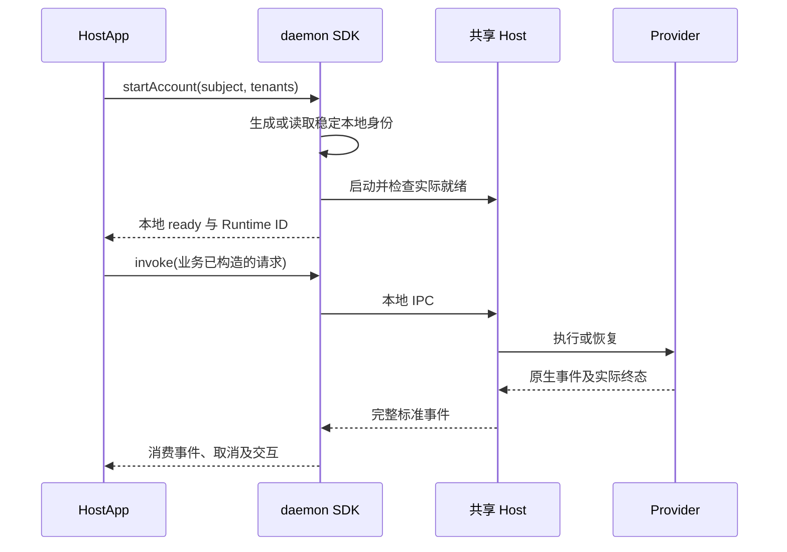

# 模块与传输流程

日期：2026-10-14。原则与状态语义见 [Runtime 合同](runtime-local-and-online-contract.md)。

## 纯本地路径



此路径不请求 Worker enrollment、不要求 Human Token 或 IM 连接。Provider 必须由 HostApp 预先准备并完成所需认证。当前 SDK 仍使用 daemon 包的本地控制进程。

## 按需接入路径

```text
HostApp 额外携带包并登记工厂
  -> 显式 startModule(id, config)
  -> daemon 加载并启动对应模块
  -> 模块通过注入的共享 Host 执行入口工作

channel-im <-> IM 服务
worker-access <-> Worker 注册／当前 WS 远程执行实现
```

登记工厂不导入包或建联；模块启动接纳不代表成功连接。HostApp 决定是否启用，daemon 管理生命周期，接入包负责协议。停止一个模块不停止仍用于本地调用的 Host。

Worker／IM 独立启用。access 的已确认职责仅为注册；现有 Worker 包仍组合注册、WS 与远程执行，最终设备连接合同待评审。

## 传输与状态边界

| 边界 | 当前用途 |
| --- | --- |
| SDK／CLI 到本地控制服务 | UDS／Windows Pipe，JSON-RPC 请求、响应与事件 notification |
| 本地控制服务到 adapter-host | stdio NDJSON RPC |
| Host 到 Provider | Adapter 选择的子进程、SDK 或原生协议 |
| channel-im 到 IM | 显式启用后的频道连接 |
| worker-access 到 Worker | 显式启用后的注册与现有远程执行连接 |

本地源流查询与修复使用原 `run_id + stream_id + after_seq`，订阅断开不等于取消。Host 与当前远程 relay 是有界内存，不承诺 durable outbox 或事件持久 ACK。完整历史与业务投递由消费应用负责。

云端命令受理、模块启动受理与执行完成是不同回执。取消响应也仅表示接纳，必须继续观察真实终态。

## 会话与配置

业务发起方在调用前构造五元组、应用业务 defaults／mandatory 并提交当前 Context v3。通用接入不读取 Agent 配置、补上下文或创建默认 Agent。

本地 Provider binding 由应用保存；远程 binding 由远程执行合同管理。opaque Provider session 存在不保证恢复成功。无论本地还是远程，reset／恢复失败后都由业务方决定重新提供背景。

reference Core 的 FIFO 用于本地参考调度；远程队列、租约和 fencing 只约束相应远程执行。Harness 不拆分业务任务或自动重试业务副作用。
