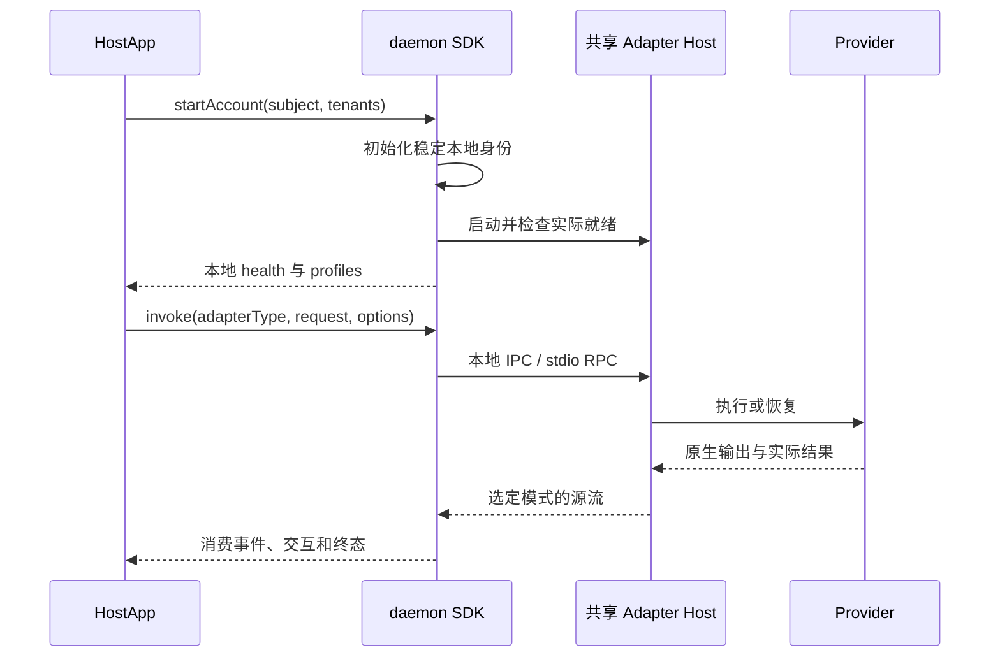

# 模块与传输流程

## 本地执行

SDK 当前使用 daemon 包的本地控制子进程。Provider 由 HostApp 预先安装并完成所需认证；本地执行不要求 Worker enrollment 或 IM 连接。

## 可选业务接入

HostApp 明确携带扩展并提交配置，扩展通过注入的共享 Host 执行。通用 `extras` 使用加载函数、停止信号和 disposer；保留的模块 API 使用登记工厂及 `startModule`／`stopModule`。两套 API 的参数不能混用，具体以包导出和 SDK 类型为准。

Octo 和 WeCom 的协议实现在各自 `extra-channel-*` 包中。Worker 接入包已移除；本仓库当前没有可启用的 `createWorkerAccessModule`。

## 传输与回执

| 边界 | 当前用途 |
| --- | --- |
| SDK／CLI 到本地控制服务 | UDS／Windows Pipe，JSON-RPC 请求、响应及 notification |
| 本地控制服务到 Adapter Host | stdio NDJSON RPC |
| Host 到 Provider | Adapter 选择的子进程、SDK 或原生协议 |
| 业务扩展到外部系统 | 扩展自身管理的连接和认证 |

公共 invoke 默认 native；需要 CanonicalEvent 时显式指定 canonical。两种输出及独立 Host 控制事实见 [模式合同](27-native-canonical-protocol-contract.md)。

断流修复沿原 `run_id + stream_id + after_seq` 订阅，不重新 invoke。Host 是有界内存窗口，不提供 durable outbox、逐事件 ACK 或重启后完整历史。命令接纳、取消接纳和执行终态分别判断。

业务方保存 Provider binding、完整事件及结果投递状态，决定会话重置和失败后的背景重发。Runtime 不调度业务任务，不重试业务副作用，也不从旧请求恢复模型 Context。
