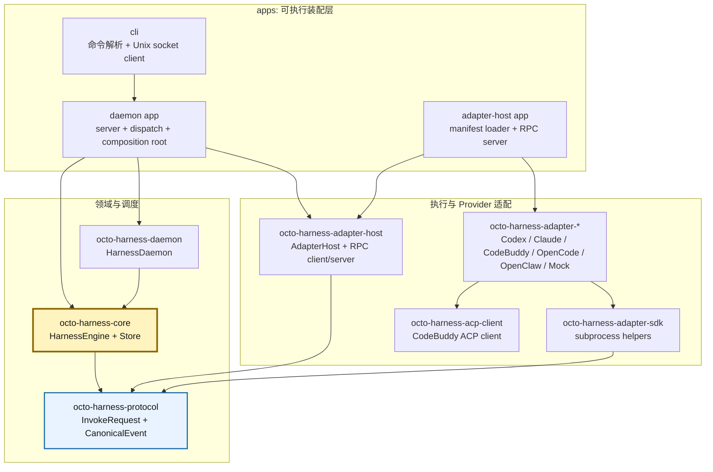
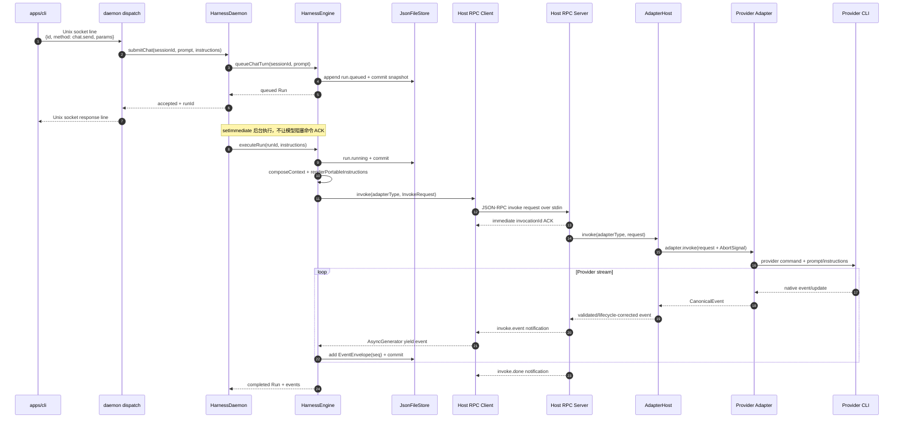
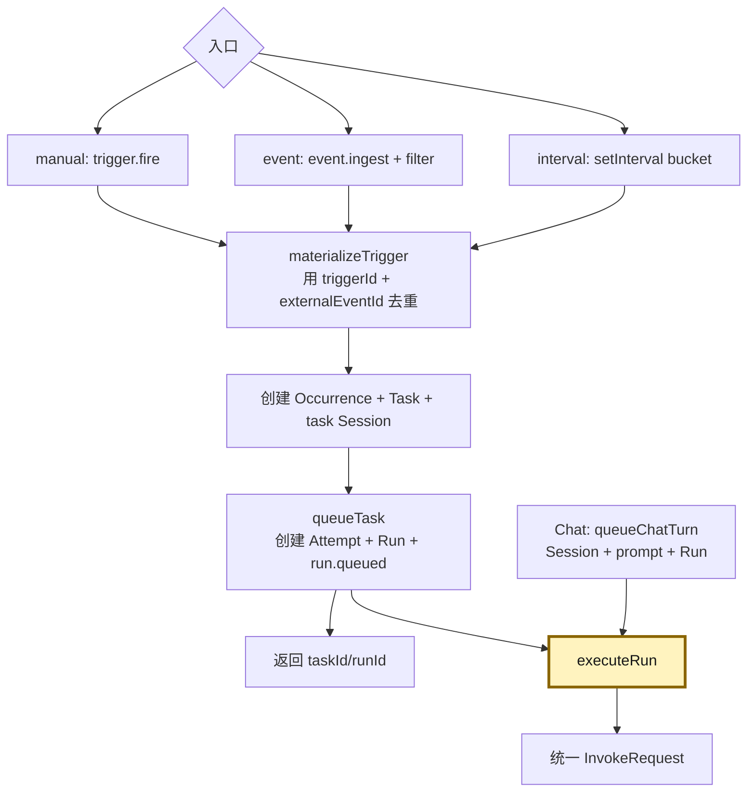
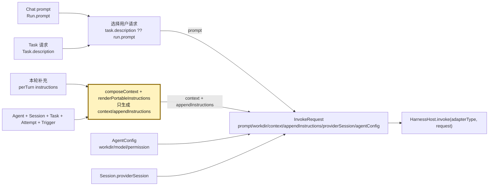
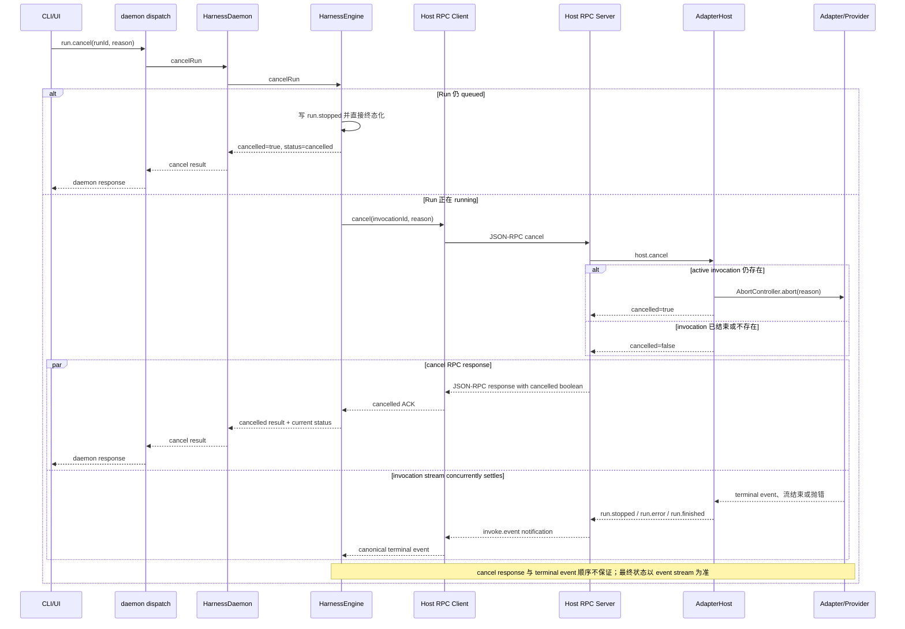

# 02 Octo Harness 当前模块、核心与消息流程

本文只描述当前工作区中已经运行的单机实现。跨节点 WSS、ACK 重放、lease/fencing 仍是 [Transport And Multi-node](09-transport-and-multinode.md) 的目标设计，不在当前调用链中。

## 先给结论

- **领域核心**是 `packages/octo-harness-core` 中的 `HarnessEngine`。它决定 Chat、Task、Trigger、Session、Attempt、Run 的关系和状态迁移。
- **稳定契约**是 `packages/octo-harness-protocol`。它定义 `InvokeRequest`、canonical event、provider session 和持久化 `EventEnvelope`。
- **后台编排器**是 `packages/octo-harness-daemon` 中的 `HarnessDaemon`。它负责排队、`setImmediate` 后台执行、trigger 匹配、interval timer、等待、取消和重启恢复。
- **执行边界**是 `packages/octo-harness-adapter-host` 中的 `AdapterHost`。它选择 adapter、控制 invocation、传播取消、修正 message lifecycle 并保证当前协议下单一终态。
- **Provider 差异**终止于各 `octo-harness-adapter-*`。Core 不包含 `if adapterType === "codex"` 一类分支。
- 当前有两条 **Octo Harness 自有控制边界**：CLI 到 daemon 使用 Unix socket；daemon 到 adapter-host 子进程使用 stdio。只有第二条是 JSON-RPC 2.0。Adapter 到 provider 还会产生额外的本地子进程 IPC，其中 CodeBuddy ACP 也是 JSON-RPC 2.0。

## 一、源码模块依赖

实线表示 TypeScript/package import，不表示运行时网络连接。



为什么 `HarnessEngine` 是核心，而不是 daemon：

1. Engine 可以直接搭配 `MemoryStore + in-process AdapterHost` 运行，core tests 就是这样做的。
2. Engine 只依赖 `Store` 与 `HarnessHost` 两个端口，不依赖 Unix socket、stdio、child process 或具体 provider。
3. daemon 把异步排队、timer 和恢复加在 Engine 外层；删除 daemon 不会删除领域模型。
4. AdapterHost 负责执行纪律，不拥有 Task/Chat 的业务状态。

## 二、每个模块负责什么

| 模块 | 核心类/函数 | 负责 | 不负责 |
|---|---|---|---|
| `apps/cli` | `command`, `callDaemon` | CLI 参数转 daemon method；一次 socket request/response | 领域状态、provider 进程 |
| `apps/daemon` | `startDaemonServer`, `dispatch` | 装配 Store/Engine/Daemon/Host；Unix socket server；方法路由 | Provider native event 解析 |
| `octo-harness-daemon` | `HarnessDaemon` | trigger 匹配、排队、后台执行、timer、wait、cancel、recover | 组装 provider 命令 |
| `octo-harness-core` | `HarnessEngine` | 领域对象、状态机、`InvokeRequest` 组装、event envelope、持久化 | IPC、provider native 协议 |
| `octo-harness-core/store` | `MemoryStore`, `JsonFileStore` | Map 索引、event append、JSON snapshot/atomic rename | 多 writer 事务、分布式 lease |
| `octo-harness-protocol` | `InvokeRequest`, `CanonicalEvent`, `EventEnvelope` | Core/Host/Adapter 共同类型与最小 runtime validation | 调度策略和 I/O |
| `octo-harness-adapter-host` | `AdapterHost` | adapter registry、invoke、cancel、message/terminal lifecycle | Task/Chat 状态 |
| `octo-harness-adapter-host/rpc` | `AdapterHostRpcClient/Server` | stdio NDJSON JSON-RPC；ACK + event notifications | Provider 命令构造 |
| `apps/adapter-host` | manifest loader | 动态 import adapter，注册到一个 Host，启动 RPC server | 调度 Run |
| `octo-harness-adapter-sdk` | `createJsonCliAdapter`, `spawnJsonLines` | provider 子进程和 JSONL 的公共模板 | Provider 字段语义 |
| `octo-harness-acp-client` | `AcpClient` | CodeBuddy ACP initialize/session/prompt/update/cancel | Canonical event 语义 |
| `octo-harness-adapter-*` | `build*Command`, `normalize*Event` | 通用请求转 provider 输入；native stream 转 canonical events | 修改全局 Run/Task |
| `config/adapters.json` | adapter manifest | 决定 host 加载哪几个 adapter module | 表示 provider 已经启动 |

## 三、当前运行时进程和 Transport

每个 subgraph 表示一个进程；箭头标出物理 Transport 和消息方向。

```mermaid
flowchart LR
  USER["用户 / 将来的 Desktop UI"]

  subgraph P1["CLI 进程"]
    CLI2["apps/cli"]
  end

  subgraph P2["daemon 进程"]
    SOCKET["Unix socket server\ndispatch"]
    HD["HarnessDaemon\n后台编排"]
    HE["HarnessEngine\n领域核心"]:::core
    STORE["JsonFileStore\n.octo-harness/state.json"]
    HC["AdapterHostRpcClient"]
  end

  subgraph P3["adapter-host 进程"]
    HS["AdapterHostRpcServer"]
    HOST2["AdapterHost\nregistry + lifecycle"]
    MODS["6 adapter modules"]
  end

  subgraph P4["每次 invocation 的 provider 进程"]
    PROVIDER["codex / claude / codebuddy /\nopencode / openclaw"]
  end

  USER --> CLI2
  CLI2 -->|"command: Unix socket + JSON line"| SOCKET
  SOCKET -->|"trigger/chat submit, task continue, cancel/wait"| HD
  SOCKET -->|"agent/chat/trigger domain commands"| HE
  SOCKET -->|"run/task/chat queries"| STORE
  SOCKET -->|"adapter list/probe"| HC
  HD --> HE
  HE <--> STORE
  HE -->|"HarnessHost.invoke/cancel"| HC
  HC -->|"stdio stdin: JSON-RPC request"| HS
  HS -->|"stdio stdout: response + notifications"| HC
  HS -->|"list/probe/invoke/cancel"| HOST2
  HOST2 -->|"metadata/result/canonical events"| HS
  HOST2 -->|"InvokeRequest + AbortSignal"| MODS
  MODS -->|"CanonicalEvent stream"| HOST2
  MODS -->|"provider-specific command / prompt"| PROVIDER
  PROVIDER -->|"native JSONL or ACP updates"| MODS

  classDef core fill:#fff3bf,stroke:#8a6500,stroke-width:3px,color:#171717;
```



当前 Transport 矩阵：

| 边界 | 物理 Transport | 应用协议 | 生命周期 |
|---|---|---|---|
| CLI -> daemon | Unix Domain Socket | 一行 JSON request + 一行 JSON response；不是 JSON-RPC 2.0 | 每条 CLI 命令新建连接，服务端只读第一行 |
| daemon -> adapter-host | child stdin/stdout | NDJSON JSON-RPC 2.0 | daemon 启动时创建一个长期 host 子进程 |
| Host -> Codex/Claude | child stdin/stdout | prompt 走 stdin；native JSONL 走 stdout | 每 invocation 一个子进程 |
| Host -> OpenCode | argv/env/temp file + child stdout | prompt 是 positional argv；native JSONL 走 stdout | 每 invocation 一个子进程 |
| Host -> OpenClaw | argv/message file + stdout JSON | OpenClaw local CLI | 每 invocation 一个子进程 |
| Host -> CodeBuddy | child stdin/stdout | ACP JSON-RPC 2.0 | 每 invocation 一个 ACP 子进程/client |
| UI/Runtime -> remote node | 当前不存在 | WSS 只写在目标设计中 | 尚未实现 |

因此，当前代码不能概括为“所有模块都使用 JSON-RPC 2.0”。统一发生在 `HarnessHost` 和 canonical event 契约，不是所有 wire 都相同。

### Transport 上的真实消息形状

CLI 到 daemon 的 `chat.send` 没有 `jsonrpc` 字段：

```json
{"id":"cli-1","method":"chat.send","params":{"sessionId":"session-1","prompt":"分析仓库","instructions":"先给结论"}}
```

daemon 在 `run.queued` commit 后返回一行：

```json
{"id":"cli-1","result":{"accepted":true,"sessionId":"session-1","runId":"run-1"}}
```

Engine 组装并交给 Host 的核心请求形状为：

```json
{
  "invocationId": "invoke-1",
  "sessionId": "session-1",
  "runId": "run-1",
  "prompt": "分析仓库",
  "workdir": "/workspace/repo",
  "context": {"schema": "octo-harness.context/v1"},
  "appendInstructions": "[Harness Context]\n...\n\n[Per-Turn Instructions]\n先给结论",
  "providerSession": {"sessionId": "provider-thread-1", "resumable": true},
  "agentConfig": {"model": "..."}
}
```

daemon 到 host 的 stdio 则使用 JSON-RPC 2.0。请求：

```json
{"jsonrpc":"2.0","id":"rpc-1","method":"invoke","params":{"adapterType":"codex","request":{"invocationId":"invoke-1","sessionId":"session-1","runId":"run-1","prompt":"分析仓库","workdir":"/workspace/repo","context":{},"appendInstructions":"...","agentConfig":{}}}}
```

host 先 ACK：

```json
{"jsonrpc":"2.0","id":"rpc-1","result":{"invocationId":"invoke-1"}}
```

随后按事件推 notification；这些 notification 没有 JSON-RPC `id`：

```json
{"jsonrpc":"2.0","method":"invoke.event","params":{"invocationId":"invoke-1","event":{"type":"message.delta","payload":{"text":"..."}}}}
{"jsonrpc":"2.0","method":"invoke.event","params":{"invocationId":"invoke-1","event":{"type":"run.finished","payload":{}}}}
{"jsonrpc":"2.0","method":"invoke.done","params":{"invocationId":"invoke-1"}}
```

`invoke.done` 关闭 RPC client 中该 invocation 的 `AsyncQueue`；业务 Run 的成功/失败由此前收到的 terminal canonical event 决定。

## 四、一条 Chat 指令如何执行

下面对应 `octo-harness chat send <session-id> --prompt ...`。



这里有两个 ACK：

1. daemon 对 CLI 的 ACK：`run.queued` 已写入当前 JSON Store 后返回 `runId`。
2. host 对 daemon 的 ACK：收到 `invoke` 后立即返回 `invocationId`，随后通过 notification 流事件。

它们不是同一个 ACK，也不提供跨进程重连重放；当前 host notifications 没有 transport seq。

## 五、Trigger/Task 如何收敛成同一种 Run



Chat 与 Task 的区别在 `executeRun` 之前：

- Chat prompt 来自 `Run.prompt`，Session 直接保存 `agentId`。
- Task prompt 来自稳定的 `Task.description`，Run 通过 `Attempt -> Task` 找到 Agent。
- 到 `executeRun` 后，两者都变成同一个 `InvokeRequest -> CanonicalEvent stream`。

## 六、Prompt、控制指令和 Session 如何传递



`appendInstructions` 不是另一条 RPC；它是 `InvokeRequest` 的普通字段，由各 adapter 放入 provider 支持的 carrier：

| Adapter | 用户 prompt | Harness instructions | Session 恢复 |
|---|---|---|---|
| Codex | app-server `turn/start.input` | 临时 `CODEX_HOME/config.toml` + thread `developerInstructions` | app-server `thread/resume` |
| Claude Code | stdin | 临时文件 + `--append-system-prompt-file` | `--resume <session>` |
| CodeBuddy | ACP `session/prompt` text | 当前实现与 prompt 拼接后一起发送 | ACP `session/load` |
| OpenCode | CLI positional prompt | 临时 instructions 文件写入 `OPENCODE_CONFIG_CONTENT` | `--session <id>` |
| OpenClaw | 临时 message file | 与用户请求按 Harness/User 两段组合在同一文件 | `--session-id <id>` |

Adapter 通过 `session.update.payload.providerSession` 上报 provider thread/session。Engine 保存到 Harness Session，下一轮重新放入 `InvokeRequest.providerSession`。

当前 daemon 的 `instructions` 只作为 `#schedule(runId, instructions)` 的内存参数传给 `executeRun`，没有写入 `Run`；这是当前实现事实，不应把它误画成已持久化的 command payload。

## 七、事件如何返回并变成 UI 可读数据

```mermaid
flowchart RL
  P2["Provider native stream"]
  N["Adapter normalizer\nprovider event -> CanonicalEvent"]
  H2["AdapterHost\n校验 + 补 message lifecycle + 单终态"]
  RPC["invoke.event\nJSON-RPC notification"]
  Q["AdapterHostRpcClient\ninvocation AsyncQueue"]
  E2["HarnessEngine\nenvelope(run, nextSeq, event)"]:::core
  ST["Store.events[runId]\nEventEnvelope[]"]
  API2["daemon method run.events / run.wait"]
  UI2["CLI / 将来的 UI projection"]

  P2 --> N --> H2 --> RPC --> Q --> E2 --> ST --> API2 --> UI2

  classDef core fill:#fff3bf,stroke:#8a6500,stroke-width:3px,color:#171717;
```



三个事件层次不能混在一起：

1. **Provider native event**：Codex `thread.started`、Claude `assistant/result`、ACP `session/update` 等，只存在于 adapter 内。
2. **CanonicalEvent**：只有 `type + payload`，Host 和 Engine 可以共同消费。
3. **EventEnvelope**：Engine 增加 `id/seq/tsMs/sessionId/runId` 后写 Store，CLI/UI 读取这一层。

当前 Core 把 `run.finished`、`run.error`、`run.stopped` 三者都视为 terminal，分别投影为 `completed/failed/cancelled`。

## 八、取消指令如何传播



通常能响应 `AbortSignal` 的 adapter 会收敛为 `run.stopped`；如果 provider 忽略取消或与自然完成竞态，在当前契约下，上层仍可能收到 `run.finished` 或 `run.error`，最终以 event stream 为准。

## 九、当前 capabilities 和 allowed methods 到底在哪里

当前代码没有通用调度 capability engine，也没有按连接角色生成的 method ACL：

- Adapter metadata 会列出 `capabilities`，`adapter.list` 可以返回它们。
- `HarnessEngine.registerAgent` 当前只检查 `adapterType` 是否已加载，不根据 capabilities 调度或拒绝功能。
- daemon 允许的方法就是 `apps/daemon/src/server.ts` 的 `dispatch` switch。
- host 允许的方法就是 `AdapterHostRpcServer` 的 `list/probe/invoke/cancel` 分支。
- Unix socket `0600` 是当前本地访问边界；没有 user/runtime role RBAC。

所以在现阶段，capabilities 主要是 metadata，还没有进入业务调度；allowed methods 也只是硬编码路由，不是一套独立权限系统。

## 十、本地与未来远程 Transport 的正确替换点

```mermaid
flowchart TB
  subgraph Current["当前单机"]
    UI3["CLI / Desktop"] -->|"Unix socket"| LD["Local daemon"]
    LD -->|"HarnessHost port"| LC["AdapterHostRpcClient"]
    LC <-->|"stdio JSON-RPC"| LH["Local adapter-host"]
  end

  subgraph Future["未来多节点"]
    CP["Control Plane / RunService"] <-->|"WSS run protocol"| RN["Runtime Node daemon"]
    RN -->|"HarnessHost port"| RC2["AdapterHostRpcClient"]
    RC2 <-->|"stdio JSON-RPC"| RH["Node-local adapter-host"]
  end
```



远程化不是把节点内部所有 stdio 机械替换成 WSS：

- 一个 Runtime Node 内，daemon -> adapter-host 仍适合 stdio。
- WSS 应位于 Control Plane/RunService -> Runtime Node 的节点边界。
- Core 已通过 `HarnessHost` 隔离 host transport；但跨节点协议应使用 `run.start/run.event`，不要直接把 provider 进程管理暴露给 UI。

## 源码阅读路径

按下面顺序阅读，能最快还原完整调用链：

1. [`apps/daemon/src/server.ts`](../apps/daemon/src/server.ts)：装配根和外部 method dispatch。
2. [`packages/octo-harness-daemon/src/index.ts`](../packages/octo-harness-daemon/src/index.ts)：排队、后台执行、恢复和取消。
3. [`packages/octo-harness-core/src/engine.ts`](../packages/octo-harness-core/src/engine.ts)：真正的领域核心与 InvokeRequest 组装。
4. [`packages/octo-harness-protocol/src/index.ts`](../packages/octo-harness-protocol/src/index.ts)：请求和事件契约。
5. [`packages/octo-harness-adapter-host/src/rpc.ts`](../packages/octo-harness-adapter-host/src/rpc.ts)：stdio JSON-RPC ACK/stream。
6. [`packages/octo-harness-adapter-host/src/index.ts`](../packages/octo-harness-adapter-host/src/index.ts)：adapter lifecycle 和取消。
7. [`apps/adapter-host/src/index.ts`](../apps/adapter-host/src/index.ts)：manifest 动态加载。
8. 任一 [`packages/octo-harness-adapter-*`](../packages/)：provider 输入和 native event 归一化。
