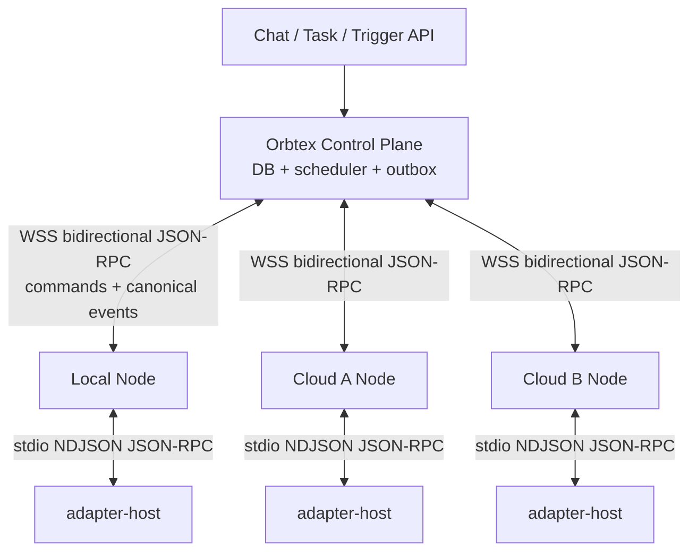

# 09 Transport And Multi-node Design

## 当前状态与目标

当前 Orbtex Harness 是可运行的单机基线：CLI 通过 Unix socket 调 daemon，daemon 通过 stdio NDJSON JSON-RPC 调 adapter-host。它**尚未实现 WebSocket 节点注册、跨云调度、事件 ACK/重放和 lease/fencing**。

目标版本增加本地与跨云节点后，Chat/Task/Trigger/Run 核心模型和 adapter 的 `invoke(): AsyncIterable<CanonicalEvent>` 不修改。新增内容止于 control plane、node runtime 和 transport/rpc 层。

推荐拓扑不是所有节点直接互连，而是每个 Runtime Node 主动连接中心 Gateway：



这对 NAT、防火墙、鉴权、节点发现和故障转移都更直接。如果以后确实需要 peer-to-peer 大文件传输，可让中心面负责 rendezvous，直连失败走 relay；Run ownership 与事件权威状态仍留在 control plane。

## 分层原则

```text
Agent Core / Domain Engine
        ↓ AdapterPort: invoke/cancel + AsyncIterable<CanonicalEvent>
Distributed Run Client / Local Host Client
        ↓ domain RPC: run.start/run.cancel or adapter.invoke/adapter.cancel
JsonRpcPeer
        ↓ request/response/notification, timeout, correlation, dispatch
MessageTransport
        ↓ stdio NDJSON or WebSocket JSON frame
physical stream/socket
```

核心规则：

- Agent Core 不 import `ws`、`readline` 或 child process stream。
- Adapter 不知道 run 来自本机、云节点、Chat 还是 Task。
- Transport 不理解 Agent、Session、Tool 或 lease。
- JSON-RPC peer 不负责持久重放；可靠会话层负责 cursor/ack/outbox。
- provider 私有协议只存在于 adapter 内部。

## Transport 接口

用户给出的四方法接口适合 demo，但生产多节点至少需要异步写入、错误、关闭原因和一次性启动语义：

```ts
export type JSONRPCId = string | number;

export type JSONRPCMessage =
  | { jsonrpc: "2.0"; id: JSONRPCId; method: string; params?: object }
  | { jsonrpc: "2.0"; method: string; params?: object }
  | { jsonrpc: "2.0"; id: JSONRPCId; result: unknown }
  | {
      jsonrpc: "2.0";
      id: JSONRPCId | null;
      error: {
        code: number;
        message: string;
        data?: { code?: string; [key: string]: unknown };
      };
    };

export interface TransportSink {
  onMessage(message: JSONRPCMessage): void | Promise<void>;
  onError(error: Error): void;
  onClose(info: { clean: boolean; code?: number; reason?: string }): void;
}

export interface MessageTransport {
  readonly kind: "stdio" | "websocket";
  start(sink: TransportSink): Promise<void>;
  send(message: JSONRPCMessage, options?: { signal?: AbortSignal }): Promise<void>;
  close(reason?: string): Promise<void>;
}
```

关键差异：

- `send(): Promise<void>` 才能表达 stdout drain 或 WebSocket buffered amount/backpressure。
- `start()` 只允许一次，先装 handler 再接收，避免 constructor 内到达的首帧丢失。
- `onError` 与 `onClose` 分离；远端断线不是 JSON parse error。
- 每个实现必须执行 schema validation、最大帧限制和 bounded queue。
- 协议日志只能写 stderr/独立 logger，不能污染 stdio stdout。

Stdio 每条消息编码为 `JSON + "\n"`；WebSocket 每个 text frame 放一条 JSON 消息，不需要换行。两者向 `JsonRpcPeer` 交付完全相同的对象。

## JsonRpcPeer 的职责

```ts
interface JsonRpcPeer {
  request<T>(method: string, params: object, options?: {
    signal?: AbortSignal;
    timeoutMs?: number;
  }): Promise<T>;

  notify(method: string, params: object): Promise<void>;
  expose(method: string, handler: (params: unknown, ctx: RpcContext) => unknown): () => void;
  close(): Promise<void>;
}
```

它维护 pending request map、生成 ID、分发双向 method、校验 result/error 互斥，并在连接关闭时拒绝 pending promises。严格 JSON-RPC error 使用整数 `code`，Orbtex 的业务错误码放在 `error.data.code`，例如：

```json
{
  "jsonrpc": "2.0",
  "id": "rpc-17",
  "error": {
    "code": -32010,
    "message": "adapter is unavailable on node",
    "data": {"code": "adapter.unavailable", "adapterType": "codex"}
  }
}
```

`$/cancelRequest` 不是 JSON-RPC 2.0 标准 method。如果实现它，只用于取消仍未返回的普通 RPC：

```json
{"jsonrpc":"2.0","method":"$/cancelRequest","params":{"id":"rpc-17"}}
```

Agent invocation 在 `run.start` ACK 后仍会长时间运行，因此必须另有 `run.cancel(runId/invocationId)`。取消 RPC request 和取消业务 Run 是两种语义。

## 两个 RPC 边界

### daemon ↔ 本机 adapter-host

延续当前协议，但规范化命名：

```text
host.hello
adapter.list
adapter.probe
adapter.invoke       -> immediate ACK
adapter.cancel
adapter.reattach
invoke.event         -> notification with invocationId + seq
invoke.session       -> opaque provider session side channel
host.heartbeat
host.shutdown
```

这里可完全信任本机 daemon 分配的 workdir，但仍需限制帧大小和 adapter 子进程权限。

### Control Plane ↔ Runtime Node

公网边界使用 Run 语言，不暴露 `adapter-host` 的内部进程管理：

```text
node.hello
node.heartbeat
node.capabilities.update
run.start            -> immediate durable ACK
run.cancel
run.steer
run.resume
run.event            -> notification
run.events.ack       -> notification
```

一个 WebSocket 连接是双向 JSON-RPC peer：control plane 可以向 node 发 request，node 也可以主动 request/notify。

## 跨云握手

node → control plane：

```json
{
  "jsonrpc": "2.0",
  "id": "hello-1",
  "method": "node.hello",
  "params": {
    "protocolVersions": [1],
    "nodeId": "node-hz-01",
    "runtimeKind": "cloud",
    "agentVersion": "0.1.0",
    "capabilities": {
      "os": "linux",
      "arch": "arm64",
      "maxConcurrentRuns": 4,
      "adapters": [
        {"type": "codex", "version": "1.2.3", "capabilities": ["session.serialize", "tool.canonical"]},
        {"type": "claude-code", "version": "2.0.0", "capabilities": ["session.serialize", "session.fork"]}
      ]
    },
    "resumeToken": "opaque-previous-connection-token"
  }
}
```

control plane → node：

```json
{
  "jsonrpc": "2.0",
  "id": "hello-1",
  "result": {
    "protocolVersion": 1,
    "connectionId": "conn-01",
    "heartbeatIntervalMs": 15000,
    "maxFrameBytes": 4194304,
    "maxUnackedEvents": 256,
    "resumeAccepted": true
  }
}
```

连接通过 TLS，node credential 必须绑定 tenant/node/scopes。更强的设备身份可在 WS upgrade token 之外增加 nonce challenge + device signature；provider API key 不应出现在握手或普通日志中。

## Run Start：ACK-then-stream

control plane 必须先在事务中创建 Run、assignment 和 outbox command，再投递：

```json
{
  "jsonrpc": "2.0",
  "id": "cmd-100",
  "method": "run.start",
  "params": {
    "commandId": "command-01",
    "runId": "run-01",
    "sessionId": "session-01",
    "attempt": 1,
    "lease": {
      "leaseId": "lease-01",
      "fencingToken": 42,
      "expiresAtMs": 1787889600000
    },
    "adapterType": "codex",
    "request": {
      "prompt": "检查仓库并汇报测试风险",
      "workspace": {"kind": "git", "url": "ssh://git/repo", "revision": "abc123"},
      "providerSession": null,
      "agentConfig": {"model": "gpt-5.6-sol"},
      "appendInstructions": "输出结论和证据",
      "invokeOptions": {"thinking": "enabled", "effort": "medium"}
    }
  }
}
```

node 必须在本地 durable inbox 记录 `commandId` 和 assignment 后再 ACK：

```json
{
  "jsonrpc": "2.0",
  "id": "cmd-100",
  "result": {
    "accepted": true,
    "runId": "run-01",
    "invocationId": "inv-01",
    "lastProducedSeq": 0
  }
}
```

同一个 `commandId` 重投必须返回同一结果，不得启动第二个 provider 进程。

## Canonical event：thinking、tool call 和 result

Orbtex 保持当前 `channel: "analysis" | "final"` 设计；adapter 可把 Aily 风格 `reasoningContent` 映射到 analysis channel。传输层完全不理解这些内容。

```json
{
  "jsonrpc": "2.0",
  "method": "run.event",
  "params": {
    "runId": "run-01",
    "invocationId": "inv-01",
    "fencingToken": 42,
    "seq": 1,
    "eventId": "run-01:1",
    "event": {
      "type": "message.delta",
      "payload": {
        "messageId": "msg-analysis-01",
        "channel": "analysis",
        "text": "我先检查测试入口。",
        "visibility": "internal"
      }
    }
  }
}
```

```json
{
  "jsonrpc": "2.0",
  "method": "run.event",
  "params": {
    "runId": "run-01",
    "invocationId": "inv-01",
    "fencingToken": 42,
    "seq": 2,
    "eventId": "run-01:2",
    "event": {
      "type": "tool_call.create",
      "payload": {
        "toolCallId": "call-01",
        "parentMessageId": "msg-analysis-01",
        "name": "exec_command",
        "arguments": {"cmd": "pnpm test"}
      }
    }
  }
}
```

```json
{
  "jsonrpc": "2.0",
  "method": "run.event",
  "params": {
    "runId": "run-01",
    "invocationId": "inv-01",
    "fencingToken": 42,
    "seq": 3,
    "eventId": "run-01:3",
    "event": {
      "type": "tool_call.update",
      "payload": {
        "toolCallId": "call-01",
        "status": "completed",
        "arguments": {"cmd": "pnpm test"},
        "output": {"kind": "text", "text": "13 tests passed\n", "exitCode": 0}
      }
    }
  }
}
```

Tool output 大于帧限制时不能硬塞 JSON：先存 artifact/blob store，event 只带 preview、hash、size 和 `artifactRef`。reasoning 默认不跨租户共享，不进入普通业务日志，并允许 control plane 按 policy 丢弃。

## Event ACK、重放与背压

WebSocket 连接成功不等于事件已持久化。采用 at-least-once 传输与幂等落库：

1. node 按 Run 生成严格递增 `seq`，先写本地 spool，再发送。
2. control plane 在数据库以 `(runId, seq)` unique key 落库，同时验证 `fencingToken`。
3. commit 后发送累计 ACK：

```json
{
  "jsonrpc": "2.0",
  "method": "run.events.ack",
  "params": {"runId": "run-01", "throughSeq": 3, "fencingToken": 42}
}
```

4. node 收到 ACK 后才删除 spool 中 `<= throughSeq` 的事件。
5. 断线重连后，node 从第一个未 ACK seq 重放；重复事件由 unique key 消除。
6. `maxUnackedEvents` 到达阈值时暂停读取 provider stream，背压一直传回 adapter；不能无限堆内存。

不承诺物理 exactly-once。系统提供的是“至少一次投递 + 幂等存储 + 单调状态机”形成的逻辑一次效果。

## Resume 与重连

WS transport 可以自动重连，但不能自行决定业务恢复。连接恢复后 node 发：

```json
{
  "jsonrpc": "2.0",
  "id": "resume-1",
  "method": "run.resume",
  "params": {
    "runId": "run-01",
    "invocationId": "inv-01",
    "fencingToken": 42,
    "lastAckedSeq": 3,
    "providerProcessAlive": true
  }
}
```

control plane 回应是否继续当前 lease、重新 claim，或停止陈旧 invocation。旧连接和旧 worker 即使晚到，也会因较小 `fencingToken` 被拒绝。

Provider session 还需要 node affinity：Codex thread、Claude session 或本地 workdir 未必能搬到另一台机器。只有 adapter 声明 session state portable，且 workspace/artifacts 已同步，scheduler 才能跨节点恢复；否则明确终止并由 Task retry 开新 provider session。

## Cancel 与 Steer

```json
{
  "jsonrpc": "2.0",
  "id": "cancel-1",
  "method": "run.cancel",
  "params": {
    "commandId": "cancel-command-01",
    "runId": "run-01",
    "invocationId": "inv-01",
    "fencingToken": 42,
    "reason": "user_cancelled"
  }
}
```

node ACK 只表示已接收取消并触发 `AbortController`，最终结果仍以 `run.stopped`/`run.error` event 为准。重复 cancel 必须幂等。`run.steer` 应进入 session gate，在 provider turn 支持安全注入时执行；不支持时返回 capability error，不能偷偷拼接进 workdir 文件。

## 多节点调度约束

调度器至少匹配：

- tenant、node online/degraded 状态与 credential scope
- adapter type/version/capabilities
- OS/arch、模型与 provider credential 可用性
- 当前并发、配额、数据地域
- workspace locality 和 provider session affinity
- Agent 显式绑定的 node/runtime 或允许的 node pool

Run assignment 使用有限时 lease。node 定期 heartbeat/renew；超时后 control plane 增加 fencing token 再分配。没有 fencing 的“检测断线然后重派”会产生两个 provider 同时执行同一个 Run。

## Workspace、Prompt 与 Secret

跨云 request 不传 `/Users/...` 这类本机路径。Control plane 传 `workspaceRef/revision` 和 artifact refs，node 在自己的受控目录 materialize，并把真实路径只交给本机 adapter。

Prompt 仍使用现有显式字段：user prompt、persistent agent instructions、per-turn instructions、structured context、skill refs。不要让 Agent 通过 CLI 评论回复，也不要要求它读取 workdir 内某个私有 skill 才知道如何汇报。

Secret 使用短期、run/node/tenant scoped credential，由 node credential broker 注入 provider 环境；不得持久化进 event、session params、prompt、spool 或错误堆栈。

## 推荐实现顺序

1. 抽出 `MessageTransport` 和 `JsonRpcPeer`，用现有 stdio host 契约测试锁住行为。
2. 给本机 host 协议增加 `host.hello`、每 invocation `seq`、`invoke.session`，移除对额外 `invoke.done` 的必要依赖，终态 event 即完成标志。
3. 实现单 control plane + 单 WebSocket node，先只跑 mock adapter。
4. 增加 durable command inbox、event spool、累计 ACK 和断线重放测试。
5. 增加 node registry、capability scheduling、lease/fencing，再开放两个节点。
6. 最后接真实 Codex/Claude/CodeBuddy/OpenCode/OpenClaw，验证取消、断线、重复 command、陈旧 lease 和大 tool output。

每一步都保持 `CoreEngine -> AdapterPort` 的接口不变；Transport 差异只出现在装配根和 RPC client/server。
