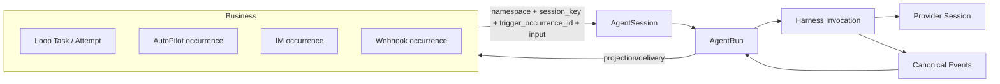

# Aily 研究在统一 AgentRun 架构中的映射

本文保留 Aily CLI 研究结论，但所有 Octo 目标定义按统一架构表达。Aily 的 Task/Task Run/Session Run 是其产品与实现术语，不应复制到 Agent Worker 的执行模型。

## 目标模型



## 概念对应

| 研究对象 | 所属域 | Octo 目标映射 |
|---|---|---|
| Aily Task | Aily/Loop 业务 | 由 Loop 类业务服务持有，不进入 Worker |
| Aily Task Run/Attempt | Aily/Loop 业务尝试 | 业务记录引用 `agent_run_id` |
| Aily Session Run | Aily 会话执行 | 统一为 `AgentRun` |
| Aily Invocation | Runtime | Harness `invocation_id` |
| Provider Session | Provider continuity | Worker `AgentSession.provider_session`，opaque |
| Auto trigger record | AutoPilot | namespace-owned occurrence，提交 AgentRun |
| Chat/IM message | Channel Gateway | IM occurrence + delivery，提交同一种 AgentRun |

所以 `AgentRun` 不是 UI 拼装名，也不是 TaskAttempt 的别名；它是 Worker 唯一的一次执行实体。Task 的父子关系、attempt number、交付状态与触发调度仍在 Loop。IM 也不创建 ChatRun，它用 IM namespace 和 session key 调用相同接口。

## 身份变化示例

```text
Loop task_42
├── attempt_1 -> agent_run_01 -> invocation_01
└── attempt_2 -> agent_run_02 -> invocation_02

AgentSession: (loop, agent_900, v1/task/task_42)
Provider session: codex_thread_abc (opaque; reset 后替换)
```

业务 retry 会创建新的 Loop attempt 与 AgentRun；它可以沿用 AgentSession 来继续 provider 上下文，也可以先 reset 再提交。Runtime 断线恢复不创建新的业务 attempt，由 Worker lease/fencing 与 Harness command recovery 处理。

## 状态分离

- Loop Task：`todo/in_progress/in_review/blocked/done` 等产品状态。
- AgentRun：`queued/leased/running/interacting/cancelling/completed/failed/cancelled/expired`。
- Invocation：本地 accepted/running/stopped，用于进程与 outbox 恢复。
- Delivery：pending/sent/failed，可独立重试。

一次 AgentRun completed 不等于 Loop Task done；IM delivery failed 也不能把 Run 改成 failed。

## 对研究结论的保留

Aily 的证据仍说明三件事：业务 Task 与模型调用不是同一对象；provider resume ID 应保持 opaque；命令接受与执行终态必须分离。目标架构吸收这些结论，但不复制其 Task Run/Session Run 多层状态机。
