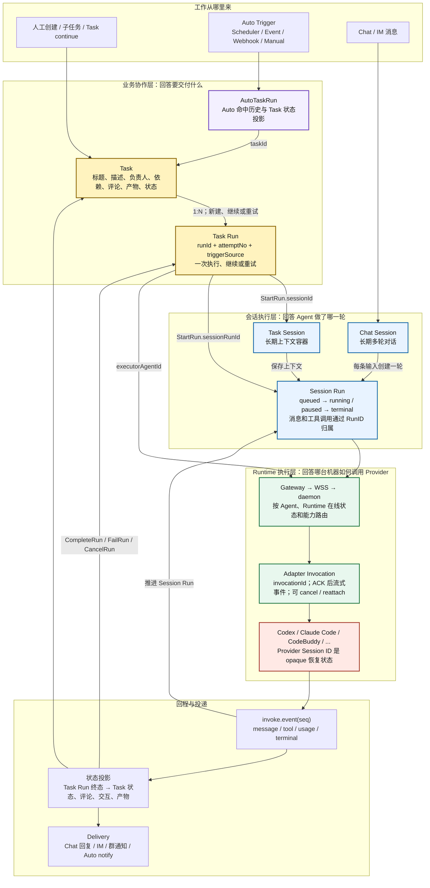
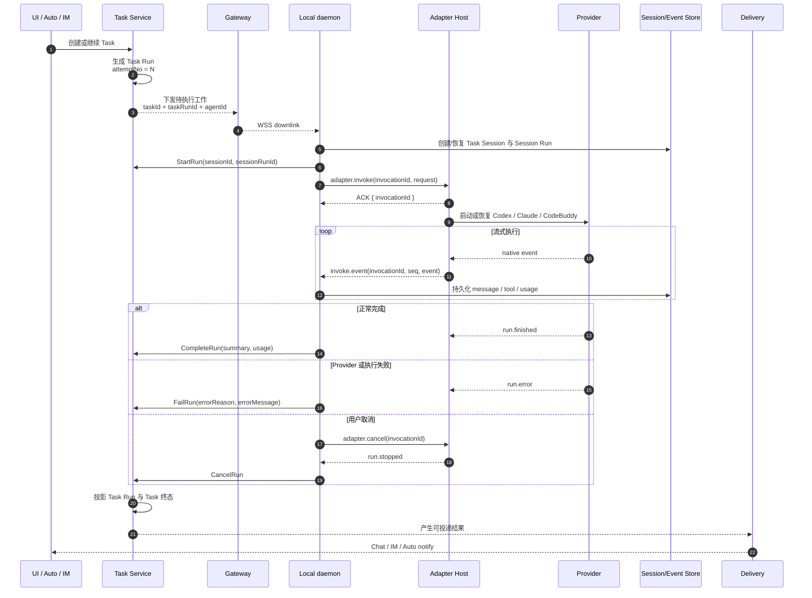
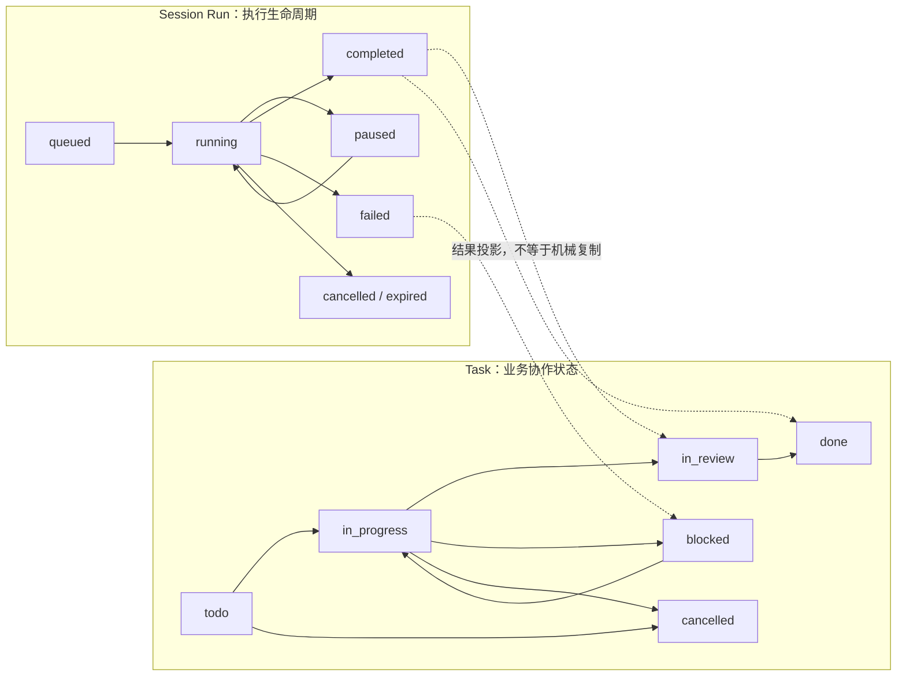

# 12 Aily Task、Run 与 Agent 执行概念模型

本文基于本机 Aily CLI `0.1.54` 的 Gateway API 类型、Task CLI 和 Adapter Host 协议，梳理 `Task`、`Task Run`、`Session Run`、`Agent Run`、`Invocation` 的关系。

## 一句话结论

**Task 是要交付的长期工作；Task Run 是第几次尝试；Session Run 是 Agent 在会话里执行的一轮；Invocation 是本地 Runtime 对 Provider 的一次调用。**

`Agent Run` 在本机可见的 Aily 公共类型中不是独立实体，更适合作为 UI 上对 `Task Run + Session Run + Invocation` 的组合称呼。

## 核心流程图



这张图最重要的边界是：

1. `AutoTaskRun` 不是实际跑模型的 Run。它是 Auto 命中后关联 `taskId` 的运行历史/状态视图。
2. `Task Run` 属于 Task 领域，负责 `attemptNo`、触发来源、重试关系和业务终态。
3. `Session Run` 属于会话领域，负责消息、工具调用、暂停、取消和用量。
4. `Invocation` 属于本地 Runtime，负责 Provider 进程、流式事件、取消和断线重挂。
5. Chat 不需要先创建 Task；它从 Chat Session 直接创建 Session Run，但之后复用相同 Runtime 执行链。

## 概念关系

| 概念 | 稳定多久 | 解决的问题 | 关键标识/字段 | 与下层关系 |
|---|---|---|---|---|
| Agent | 长期配置 | 谁来执行、用哪个 Adapter/模型/权限 | `agentId` | 一个 Agent 可负责多个 Task/Session |
| Auto Trigger | 长期规则 | 为什么、何时创建工作 | `triggerId`, `TriggerKind` | 每次命中产生一条 Auto 运行历史并关联 Task |
| AutoTaskRun | 一次触发记录 | 这次 Auto 命中了什么、对应哪个 Task | `taskId`, `triggerKind`, `triggerId`, `status` | 指向 Task；状态值与 Task 状态对齐 |
| Task | 长期工作项 | 要交付什么、谁负责、依赖和协作信息是什么 | `taskId`, `description`, `assigneeId`, `status` | 一个 Task 有多次 Task Run |
| Task Run | 一次尝试 | 这是第几次执行，来源、重试和结果是什么 | `runId`, `attemptNo`, `retryOfRunId`, `triggerSourceType` | 启动后绑定 Session/Session Run |
| Session | 长期上下文 | 多轮执行如何延续历史 | `sessionId`, `SessionType=Chat\|Task` | 一个 Session 有多次 Session Run |
| Session Run | 一轮 Agent 执行 | 本轮消息、工具、用量和生命周期如何归属 | `runID`, `status`, `triggerMessageID` | 经 Gateway 路由到 Runtime |
| Invocation | 一次 Runtime 调用 | 如何启动、取消或重挂 Provider 调用 | `invocationId`, `seq` | 对应一次 Adapter invoke stream |
| Provider Session | Provider 私有长期上下文 | Codex thread、Claude session、ACP session 如何恢复 | Adapter 私有 session state | 通过 `invoke.session` 旁路持久化，不进入用户消息 |
| Delivery | 独立投递 | 结果送到哪里、失败是否重试 | target、channel、condition | 消费已持久化结果，不决定 Run 是否成功 |

## 一次 Task 的完整时序



本机 CLI 暴露的 Task Run 命令是只读查询；`StartRun`、`CompleteRun`、`FailRun` 由 daemon 围绕 worker/Provider 生命周期调用。由于 Gateway API 没有公开 `CreateRun` 命令，可以推断待执行 Task Run 由服务端任务编排流程预先生成，然后下发 daemon。

## 一组具体 ID 怎么变化

假设用户要求 Agent 分析同一个代码仓库，第一次失败后继续执行：

```text
Agent
└── agent_900                         长期配置，不因重试变化

Task
└── task_42                           长期工作项，不因重试变化
    ├── taskRun_01                    attemptNo=1, status=failed
    │   ├── session_task_42           Task Session，可长期复用
    │   ├── sessionRun_01             第一轮会话执行
    │   └── invocation_01             第一次本地 Provider 调用
    │
    └── taskRun_02                    attemptNo=2, retryOfRunId=taskRun_01
        ├── session_task_42           仍是同一个 Task Session
        ├── sessionRun_02             新的一轮会话执行
        └── invocation_02             新的本地 Provider 调用

Provider session
└── codex_thread_abc                  可被两次 invocation 复用的 opaque ID
```

因此重试时通常：

- `taskId` 不变，因为业务目标没有变。
- `taskRunId` 改变，因为产生了新的尝试。
- `sessionId` 可复用，因为需要延续 Task 上下文。
- `sessionRunId` 改变，因为这是新的一轮会话执行。
- `invocationId` 改变，因为 Runtime 发起了新的 Provider 调用；同一次失联恢复可用原 invocation 做 `reattach`。
- Provider Session ID 通常复用，但它由 Adapter/Provider 决定，业务层不解析。

## Task 状态和 Run 状态不要混为一谈



执行完成不一定等于业务完成。例如 Agent 产出代码后，Task 可以进入 `in_review`；Delivery 失败也不应该把已完成的 Session Run 改成失败。

## “Agent Run”应该怎么用

本机 Aily 包含 “inside an agent run” 一类描述，但可见 API 中没有名为 `AgentRun` 的权威接口或数据结构。为了避免歧义，Orbtex 应采用以下命名规则：

| 使用场景 | 推荐名称 | 不建议 |
|---|---|---|
| 数据库/API 中的第 N 次任务尝试 | `TaskRun` 或当前的 `Attempt + Run` | `AgentRun` |
| Chat/Task 会话中的一轮执行 | `SessionRun` | `AgentRun` |
| daemon 到 Adapter Host 的一次调用 | `Invocation` | `Run` |
| UI 给用户看的组合详情页 | `Agent 执行` | 暴露三个内部 Run 名称 |

UI 的“Agent 执行详情”可以聚合展示：

```text
业务：Task #42 / 第 2 次尝试 / 来源 webhook
会话：Session Run #2 / running / 当前工具 Bash
节点：MacBook runtime / codex-local / invocation_02
结果：12 条消息 / 3 次工具调用 / 等待用户确认
```

也就是说，`Agent 执行`适合作为读模型，不适合作为第四套重复的状态机。

## 对 Orbtex 的映射

| Aily 概念 | Orbtex 当前对象 | 判断 |
|---|---|---|
| Task | `Task` | 一致 |
| Task Run 的 `attemptNo` 与来源 | `Attempt` | Orbtex 拆得更明确 |
| Task/Chat 的业务执行 | `Run` | 一致，Chat 与 Task 在此收敛 |
| Session | `Session(type=chat\|task)` | 一致 |
| Adapter Invocation | `Run.invocationId` + `InvokeRequest.invocationId` | 已存在，但生产版宜单独持久化 invocation/lease |
| Provider Session | `Session.providerSession` | 一致，保持 opaque |
| AutoTaskRun | `TriggerOccurrence + Task` | 语义接近；可增加面向 UI 的 Auto run projection |
| Session/Event Store | `EventEnvelope(runId, seq)` | 一致 |

Orbtex 当前的 `Attempt + Run` 比单个 Task Run 更适合高可用实现：Attempt 保存业务来源和编号，Run 保存排队、执行、取消和事件。生产化时只需要进一步把 Runtime `Invocation` 从 Run 中拆为可租约、可 fencing、可 reattach 的持久记录，而不是新增含糊的 `AgentRun`。

## 依据与边界

已验证依据：

- `@lark-harness/gateway-api/dist/__apis.d.ts`：`Task`、`Task.Run`、`Session.Run`、`AutoTaskRun`、`SessionType`、`StartRun`、`CompleteRun`、`FailRun`。
- `aily-cli/dist/commands/task/index.js`：Task Run 状态由 daemon 围绕 worker 生命周期驱动。
- `aily-cli/dist/commands/task/helpers.js`：worker 注入 `AILY_CLI_TASK_ID` 和每次唤醒变化的 `AILY_CLI_TASK_RUN_ID`。
- `@lark-harness/adapter-host/dist/protocol.d.ts`：`adapter.invoke` 同步 ACK，随后通过带 `invocationId + seq` 的 `invoke.event` 推流，并支持 cancel/reattach。

本机包没有暴露云端 Task queue、lease、fencing 和数据库事务实现。图中 Gateway 如何挑选 Runtime，以及服务端如何创建待执行 Task Run，是根据 WSS downlink、Runtime 注册和现有 API 边界做出的架构推断，不应当作字节内部实现细节的源码证明。
