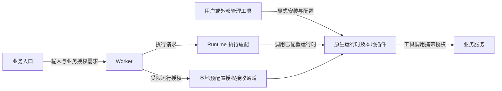

# 插件管理职责外移、FileBundle 删除与 OKF 记忆归位方案

> 2026-10-14 修订：本文件保留安装职责外移与 FileBundle 删除的历史记录。禁止通过 Run / Context 传入 MCP 连接配置的部分已由 [Run MCP 执行配置](25-run-mcp-context.md) 取代；新的 `octo.execution/mcp` 只表达本轮连接，不恢复安装与资源下载。
日期：2026-10-12

状态：已在相关项目的当前 `main` 实施破坏性更新；代码、结构重建及部分真实流程已验证。整体保持 Alpha，Team 也是 Alpha。原生工具授权接收和各引擎的完整联调仍有明确限制，见第 12 节。

## 1. 改造结论

Skill、Plugin、MCP 和 connector 的安装、配置、更新、启用、停用及卸载，由用户通过原生运行时或外部管理工具完成。Octo Runtime 不再承担这些能力的管理职责。云端不得通过 Run、Context、资源下载或其他旁路下发插件定义及安装配置。

Agent 保存执行意图、业务身份和运行时绑定。Agent 不再保存插件文件树、安装清单、MCP 启动配置或 connector 定义。Runtime 对接已经配置完成的原生运行时，处理执行、事件转换及运行期间的交互。云端保留业务授权，授权不产生安装、启用或重新配置插件的效果。

OKF 知识与业务记忆暂时归 `octo-agent-app-loop`（下文称 Loop App）管理。Loop App 拥有其内容、作用域、版本、检索、读写授权和使用记录；Worker 不再将 OKF 作为所有 AgentRun 的公共记忆平面。暂时归位表示当前阶段的职责选择，不承诺后续拆分为独立服务。

本次直接删除 FileBundle 全链路，并同步修改所有生产者和消费者。没有旧协议兼容、数据迁移、自动转换、双写、版本协商或回退分支。部署时停止受影响服务，drop 受影响的自有数据结构，按最终 schema 重建并重新初始化运行状态。

本文中的“原生运行时”指实际执行 Agent 的引擎及其宿主环境。某个运行时提供管理接口时，外部客户端可以直接调用该接口。具体产品仅作为例子，不构成本方案的依赖；Runtime 不包装新的统一插件管理接口。

## 2. 范围与约束

### 2.1 本次范围

- 删除 `octo.file-bundle/v1`、资源包 CRUD、上传、解析、快照和本地物化。
- 删除经 Context 或 execution plan 下发的 Skill、Plugin、MCP、connector 配置，以及从包内配置派生的 CLI 启动器。
- 删除 Agent 管理、Ask、Team、Loop 等入口对 FileBundle 的依赖。
- 将运行授权从 FileBundle 内容和资源身份中解耦。
- 将 Worker 的独立 OKF 知识领域转入 Loop App，删除 Worker 的知识管理、自动解析和 Runtime 专用知识读取接口。
- 同步修改 Runtime、Worker、Access、Loop、Channel、Work App、相关 MCP 服务及共享协议。
- 更新数据库初始结构、生成合同、样例、测试和运维说明。

### 2.2 本次不扩展的范围

- Runtime Relay 与 IM Channel 的网络拓扑划分。
- AgentSession、Run 调度权威、租约、fencing 和事件可靠性模型的整体重构。
- 新建插件商店、插件数据库、统一安装器或云端配置中心。
- 客户端兼容性升级及历史数据保留。

Run 保持 `schema_version=7`，Context 保持 `octo.context-envelope/v3`，遵循当前统一开发基线；直接修改它们的字段合同。协议编号保持不变不代表旧字段继续有效。删除的已知字段和 Context 类型必须明确拒绝，不能当作未知可选扩展静默忽略。

## 3. 最终职责边界

| 对象或动作 | 最终责任主体 | Octo 的职责与限制 |
| --- | --- | --- |
| 插件来源、安装和依赖管理 | 用户、原生运行时或外部管理工具 | 不上传插件包，不执行安装命令，不因 Run 补装依赖 |
| Skill 内容与发现目录 | 原生运行时 | Runtime 不解析云端 Skill 文件，不建立 Skill 资源缓存 |
| MCP 命令、参数、URL、transport 和固定配置 | 原生运行时 | 云端执行请求不传这些配置；Runtime 不改写原生配置文件 |
| connector 定义与启用状态 | 原生运行时 | 不通过内置 connector、临时包或运行计划下发定义 |
| MCP 进程和插件生命周期 | 原生运行时 | Runtime 不实现通用 MCP 进程管理；仅管理已有职责内的 provider invocation |
| 本地工具使用许可和远程接入许可 | 用户、原生运行时 | 安装不等于允许远程调用；Runtime 遵守本地拒绝和审批结果 |
| Agent | Worker 的 Agent 领域 | 保存身份、指令、执行约束和运行时绑定；不拥有插件部署状态 |
| OKF 知识与业务记忆 | Loop App，当前阶段 | 管理内容、版本、作用域、检索、读写授权和使用记录；不借此管理插件 |
| 原生运行时的本地记忆 | 用户和原生运行时 | Loop App、Worker、Runtime 不自动同步或覆盖本地记忆 |
| Run、会话、取消和执行归属 | Worker 与现有运行链路 | 保留现有权威划分；不借此管理本地插件 |
| 业务对象访问权限 | Access、Loop、目标业务服务及授权服务 | 校验真实请求者和对象权限，签发或验证受限授权 |
| 运行授权的本地接收 | 原生运行时或用户预配置的本地授权接收端 | Runtime 只在已有受控运行通道传递授权，不生成工具配置 |
| 任务附件、正文和产物 | 现有内容、云盘及材料服务 | 作为业务数据传输；不能作为插件安装来源 |
| 配置界面 | 原生运行时界面或外部客户端 | Work App 可以打开原生管理入口；不再持有可回写云端的插件配置模型 |

上述职责不会因组件部署在本机还是云端而改变。企业托管运行时也由其运行环境管理工具安装插件，不恢复 Worker 向 Runtime 下发包的路径。

## 4. 目标执行行为



授权接收通道是已有运行时能力或用户预配置的本地设施，不是新建的 Runtime 插件管理服务。若目标运行时没有受控的授权接收能力，本次不为其自动生成 MCP 配置、shell wrapper 或凭据路径配置；需要业务授权的场景明确返回不支持。

### 4.1 普通执行

1. 用户在原生运行时中完成插件安装和配置，并授予需要的本地使用许可。
2. 业务入口提交输入、Agent 选择、执行约束和业务授权需求。
3. Worker 校验请求者、Agent 和业务对象权限，按现有规则分配 Runtime 与租约。
4. Runtime 调用绑定的原生运行时，不解析插件包，不建立下载任务，不执行安装或配置更新。
5. 原生运行时自行发现和使用本地能力，并处理本地工具审批。
6. Runtime 回传执行事件、交互请求与终态；Worker 保存执行状态。

### 4.2 能力缺失与本地变更

- 原生运行时可报告工具缺失时，返回明确的缺失结果。Runtime 不尝试补装，也不将缺失改写为已准备成功。
- 普通开放式对话不新增“完整插件清单已注册”的前置条件，不把插件盘点重新做成云端准入机制。
- 业务流程必须使用某项工具时，只有收到原生运行时能够提供的使用证据，才能声明对应操作成功；仅收到授权不表示工具存在或已执行。
- 原生运行时无法报告插件清单或加载结果时，保持证据缺失，不伪造 `loaded_skills`、插件版本或安装回执。
- 用户在执行期间更新或停用插件时，由原生运行时决定当前 invocation 的行为。云端不冻结插件字节，也不据旧包摘要恢复本地插件。

### 4.3 OKF 记忆暂归 Loop App

现有 OKF Knowledge 与 FileBundle 是两个领域，不能只删除 FileBundle 就认为记忆职责已经外移。当前 Worker 的 `KnowledgeService` 管理 OKF 包及版本，`ResolveForRun` 按 scope 解析知识快照，并提供独立管理和 Runtime 读取接口；这些职责需要单独归位。

目标行为如下：

1. Work App 或其他业务客户端直接调用 Loop App 的 OKF 管理接口，完成创建、编辑、提交版本、导入、读取和查看使用记录。
2. Loop App 按真实请求者及业务作用域校验访问权限。现有 user、octo_space、teamspace、work_project 语义在归位后逐项明确，不能将 scope ID 本身当作授权。
3. Loop App 在业务场景中选择需要的记忆内容，并通过普通正文或业务材料引用提交给执行链路。材料引用绑定所选版本；Worker 校验通用输入合同，不负责 OKF scope 解析、排序、渐进披露或版本选择。
4. 若 Agent 需要主动检索或写入 OKF，用户须先在原生运行时配置相应工具；该工具访问 Loop App 并接受业务权限校验。Loop App 不下发 connector 或安装配置。
5. 记忆写入只有经 Loop App 权限校验并持久化后才表示成功。模型输出、Run 完成和材料读取都不自动产生记忆提交；保留现有显式提交及版本冲突语义。

删除 Worker 的 `knowledge_snapshot` 专用执行字段和 `/v1/runtime/knowledge_bundle/*` 接口，不新增 Runtime 的 OKF 缓存、记忆目录物化或专用检索客户端。执行链路收到的记忆正文按业务数据处理，不能升级为安装指令、本地配置或权限来源。

AgentSession 的 provider resume、continuity 和上下文压缩属于执行连续性，不属于 OKF 业务记忆，本次不随 OKF 移入 Loop App。原生运行时自行维护的本地记忆也不纳入此次归位。

## 5. 协议直接变更

本节是目标合同。新增授权字段的最终 schema 必须先在共享协议中定义，再同步生成各服务合同，不能由各服务分别猜测。

### 5.1 删除的协议内容

| 层级 | 删除内容 | 替代行为 |
| --- | --- | --- |
| 文件资源协议 | FileBundle、BundleFile、ResolvedFileBundleResource 及包摘要计算 | 不建立替代插件文件协议 |
| Context | `octo.resources/skills`、`agent_plugins`、`connectors`、`knowledge` 及 include/exclude、components、invoke 等包选择语义 | 插件使用由本地配置决定；知识内容走普通材料引用 |
| Agent revision / execution profile | 云端 `mcp_servers`、插件包引用及安装配置 | 保留执行意图和原生 Agent / Runtime 绑定 |
| ResolvedExecutionPlan | `resources`、云端 `mcp_servers`、资源内 `mcp_credentials` | 运行授权通过独立受控通道取得 |
| ContextPreparation | 包物化回执、资源 root/data 路径、包 revision/digest/components | 保留工作区、材料、continuity、Run/lease/fence 校验 |
| ContextApplication | 由云端包推导的强制 `loaded_skills` 及一致性比较 | 原生应用证据按实际支持报告；不证明插件安装成功 |
| 编译产物 | 云端资源派生的 skillRoots、MCP 配置、知识包目录、CLI launcher 清单 | adapter 使用原生运行时已经配置的能力 |
| 工具授权 | FileBundle resource ID、包内 MCP 名称、包摘要作为授权来源 | 使用真实服务主体、业务授权范围和当前执行归属 |
| OKF 执行扩展 | Worker 注入的 `knowledge_snapshot` 和 Runtime 知识快照/文件读取合同 | Loop App 选择的普通正文或材料引用；主动访问使用用户预配置工具 |

`octo.content/references`、任务材料回执和业务 `resource_ref` 继续用于数据对象引用。它们不再解析为插件包。删除包选择不能删除业务数据引用本身。

### 5.2 独立运行授权合同

实现沿用 Run capability 的签发与验证设施，替换其权限来源和目标绑定。当前语义如下：

| 数据 | 来源与约束 |
| --- | --- |
| 请求者、Space、namespace | 从已验证身份和现有冻结业务请求取得，不信任客户端自报主体 |
| Run、Runtime、lease、fencing | 由 Worker 根据当前执行归属绑定 |
| 接收服务主体 / audience | 来自服务端可信授权登记；本地预配置工具与目标服务自行匹配 |
| 允许的业务操作与对象范围 | 由业务服务验证后给出；不得从上传 `mcp.json` 或本地自报安装清单取得 |
| 过期与撤销条件 | 沿用明确的 Run capability 规则；执行归属变化、终态或撤权后重新验证 |
| 授权凭据 | 仅经受控 Runtime 通道交付，不能进入普通 Context、renderer、日志或模型正文 |

授权响应只包含凭据和必要的授权约束，不包含插件文件、安装来源、命令、启动参数、MCP URL、transport、环境配置或任意可写 headers 模板。授权对象标识与业务对象引用不得重新命名成 connector 包身份。

本地授权接收端将凭据交给已配置工具时，匹配接收服务主体和授权范围。不得因收到新 audience 自动添加 MCP Server 或修改配置。外部工具原有固定凭据仍由用户自行配置，本次不将其全部迁入 Octo。

有效权限取请求者业务权限、云端授权范围和本地许可的交集。云端授权不能覆盖本地拒绝；本地安装不能扩大云端业务权限。

受信业务生产者提交 Run 时，可以携带以下无秘密字段。Worker 要求生产者具备 `worker.execute`，并校验真实主体、租户、namespace 和接收服务登记：

```json
{
  "tool_authorizations": [{
    "service_subject_id": "verified-service-uid",
    "allowed_tools": ["task_get_materials"],
    "resource_refs": ["task:task-id"]
  }]
}
```

每次请求最多 32 个接收主体；主体最多 96 个字符。每个操作或对象集合包含 1 至 128 个不同字符串，每个字符串最多 512 个字符。禁止重复接收主体和额外 URL、命令、headers 等配置字段。

Runtime 使用 `POST /v1/runtime/context/authorizations/resolve`，提交 `run_id`、`lease_id` 和 `fencing_token`。Worker 返回 `data.authorizations[]`，每项包含上述范围以及 `token`、`octo_space_id`、`namespace` 和 `expires_at`。接收服务继续检查当前 Run、租约、fencing、终态和业务权限。

Runtime 的本地 `businessServiceBindings` 只绑定框架自身的任务材料读取与任务/讨论产物归档客户端。默认 Task 只请求这五项：`task_get_materials`、`task_authorize_material_snapshot`、`task_prepare_output`、`task_commit_output`、`task_fail_output`。同一服务主体的其他操作仍属于原生工具授权，不能因服务主体相同而视为已经交付。缺少 `receiveToolAuthorizations` 接收器时返回 `TOOL_AUTHORIZATION_RECEIVER_UNSUPPORTED`。

### 5.3 校验、错误和准备回执

- 已删除的 FileBundle 路由不再注册；调用方收到接口不存在的结果，不提供兼容转发。
- 已删除的协议字段和 Context 类型在入口校验中拒绝；拒绝发生在 provider 执行和授权签发前。
- 材料准备成功仍只表示材料已准备，不能替代原生执行成功或工具调用成功。
- 独立区分本地工具缺失、本地未许可、运行时不支持授权接收、云端无权限、授权失效和目标服务调用失败。
- 错误的最终代码在共享合同中统一定义；不得继续使用 `FILE_BUNDLE_*` 描述上述新失败原因。
- compiled hash 不再包含插件文件及包安装状态；若授权范围参与执行约束，只计算无秘密的授权范围，不能计算 bearer 或其他秘密。

## 6. 各仓库改动清单

### 6.1 octo-runtime

- 从 `packages/octo-runtime-protocol` 的 schema、校验器、Context catalog、合并规则和 fixtures 删除文件包及包选择类型。
- 修改 `context-preparation.ts`：保留工作区和 provider 状态准备，删除资源物化、包摘要、执行位修改、manifest/SKILL 解析及包内 MCP 配置解析。
- 删除由包内 `cli.json` 驱动的 `cli-bindings.ts` 生成启动器路径，清理编译器对这些路径的提示注入。
- 修改 `agent-work-runtime.ts` 的资源 resolve 调用、准备阶段和回执封存，不调用已删除的 `/context/resources/resolve`。
- 修改 `context-pipeline.ts`、`run-context.ts` 和 adapter SDK 的资源准备类型；本地原生配置不能由云端 plan 覆盖。
- 检查各 adapter 对动态 Skill/MCP 注入的调用。只为云端包服务的注入路径删除；原生运行时自身的能力与执行适配继续由对应 adapter 对接。
- 修改 embedded SDK 与 daemon 接口，不提供 install/update/uninstall/enable 等统一插件管理能力。
- 删除 SQLite 中仅服务于资源安装快照的状态及 Runtime 自有资源缓存路径；保留用户的原生运行时配置和插件目录。
- 更新准备、编译、应用、恢复和跨服务合同测试，删除以包下发成功为正确行为的用例。

### 6.2 octo-agent-worker

- 删除 FileBundle handler、service、repository、domain、catalog、上传逻辑及对应接口注册。
- 删除 `/context/resources/*` 的包管理路由、Runtime resolve 路由及 `/platform/file-bundles/*` 管理路由；实际挂载前缀以 router 为准。
- 删除 `SetFileBundleObjects` 等依赖接线；对象存储仍供事件归档或业务材料使用时，保留那些独立用途。
- 删除 `ResolveFileBundles`、`PreparedResources` 和 Run 的插件字节快照。
- 修改 Agent revision、Context 配置合并、执行计划、准备回执和应用证据校验。
- 修改 `run_capability_svc.go`：授权签发及验证不再读取 FileBundle、包内 `octo_auth` 或 `prepared_resources_json`；改用已验证的业务授权范围。
- 修改令牌目标绑定和校验输出，删除资源包 ID / MCP 名称的依赖；同步接收服务验证合同。
- 修改 `migrations/001_init.sql` 及初始结构校验，删除 `file_bundles`、`file_bundle_audits` 和 `agent_runs.prepared_resources_json`。
- 删除独立 OKF Knowledge 的 handler、service、repository、领域类型、模板及依赖接线，将对应业务实现归入 Loop App；不保留 Worker 代理接口。
- 删除 `/v1/knowledge/*`、`/v1/runtime/knowledge_bundle/*`、`SetKnowledgeResolver` 和提交阶段的 OKF 自动解析；删除 `knowledge_snapshot` 写入与专用校验。
- 从 Worker 最终初始 schema 删除 `knowledge_bundles`、`knowledge_bundle_revisions`、`knowledge_access_events`；同步清理知识作用域及快照嵌入的自有运行状态。

### 6.3 octo-agent-access

- 删除资源管理代理和共享生成合同中的 FileBundle 类型。
- 修改 Agent、Team 和事件输入校验，拒绝 connector 包引用和 MCP 配置。
- 将 Team 等业务授权需求从插件选择中抽离；验证真实请求者、Team roster 和对象权限后再交给 Worker。
- 保留既有身份、事件和 Team 编排职责，不保存本地插件配置，也不通过事件偷偷传递 MCP 定义。

### 6.4 octo-agent-app-loop

- 修改 `object_selection_context.go`：删除通过 `/context/resources/get` 读取 Skill 包内容的路径。
- 任务选择中的普通文件及文本继续生成业务材料引用；插件对象不再由 Loop 转成可安装资源。
- 删除任务提交和准备中对 connector / FileBundle 的必选条件。
- `/mcp/task` 若继续作为模型工具入口，依赖用户预配置的本地工具及独立业务授权；Loop 不生成 connector 配置。
- 同步 Worker 合同、对象选择测试和任务材料联调。
- 接收 OKF Knowledge 的内容、版本、模板、作用域授权和使用记录实现，提供 Loop App 自有管理与读取接口；不得直接 import Worker 的业务包或跨库查询旧表。
- 在 Loop App 自有数据库建立 OKF 结构，保留内容格式校验、显式提交、版本冲突和使用记录的业务语义；旧 Worker 数据不搬迁。
- 负责业务场景中的记忆选择和正文/材料引用生成；引用内容走既有材料读取链路，不能要求 Runtime 实现 OKF 专用协议。
- 对主动记忆检索和写入提供业务访问入口，接入已有授权验证；工具配置由用户和原生运行时管理。本次不限定必须使用 MCP，也不自动安装工具。

### 6.5 octo-agent-app-channel

- 重新生成 `internal/contracts/worker.go` 等合同，删除 ResolvedFileBundleResource 别名和包字段。
- 修改事件 Context 构造与校验，移除包选择及 connector 注入。
- 同步运行授权验证合同中受影响的字段，保留现有 IM 消息、投递和 continuity 行为。
- 本次不引入 Runtime Relay，不调整现有连接部署拓扑。

### 6.6 octo-work-app

- 删除 `plugin-kit` 的 FileBundle 目录导入、云端包管理、上传按钮、IPC 和 client 方法；不把它们改造成另一套通用本地安装器。
- 修改 `agent-management-service.ts`：删除技能同步快照和包引用保存；Agent 编辑界面不再维护可执行插件配置。
- 修改 `ask-context-service.ts`：删除临时 `mcp.json`、connector 创建和资源缓存。保留目录事实捕获及业务权限验证，改为请求目录范围授权。
- 修改 `team-submission.ts`：删除查询 `octo-team` connector 和向 Context 注入资源引用。保留 Team 创建、成员选择和业务授权。
- 问一问、Team 等入口使用用户预配置的运行时能力；缺失时展示明确失败原因和原生管理入口，不后台补装。
- 删除 `agent-access-kit` 的资源 CRUD 合同及调用。插件配置界面只在原生运行时已有管理入口时跳转或直接对接，不经 Runtime 统一管理。
- 切租户时清理授权及业务缓存；不能因切租户安装、卸载或重写用户的本地插件。
- 修改 `knowledge-kit` 的服务依赖、主进程接线、错误处理及接口测试，将 OKF 管理目标从 Worker 改为 Loop App；直接使用新接口，不提供双端自动识别或回退。

### 6.7 octo-mcp-access 及其他授权接收服务

- 更新 Run capability 验证，按服务主体、业务操作和对象范围授权，不要求 connector FileBundle 存在。
- 更新 Ask 云盘等集成说明，明确工具地址和本地配置由用户预先设置。
- 保留工具调用时的业务权限复核；插件由用户配置不表示目标服务可以跳过鉴权。
- 同步 `/mcp/team`、`/mcp/task` 等实际接收方的合同与测试，不能只改 Worker 签发端。

## 7. 数据与文件直接删除

### 7.1 删除范围

| 对象 | 处理 |
| --- | --- |
| Worker 包表及包审计 | drop `file_bundles`、`file_bundle_audits`，从新建 schema 删除 |
| Worker OKF 表及知识快照 | drop `knowledge_bundles`、`knowledge_bundle_revisions`、`knowledge_access_events`，清空相关旧快照；在 Loop App 按最终 schema 新建，不转移历史记录 |
| Run 包快照列 | 从最终 schema 删除 `prepared_resources_json` |
| Agent / Context / Run 中保存的旧包引用和旧执行计划 | 不转换；清空受影响自有状态并重新初始化 |
| 绑定旧包身份的授权记录与缓存 | 清空并重新签发；旧凭据不能在新合同下继续有效 |
| Runtime 自有包缓存和包派生启动器 | 删除确认由 Runtime 创建的资源路径；不扫描删除原生运行时插件目录 |
| 包专用对象存储文件 | 按确认的包对象集合或独占前缀清理；不得清空共用 bucket |
| Loop、Access、Channel、Work App 的旧包引用及缓存 | 删除或重建受影响自有结构，不做回填或字段转换 |

直接 drop 指受影响的 Octo 自有数据结构和运行状态。具体仓库可以重建其自有数据库，以便去除嵌在 JSON 中的旧合同。不得删除 octo-auth、用户业务文件、其他系统数据库或原生运行时配置。

实施前须提交明确的表、列、JSON 状态、缓存目录和对象存储前缀清单。该清单用于确定删除对象，不用于设计迁移。本次文档交付不执行任何 drop。

### 7.2 切换步骤

1. 完成共享 schema 和所有生产者、消费者的代码变更，生成统一合同并通过各仓库检查。
2. 停止受影响入口、调度和执行进程，结束当前开发基线的旧 Run；不让旧请求继续写入新结构。
3. 按删除清单 drop 或重建受影响自有结构，清理旧包对象、旧授权和 Runtime 自有缓存。
4. 使用最终初始 schema 启动服务；复用仓库约定的固定数据库实例和库名，不创建临时 FileBundle 数据库。
5. 用户通过原生运行时或外部管理工具配置需要的工具；该动作不经过 Worker / Runtime。
6. 重建需要的 Agent、Context 配置、Runtime 状态及 Loop App 的 OKF 内容，构建并重启 Worker、Runtime、Work App 和所有受影响服务。
7. 对真实测试环境验证普通执行、Ask 云盘、Team、Loop、IM、授权失效和设备重连。

切换失败时停止入口并修复当前新合同。不得启动兼容桥或自动恢复旧包下发路径。

## 8. 实施顺序与完成标准

| 阶段 | 交付物 | 完成标准 |
| --- | --- | --- |
| A：协议与授权 | 最终 schema、服务合同、独立授权来源 | 删除字段、授权主体和所有接收方语义一致；没有包配置进入授权响应 |
| B：执行侧删除 | Runtime、adapter、embedded、Worker 改动 | 普通 Run 不请求包、不写插件配置、不生成包派生可执行文件 |
| C：业务入口替换 | Access、Loop、Channel、Work App、MCP 接收端 | Ask、Team、任务和 IM 不创建或依赖 connector 包 |
| C：OKF 职责归位 | Loop App 的 OKF 实现和 Work App 接线 | OKF 管理和检索归 Loop App；Worker 无知识管理、自动解析或专用读取路径 |
| D：结构删除 | 初始 schema、drop 清单、缓存清单 | 新建环境没有 FileBundle 表、接口或旧包状态，旧授权被拒绝 |
| E：联调与文档 | 测试结果、运行说明、配置说明 | 真实场景通过；所有插件配置由原生运行时或外部管理工具完成 |

阶段是实施依赖顺序，不是新旧协议并行运行阶段。各仓库最终一起切换。

## 9. 验收场景

| 场景 | 预期结果 | 验证依据 |
| --- | --- | --- |
| 已配置本地工具的普通 Run | 使用原生配置执行成功 | 无包 API 请求；原生配置内容未被改写 |
| 未安装业务必需工具 | 明确失败或原生运行时报告缺失 | 没有下载、安装、包物化或 connector 创建 |
| 本地用户拒绝工具使用 | 本次操作不执行 | 云端 grant 不能绕过本地审批 |
| 旧资源 Context / `mcp_servers` 输入 | 执行前拒绝 | provider 未启动；未签发对应授权 |
| Ask 云盘 | 使用已配置工具及目录范围授权 | 无临时包；授权范围外的目录访问被拒绝 |
| Team 协作 | 使用已配置 Team 工具和真实成员范围 | 不查询 `octo-team` 包；越权成员操作被拒绝 |
| Loop 任务材料 | 普通数据仍可读取和提交 | 不从材料解析安装定义；任务工具使用独立授权 |
| 授权接收能力不可用 | 返回明确不支持结果 | 不生成 `mcp.json`、wrapper 或环境配置进行补偿 |
| Run 终态、租约替换或撤权 | 原授权不可继续使用 | 接收服务实时校验执行归属和业务权限 |
| 切租户及设备重连 | 重新校验业务授权 | 不改变本地插件安装；不恢复旧包快照 |
| 插件管理入口 | 用户在原生运行时或外部工具完成配置 | Runtime / Worker 没有安装生命周期 API |
| OKF 管理与版本提交 | Work App 直接访问 Loop App，显式提交成功才形成新版本 | Worker 无知识管理请求；冲突提交不被自动覆盖 |
| OKF 内容用于执行 | Loop App 选出的正文或固定版本材料可被使用 | 无 `knowledge_snapshot` 注入或 Runtime 知识包请求；越权读取被拒绝 |
| Agent 主动检索或写入 OKF | 已配置工具经 Loop App 授权后操作 | 工具缺失不补装；Run 完成不自动提交记忆 |
| 本地记忆与会话恢复 | 继续由对应运行时和现有执行链路负责 | 不被 Loop App 的 OKF 管理覆盖 |
| 全新数据库启动 | 仅创建最终结构 | 无 FileBundle 表、包快照列和旧包管理路由 |

代码检查覆盖 TypeScript 构建、Go 测试、协议生成一致性和跨服务合同。Work App 的真实接口和 UI 变更按仓库要求通过 CDP 驱动真实 renderer，对接线上测试环境验证。

## 10. 实施时需要核实的接口事实

以下事项影响具体实现，但不改变插件管理职责：

- 各原生运行时提供哪些执行、工具审批和授权接收接口；没有接口时不得假定支持。
- 当前 Ask、Team、Task 工具如何在用户预配置状态下接收 Run 授权；本次不指定某个运行时产品或虚构管理 API。
- 所有 FileBundle 引用所在的数据库 JSON、对象存储前缀和本地缓存路径，作为实际 drop 清单补齐。
- 现有 provider application ACK 能提供哪些真实证据，确定删除包证据后可保留的最小回执。
- OKF 作用域授权如何在 Loop App 验证，特别是 user 和 octo_space；需沿用真实身份来源，不依赖 Worker 代为管理。明确 Loop App 最终接口路径和材料读取适配，直接同步全部客户端。

## 11. 当前实现入口

以下是修改后的入口。旧 FileBundle、CLI 包装器及 Worker OKF 文件已经删除，不能继续作为接口依据。

- Runtime：`packages/octo-runtime-daemon/src/context-preparation.ts`、`tool-authorizations.ts`、`context-pipeline.ts`、`agent-work-runtime.ts`。
- 共享协议：`packages/octo-runtime-protocol/schema/protocol.schema.json`、`src/context.ts`、`context-catalog.ts`、`context-configuration.ts`、`context-application.ts`。
- Worker：`internal/service/run_capability_svc.go`、`internal/domain/context_preparation.go`、`internal/handler/router.go`、`migrations/001_init.sql`。
- Work App：`src/main/ask-context-service.ts`、`team-submission.ts`、`agent-management-service.ts`；原 `embedded-harness-service.ts` 在 2026-10-14 的包解耦中迁为 `daemon-runtime-service.ts`，当前本地与按需接入原则见 [Runtime 合同](runtime-local-and-online-contract.md)。整个 `packages/plugin-kit` 已删除。
- OKF 当前实现：Loop 的 `internal/domain/knowledge*.go`、`internal/service/knowledge*.go`、`internal/handler/knowledge_handler.go`、`knowledge_mcp.go` 和 `internal/repository/knowledge_repo.go`。
- Work App OKF 接线：`packages/knowledge-kit/src/electron/knowledge-service.ts` 和 `src/main/index.ts`。
- Loop：`internal/service/object_selection_context.go`，以及此次新增的 OKF 业务实现。
- Channel：`internal/contracts/worker.go`。
- MCP Access：`README.md` 中 Ask 云盘的 connector FileBundle 说明及对应鉴权链路。

各仓库 README 与 Runtime 架构文档已更新职责；Work App 的旧 FileBundle、plugin-kit 及技能关联方案标注为历史方案。

## 12. 实施与验证记录

验证日期：2026-10-12 至 2026-10-13。完整范围和证据入口见 [验证记录](../../octo-work-app/docs/validation/local-plugin-ownership-2026-10-12/README.md)。

- Runtime 构建与类型检查通过；899 项测试通过，5 项 opt-in 真实环境测试跳过。既有 lint 仍有 28 项问题，本次未声称 lint 全部通过。
- Worker、Access、Loop、Channel、MCP Access 的 Go 测试、静态检查、构建与相应合同检查通过；Worker 的 race 验证覆盖关键 domain/service/handler，其余相关项目完成全量 race。
- Work App 的全量类型检查、主程序与各 kit 测试、最终构建通过；新增本地身份绑定的 29 项针对性测试通过。
- 四个固定本机自有库已 drop、重建、校验并启动。Worker 为 30 张表，Loop 为 30 张表，Access 为 11 张表，Channel 为 10 张表；其中各服务含自身结构管理表。FileBundle 两表及 `prepared_resources_json` 不存在；OKF 三表仅存在于 Loop。
- 使用真实 im-test 登录态，CDP 验证本地 Runtime 接入、插件桥方法消失、桌面与窄窗口展示、Loop OKF 创建/提交/读取/版本冲突拒绝、普通 Codex Run 完成。
- Ask 目录准备与执行预检通过；返回一项目录范围授权，没有 connector Context。该结果不表示原生工具授权接收已实现。
- Loop 的真实 Task Run 已完成材料准备和文本报告。联调修复了缺少 Run 来源登记、任务 `task_id` 和 Team 附件 `attachment_id` 的合同错配；来源登记继续校验冻结事件、真实 Access 回执及任务版本。Runtime 最终构建和 20 项针对性测试通过，Loop 修复后全量 test、race、vet 和构建通过。文件产物上传与 Team 完整协作仍需另行验收。
- 已确认的本地 Runtime `context/resources` 缓存移至同目录的 `resources.retired-20261012`，不再作为有效资源目录。未删除原生插件目录、共用对象存储或未核实内容的 `plugin-data`。

当前 Alpha 限制：

- Work App 没有实现通用原生工具授权接收器。Ask/Team 的真实工具调用需要用户预配置的接收能力；缺失时明确失败，不补装或改写配置。
- Team 的创建和授权传播已有测试，完整交接、取消竞态和各原生引擎的真实工具流程尚未达到 Beta 验收条件。
- Teamspace、Work Project 的 OKF Run 返回 `KNOWLEDGE_RUN_SCOPE_UNSUPPORTED`。直接 Human 管理接口仍校验实时成员权限；Run 不使用空凭据或服务身份绕过验证。
- Runtime Relay 与 IM Channel 的拓扑划分未在本次改造范围内；所有 adapter 的真实执行验证不能由一次 Codex Run 代替。
