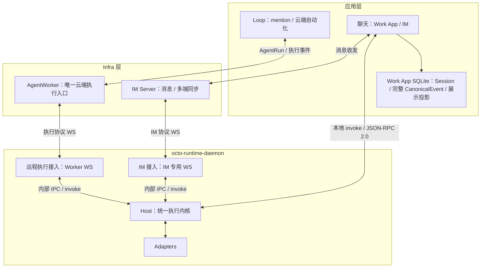

# Infra 瘦身：AgentWorker 作为唯一云端执行入口

日期：2026-10-13。当前分支破坏性更新，不迁移历史执行数据，不提供旧协议回退。

## 1. 最终责任边界

撤销 `octo-agent-access`。服务调用方使用 `octo-agent-worker` 完成 Agent 配置、Runtime 注册、寻址、单次 AgentRun 与执行交互。依据 2026-10-13 后续澄清，指定单个 Agent 的 TriggerEvent 接入与一对一调用记录从 Access 迁入 Worker，保存谁、在什么情况下、发起了什么调用。Automation、TeamSession、handoff、Webhook 编排进入 `octo-agent-app-loop`。

本地助理和 IM 都调用本机 Host。Work App 普通聊天不会先创建 Loop WorkExecution，再订阅云端 SSE。Loop 仅负责其自身云端业务，例如 mention、任务、讨论、定时器和 Webhook。

图中的 IM Server 属于聊天基础设施，不等于已撤销的 Access。IM 专项的群聊和 GROUP.md 扩展范围见 [Channel 专项](26-channel-local-stream-and-ack-plan.md)。

## 2. Worker 保留与删除

唯一根 DDL `octo-agent-worker/migrations/001_init.sql` 保留 7 张应用表：5 张控制配置表，以及 2 张轻量发起记录表：

| 表 | 用途 |
| --- | --- |
| agents | Agent 身份与配置入口 |
| agent_context_configurations | Context defaults / mandatory |
| runtimes | 已注册设备信息 |
| runtime_credentials | Runtime 身份凭据 |
| runtime_enrollments | 注册流程 |
| event_record | 单 Agent TriggerEvent 的发起事实、身份、输入与幂等键 |
| action_execution | 一对一 AgentRun 调用指针与生命周期状态 |

另有迁移器自己的 `gorp_migrations`、`octo_schema_ownership` 两张元数据表。一次 TriggerEvent 接入新增一条发起记录和一条调用记录；生命周期变化更新调用状态，步骤、delta、工具输出和完整 CanonicalEvent 均不进入这两表。执行内存、交互、准备回执、Runtime 命令与在线租约驻有界内存，心跳和输出事件热路径不逐条写 MySQL。

删除步骤和输出 DDL、持久执行事件 repository、archive、projection、presentation、checkpoint、Redis 事件流、离线自动重派和定时归档删除器。不存在 ACK 后删除执行大表的替代实现，也不把 MySQL 换成另一种云端执行日志库。轻量发起记录不保证输出投递，也不承载 Automation 或 Team 编排。

`octo-agent-access` 不再包含可运行服务、DDL 或部署清单；原数据库及本机网关路由退出运行。

## 3. 本地执行与业务存储

Daemon 的 Host 包装同一个 Adapter Host RPC 内核。远程 Worker 接入、内置 IM 接入和 Embedded SDK 使用同一执行、取消与交互能力。

普通本地调用使用 `agent_run.invoke`：一次 JSON-RPC 2.0 请求启动执行，同一 IPC 连接收到一次响应和后续 `agent_run.event` notification。Embedded SDK 对外暴露 `invoke(adapterType, request): AsyncIterable<CanonicalEvent>`。这不是 HTTP/SSE 包装；`agent_run.subscribe` 只用于已执行 Run 的断线修复，不再次提交执行。

Work App main 是聊天业务的所有者。账户、Space、Owner 隔离的本地 SQLite 保存：

- Session、消息、工作区与 opaque provider session；不把 provider session 等同于 TeamSession。
- 每条完整 `CanonicalEvent` 的 `protocolVersion`、`type`、完整 `payload` 和应用顺序号，包括 delta、工具、交互、终态与扩展数据。
- `run-items`、正文和状态是可重建的展示投影，不代替原始事件；公开界面过滤发生在应用投影层，不能在 Host 截掉原始事件。
- 图片资源由应用保存和校验，再在本地 invoke 中 materialize；不请求已删除的 Worker artifact API。

事件按 64 条或 250ms 的批量事务追加；结束、切换账户前刷新。消息与投影在提交及结束时保存，不每个 token 重写整段会话。没有逐事件 ACK 水位、ACK DELETE、后台自动归档或历史清理器。应用退出异常时，最多尚未提交的一批事件可能丢失；不宣称等同逐事件同步持久化。

重开应用从本地历史读取；未完成投影可从已保存的 CanonicalEvent 重建。缺少终态时明确显示中断，不能凭断流伪造完成。云端业务若需要保存，也由其应用消费事件决定，Worker 不保证业务投递或展示完成。

## 4. 有界内存与故障语义

Host 默认最多 128 个 Run、每 Run 4 MiB / 4096 条事件、总事件 64 MiB、单条 256 KiB、120 秒窗口、16 个 IPC 订阅。达到字节上限可能先于时间窗口覆盖旧事件。Worker 也使用有界内存运行索引与源事件窗口；各层容量独立，不能把两层合计说成只有 64 MiB。

断流后沿相同 `run_id + stream_id + after_seq` 补发。源变更返回 `STREAM_EXPIRED`，窗口覆盖返回 `STREAM_GAP`，已淘汰 Run 返回不可用。SDK 只在已有源身份的连接中断后尝试修复，不能自动重新 invoke。无逐事件 ACK，不需要 SQLite outbox INSERT/DELETE。

Worker/Host 重启后不恢复旧执行事件或副作用。通过 TriggerEvent 发起的调用保留幂等键和原 Run 指针，不重复启动；执行内存已丢失且终态未确认时返回 `RUN_OUTCOME_UNKNOWN`，不能把回执当作可恢复的输出流。普通本地 invoke 的去重由宿主业务管理。需要业务可靠投递的应用自行承担持久状态。取消响应只表示受理，终态仍由执行事件确认。

## 5. Automation、Team 与外部执行扩展

本地规则、设备休眠补跑、通知和保存由宿主业务负责，触发后使用同一本地 invoke。此次不在执行内核增加 Cron。

Loop 保存其云端业务 Event、Trigger、Automation、TeamSession、Webhook 与业务结果，生成冻结的 Context 后提交 Worker 单次 Run。Loop 自己消费原始执行事件、管理 handoff、重试、完成判断和业务 SSE。Worker 不理解协作拓扑或自动启动后继 Agent。

保留 `agent_source=preset|provisioned` 表达定义来源；独立 `execution_target.target_kind` 表达 `standard_harness_agent | ability_provider`。外部能力目标使用 `executor_id` 和 `provider_binding_ref`，不强迫伪造 Runtime。没有安装执行器时返回 `EXECUTOR_UNAVAILABLE`，不能伪造成功或转为本地执行。Dify 仅为后续协议消费者示例，不属于本轮联调验收。

Run 保持 7，Context 保持 `octo.context-envelope/v3`。环境覆盖使用已定义的 Context 扩展，不另造顶层结构或版本回退。已识别字段、mandatory、身份及授权约束继续校验。

## 6. 验收

1. Worker 根 DDL 只有 7 张控制配置表和 2 张轻量发起记录表，无步骤、输出、归档大表及自动删除执行数据逻辑；表行数不随输出事件条数增长。
2. Access 服务、DDL 和网关入口退出；业务代码位于 Loop 或宿主应用。
3. Runtime 真实注册、远程单 Run、普通本地聊天都能执行；本地聊天不创建 Loop 执行、不请求云端 Run SSE。
4. 本地 SQLite 与实际 invoke 的完整 CanonicalEvent 相等，能重开会话；正文 delta 和 run-items 只是投影。
5. 断线修复不重复执行；过期和缺口明确报错，不用持久 outbox 或逐事件 ACK。
6. 构建、测试、协议/OpenAPI 检查和真实 im-test 验证完成后提交并推送当前分支。
