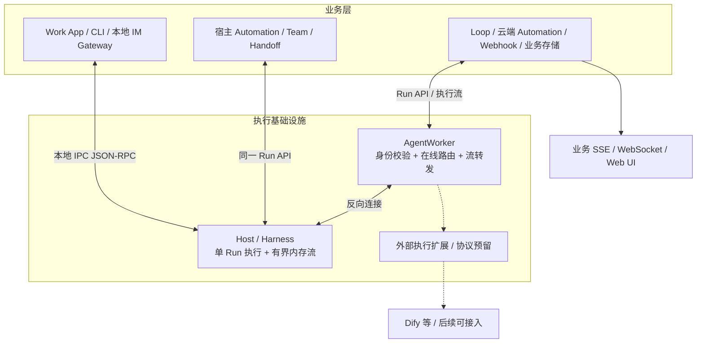

# Infra 瘦身方案：只保留 AgentWorker 的执行边界

日期：2026-10-13。状态：评审提案，尚未实施。

关联专项：[Channel 本地化、内存续流与 ACK 评估](26-channel-local-stream-and-ack-plan.md)。

## 1. 结论与最新约束

目标可实现：业务负责触发、编排、消费、展示与保存；Infra 提供一次 AgentRun 的执行能力和事件流。最终保留 `octo-agent-worker`，撤销 `octo-agent-access`；不把 Access 的业务模块整体搬到 Worker。

以本次讨论的最新澄清为准：

- 云端执行链路不持久化 evt、AgentRun、步骤、终态账本或输出。不采用“仍然每次写两张轻量表”的折中。
- 本地事件传输不通过 SQLite outbox 保证可靠性，不逐事件 INSERT，也不因 ACK DELETE。
- Host 在有界内存中保留运行状态与短窗口事件，支持连接断开后的补发；不承诺 Host 重启后恢复历史流。
- 记录步骤是显式打开的诊断能力，默认关闭；业务历史由发起方自行消费和保存。业务保存不能反向成为 Infra 接收、执行或结束 Run 的条件。
- TeamSession、handoff、排程、Webhook、IM 投递均属业务。Worker 不保证上层业务完成或消息送达。
- 保留 Agent 类型区分与外部执行扩展合同，允许后续接入 Dify 等服务；本轮只交付协议预留，不实现 Dify Driver，也不进行 Dify 联调验收。

早期材料中的“只保留 evt + agentrun”在这里表示业务可选的记账对象，不再作为 Infra 默认建表要求。现有身份、凭据和 Agent 配置的存储另属控制配置范围；本方案不借此保留任何执行流水，也不擅自删除身份系统。

## 2. 当前代码事实

以下来自当前工作区静态核对，不是线上性能测量。核对时 HEAD：Harness `66704ca`、Worker `af70383`、Access `2c79143`、Channel `2447643`、Work App `557b4f7`、Loop `bc5cda4`；工作区已有改动，HEAD 不是全部文件内容的冻结快照。

| 位置 | 当前事实 | 改造含义 |
| --- | --- | --- |
| [Worker runaggregation](../../octo-agent-worker/internal/runaggregation/aggregator.go) | 合并事件、维护投影、控制事件、checkpoint 与 durable 水位 | 不能只删几张表；必须拆掉云端持久化与输出聚合契约 |
| [Worker 初始化表](../../octo-agent-worker/migrations/001_init.sql) | 包含 agent_runs、run_items、run_checkpoints、run_experience_state、run_archive_claims 等 | 当前已经不是简单的原始事件逐条表；仍有执行与展示状态持久化 |
| [Worker 归档](../../octo-agent-worker/internal/repository/run_archive.go) | 收集多表数据、归档并删除 Run 及关联记录 | 整条执行归档链退出 Infra，不换成另一个强制对象存储归档器 |
| [Access service](../../octo-agent-access/internal/service) | 有 schedule、trigger_evaluator、action_dispatcher、run_observer、team_coordinator | 分别回归宿主与 Loop；不以服务合并掩盖边界问题 |
| [Harness AgentWorkRuntime](../packages/octo-harness-daemon/src/agent-work-runtime.ts) | 每事件写 outbox，等待 received/durable 两类水位；Channel context 提交依赖云端 durable ACK | 本地与云端必须同步改造，否则云端不存后，本地可能持续积压 |
| [Harness 本地服务](../packages/octo-harness-daemon/src/server.ts) | 已有 Socket、查询、取消和 events.subscribe；当前 dispatch 没有通用业务 submit | 复用传输与执行组件，补齐本地执行入口，不能宣称现有接口已经满足业务流 |
| [Work App 会话服务](../../octo-harness-work-app/src/main/agent-conversation-service.ts) | 依赖 Access 会话与 Worker Presentation | 会话业务留在宿主或 Loop，展示改为消费 Host/Worker 原始执行事件 |

本次只新增文档，不修改现有实现。

## 3. 目标拓扑



本机流不绕云。跨设备调用可以通过 Worker；外部执行分支在协议与执行扩展接口中预留，不要求提供方伪造本地 Runtime。图中虚线是后续接入位置，不是本轮需要实现的运行链路。

云端 Channel 服务撤销，Channel 连接器由宿主侧业务运行。第三方只支持公网 Webhook 时，入口归 Loop，后续通过 Worker 路由到在线 Host；不恢复一个集中式 Channel 中台。

## 4. 边界与删除清单

| 能力 | 最终权威 | Worker / Harness 的边界 |
| --- | --- | --- |
| Agent 执行定义、可执行 revision / preset | 控制配置与执行层 | 保留最小身份、配置解析与可信执行快照；产品目录、发布 UI 不进入执行内核 |
| 单次调用、取消、执行超时、交互响应 | 执行层 | 保留；这些不是业务编排 |
| Runtime 在线寻址、连接身份、并发准入 | Worker 与 Host | 运行状态驻内存；断线不自动变更执行目标 |
| provider session / resume | 实际执行端 | 使用 opaque provider session；恢复能力以提供方实际支持为准 |
| Conversation、TeamSession、handoff | 宿主或 Loop | Worker 不存协作图，不根据输出自动发起下一个 AgentRun |
| 产品审批、交付审批 | 业务 | 与 provider 工具执行授权分开；后者的身份与权限校验仍保留 |
| Cron、misfire、Webhook 去重与重试 | 本地宿主或 Loop | Worker 不保存计划，不扫库找待触发工作 |
| IM 地址映射、上下文选择、发卡片、限流、发送重试 | 本地 IM Gateway | Host 只接收已准备输入，输出不携带“必须送到哪个 IM”的策略 |
| 实时正文与工具进度 | 发起方消费 | Infra 只保留规范化事件和必要协议校验，不产生产品 Presentation |
| 历史、产物、摘要、业务回放 | 发起方 | 可以自行保存；无订阅者时也不默认创建云端归档 |
| Skills / Plugin / MCP 安装 | 本地宿主或原生 Runtime | 不经 Worker 分发安装包或修改本机配置 |

### 4.1 Worker 删除或替换

- 删除 `runprojection`、`runpresentation` 及展示查询接口。
- 将 `runaggregation` 的业务投影、checkpoint、云端落库全部移除；仅提取有界转发、顺序校验等通用机制。
- 删除 `runarchive`、执行归档 claim、执行大表生命周期清理及围绕这些表的巡检。
- 移除 AgentRun/事件执行流水 repository；在线 Run 索引、短期去重、取消路由改成有限容量的内存结构。
- `runstreambus`、`runtimetransport` 仅保留必要路由与流控，不得通过 Redis Stream、Redis AOF 或 Kafka 暗中恢复执行日志持久化。
- 删除默认离线队列、自动重派与跨 Runtime failover。目标离线返回明确错误，是否等待及重试由业务决定。

### 4.2 Harness 同时瘦身

不能把 Worker 的胖逻辑全部下沉到 Harness。需要同步移除强制 `AgentWorkStore` 事件 outbox、按云端 durable ACK 收尾的状态，以及 reference Core 的默认执行事件落盘路径；复用 MemoryStore 时还必须补上容量上限，不能把无限 Map 当成瘦身完成。

`team-input.ts` 的团队任务模板、`task-outputs.ts` 的 Loop 交付类型、`agent-work-runtime.ts` 内按业务场景归档产物的分支应移到宿主/Loop 适配层。通用工作区、资源授权、输入准备和 adapter 原生事件翻译继续保留。业务可以提交数据，不应要求执行内核理解 Team/讨论/任务看板状态。

Channel context 的提交从“云端确认归档后提交”改为本地 Gateway 的业务消费决策；是否保存会话历史由 Gateway 自己决定。

## 5. 不持久化之后，执行契约如何成立

### 5.1 一个执行源，两个入口

本地调用与远程调用复用同一个执行内核、Context 校验、adapter、取消机制和 CanonicalEvent。区别只有调用凭证与路由。

每次调用固定一个执行权威：本轮 Harness Run 由目标 Host 持有；协议允许后续外部执行器持有自身 Run。Worker 的路由索引不成为另一个终态权威。本地 Run 不补写云端账本。

AgentSession 是执行会话，不是 TeamSession。会话与正在运行的 Run 在执行端内存关联；相同 provider session 的并发约束在执行端执行。业务需要跨进程恢复会话时自行保存 opaque resume reference，执行端复核身份与来源后再使用。不得承诺整个基础设施崩溃后的会话恢复。

### 5.2 必须保留的运行时语义

以下是建议冻结的接口行为，尚未实现：

| 情况 | 调用方能观察到的结果 |
| --- | --- |
| submit 返回 accepted | 执行端已经接纳到内存，分配 run_id；不是落库成功，也不是业务完成 |
| 同一存活执行端、去重窗口内重复 submit | 相同作用域、idempotency_key 和请求摘要返回同一 Run；摘要不同报冲突 |
| 断开执行流 | Run 继续执行至正常终态、执行期限或显式取消；断流不触发重新提交 |
| 执行端重启、去重窗口过期 | 不保证识别旧请求。返回状态不可确认，业务决定下一步，Infra 不偷偷重跑 |
| cancel 返回已接收 | 表示取消请求已受理；仍须等提供方或 Host 确认终态，不能立即宣称已取消 |
| 接收者追不上事件流 | 按有界队列处理，报告缺口或断开慢订阅；不无限占内存，不拖死 provider |
| 执行错误 | 返回错误响应或终态事件；“不持久化”不等于“不报错” |
| 查询已淘汰的 Run | 返回不可用/已过保留窗口；不能将“查不到”解释为“从未执行” |

建议增加独立的 `outcome_unknown` 查询结果/错误语义，而不是把连接中断伪造为 `failed` 或 `completed`。是否新增 Run 状态枚举需在协议实施时统一，不在文档中当成现有字段。

### 5.3 无持久化与多 Worker 实例

- Runtime 重连后重新发布在线身份及仍存活的 Run 摘要，Worker 重建临时路由。
- 云端多实例通过连接亲和、按 Runtime 定位或仅内存共享注册表找到连接所属实例。不得把全部事件广播给所有实例。
- lease、fencing 等必要的防止旧连接写入的校验仍保留，但不能再依赖永久计数器实现。Host 在存活期间签发/校验连接 incarnation，接纳新控制连接后拒绝旧 incarnation 的命令。
- 执行端重启后使用新的随机 incarnation；旧实例的 Run、订阅和命令不得冒充新实例。若需要跨进程、跨集群的严格排他与崩溃后精确恢复，则已超出本方案的无持久化保证。
- Worker 重启后可重连到仍存活的 Host 续流。外部执行器的恢复能力由后续接入实现声明，不作为本轮交付要求。

业务如果要求“断电后绝不重复调用、绝不丢失结果”，必须自己承担持久任务与幂等副作用；不能同时要求 Infra 零持久化并提供无限恢复。

## 6. 保留 Agent kind 与外部执行协议预留

### 6.1 复用概念，不把历史提案当成当前实现

[历史 TargetKind 方案](../../docs/todo/TODO-0004-targetkind-serverless-manus-platform-plan.md)提出过 `standard_harness_agent | ability_provider`。当前 Worker 的 [Agent 模型](../../octo-agent-worker/internal/domain/agent.go)有 `agent_source=preset|provisioned`，本次检索未发现这两个 TargetKind 的完整落地实现。`agent_source` 回答定义来源，不能替代执行种类。

建议保留历史两类含义，实施时统一字段名为既定的 `target_kind`，不同时新增同义的 `agent_kind`：

| target_kind | 执行方式 | 示例 |
| --- | --- | --- |
| standard_harness_agent | 路由到 Harness，由原生 adapter 执行 | Codex、Claude Code |
| ability_provider | 预留外部执行器调用能力服务的分支 | Dify、约定合同的 HTTP Agent；本轮不接入 |

提供方名称由外部执行绑定表达；Serverless 是服务部署方式，不新增 `serverless_agent` 类型。本轮不引入具体提供方 Driver、Kernel、FaaS 调度和沙箱平台。

冻结后的执行目标采用判别联合：Harness 分支校验 runtime/adapter，外部能力分支预留 provider binding 与执行器标识。外部能力目标不强制填写 runtime_id、工作目录或 Shell 能力，确保以后接入时无需伪造设备身份或重写通用 Run 合同。

### 6.2 预留必须可用，不只保留枚举

本轮协议与通用执行接口需要保留以下扩展边界：

- 请求 schema、生成类型和校验器能表达 `ability_provider` 目标及其授权绑定引用，不在入口统一强制要求 Harness 字段。
- 执行分发接口允许按目标种类接入外部执行器，并复用一次 Run 的事件、错误和终态合同；不把所有请求写死到 adapter/runtime 寻址。
- 外部执行器可以声明实际支持的取消、交互和恢复能力；协议不默认承诺这些能力均存在。
- 提供方的 opaque 会话/运行引用可以通过扩展合同表达，不要求为它们新增 Infra 持久化映射表。
- 没有安装对应执行器时返回明确的执行器不可用错误，不把请求静默转换成 Harness Run。

调用目标与凭据仍来自已授权绑定；凭据不进入模型输入或公开事件。后续业务或提供方接入模块可以实现该接口，无需扩充 Worker 的业务职责。

本轮只校验通用合同能够表达外部目标、通过目标分支校验并到达扩展入口。可以使用通用样例或测试执行器验证合同；不要求真实 Dify 服务、Dify 模式选择、API 映射、流式调用、取消或恢复验收。

Dify 仅作为未来消费者示例，不是本次改造完成条件。

## 7. Automation 与 Handoff 回到业务

### 7.1 本地自动化

```text
宿主保存规则 → 宿主判定触发时刻 → 准备输入 → 本地 AgentRun
                                             ↓
                                  宿主消费流、决定是否保存/通知
```

时区、设备休眠后补跑、并发策略、失败重试、是否后台常驻均由宿主决定。Harness 不内置第二套 Cron，也不要求云端保存规则。

### 7.2 云端自动化

```text
Webhook / 定时器 → Loop 验签、去重、过滤 → RawEvent
→ Loop 准备 Context 与目标 → Worker AgentRun → Loop 消费流
```

RawEvent 是 Loop 的输入事实，Worker 不对任意事件运行规则引擎。一条 RawEvent 可产生零个或多个 Run，映射由 Loop 保持。Loop 是否保存事件及任务由其业务要求决定；Worker 不要求它必须存，也不代存。

目标离线时，Worker 返回不可用；Loop 决定排队、过期或放弃。删除 Worker 的可靠队列，不代表让云端自动化无声丢失触发。

### 7.3 Team / Handoff

宿主或 Loop 消费 A 的输出，按自身策略决定是否启动 B；授权、上下文裁剪、协作图、循环上限、并发、取消传播都在业务层。不能仅凭模型输出的任意文本自动取得执行 B 的权限。

多 Agent 的流合并、排序和给终端的 SSE 由业务完成。若复用现有协调器，提取为业务库，由宿主/Loop 持有状态；不得新增一个 Worker 内全局 TeamSession 引擎。

## 8. Context、envs 与日志

Run 继续 `schema_version=7`，Context 继续 `octo.context-envelope/v3`，不引入旧版兼容、双写或回退。附带建议中的 Context 示例与当前结构不符：当前顶层是 `schema` 和 `items`，不是 `schema_version`。

`envs` 不是完成瘦身的前置条件。若同期实现，建议放入明确的执行配置扩展，经 schema、校验器、hash、冻结计划、生成类型和 adapter 同步处理；不直接把敏感键值加进可能进入模型的通用 Context。

环境变量只作用于该次受控子进程，不修改共享 `process.env`。受保护变量由宿主策略拒绝覆盖；密钥采用引用解析，不进流、日志和业务快照。外部能力协议不把 `envs` 当成修改远端服务器环境的能力。

默认只保留有界运行指标及不含正文的错误摘要；步骤诊断默认关闭。可选诊断 sink 必须有字节、时间和队列上限，排障记录不能成为执行依赖。不默认上传 token delta、私有推理、工具完整输出或凭据。

## 9. 长期容量目标

本方案通过“不产生执行数据库记录”和“所有临时状态有上限”控制容量，不承诺 SQLite/MySQL 本身一定慢，也不以换存储代替减少职责。

内存预算至少覆盖：活动 Run 数、每 Run 环形缓冲、全局缓冲、单帧、订阅数、每连接待发送字节、已完成 Run 短期保留、幂等缓存、指标标签基数。任何一项都不能无界。

预算示例及压测设计见 Channel 专项。超限时报告具体错误/缺口；不得自动创建磁盘 outbox。日志服务故障、业务不消费、Worker 断线均不能形成无限积压。

原建议中的“几年都不会崩”“删除逻辑必然崩”“每 Run 只会 1～2 次写”等说法没有实测支撑。即使只存 2 KB/Run，每天一万次也约 7.3 GB/年，还未计副本和备份；本方案不采用这条存储路径。

## 10. 实施顺序与完成条件

遵循当前仓库的统一基线，按一次破坏性切换实施，不建设旧协议兼容或双写。下面是实施计划，不是本次已经执行的操作。

P1～P4 是开发交付批次，不表示可以分别上线不兼容的半条链路。涉及 outbox、云端持久化和 ACK 的变更必须协同切换，不能先停云端落库，再让旧 Harness 继续等待 durable ACK。

| 阶段 | 交付 | 完成条件 |
| --- | --- | --- |
| P0 合同冻结 | Run 权威、无持久化边界、内存续流、错误与去重窗口、外部执行扩展 | 文档、生成类型与消费者对同一保证达成一致；外部目标合同可表达并通过分支校验 |
| P1 本地执行与流 | 同一执行内核的本地 submit/subscribe/cancel；删除强制 outbox | 单机不经 Worker 可执行；事件路径 SQLite 写入为零；断线窗口内能续流 |
| P2 Channel 专项 | 本地 Gateway 与 Work App 接入 Host | 本地无云 SSE；IM 投递状态由 Gateway 持有；详见专项验收 |
| P3 业务迁出 Access | 宿主/Loop 接管 Automation、Conversation、Team、handoff | 两类自动化与 Team 均可独立运作；调用方不再依赖 Access |
| P4 Worker 瘦身 | 云端无 Run/事件/终态持久化，删除聚合归档与清理链 | 执行 SQL/对象存储写入为零；Worker 重启不会偷偷重派 Run |
| P5 停服与清理 | 删除 Access、云端 Channel 部署与配置引用 | 无消费者依赖，更新各仓库 AGENTS/架构文档及部署清单 |

本次只写方案，不删除数据库、不停服。实际切换前列明实例、库、自有运行状态及保留业务数据，先停止接单并处理在途 Run。切换失败可停止新流量并修复；重启旧服务不能恢复本方案已丢弃的内存事件，不宣称无损回滚。

跨仓库实施应同步 Worker、Harness、Work App、Loop 的协议与生成代码，构建并重启受影响进程；真实接口验证遵循 im-test/octo-auth 约束。不得把本机测试写成云端部署完成。

## 11. 总体验收

- 无本地/云端事件 outbox；无 Infra AgentRun、evt、终态、展示投影与归档持久化。
- Host 存活且窗口内断线，补发缺失事件后接上实时流；过窗或重启明确返回缺口/过期。
- 无订阅、慢订阅、长时间断云时内存受限，执行端不等待云端 durable ACK。
- 本地 Run 不经过云；远程 Run 只走必要路由；同一请求不会因流断开自动执行第二次。
- 宿主与 Loop 独立拥有各自自动化与 Team 状态，Worker 不理解其业务转移。
- 外部目标可经通用合同表达并到达执行扩展入口，不强制伪造 Runtime；未配置执行器时显式报错。Dify 实现与联调不在本轮验收范围。
- 业务消费失败不改变已经确认的执行终态；IM 发送失败由 Gateway 处理。

后续实施前仍需确定的是容量预算与窗口时长。这些不影响“云端零执行持久化、本地无 SQLite 续流 outbox、默认无逐事件 ACK”的推荐结论；外部提供方的具体接入另行安排。
