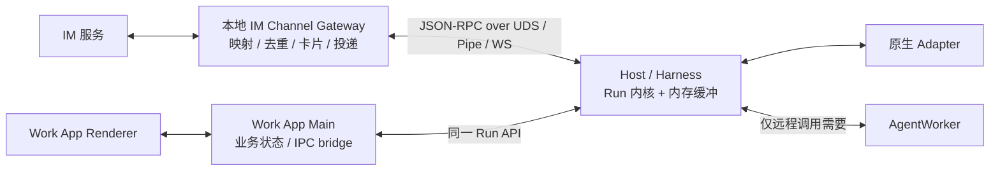

# Channel 专项：Host 本地流、断线续传与 ACK 取舍

日期：2026-10-13。状态：已实施第一阶段；下列验收范围之外的条目仍为目标方案。

关联总方案：[Infra 瘦身与 AgentWorker 边界](25-thin-infra-agentworker-plan.md)。

## 当前实现与验收范围

- Worker WS 已移入 `octo-harness-worker-access`；IM WS 位于 `octo-harness-im`。Daemon 装配两者，执行共用 AdapterHostRpc 与 adapter-host。
- 本地 IM 直接执行，不调用旧 octo-agent-access，不从 Worker 获取 SSE。eventId/runId 由本地创建，云端登记不在本轮实现内。
- `HostRunService` 提供本地 submit/invoke/subscribe/get/cancel/respond。源事件过滤私有 analysis 后分配连续 seq，按 Run 保存 stream_id；单 Run 4 MiB/4096 条、全局 64 MiB、最多 128 Run、120 秒窗口、最多 16 订阅。覆盖或过期明确返回 gap/expired，不自动重跑。
- 订阅采用一次 JSON-RPC 响应和后续 notification；关闭专用 socket 释放订阅。目前无独立 unsubscribe 方法和公开 WS listener。本地授权沿用 Home socket/OS 用户边界。
- Worker 事件 outbox 已改为有界内存；Core 的逐事件记录默认不落盘，显式诊断开关可启用。既有身份、Run/Session 摘要和诊断日志不属于聊天历史清理范围。
- IM 私聊最小链路已完成真实 im-test 入站、Codex 执行及服务端回发验证。自动测试覆盖会话复用和重置；群聊、GROUP.md、卡片、typing、跨进程崩溃恢复未实现。Work App 全部业务页面迁移和极限负载验收不在本轮完成范围内。

以下正文保留设计依据和后续目标；第 3、5 节描述改造前的成本和差距，不应当作当前实现声明。

## 1. 直接回答：不要用 SQLite 换取短暂断线续流

推荐采用 **Host 有界内存缓冲 + 源事件序号 + 客户端重连游标**。默认不做逐条 ACK，也不做定时累计 ACK，不写事件 outbox，不等云端 durable ACK。

IM Channel Gateway 连 Host 的 WS/IPC 断开后，只要 Host 进程仍存活、缺失事件仍在缓冲窗口内，Gateway 就能重连补发，然后继续接收新事件。传输换成 UDS 不改变这套语义。

这个保证是“短窗口连接恢复”，不是“进程崩溃后的持久消息队列”。不持久化、有界内存、无限时间零丢失三者不能同时成立。

## 2. ACK 到底是否必要

ACK 是确认语义，不天然意味着写数据库。当前系统把 ACK 与本地/云端持久化捆绑，才产生了大量存储操作。

| 机制 | 解决的问题 | 本专项建议 |
| --- | --- | --- |
| TCP 的可靠传输 | 同一连接内字节可靠有序 | 继续使用；无法代替跨连接重放 |
| JSON-RPC submit/cancel 响应 | 命令是否接纳，参数是否有效 | 保留；这不是逐事件 ACK |
| 逐事件应用 ACK | 确认每条事件被消费 | 默认不要；短窗口续流不依赖它 |
| 定时/按条数累计 ACK | 发送端获知消费进度、实施端到端 credit 流控 | 第一版不要；仅在压测证明必要后加入内存级 flow-control，不写数据库 |
| reconnect 的 last_seq | 告知上次已接收的连续位置 | 保留；只在重连时传，不需要为每条事件返回消息 |
| durable ACK | 确认数据已持久化，允许删 outbox | 删除；没有持久化目标就没有这个水位 |
| IM API 发送/更新回执 | 消息是否被 IM 服务接纳 | Gateway 业务负责，不向执行层冒充“Run 已持久化” |

因此准确结论是：**无需 ACK 驱动的可靠 outbox；需要重连时报告接收进度。** 不把正常连接的发送成功当成业务消费完成。

## 3. 改造前的 SQLite 成本：有证据的部分与未测部分

核对路径：

- 旧 AgentWorkStore（参考快照位于同级 octo-channel-design-reference）：`allocateAndAppend` 每个事件执行 `BEGIN IMMEDIATE`、INSERT、更新 Run 序号、COMMIT。
- 同文件 `advanceReceived` 更新 SQLite 的接收水位；`advanceDurable` 在事务中更新 durable 水位并按累计序号 DELETE。删除是累计批量删除，不是每条 ACK 都只删一条。
- [SQLite 初始化](../packages/octo-harness-core/src/sqlite.ts)：使用 Node `DatabaseSync`、WAL、`synchronous=FULL`。
- 旧 AgentWorkRuntime：逐事件调用上述写入；终态与 Channel context 提交受云端 durable ACK 约束。

设每秒产生 E 条事件，每秒推进 A 次 ACK，现有事件入站约产生 E 次事件事务；另有接收水位更新、durable 事务、发送查询和最终清理。ACK 已有累计语义，因此单纯降低 ACK 次数不能消除 E 次事件事务。

同步数据库调用位于事件处理路径，会占用所在 JS 线程；WAL/FULL 还包含耐久同步成本。实际延迟取决于磁盘、事件大小、并发和 checkpoint，**本次未做压测，不能给出吞吐下降百分比，也不能断言 SQLite 必然成为瓶颈**。

既然产品不要求落盘与崩溃恢复，就没有必要为这条保证付成本。推荐直接移除事件持久化，而非先调 SQLite、换库或做更复杂的删除器。

## 4. 本地架构与职责



同一宿主内可直接调用 SDK；跨进程优先复用现有 UDS/Windows Named Pipe；确需 WebSocket 时仅监听 loopback 并鉴权。IPC 不是“任何本地进程都可信”。

Work App main 接入 Embedded SDK。renderer 经现有唯一 `window.octoWork` preload 桥与 Provider 注入的 Port 取能力；kit 不直接访问全局桥，不在 renderer 放 token，也不再造 `window.octoChannel`。

Gateway 自己处理 IM 消息到 Context 的转换、线程/会话对应关系、发送限流、卡片更新和业务消费游标。Host 不持有 IM 投递队列，不把 IM 历史变成自身必存数据。

本地化不意味着 IM 服务本身离线可用。仅当本地配置、身份授权和所选 provider 均可用时，本地执行才可不依赖 Worker；需联网的模型和 IM API 仍然需要网络。

## 5. 可复用的代码与必须补齐的差距

| 当前组件 | 可以复用 | 不能直接宣称已有的能力 |
| --- | --- | --- |
| Harness `server.ts` | Socket 生命周期、取消、流写入与 drain 控制 | 当前 `{id,event}` 多行输出不是完整 JSON-RPC 2.0 notification 合同；缺通用本地 submit |
| Harness `live-event-bus.ts` | 有界 Buffer、固定 slot、订阅数量限制、gap 和背压处理思路 | 当前是观测流，混合多个 source；没有业务级 after_seq 续流接口，不能原样给产品消费 |
| Embedded SDK | 宿主管理的 Daemon 进程、账户隔离、Windows Pipe | 当前注册/健康仍有云连接语义，要分离本地可执行与云连接状态 |
| Work App `agent-conversation-service.ts` / `team-streams.ts` | 宿主事件桥与业务视图 | 当前依赖 Access 状态流和 Worker Presentation，需改为业务自身模型 |
| Channel `internal/clients/worker/stream.go` | 流解析错误处理思路 | 当前云 SSE 注释明确中间进度不回放，不能满足 Host 源窗口内按序补发 |

当前 LiveEventBus 默认 6 MiB、8192 slots、16 subscribers，是观测模块的现有限制，不是本方案的业务容量结论。新的业务流应复用有界缓冲基础，而非复制 provider-native/调试内容或复用无作用域的全局观测订阅。

## 6. 建议协议：一次响应，后续通知

JSON-RPC 2.0 规定请求、响应和 notification，不规定“重复返回同一 id 的 result”这种流式扩展。建议使用一次订阅响应，加不带 id 的事件通知。[JSON-RPC 2.0 规范](https://www.jsonrpc.org/specification)

以下方法和字段是目标提案，不是现有接口声明。Run 请求仍复用 Run=7 与 Context=v3 的业务无关执行合同。

| 方法 | 含义 |
| --- | --- |
| `agent_run.submit` | 校验并接纳执行；可原子创建发起者订阅，避免快 Run 在首次订阅前完成 |
| `agent_run.subscribe` | 校验作用域后按 run_id、stream_id、after_seq 补发并持续订阅 |
| `agent_run.get` | 查询执行端仍保留的内存状态，不查云端历史库 |
| `agent_run.cancel` | 请求停止同一执行权威上的 Run |
| `agent_run.respond` | 回答仍有效的交互/审批请求，验证调用者与请求身份 |
| `agent_run.unsubscribe` | 释放订阅，不等于取消执行 |

建议重连请求：

```json
{"jsonrpc":"2.0","id":"sub-2","method":"agent_run.subscribe","params":{"run_id":"run_demo","stream_id":"stream_demo","after_seq":120}}
```

窗口可用时先返回：

```json
{"jsonrpc":"2.0","id":"sub-2","result":{"subscription_id":"sub_demo","stream_id":"stream_demo","oldest_seq":90,"latest_seq":135}}
```

随后补发 121 至当前尾部并继续推送：

```json
{"jsonrpc":"2.0","method":"agent_run.event","params":{"subscription_id":"sub_demo","run_id":"run_demo","stream_id":"stream_demo","seq":121,"event":{"type":"message.delta","payload":{"text":"继续输出"}}}}
```

示例省略了连接鉴权握手与完整事件字段；不得将 run_id 或 stream_id 当作读取权限。实际字段必须同步 schema、生成类型和全部消费者。

### 6.1 序号与身份

- `stream_id` 标识源执行流 incarnation，同一 Run 的 WS 重连不改变它；Host 重启不能复用旧 stream_id。它不同于当前云 SSE 每连接变化的 stream_id。
- `seq` 在同一源流内连续递增，先分配序号、写内存 ring，再通知消费者；重放沿用原序号，不重复调用 adapter。
- 序号分配在业务可见事件的规范化与敏感信息过滤之后；不直接使用混有私有观测事件的全局 local_seq，避免正常过滤被误判为丢帧。
- `subscription_id` 标识本次订阅，可随重连变化；不能用于去重执行事件。
- 客户端只在校验帧并交给自身有界消费队列后推进“最后连续接收序号”；不能收到 125 就忽略 121～124 的缺口。
- Gateway 接收游标与 IM 投递状态分开。接受进内存队列不等于用户已在 IM 看到消息。

### 6.2 重放与实时流切换

Host 先建立订阅并确定当前高水位 H，再让该订阅从 after_seq+1 沿同一 ring 游标读取；到达 H 后继续等待新事件。整个期间序号规则不变。

不得先复制旧数据、结束复制后才挂实时 listener，那样会丢掉两步之间到达的事件。也不得为每次重连复制整个 ring，导致内存乘以订阅数。

如果回放时 ring 已被覆盖，立即报告 gap。消费者以 `(stream_id, seq)` 去重；不保证重复通知永远不会发生。

### 6.3 返回缺口，避免无声“接着显示”

建议错误 `STREAM_GAP` 携带 requested_after_seq、oldest_seq、latest_seq。默认拒绝声称完整续流；Gateway 可以明确接受缺口后从当前窗口重新订阅，并在自己的业务视图提示内容不完整。

Host 重启或 Run 已淘汰时返回 `STREAM_EXPIRED` / `RUN_NOT_AVAILABLE` 等明确语义；最终错误名在协议实现时冻结。不因历史流不可用而自动重新发起 Run。

after_seq 大于源尾部、游标与 stream_id 不匹配、跨租户读取都返回错误。断线不是错误终态，缺口也不能伪造成功。

## 7. 不需要逐条 ACK，如何回收与流控

ring 按字节、条数、时间共同限制，达到任一上限就淘汰最早事件；**回收不等待任何消费者 ACK**。时间窗是最大保留时长，字节或条数先到上限时，实际可补发时间会更短。

每个消费者只持一个游标和有界发送状态。独立限制订阅总数、socket 缓冲和单消费者待发送字节；慢消费者不能 pin 住无限旧帧。超限则断开慢订阅并提供重连/缺口语义，不把压力无限传回 adapter。

WebSocket 的 TCP 背压不代表业务消费完成；结合库的待发送字节、排队数量及写超时控制内存。若真实压测表明客户端内部队列无法靠这些限制控制，再加入按批 credit/累计消费通知；通知只更新内存，不等待 durable，也不改变 ring 的硬上限。

终态与待响应交互采用独立、限量的控制状态保留，避免普通 delta 挤掉刚完成的状态。终态保留同样有 TTL、字节与条数上限，不为每个历史 Run 永久 pin 一条记录。可以查询“已完成”，不代表可以重建已淘汰的完整正文。

Run 完成后仅在配置窗口内保留尾部事件；Host 不聚合完整 transcript，也不为续传创建产物归档。发起方需要完整历史时自行消费保存。

## 8. 断线场景与保证范围

| 场景 | 预期行为 |
| --- | --- |
| WS/UDS 短暂断开，Host 与 Gateway 均存活 | Gateway 带内存游标重连，窗口内补发后继续实时流 |
| Gateway 重启，Host 存活 | 若业务仍掌握 run/stream 引用，可从 Host 现存窗口读取；没有旧游标则不能保证投递不重复 |
| Host 重启 | 内存流丢失；不承诺恢复，禁止把旧游标接到另一条新流 |
| 断线期间超过字节/条数/时间限制 | 显式 STREAM_GAP，不承诺补齐全部 token |
| Run 在断线期间结束且仍在窗口内 | 补发包括终态的尾部，然后结束订阅 |
| 只剩终态、正文已淘汰 | 返回可确认的终态，正文缺失由业务显示；不伪造完整答案 |
| Worker 重启，但 Host 存活 | 重新发现 Host 后按源 stream_id/seq 补发；Worker 不能用自己的临时接收水位充当终端游标 |

一条远程链路可以是 Gateway/Loop → Worker → Host。续流游标必须一直指向 Host 源流；中间 Worker 不负责保存全部事件或确认终端业务消费。

外部能力仅预留通用执行协议；Dify 等提供方的续流、取消与恢复不属于本专项实现或验收范围。

## 9. IM 投递不是流 ACK

Gateway 负责把事件转换为 IM 消息。优先在同一业务消息/卡片上做增量更新，利用渠道实际提供的消息身份或幂等机制，避免补发 token 变成重复发消息。

若 IM API 超时但可能已发送成功，Gateway 查询或按渠道幂等规则处理；不能要求 Host 重跑 Agent。没有渠道幂等与持久投递记录时，不承诺 Gateway 崩溃前后 exactly-once。

业务可选择本地保存少量投递记录或最终消息，也可完全不保存；这是它自己的产品取舍，不是基础设施强制写 SQLite 的理由。

第三方 IM 若只接收公网 Webhook，Loop 负责入口与验签，Host 在线时再触发本地执行。Host 离线的排队策略归 Loop。不要把本地 Channel 的无云执行流误解为外部 Webhook 无需公网入口。

## 10. 容量模型与性能验证

近似有效补发窗口：

```text
T_effective ≈ min(TTL, B_run / R_bytes, N_run / R_events)
总载荷内存 ≤ B_global
总实际内存还需计入索引、帧对象、控制状态和连接发送缓冲
```

下面只是供压测的起始候选，不是已承诺默认值：每 Run 4 MiB、4096 帧、最多 120 秒，全局事件载荷 64 MiB。

| 输入速率假设 | 4 MiB 可容纳的时间 | 含义 |
| --- | --- | --- |
| 20 帧/秒，每帧 1 KiB | 约 205 秒 | TTL 先到，最多约 120 秒 |
| 100 帧/秒，每帧 2 KiB | 约 20.5 秒 | 字节先到，不能宣称稳定续传两分钟 |
| 20 个 Run 均占满 4 MiB | 需求 80 MiB | 已超全局 64 MiB；必须公平淘汰/准入并显式报告 gap |

推荐实现前做一组隔离压测，不改用户实际数据库、不向真实 IM 发压测消息：

1. 对照当前 SQLite outbox、纯内存 ring；必要时增加“纯内存 + 累计流控”作为比较项。
2. 固定输入帧序列与大小，覆盖 1/10/50 个并发 Run、大小混合事件、终态与交互。此为测试负载，不是容量承诺。
3. 注入短断线、超窗断线、慢订阅、无订阅、Host 重启、Worker 重启。
4. 记录事件路径 SQL 次数、WAL 写入字节、事件循环延迟、CPU、RSS、生产到接收 p50/p95/p99、gap/重复帧数量和 terminal 可达性。
5. 单独验证真实 adapter 与 im-test 链路，确认 IM 卡片增量更新、取消、切租户和断线提示；压测吞吐不能代替端到端验证。

推荐方案的确定性门槛是：事件传输 SQL 写入为零、窗口内补发序号完整、超过窗口必报 gap、达到预算后内存趋于有界。性能阈值在取得设备与业务基线后确定，不在这里编造“微秒响应”或“提升百分比”。

## 11. 实施步骤

1. 冻结源流身份、序号、重连、缺口和命令响应合同。明确默认无事件 ACK，无持久化。
2. 将 Run 接纳、执行、取消与源事件发布提取为本地/远程共用执行入口，保留身份、授权、mandatory 和准备回执校验。
3. 为业务流增加有界 ring 与 after_seq 订阅；复用现有传输和有界缓冲基础，保持观测流与业务流权限隔离。
4. 删除 AgentWorkStore 事件 outbox、received/durable 水位持久化及其清理；同步移除 Worker 对 durable ACK 的依赖，不能伪造 durable ACK 来让旧客户端删数据。
5. 改造 Channel context 成功提交，解除对云端终态归档授权的依赖，由本地业务确认自己的上下文消费。
6. Work App/Gateway 接上 Host；不再拉云端 Presentation SSE。业务会话、Team 和 IM 投递仍由各自服务持有。
7. 更新配置、schema、生成类型、样例与测试，同步构建并重启相关进程；通过隔离压测和真实链路验证后停用云端 Channel。

不做旧 outbox 双写，不设计旧/新协议自动回退。在途 Run 的处理和旧数据库删除范围由实施清单明确；本次文档不会执行删除。

## 12. 专项验收

- 同机 Work App 与 Gateway 均从 Host 取流，不经过云端 SSE。
- submit 超快完成时首个订阅仍能收到窗口内事件，不存在订阅竞态。
- 在 120 后断线、源推进到 135，窗口有效时从 121 补发；后续实时帧顺序连续。
- 重连不重新调用 adapter；重复帧不会造成重复追加已消费内容。
- 过窗、错误 stream_id、Host 重启明确失败，不自动重跑、不静默漏字。
- delta 不写 SQLite/MySQL/对象存储；无消费者或云端断线不创建磁盘队列。
- 慢订阅与高并发下 ring、连接缓冲、控制状态和去重缓存均有界。
- 取消、审批响应与租户隔离有效，旧连接/旧 Space 无法控制新 Run。
- IM API 失败不改变 AgentRun 已确认终态，Gateway 独立呈现投递结果。

本专项推荐第一版不增加任何正常流期间的事件 ACK。若未来增加内存级累计流控，需要给出压测证据；跨 Host 重启零丢失则属于新的可靠性需求，不能以“续流优化”为名重新引入强制持久化。
