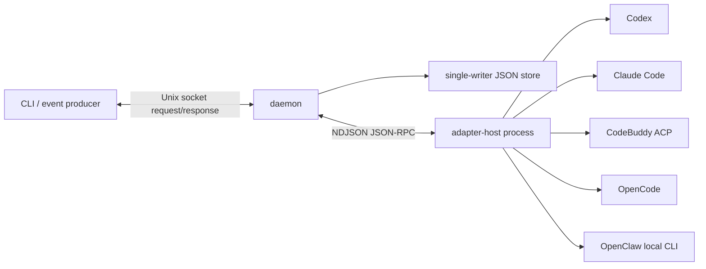
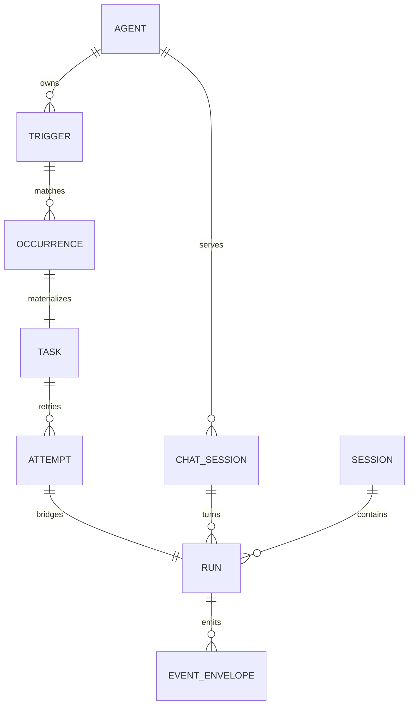

# Architecture

本页描述当前可运行的单机架构。保持 Core/Adapter 契约不变的跨云节点演进方案见 [Transport And Multi-node](transport-and-multinode.md)。

## Process Boundaries



CLI 不读写 workdir 内的状态文件，也不直接启动 provider。daemon 是 Chat/Task/Trigger/Run 的权威写入者；adapter-host 只拥有 invocation 生命周期和 provider 子进程。manifest 决定 host 加载哪些 adapter，daemon 只依赖公共 host client。

## Domain Model



- Chat Session：连续对话和 provider session binding，不含 Task orchestration 字段。
- Task：持久工作项，由 trigger occurrence 产生或继续。
- Attempt：某个 Task 的第 N 次执行，保存 trigger/comment source。
- Run：一次 provider invocation，Chat 与 Task 共享。
- Session：`chat|task` 分类、单 active run、opaque provider session。
- Trigger/Occurrence：规则定义与一次实际发生分离；后者承担幂等键。

## Trigger To Run

1. `materializeTrigger` 检查 `(triggerId, externalEventId)`。
2. 新 occurrence、Task、Task Session 在一次 store commit 中持久化。
3. `queueTask` 建 Attempt/Run，先写 `run.queued`。
4. daemon 返回 `taskId/runId`，通过 `setImmediate` 后台执行。
5. `executeRun` 写 `run.running`，构造显式 InvokeRequest。
6. host 迭代 adapter stream，daemon 按 seq 追加 envelopes。
7. terminal event 更新 Run/Attempt/Task，释放 session active run。

Event trigger 只做匹配；interval trigger 只产生 occurrence。二者都不能直接调用 host。

## Canonical Event Contract

```text
run.queued -> run.running
session.update?
message.create -> message.delta* -> message.update
tool_call.create -> tool_call.delta* -> tool_call.update
usage.update*
run.finished | run.error | run.stopped
```

Host 执行以下约束：

- adapter terminal 暂存到 stream/cleanup 成功后才发布。
- adapter 无 terminal 退出时合成 `run.stopped`。
- provider/cleanup 异常合成 `run.error`。
- cancellation 只收敛为一个 `run.stopped`。
- final/analysis channel 各有稳定 `messageId`。
- delta 前缺 create 时补 create；terminal 前 open message 自动补 update。

Gateway envelope 再增加 `id, seq, tsMs, sessionId, runId`。store 以 `(runId, seq)` 幂等追加。

## Session Identity

三个 ID 不应合并：

- Harness Session ID：Chat/Task 的稳定会话。
- Harness Run ID：一次 turn/attempt。
- Provider Session ID：Codex thread、Claude UUID、ACP/OpenCode session 或 OpenClaw local session ID。

adapter 通过 `session.update` side channel 上报 opaque `providerSession`；core 保存到 Session，下一轮放回 InvokeRequest。Task continuation 和 Chat next turn 因而都能恢复 provider context，同时拥有新的 Harness Run/event seq。

## Persistence And Recovery

`JsonFileStore` 把所有 Map 写入 versioned JSON，使用 `0600` 临时文件 + atomic rename。daemon 是单 writer。重启时：

- queued run 重新入队。
- 已 materialize 但尚无 run 的 queued Task 补建 Attempt/Run 后入队。
- 失去 provider process 的 running run 终止为 `run.error(code=daemon_restarted)`。
- terminal run 原样保留。

生产替换点是 store 接口，不是 adapter：使用关系数据库事务、outbox、worker lease/fencing 和事件总线即可保留领域边界。
