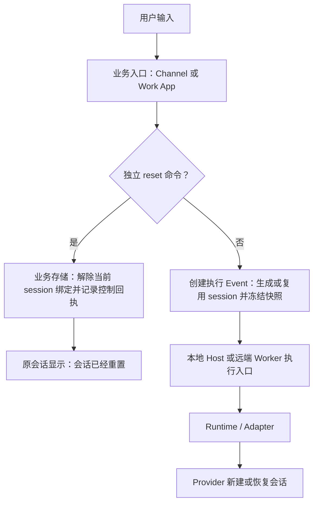

# 业务会话、执行 Session 与本地 Reset：IPD-SE 方案

版本：0.2。日期：2026-10-14（Asia/Shanghai）。状态：已实施，验证范围见第 12 节。

本文采用项目裁剪的 RR → SR → FEAT → AC → WP 追踪链。范围覆盖业务 Event 发起方、全部已接入 IM Channel、Octo Work 本地会话、Loop 会话入口、Worker、Runtime 与 Adapter。第 8 节区分已核对源码和待盘点部署，不把历史架构文档中的服务名称当作当前运行事实。

## 1. 决策与范围

### 1.1 已确认的方向

1. `conversation_id` 是稳定的业务会话身份。业务方可以使用群聊、子区或私聊地址构造该标识，无须向 Runtime 申请一个 conversation UUID。
2. 业务方拥有 `conversation_id → 当前 session_id` 的映射。Channel 插件、Octo Work main 和云端会话业务服务，分别管理自己拥有的会话；Worker、daemon 和 Adapter 不接管该映射。
3. 业务方在构造触发 AgentRun 的 Event 时确定执行 `session_id`，并随 Event 冻结。首次执行生成；普通续聊复用；reset 后生成新的值。同一 Event 重投不得重新生成。
4. 简单接入方可以省略 `session_id`，此时按 `conversation_id` 确定本次执行会话。已支持 reset 的官方入口必须显式发送执行 session，不能在 reset 后漏传并回到旧默认值。
5. `/reset` 由业务入口拦截。成功后返回固定正文：**会话已经重置**。命令自身不创建 AgentRun，不进入模型输入，不产生模型计费。
6. Octo Work 本地会话的 reset 完全在本机完成：通过本地 IPC 更新 SQLite，并生成本地控制提示；不请求 Worker、云端 Event 接口、Runtime invoke 或 Provider。后续普通消息才触发执行。
7. reset 保留 `conversation_id`、聊天历史、既有 Run 与产物。业务方决定新 session 首轮需要提交哪些背景；底层不得从旧 Event 或聊天记录自动补背景。

### 1.2 本方案选择的具体实现

为落实“在发起 Event 时生成”，本方案采用**延迟分配**：reset 先持久化“待新建 session”，下一条普通输入形成执行 Event 时再分配新 ID。reset 成功表示旧 session 已不再被后续新 Event 选用，不表示已经创建 Provider 会话。

具体流程是：`S1 → reset → pending → 首次新 Event 分配 S2 → 后续 Event 复用 S2`。这不是每个 Event 都生成一个 session。若在 pending 状态连续 reset，可以继续记录控制操作，但无需预建多个空 Provider 会话。

活动 Run 不隐式取消：Work 保持 busy 接纳规则，IM 保持 conversation 执行队列。Loop reset 清空该 conversation 的全部目标绑定，不修改 Team 编排身份。群聊沿用入口既有身份和权限规则。

### 1.3 不扩大的范围

- reset 不等于取消执行、删除聊天、创建新 conversation、清理工作区、清除原生长期记忆或重建业务 Task。
- 不新增中心化 Conversation 服务，不强制所有 Channel 将映射交给云端。
- 不让执行层解析 `/reset`、群聊 ID、私聊 UID 或子区格式。
- 不修改 Runtime 安装归属、模型上下文归属、执行授权、租约或 fencing 的既有边界。
- 保持当前 [Infra 瘦身方案](25-thin-infra-agentworker-plan.md)：Worker 是唯一云端单 Agent 执行入口；不恢复独立 Access 服务、Worker 持久执行大表或逐事件 outbox / ACK。业务 session 的持久化不构成执行恢复保证。
- 本次实施涉及 Work、边缘 IM、Loop 和 Worker；本机 Loop 仅重建原本为空的业务会话绑定表，保留 conversation 和消息。未创建 Agent Access 会话绑定表。

## 2. 术语、身份与协议

### 2.1 身份表

| 名称 | 含义与生命周期 | 权威主体 |
| --- | --- | --- |
| `conversation_id` | 业务会话；reset 前后不变 | 会话所属业务方 |
| `session_id` | 跨多个 Run 的逻辑执行会话；reset 后换新 | Event 发起业务方 |
| `agent_session_id` / `agentSessionId` | 执行合同中承载上述逻辑 session 的字段名，不额外定义第二个业务 session | 执行层校验并使用业务指定身份 |
| Provider `sessionId` | 引擎返回的原生 resume 标识，与逻辑 session 不是同一个 ID | Provider 生成；当前执行状态持有方保存绑定 |
| `event_id` / occurrence 幂等键 | 一次已冻结的执行请求；重投保持不变 | Event 发起方及接纳账本 |
| `run_id` | 一次执行；同一 session 下可以有多个 Run | 当前执行链路的 Run 创建方 |
| `control_id` | 一次 reset 控制操作的幂等身份；不是 Run ID | 业务入口，IM 可使用已验真的平台消息身份 |
| `binding_revision` | 业务映射的并发版本，防止迟到回写；不是旧 Worker reset generation 的别名 | 会话所属业务方 |

本文“执行 Event”指触发执行的请求快照，不指执行期间的 `CanonicalEvent`、`session.update` 或 `agent_run.event`。本地直接 invoke 的入口也须在调用前固定同等输入快照；不要求为此走云端 Event API。

### 2.2 作用域与示例

业务可采用 `group-<group_id>-<subarea_id>`、`dm-<uid>`，但应明确编码和无子区时的表示，不能因分隔符碰撞混淆两个地址。推荐用结构化字段形成存储复合键，展示名称不承担编码职责。

会话映射至少位于已经验证的租户、业务 namespace、owner / 接入账号、endpoint / bot、执行目标作用域内，再按 `conversation_id` 查找。不同机器人收到同一用户的 `dm-uid` 不得复用执行上下文；群聊子区与主区必须隔离。多人共享的群聊不能额外按每位发言人切成不同 session，除非该业务明确采用个人会话策略。

生成 session 推荐使用带前缀的 UUID。`conversation_id + 随机串` 也成立，但须满足统一长度和字符约束，不把 UID 等业务标识作为路径直接拼接。Runtime 视 session 为不透明标识。

### 2.3 执行合同

```ts
// 仅列出本次相关字段；既有身份、目标、输入、Context 和幂等字段仍必需。
interface ExecutionEventSession {
  conversation_id: string;
  session_id?: string;
}

// Event 接纳时归一化一次，并保存结果；重投使用已冻结结果。
effective_session_id = event.session_id ?? event.conversation_id;
invoke.agentSessionId = effective_session_id;
```

规则：

1. 仅字段缺省触发默认值；显式 `null`、空串、纯空白或非法值必须报格式错误，不能静默回退。该校验先于上面的示意表达式。
2. Event 的 `conversation_id` 和 session 属于请求元数据，不是必须注入模型的 Context item。
3. 同一幂等键重投相同快照返回原回执；修改 session 或输入属于冲突。reset 不能改变已保存 Event 的 session，也不能使旧 Event 因当前映射变化被当作新执行。
4. 官方 reset 入口始终显式传 session；缺省规则仅用于简单接入，不是旧 `session_affinity_key` 的兼容转换。
5. Worker 使用业务 `session_id` 作为公开 `agent_session_id`，独立的 `session_scope_id` 隔离租户、namespace、调用主体和 Agent 的 Host 工作区。reference Core 的物理 `asess_*` 记录仍按 namespace、Agent、业务 session 查找，不代表 conversation 的当前绑定。
6. 默认值可能在不同作用域内同名，因此 Worker 存储、查询、队列键、resume 绑定和幂等查找必须携带真实作用域。不能仅将字符串塞入现有全局 ID 查询就宣称支持；也不能因为猜中 ID 而越权续接。
7. Run `schema_version=7` 与 Context `octo.context-envelope/v3` 保持项目基线。同步修改生产者、消费者、生成类型和 fixtures，不添加旧字段双写、转换或回退。具体字段长度须在 WP-01 统一，并核查现有数据库索引、路径和 Provider adapter 限制。

## 3. 需求追踪

| RR 原始需求 | SR 系统要求 | FEAT | AC |
| --- | --- | --- | --- |
| RR-01 业务决定执行 session | SR-01 发起方持有映射，执行侧只用冻结身份 | F01、F05 | AC01、AC02、AC15 |
| RR-02 发起 Event 时生成 | SR-02 首次和 reset 后首次生成；续聊、重投保持 | F01、F02 | AC01～AC04、AC12 |
| RR-03 conversation 保持稳定 | SR-03 reset 仅切换执行上下文，不删除历史 | F01、F03、F04 | AC03、AC08、AC13 |
| RR-04 所有 Channel 支持命令和回复 | SR-04 所有注册 connector 经统一控制分支并回同一会话 | F02、F06 | AC05～AC07、AC17 |
| RR-05 Octo Work reset 纯本地 | SR-05 本地存储和提示，不创建 Event/Run/模型调用 | F03 | AC08～AC10、AC18 |
| RR-06 可省略 session | SR-06 缺省取 conversation，非法值不回退 | F05 | AC11、AC15 |
| RR-07 不再续上旧 Provider 会话 | SR-07 新 session 不携带旧 resume，迟到写入不污染 | F01、F05 | AC13、AC14、AC16 |
| RR-08 全模块可落地验证 | SR-08 同源合同、工作包、真实入口证据 | F04～F06 | AC17～AC22 |

## 4. 目标模块与数据流



| FEAT | 模块职责 | 改造边界 |
| --- | --- | --- |
| F01 业务映射与快照 | 获取当前 session、延迟分配、原子保存、控制幂等、Run 身份冻结 | 可共享 helper 和存储 port；数据由业务所属节点管理，不放进 Runtime Core 的中心会话服务 |
| F02 Channel 控制入口 | 归一化消息、校验发送者和目标、识别命令、保存 reset、返回原会话 | 在 buildContext / createImInvocation 前短路；平台 connector 只适配地址与投递 |
| F03 Work App 本地会话 | main 操作 SQLite；preload 暴露控制能力；renderer 显示本地控制提示 | 沿用唯一 `octoWork` 桥；kit 经 Port 注入；不调云端、不启动模型 |
| F04 Loop / 云端业务入口 | 拥有其会话映射，在业务事务中保存 session 与执行 Event | 不覆盖 Work App 本地映射；命令识别早于 WorkExecution 和 Event 创建 |
| F05 Worker / Runtime / Adapter | 接纳冻结 session、按作用域查执行状态、保持执行可靠性、准确报告 resume | 不解析 reset，不记录 conversation 的“当前 session”，不自动补业务背景 |
| F06 回执、展示与验收 | 控制操作持久化、IM 回复投递、历史提示、覆盖每个入口 | 无假 Run、无假 assistant 模型输出；实际投递结果与本地状态成功分别记录 |

运行状态仍有明确持有方：本地 Work App / IM 插件保存其 Provider 绑定；远端 Worker 在现有有界内存执行状态中保存远端绑定。绑定由逻辑 session 和执行配置作用域索引，不能只用 conversation 查 resume。Worker 的持久 Event / Action 账本保存调用身份和指针，不因此恢复持久 AgentSession / Run 日志表。

## 5. 业务状态与主流程

### 5.1 最小数据模型

```text
ConversationBinding
  scope + conversation_id + execution_target   业务映射键
  current_session_id: string | null            null 表示待新建
  binding_revision                             业务并发版本

ExecutionEventSnapshot
  occurrence_id / event_id                     原有幂等身份
  conversation_id
  session_id                                  官方入口显式保存
  binding_revision                            业务回写校验依据
  input + context + execution_target           冻结输入

ResetReceipt
  scope + conversation_id + control_id         唯一控制操作
  previous_session_id
  resulting_binding_revision
  message = "会话已经重置"
  delivery_state                              IM 投递另行更新
```

这是逻辑模型，不要求各业务使用相同数据库。Octo Work 使用自己的 SQLite；Channel 使用宿主注入的业务存储；云端会话由所属业务服务持久化。仅在内存 Map 中更新不能满足“成功后重启仍生效”的要求。

### 5.2 普通输入形成 Event

1. 业务入口验证身份、会话访问权限和执行目标，并按本业务 scope 查找原 occurrence 回执；已存在则返回原结果，不读取当前映射替换原 session。
2. 在会话锁 / 事务中读取当前映射。若 `current_session_id` 为空，生成新 ID；否则复用已有值。
3. 同一事务保存映射、session、输入和 Context 快照，以及可恢复的待提交记录。原子性由所属业务存储保证，不能仅更新内存后立即 invoke。
4. 提交层发送已冻结快照。本地直连路径从同一快照构造 InvokeRequest；允许按原合同重投时不得重新取“最新 session”。持久化待提交意图不授权自动重新执行结果未知的 Run；本地 invoke 断线只按原源身份修复订阅，远端已接纳 Event 返回原调用指针。
5. Provider 的 `session.update` 只更新该 Run 所绑定的 session。session 存在不证明 resume 成功，实际恢复结果按既有合同返回。

### 5.3 `/reset`

1. 业务入口在正文 Context 采集、Agent 配置解析、资格探测和模型调用前识别独立控制命令；必要的业务身份与权限校验仍必须执行。
2. 以真实来源消息 ID / `control_id` 查重。重复操作返回原控制回执，不重复切换，不改写后续已创建的 session。
3. 在会话事务中将 `current_session_id` 置空、推进 `binding_revision`，保存 reset 回执及业务控制提示。旧 session 的历史记录保留；不得将旧 Provider handle 搬到下一 session。
4. 提交成功后，Octo Work 渲染本地提示；IM Channel 向原私聊、群聊或子区发送“会话已经重置”。
5. 下一条普通输入按 5.2 节生成新 session。连续普通输入继续复用该新值。

reset 前还没有模型执行的会话同样可记录控制成功，保持 pending。Octo Work 空白新会话可以先保存轻量 conversation 和控制提示；不能为了展示成功而创建空 Run。

### 5.4 默认值示例

| 输入阶段 | conversation | Event session | 行为 |
| --- | --- | --- | --- |
| 简单接入，始终不传 session | C1 | 缺省 | 接纳时使用 C1；没有表达 reset |
| 官方入口第一条普通消息 | C1 | 新建 S1 | 保存并执行 S1 |
| 官方入口续聊 | C1 | S1 | 继续 S1 |
| `/reset` | C1 | 没有执行 Event | 当前绑定置空；显示控制提示 |
| reset 后首条普通消息 | C1 | 新建 S2 | 不携带 S1 的 Provider handle |
| reset 前 Event 在 reset 后重投 | C1 | 冻结的 S1 | 按旧 occurrence 查重，不改成 S2，不把 S1 恢复为当前映射；执行状态已丢失时明确返回未知，不重新运行 |

## 6. 控制命令、并发与失败

### 6.1 命令识别和回复

统一识别业务入口中由用户发出的独立 `/reset`。建议规则为 trim 后精确匹配；平台要求的机器人 mention 由 connector 先归一化。引用、代码块、工具输出、模型输出和正文中的“解释 /reset”不能触发命令。带附件或额外正文时提示用户单独发送命令，不能悄悄丢弃附件。

成功正文固定为“会话已经重置”，不在用户提示中附带 session、generation 或内部执行字段。控制提示应显示为系统 / 本地提示，不伪装成模型生成内容；需要排障的 ID 放诊断数据。

命令失败应回复明确失败原因。存储失败不能回复成功，也不能将 `/reset` 降级成普通模型输入。已经完成本地切换但 IM 回复失败时，只恢复投递，不再次 reset；不把“状态已提交”误报为“对方已收到”。

### 6.2 幂等与持久化

- 普通消息幂等先于 session 分配；reset 控制幂等独立于 AgentRun 幂等。控制记录不复用必须带 `run_id` 的执行表。
- reset 的映射变化、幂等回执和本地提示同事务提交。IM 待回复记录与切换一起持久化，再走既有投递机制。
- 发起方并发接收消息时，对同一业务映射的“分配 / 冻结 / reset”串行提交；先冻结的 Event 属于旧 session，reset 提交后冻结的 Event 属于新 session。
- 进程在提交后、回复前崩溃时，重启读到已完成的 reset，只继续展示或投递原回执。不能用现有 120 秒内存去重窗口保证跨进程控制幂等。
- IM 平台发送结果未知时遵循平台实际幂等能力和现有 unknown 状态，不承诺平台不支持的端到端恰好一次投递。

### 6.3 活动 Run 与迟到事件（建议策略）

建议 reset 立即在业务侧生效，不等待 Provider 完成，也不隐式取消旧 Run。会话中已有执行仍按原 session 结束；`/stop` / `/cancel` 保持独立能力。

为避免在相同工作区产生意外并行，建议保留入口原有 conversation 级串行执行策略：新 Event 可绑定新 session 并排队，等旧执行结束后启动；原入口使用 busy 拒绝时也可以保持其接纳策略，重试后必须取新 session。不能因 session 换新而绕过原并发限制。该建议不要求 Worker 理解业务 conversation 队列。

当前 IM `tail` 同时串行化执行与 reset，需要拆分“业务接纳 / 控制”与“模型执行等待”，否则重置提示仍会被长 Run 阻塞。Work App reset 应绕过普通 send 的 `CONVERSATION_BUSY`，但不能借此启动另一 Run。

旧 Run 的消息、终态和 Provider 更新继续归旧 Run / 旧 session；只在捕获的 session、scope 和 `binding_revision` 仍匹配时更新当前会话绑定。禁止旧 Run 最终保存整个过期 conversation 对象覆盖新映射。取消或 reset 不撤销已发生的外部工具副作用。

### 6.4 Context、配置与工作区

reset 后创建新的 Provider 对话，不带旧 resume 标识；Adapter 不能使用“最近会话”或默认 continue 偷续。若某个原生执行目标不能创建独立会话，必须暴露该限制，不以换逻辑 ID 冒充新 Provider 会话。

业务可以向新 Event 发送必要背景，也可以明确发送空模型上下文。执行层不得自动回放旧消息、摘要或 Context。reset 不清理工作区文件或 Provider 的长期记忆，因此“独立对话”不表示“所有历史影响均被擦除”。保留业务选择的工作区，清除的只是旧 Provider 续接绑定及其配套有效性标记。

## 7. 全入口覆盖矩阵

| 入口 | conversation 的权威 | reset 处理位置 | 成功消息出口 | 范围要求 |
| --- | --- | --- | --- | --- |
| Octo IM 私聊 | Channel 的账号 / endpoint 作用域 | `ImChannelModule` 业务控制分支 | 原私聊 reply | 同一 UID 不跨 bot 串线 |
| Octo IM 群聊、子区 | Channel 的群聊 / 子区地址 | 同一控制分支 | 原群聊或原子区 reply | 重置子区不得重置其他子区 |
| 企业微信单聊、群聊 | Channel 的可信 userid / chatid | 同一控制分支 | 原请求的 stream reply | reply stream 必须完成，不建立模型展示卡 |
| 后续新增 IM connector | 平台归一化地址 + 业务 scope | 必须复用或满足相同控制合同 | 平台原会话 reply | `/reset` 和回执测试是 connector 接入验收项 |
| Octo Work ConversationView、新会话入口 | Work App 本地 SQLite | main 本地会话服务 | 本地持久控制提示 | 离线、无可用模型时也能完成本地 reset |
| Octo Work AskPanel / 页面问一问 | Work App 的页面绑定和本地 conversation | 同一本地服务 | 当前 Ask 会话控制提示 | 不清除页面到 conversation 的绑定；与“新建对话”区分 |
| Loop 云端会话、任务会话输入入口 | Loop 业务存储 | 业务入口在建 Event 前拦截 | 原会话控制消息 / 回执 | 不创建 WorkExecution；不修改 Task 状态或处理权 |
| 部署中独立 Channel 服务（若仍存在） | 该 Channel 业务存储 | 该服务的统一入站控制入口 | 现有 delivery 出口 | 必须盘点实际平台清单并全部覆盖，不能以本地两种 connector 代替验收 |

这里“全部 Channel”指所有实际启用的接入入口，而不是所有想象中的 IM 平台。当前仓库注册的 connector 是 Octo 和企业微信；未找到独立 Channel 服务的当前源码，WP-01 必须对照部署完成盘点。参考目录 `octo-channel-design-reference` 不参与构建，不能作为生产实现通过的证据。

非会话型 Automation / Webhook 没有聊天回复对象，不强制解释 payload 中的 `/reset`；它们作为 Event 发起方也必须遵守 session 快照合同。若提供可交互聊天入口，该入口须纳入矩阵。

## 8. 现状与逐模块改造点

以下保留实施前的源码核对结果及改造目标；最终实现和实测范围见第 12 节，不代表线上部署。

| 模块与已核对文件 | 当前事实 | 目标改造 |
| --- | --- | --- |
| [IM application](../packages/octo-runtime-channel-im/src/application/im-channel.ts)、[contracts](../packages/octo-runtime-channel-im/src/contracts.ts) | session 在内存 Map；首次收消息生成 ID；reset 排在 `tail` 后，只加 generation、清 handle，回复含内部 ID | 引入业务存储 port；首次执行 Event 延迟分配；reset 将当前绑定置空；独立控制接纳；固定成功文案与持久幂等 |
| [IM dispatcher](../packages/octo-runtime-channel-im/src/execution/dispatcher.ts) | 构造 Event / Run ID，`agentSessionId` 取 `session.id`，请求携带 providerSession | 构造前分配并持久化业务 session；冻结 Event，不在重投时重新生成；只携带匹配该 session 的 handle |
| [connector registry](../packages/octo-runtime-channel-im/src/connectors/registry.ts)、[Octo](../packages/octo-runtime-channel-im/src/connectors/octo/channel.ts)、[Wecom](../packages/octo-runtime-channel-im/src/connectors/wecom/channel.ts) | 当前注册两类 connector，都提供 reply；Octo 区分 direct / thread / group，Wecom 区分单聊 / 群聊 | 验证命令归一化、子区地址、权限和原会话回包；全部平台共用控制逻辑 |
| [IM delivery](../packages/octo-runtime-channel-im/src/delivery/dispatcher.ts)、[ports](../packages/octo-runtime-channel-im/src/ports.ts)、[manager](../packages/octo-runtime-channel-im/src/lifecycle/manager.ts) | 投递回执也在内存；宿主依赖当前没有业务 session 存储 port | 注入持久化映射和控制回执存储；重启只恢复未完成回复；CLI / daemon / SDK 宿主装配一并接线 |
| [Work App service](../../octo-work-app/src/main/agent-conversation-service.ts) | 首次 send 已独立生成 `conv_*` 与 `as_*`；本地 invoke；异步执行持有可变 record；无会话 `/reset` 分支 | 在普通执行前处理控制命令；新 session 在 Event 快照时分配；执行捕获不可变身份；旧 Run 保存不得覆盖新映射 |
| [LocalChatStore](../../octo-work-app/src/main/local-chat-store.ts) | SQLite 独立存 conversation；`save(record, clientMessageId)` 依赖执行 submission / receipt | 增加不依赖 Run 的会话更新、reset 幂等和控制提示事务；保存 Event session；将会话绑定更新与旧 Run 投影更新分开 |
| [Work App contracts](../../octo-work-app/src/shared/contracts.ts)、[ConversationView](../../octo-work-app/src/renderer/src/surfaces/ConversationView.tsx)、[starter](../../octo-work-app/src/renderer/src/hooks/useConversationStarter.ts) | `SendMessageResult` 必须含 executionId；消息 role 只有 user / assistant | 控制结果使用独立判别分支，无 executionId；系统提示不创建模型占位、不订阅 Run、不显示运行计时；通过唯一 preload 桥接 main |
| [AskSessionService](../../octo-work-app/src/main/ask-session-service.ts)、[AskPanel](../../octo-work-app/src/renderer/src/chrome/AskPanel.tsx) | `action=reset` 当前删除页面绑定 | `/reset` 复用本地 conversation 重置；页面解除绑定属于另一业务动作，不借同名动作替换 conversation |
| [Loop conversation](../../octo-agent-app-loop/internal/service/conversation_svc.go)、[task conversation](../../octo-agent-app-loop/internal/service/task_conversation_svc.go)、[event mapping](../../octo-agent-app-loop/internal/clients/event_mapping.go)、[worker invocation](../../octo-agent-app-loop/internal/clients/worker_invocation.go) | 云端业务会话创建 WorkExecution / Event；出站 mapping 根据 conversation 派生 `session_affinity_key` | 业务事务冻结 session；reset 在创建执行前短路；出站只传已冻结值，不在重投时从 conversation 重新派生 |
| Loop `internal/automation` 的 Event / Trigger / Team 路径 | 仍使用 `SessionAffinityKey`；Team 成员有派生 key | 同步消费新 session 合同；由编排业务层管理成员 session；不能替换 coordination 的 team_session_id、operation_key 或 delegation_id |
| [Worker TriggerEvent](../../octo-agent-worker/internal/domain/trigger_event.go)、[trigger service](../../octo-agent-worker/internal/service/trigger_event_svc.go)、[run service](../../octo-agent-worker/internal/service/agent_run_svc.go)、[domain](../../octo-agent-worker/internal/domain/work.go)、[memory store](../../octo-agent-worker/internal/repository/execution_memory.go) | 入站是 affinity key；Worker 在内存创建 `asess`；reset / fresh policy 保留原 ID 并推进 generation；轻量调用账本持久化 | 接收和归一化业务 session，写入调用快照；内存索引与持久账本作用域同步；退出通过 Worker reset / fresh 改业务连续性的路径；保留运行租约与 stale-event 校验，不恢复执行大表 |
| Runtime protocol / worker-access / core / embedded / adapter-host / 各 Adapter | 已有 `agentSessionId` 和 opaque ProviderSession 传递；reference Core 可自行创建 session | 统一使用冻结身份；审计 reference 入口默认值和直接调用；新 session 不继承旧 handle；不要机械删除独立的 provider epoch / transport generation |
| schema、SDK、OpenAPI、示例与架构说明 | 历史文档存在 Worker 拥有 reset generation 的规则 | 在实施里程碑同步改写规范、生成合同和样例；历史验证记录保留历史含义，不能把本方案当作已上线说明 |

### 8.1 Work App 控制回执建议

建议普通 send 返回显式区分的 `run_accepted` / `control_completed` 结果，或由统一输入分流器调用独立 reset 方法。选定一种后统一所有入口；不要在 renderer 和 main 分别实现一套有差异的命令规则。

```ts
// 目标语义示例；最终名称在 WP-01 锁定。
type ResetOutcome = {
  kind: 'control_completed';
  command: 'reset';
  conversationId: string;
  controlId: string;
  message: '会话已经重置';
};
```

不得为了满足旧 `SendMessageResult` 类型生成假的 executionId。控制成功只能依赖本地身份、会话权限与存储，不依赖运行时在线、模型可用或云端配置获取。已有输入组件如果先采集 Context / 上传附件 / 检查模型，再调用 main，必须把命令分流提前。

## 9. 验收 AC

| AC | 场景 | 通过判据 |
| --- | --- | --- |
| AC01 | 同一会话连续两次普通消息 | conversation 相同、session 相同、Run 不同；生成 session 仅一次 |
| AC02 | 首次两条并发消息 | 业务映射只有一个 session；原并发 / 排队策略不被绕过 |
| AC03 | 消息 A → reset → 消息 B | conversation 不变、旧历史保留；B 的 session 不等于 A；B 无旧 resume handle |
| AC04 | 同一 reset 消息重复、重启后重投 | 映射只切换一次；不会清除后来创建的新 session；返回同一控制结果 |
| AC05 | Octo 私聊、群聊、子区 | 各入口识别独立命令；原地址收到准确正文“会话已经重置”；无 invoke |
| AC06 | Wecom 单聊、群聊 | 原回复 stream 正常完成；回复内容一致；模型调用数为零 |
| AC07 | reset 数据写入失败 / 回复投递失败 | 前者无成功提示且旧绑定有效；后者保留已提交切换，只重投回执 |
| AC08 | Work App 已有会话 reset | SQLite 更新、控制提示落库、conversation 不变；AgentRun / WorkExecution / 模型占位新增数为零 |
| AC09 | Work App 断网、模型不可用 | 本地 reset 仍成功；无 Worker / Event / Host invoke / Provider 请求；无云端资格预检依赖 |
| AC10 | reset 后关闭并重开 App | 控制提示仍在，首次新输入分配新 session；不会恢复旧 Provider handle |
| AC11 | session 缺省、空串、null | 缺省使用 conversation；非法值明确拒绝；官方入口 reset 后始终显式携带新 session |
| AC12 | reset 前已保存 Event 在 reset 后重投 | 返回原执行回执；源仍在时可按原合同修复订阅，状态丢失时报告未知；不重新 invoke、不采用最新 session、不复活旧映射 |
| AC13 | 旧 Run 迟到 session.update / 终态 / SQLite save | 只能更新旧 Run / 旧 session；不能覆盖 pending 或新 session 的绑定及提示 |
| AC14 | 每个支持的 Adapter 新 session 首次执行 | 捕获实际调用证明没有旧 resume / continue；不支持独立会话的目标明确报告限制 |
| AC15 | 同名 conversation / session 跨租户、owner、bot、目标 | 无上下文串线、越权查找或回执泄露；IM 不同群聊子区隔离 |
| AC16 | 新 session 的空 Context / 显式背景 | 底层只传当轮数据；不回放旧历史，不伪称旧背景已恢复 |
| AC17 | 全部已注册及实际部署的 Channel | 每个平台完成命令、回复、故障和持久化测试；新增 connector 无遗漏 |
| AC18 | ConversationView、新会话、AskPanel / 页面问一问 | 同一控制语义；Ask 保持原 conversation；没有 Run 订阅和运行计时 |
| AC19 | 文本引用、代码块、模型输出、额外正文或附件 | 非独立命令不误触发；附件不被静默丢弃；失败不会发给模型 |
| AC20 | Loop / 云端会话 reset | 业务控制记录和原会话回复存在；不建 WorkExecution / 触发执行 Event；Task 处理权不变 |
| AC21 | 已选活动 Run 策略 | reset 回执不被长 Run 阻塞；旧执行归属不变；后续执行不绕过会话并发限制 |
| AC22 | 同步合同、构建、重启后真实联调 | TS / Go / schema / SDK 一致；真实入口行为与抓包一致；每项记录证据和未覆盖项 |

模型回答“我不记得之前内容”不能单独证明 reset 生效；必须核对冻结 session、实际 Provider 参数及业务映射。Work App 纯本地验收应抓 IPC、存储变化和网络 / invoke 调用计数，不能只看提示文字。

## 10. 工作包与交付顺序

| WP | 内容与依赖 | 完成证据 | 当前状态 |
| --- | --- | --- | --- |
| WP-01 合同与盘点 | 锁定 session 字段映射、作用域、长度、控制结果、活动 Run 策略；盘点实际 Channel 和所有发起入口 | 同源合同、入口清单、数据库 / 索引影响 | 已实施；ID 上限 512 字节 |
| WP-02 业务存储 | F01；映射、Event 快照、reset 幂等、控制提示原子化 | 存储及迟到事件回归测试 | 已实施 |
| WP-03 Work App | F03；main / SQLite / preload / renderer / Ask 全链路分流 | 单元测试及真实 Electron CDP | 已实施并实测 |
| WP-04 全 Channel | F02、F06；Octo、Wecom、宿主接线 | 两种平台协议 socket 测试、持久化测试 | 已实施；线上群聊未实测 |
| WP-05 云端与执行层 | F04、F05；Loop、Worker、schema、SDK、Runtime 同步切换 | Go、Core、envelope 合同测试 | 已实施 |
| WP-06 集成与说明 | 构建、重启、真实测试、更新规范 | 第 12 节的证据和限制 | 本机完成；非云端部署 |

破坏性更新遵循项目基线，不设计旧协议自动转换、双写或版本回退。本方案不授权删除现有用户聊天历史；实施前须明确存储切换方案和获准重建的数据范围，不能把协议破坏性更新等同于可以删除业务记录。

真实 Octo Work UI 使用 CDP 驱动 im-test 登录的 renderer；本次没有发送线上群聊消息，平台验证范围见第 12 节。

## 11. 评审项与风险

1. **活动 Run 策略**：建议采用 6.3 节“立即本地切换，不隐式取消，保留会话执行串行”。若产品选择取消旧 Run，必须另列显式取消动作、失败反馈和权限；Octo Work reset 自身仍不得依赖远端取消成功。
2. **群聊权限**：沿用已验证的入口身份和权限过滤。是否所有可发起执行的成员均可 reset，还是仅管理员 / 会话管理者可 reset，需要产品确认；实现不能默认扩大到任何收到的消息。
3. **Team / 多 Agent 会话**：单 Agent 和普通 IM 为本方案明确路径。多目标会话 reset 是轮换当前目标还是所有成员，由编排业务确定；不得误改 `team_session_id`、Task handler epoch 或 delegation 身份。该项未明确前，不能宣称多 Agent 全量覆盖。
4. **部署清单**：独立 Channel 的通知业务与旧执行入口是否仍部署、拥有哪些 connector，需要以实际部署核实；只处理通知的出口无须伪造聊天命令入口。Access 已按 Infra 方案退出服务，本方案不将其恢复为依赖。当前源码核对范围为已注册的 Octo、Wecom 和 Loop 内部接入路径。
5. **ID 作用域改造**：Worker 当前自行生成 session；变为业务指定后，应专项检查有界内存索引、持久调用账本唯一约束、所有按 session 查找的 API、队列、Provider 绑定、执行回执和幂等索引，防止只改请求字段造成串线。

## 12. 实施与验证记录

2026-10-14 本机实施结果：

| 模块 | 已实现的行为 | 本次验证 |
| --- | --- | --- |
| Work main / SQLite / renderer / Ask | 控制命令在配置和模型调用前分流；持久幂等回执及系统提示；清空当前 session、Provider 和配置绑定；下一普通请求冻结新 session；Ask 保留页面 conversation 绑定 | reset、续聊、历史幂等、活动 Run 迟到回写及 Ask 等 52 项相关测试通过；真实 Electron CDP 登录 im-test，输入框发送控制命令、同一 conversation 保持、重载后两条提示、零 AgentRun 通过 |
| 边缘 IM | Octo 和 Wecom 共用即时控制分支；daemon 注入独立 SQLite；持久化 pending 绑定、control ID 和普通输入快照；排队请求冻结旧身份；迟到 Provider 更新不恢复当前绑定 | Runtime 114 项相关测试通过，含 Octo 二进制 WS、Wecom 原请求 stream 回复、活动执行 reset 和 SQLite 重开幂等 |
| Loop 业务 | 普通会话及任务执行在事务内冻结 session；reset 清空原 conversation 的全部目标绑定并保存控制消息；不创建 Event / WorkExecution；出站只使用保存的 session | 全量 Go 测试通过；固定本机 `octo_agent_app_loop` 真实 MySQL 回滚事务验证续聊复用、reset 换新和 conversation 隔离，不保留测试数据 |
| Worker / worker-access / Core | 入站字段统一 `session_id`；缺省取 `conversation_id`；显式空/null 拒绝；公开业务 session 与内部作用域分离；workspace 使用 `session_scope_id`；移除公开执行层 reset/resolve 路由 | Worker domain、repository、service、handler 测试通过；作用域隔离与缺省/非法 ID 测试；Runtime Core 和 envelope 映射测试 |
| 合同和构建 | SDK 控制回执允许没有 execution；Go、TS、SQL、OpenAPI 同步；Run=7、Context=v3 保持 | Worker、Loop、Runtime、Work 构建及本机重启；Work typecheck:all 和 kit 测试通过 |

最终全量回归：Runtime 899 项中 890 项通过、9 项按测试条件跳过；Work 1546 项通过、1 项跳过；Worker 和 Loop `go test ./...` 均通过。Work kit 测试独立通过。桌面全量测试首次与 Runtime clean/build 同时执行，出现临时缺失 dist 的模块加载错误；等待构建完成后全量重跑通过。

重启后实测：Worker、Loop 健康检查就绪；桌面内置运行时已连接云端。本地控制回执再次验证通过，`conversation.changed` 同时刷新会话列表与详情。随后真实本地模型执行完成，23 条 canonical 事件与 SQLite 完全一致，重复提交没有再次 invoke，重载后的答案正常显示。验证脚本等待实际会话导航完成，避免冷启动默认路由覆盖过早的点击。

存储边界：`octo_agent_app_loop.conversation_session_binding` 只属于 Loop 业务服务；Work 使用自己的 `sessions.db`，IM daemon 使用插件的 `im-sessions.db`。Agent Access 不持有 conversation 当前 session 映射。Worker 只持有每个冻结 session 的执行状态和 Provider 连续性，不分配业务会话的 reset 绑定。

实测限制：IM 的原平台协议使用本机真实 socket 测试，没有向线上群聊发送测试消息；未逐一实测所有原生 Adapter。IM 回复失败会保留已完成控制记录，平台重投时只补回复；没有新增启动时自动恢复投递的 outbox。SDK 默认 MemoryImSessionStore 不保证跨进程持久化，需宿主注入 SQLite 或等效存储；官方 daemon 已注入 SQLite。工作包代码已落地，这些限制保留为后续部署验收项。

第 8 节和 WP 表保留设计时的盘点与追踪信息；最终事实以本节的证据及限制为准。本机联调不代表云端服务已部署。

设计依据：[Event Context IPD-SE](../../docs/event-context-rendering-ipd-se.md)、[当前 Runtime 架构](01-architecture.md)。历史 reset/generation 文档不覆盖本次业务映射归属。
