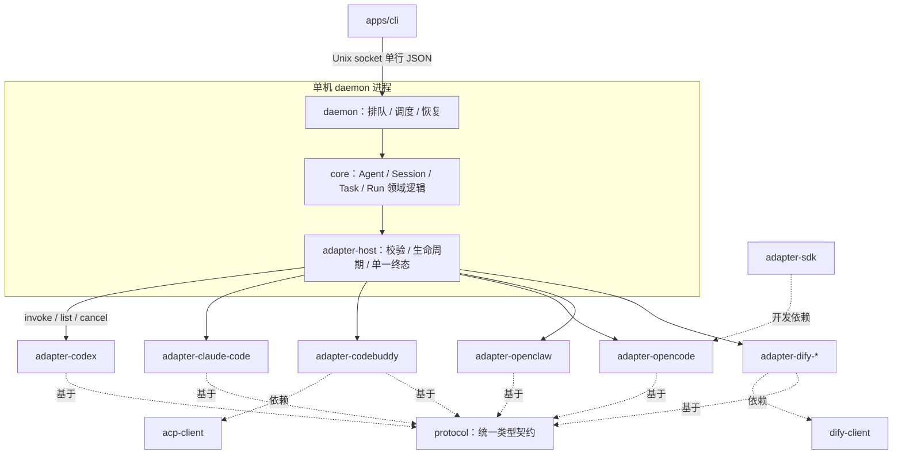

# Packages And Adapter Guide

本目录包含 Octo Harness 的全部可复用 packages 与各 provider 适配器；`apps/*` 负责将这些 packages 组装为可运行的 CLI、daemon、adapter-host 与示例进程。各包的详细说明见其自身 README，下文提供索引、整体调用关系与端到端的使用教程。

## 整体调用关系

一次请求由 CLI 进入，依次经过 daemon（调度）、core（领域逻辑）、adapter-host（调用路由）到达具体适配器，事件再沿原路径回流；protocol 为各层共用的类型契约。



## Runtime Packages

| Package | 职责 |
|---|---|
| [`@mininglamp-oss/octo-harness-protocol`](octo-harness-protocol/README.md) | 各层共用的类型契约：请求、事件、envelope |
| [`@mininglamp-oss/octo-harness-core`](octo-harness-core/README.md) | 领域模型与执行引擎：Agent / 会话 / 触发器 / 任务 / Run 的关系与状态机 |
| [`@mininglamp-oss/octo-harness-daemon`](octo-harness-daemon/README.md) | 后台编排：受理与执行分离、定时触发、崩溃恢复、等待与取消 |
| [`@mininglamp-oss/octo-harness-adapter-host`](octo-harness-adapter-host/README.md) | 适配器宿主：将统一请求路由到具体适配器，保证生命周期与单一终态 |
| [`@mininglamp-oss/octo-harness-adapter-sdk`](octo-harness-adapter-sdk/README.md) | 适配器开发 SDK：子进程、按行读取 JSON、探测、清理 |
| [`@mininglamp-oss/octo-harness-acp-client`](octo-harness-acp-client/README.md) | CodeBuddy 使用的 ACP JSON-RPC stdio 客户端 |
| [`@mininglamp-oss/octo-harness-dify-client`](octo-harness-dify-client/README.md) | Dify 使用的 HTTPS + SSE 客户端（认证、探测、停止） |

所有 `packages/*` 的目录名和 npm 非 scope 部分保持一致。provider packages 使用 `packages/octo-harness-adapter-<provider>` 与 `@mininglamp-oss/octo-harness-adapter-<provider>`。

以下 `octo-harness-adapter-*` packages 共享同一个 `InvokeRequest -> AsyncIterable<CanonicalEvent>` 上层契约，但底层 CLI、传输、权限和 provider session 格式不同。

## 先理解“本地”

当前代码是 **单机 daemon + 本机 adapter-host**。每个 adapter 都在 adapter-host 所在节点启动 provider CLI；这只说明 CLI、shell 和文件工具在该节点运行，不代表模型权重在本机：模型通常仍由各 provider 的云 API 提供。

跨云 WebSocket node、lease/fencing 和远端 workspace materialization 目前只有设计文档，尚未接入当前运行代码。不要把“Transport 可扩展”写成“已经支持多云生产调度”。

## Adapter 选择矩阵

| Adapter | 节点上的执行形态 | Provider transport | 模型通常在哪里 | Session 恢复 | Gateway |
|---|---|---|---|---|---|
| [`codex`](octo-harness-adapter-codex/README.md) | `codex app-server` 子进程 | JSON-RPC 2.0 stdin/stdout | Codex 配置的远程/本地 provider | thread ID + `thread/resume` | 不需要 |
| [`claude-code`](octo-harness-adapter-claude-code/README.md) | `claude --print` 子进程 | stdin + stream-json stdout | Anthropic/配置的云 provider | UUID + `--resume` | 不需要 |
| [`codebuddy`](octo-harness-adapter-codebuddy/README.md) | `codebuddy --acp` 子进程 | ACP JSON-RPC stdio | CodeBuddy 配置的云 provider | `session/load` | 不需要 |
| [`opencode`](octo-harness-adapter-opencode/README.md) | `opencode run` 子进程 | argv + JSON events stdout | OpenCode 配置的 provider | `--session` | 不需要 |
| [`openclaw`](octo-harness-adapter-openclaw/README.md) | `openclaw agent --local` 子进程 | NDJSON/final JSON stdout | OpenClaw 配置的 provider | `--session-id` | **明确不使用** |
| [`dify-chatflow`](octo-harness-adapter-dify-chatflow/README.md) | adapter-host 内远程请求 | HTTPS POST + SSE | Dify Cloud / 自建 Dify | `conversation_id` | 不需要 |
| [`dify-workflow`](octo-harness-adapter-dify-workflow/README.md) | adapter-host 内远程请求 | HTTPS POST + SSE | Dify Cloud / 自建 Dify | 无，调用相互独立 | 不需要 |

五个本地 CLI adapter 是“一次 invocation 一个本地 CLI process”。Dify adapters 不启动 CLI，而是在 adapter-host 进程中发起一次远程 HTTPS + SSE 请求。当前没有维护长期 provider CLI daemon；CodeBuddy 的 ACP session 可以跨新进程 `session/load`，OpenClaw local 依赖 state dir 中的 transcript，Dify Chatflow 通过 opaque `conversation_id` 恢复，Dify Workflow 调用则相互独立。

## 公共环境准备

要求 Node.js 20+：

```bash
cd /absolute/path/to/octo-harness
pnpm install
pnpm test
```

真实 provider 还需要：

1. 在 adapter-host 所在机器安装相应 CLI。
2. 让启动 daemon 的用户能在 `PATH` 中找到 executable。
3. 使用同一用户完成 provider 登录或 API key 配置。
4. 给 Agent 配置明确、存在且可信的 workdir，并用 provider sandbox/容器建立真正的访问边界。

`adapter probe` 只验证 executable，不验证登录、provider 网络、模型、额度和文件权限。

## 启动 Octo Harness

终端 A：

```bash
cd /absolute/path/to/octo-harness
export OCTO_HARNESS_HOME=/absolute/path/to/octo-harness-runtime-state
pnpm daemon
```

终端 B：

```bash
cd /absolute/path/to/octo-harness
export OCTO_HARNESS_HOME=/absolute/path/to/octo-harness-runtime-state
pnpm cli status
pnpm cli adapter list
```

`OCTO_HARNESS_HOME` 应在两个终端保持一致。默认值是用户目录下的 `~/.octo-harness`，默认 socket 为
`~/.octo-harness/sockets/octo-harness-daemon.sock`。

## Probe 与创建 Agent

```bash
pnpm cli adapter probe codex
pnpm cli adapter probe claude-code
pnpm cli adapter probe codebuddy
pnpm cli adapter probe opencode
pnpm cli adapter probe openclaw
pnpm cli adapter probe dify-chatflow
pnpm cli adapter probe dify-workflow
```

典型创建命令：

```bash
pnpm cli agent create --name codex --adapter codex \
  --workdir /absolute/path/to/repository --sandbox read-only

pnpm cli agent create --name claude --adapter claude-code \
  --workdir /absolute/path/to/repository

pnpm cli agent create --name codebuddy --adapter codebuddy \
  --workdir /absolute/path/to/repository --permission-mode dontAsk --model glm-5.3

pnpm cli agent create --name opencode --adapter opencode \
  --workdir /absolute/path/to/repository --model provider/model

pnpm cli agent create --name openclaw --adapter openclaw \
  --provider-agent main --thinking medium --timeout-seconds 300

pnpm cli agent create --name dify-chat --adapter dify-chatflow \
  --workdir "$PWD"

pnpm cli agent create --name dify-workflow --adapter dify-workflow \
  --workdir "$PWD"
```

CLI 输出中的 `id` 是 Octo Harness Agent ID。`--provider-agent` 当前只对 OpenClaw 有效；OpenCode 虽然原生有 `--agent`，此 adapter 尚未暴露。

## 公共 Chat 教程

创建 Chat：

```bash
pnpm cli chat create --agent <agent-id> --title "Repository chat"
```

命令返回一个 Session 对象，其中字段 `id` 是 Harness Session ID。把这个 `id` 用于第一轮：

```bash
pnpm cli chat send <session-id> --prompt "Explain this repository"
```

命令快速返回 `runId`；执行在 daemon 后台继续：

```bash
pnpm cli run wait <run-id>
pnpm cli run events <run-id>
```

第二次 `chat send` 复用同一个 Harness Session。Core 会把上一次 `session.update` 保存的 opaque provider session 交还相应 adapter，因此无需手工填写 Codex thread、Claude UUID 或其他 provider ID。

`chat send` 还支持可选的 `--instruction`。`--prompt` 是本轮用户请求；`--instruction` 进入 daemon 生成的 `[Per-Turn Instructions]`，再由各 adapter 使用自己的 control carrier 下发。它不会写入 workdir，也不会替换 Chat prompt。

取消仍在运行的 invocation：

```bash
pnpm cli run cancel <run-id> --reason operator_cancel
pnpm cli run wait <run-id>
```

最终以 event stream 中唯一的 `run.finished`、`run.error` 或 `run.stopped` 为准，cancel RPC 的 ACK 本身不是执行终态。

## 公共 Trigger -> Task 教程

创建 manual trigger：

```bash
pnpm cli trigger create \
  --name inspect-repository \
  --kind manual \
  --agent <agent-id> \
  --title "Inspect repository" \
  --instruction "Summarize architecture and risks"
```

这里的 `trigger create --instruction` 会保存为 Task `description`，并作为每次 Attempt 的 provider user prompt；它与 `chat send/task continue --instruction` 的 per-turn control 语义不同。

触发并查询：

```bash
pnpm cli trigger fire <trigger-id> --event-id manual-001
pnpm cli run wait <run-id>
pnpm cli task get <task-id>
```

继续同一个 Task：

```bash
pnpm cli task continue <task-id> \
  --source-id comment-001 \
  --instruction "Now focus on cancellation behavior"
```

Task continuation 产生新的 Attempt 和 Harness Run，但复用 Task Session 与 provider session binding。Task 原始 `description` 仍是本次 provider user prompt，`task continue --instruction` 作为 `[Per-Turn Instructions]` 附加；它不会改写 Task description。业务状态在 daemon store，不依赖模型调用 CLI 评论或读取 workdir 内某个 skill 才能完成汇报。

## 公共 Agent 参数

| CLI 参数 | 主要使用者 | 说明 |
|---|---|---|
| `--workdir DIR` | Codex/Claude/CodeBuddy/OpenCode | provider cwd；OpenClaw workspace 由其配置拥有 |
| `--model MODEL` | 所有真实 provider，具体语义各异 | 传给相应 adapter；resume 是否重新应用见子 README |
| `--permission-mode MODE` | Claude/CodeBuddy | provider 自己的 permission mode |
| `--sandbox MODE` | Codex | 新 session 的 Codex sandbox |
| `--dangerously-bypass-permissions` | Codex/Claude | Codex 关闭审批和 sandbox；Claude 强制使用 bypassPermissions；危险 |
| `--auto-approve` | OpenCode | 对 provider 加 `--auto`，危险 |
| `--provider-agent SLUG` | OpenClaw | OpenClaw-local agent slug |
| `--thinking LEVEL` | OpenClaw | provider thinking level；不保证输出 reasoning event |
| `--timeout-seconds N` | OpenClaw | provider turn timeout |

未被某个 adapter 读取的字段不会自动获得语义。新增 provider-specific option 时应修改 adapter、CLI、测试和相应 README，不能在 Core 中按 adapter type 写执行分支。

## 安全边界

- workdir 只是 provider 子进程 cwd 和预期代码目标，不是操作系统安全边界；是否能读取其外部路径取决于 provider 权限、sandbox、容器和宿主机账号。
- prompt、临时配置和 token 不应进入 workdir；临时控制文件尽量使用 `0600`。
- Claude `--print` 非交互模式会跳过 workspace trust 对话框，只能指向已经审查并信任的目录。
- `probe` 通过不代表 provider 可调用。
- dangerous bypass/auto approve 必须配合外部 sandbox 和最小权限凭证。
- 当前单机 host 中所有 adapters 同进程加载；同步崩溃仍可能影响其他 provider。
- 当前取消对多数 CLI 只保证直接进程 abort；生产环境应使用进程组和分级回收。

workspace 维护见 [Pnpm Monorepo](../docs/03-monorepo.md)。架构与事件契约见 [Architecture](../docs/01-architecture.md)、[Provider Adapters](../docs/05-provider-adapters.md) 和 [Prompt And Workdir](../docs/04-prompt-and-workdir.md)。
