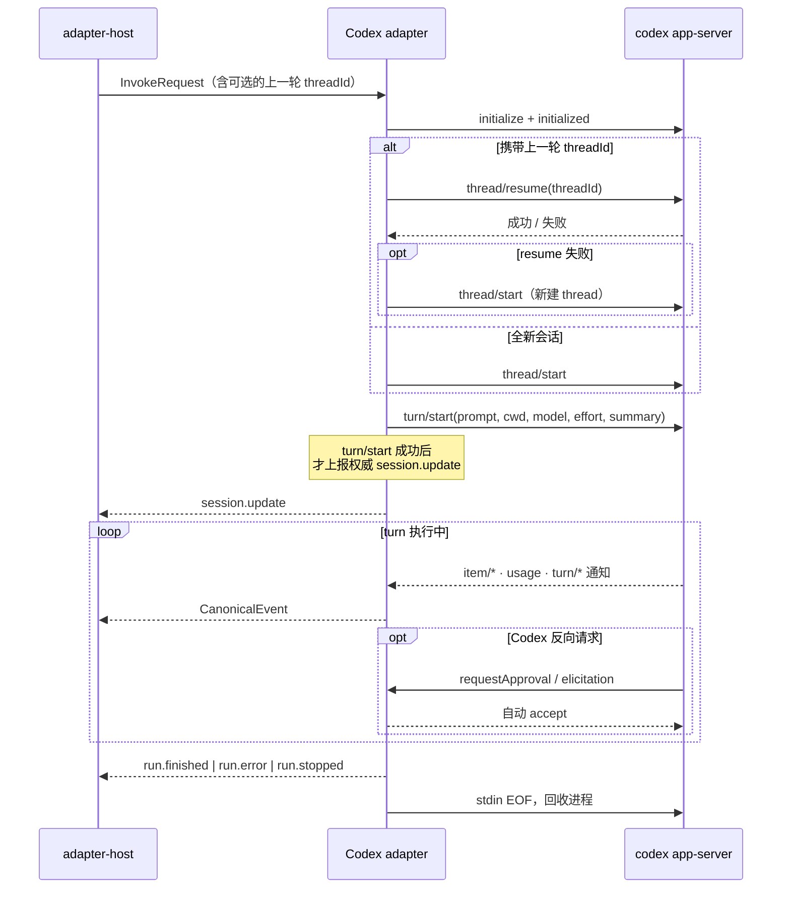

# @mininglamp-oss/octo-harness-adapter-codex

Octo Harness 的 Codex 适配器：将本地 Codex CLI 接入统一的适配器契约，负责启动 `codex app-server` 子进程、驱动会话握手、续跑上一轮会话，并将 Codex 的原生双向协议翻译为格式统一、终态唯一的 `CanonicalEvent` 流。

## 定位与职责

Codex 采用自有的会话（thread）概念与一套双向 JSON-RPC 协议，与其他 provider 差异显著；在一轮执行过程中，它会反向发起命令执行与补丁应用的审批请求，调用方必须应答，否则执行将持续阻塞。此外，上一轮会话的续跑、会话文件缺失的恢复、以及异常退出的收尾，都需要专门处理。

本适配器将上述差异收敛在自身边界内。它对每次调用启动一个 `codex app-server` 子进程，主动完成 `initialize → thread → turn` 握手，将 Codex 的原生事件翻译为 Octo Harness 的统一 `CanonicalEvent`，并自动应答 Codex 发来的审批与交互请求。上层始终得到格式统一、仅含单一终态的事件流，领域核心无需针对 Codex 编写任何分支逻辑。

适配器仅负责协议翻译，不涉及排队、Trigger、Chat/Task 持久化，也不做跨节点调度或人工权限确认。

## 工作原理

与单向读取 stdout 的 `codex exec --json` 不同，本适配器使用 `codex app-server` 的双向 JSON-RPC 2.0：Octo Harness 既主动发起请求，也应答 Codex 反向发来的请求。一次调用对应一个子进程，执行完成后即回收。



其核心机制体现为以下几点：

1. **会话续跑与自动降级**。`providerSession.sessionId` 即 Codex 的 thread ID，Core 仅将其作为不透明字符串保存。携带该 ID 时优先 `thread/resume` 续接上一轮会话；若 resume 报错，或 resume 成功但在 `turn/start` 时才发现 thread 已丢失，适配器会自动新建 thread 重试一次，并在 session 中记录低基数的降级原因（`resume_rejected` / `rollout_path_missing` / `turn_start_thread_not_found`），不会将整轮直接判定为失败。
2. **权威 session 延迟上报**。仅当 `turn/start` 真正成功、本轮确实可执行时，才向 Core 上报 `session.update`，以避免 Core 保存下一个「thread 存在但无法执行」的无效 ID。
3. **终态唯一**。`turn/completed` 映射为 `run.finished` / `run.error` / `run.stopped`；进程异常退出或被取消时，适配器均兜底为单一干净终态，此后到达的 provider 事件一律丢弃。
4. **审批自动应答**。对 Codex 反向发来的命令执行、文件修改审批请求，适配器一律回应 `accept`（对应 `approvalPolicy: never` 的无人值守语义）；对未知的反向请求回应 JSON-RPC `-32601`，避免 Codex 持续阻塞等待。该 accept 不构成安全边界（见下文）。
5. **shadow CODEX_HOME**。每轮复制一份临时 `config.toml`，仅覆盖本轮的 `developer_instructions`，而 `auth.json` / `sessions` / `skills` / `rules` 通过 symlink 复用真实 HOME。这是配置层面的覆盖，而非文件系统隔离——symlink 是活别名，写入会落到真实目录。

## 使用

前置条件：Node.js 20+、pnpm，以及 PATH 上一个已登录的 Codex CLI。

```bash
codex --version
codex login status
```

在仓库根目录启动 daemon，另开终端探测并创建 Agent：

```bash
pnpm daemon

pnpm cli adapter probe codex

pnpm cli agent create \
  --name codex-reviewer \
  --adapter codex \
  --workdir /absolute/path/to/repository \
  --sandbox read-only
```

随后执行统一的 Chat 流程：

```bash
pnpm cli chat create --agent <agent-id> --title "Codex review"
pnpm cli chat send <session-id> --prompt "Review this repository without modifying files"
pnpm cli run wait <run-id>
pnpm cli run events <run-id>
```

## 配置

以下字段通过 `agent create` 或 `agentConfig` 传入：

| 字段 | 作用 | 默认 |
|---|---|---|
| `workdir` | Codex 进程 / thread / turn 的 cwd | 必填 |
| `model` | 传给 thread 与 turn | 由 Codex 配置决定 |
| `thinking` | 映射为 turn 的 `effort`；`disabled` 兼容映射为 `low` | 由 Codex 配置决定 |
| `sandbox` | `read-only` / `workspace-write` / `danger-full-access` | `workspace-write` |
| `dangerouslyBypassPermissions` | 为 `true` 时强制 sandbox 为 `danger-full-access`，优先级高于 `sandbox` | `false` |
| `providerOptions.reasoningSummary` | reasoning summary 采集偏好 `auto/concise/detailed/none` | `auto`（`thinking:disabled` 时为 `none`） |
| `providerOptions.appServerRequestTimeoutMs` | 单个 RPC 的超时 | `30000` |

`summary` 默认显式传入 `auto`：仅设置 `effort` 并不保证 app-server 回吐 reasoning summary，不显式请求可能只得到空的 analysis。该字段仅控制 provider 是否采集，不代表内容一定对用户可见。

## 约束与注意事项

- **workdir 不是沙箱**。真正的文件与网络边界由 Codex 自身 sandbox 叠加外部隔离（容器 / VM / 独立用户）决定。`danger-full-access` 仅应在已具备外部隔离的执行节点上使用。
- **审批自动 accept 不是权限系统**。`accept` 只是无人值守下的协议兼容，实际可执行的操作取决于 sandbox、OS 用户、网络策略与可用凭证的交集。当前未将审批转发至任何人工决策链。
- **同一 thread 不支持被两个调用并发 resume**。适配器与 host 均未按 thread 串行化，也无跨进程文件锁；并发 resume 属不支持场景，调用方需在 Core / 调度层保证同一 session 同时仅有一个 active run。
- **shadow HOME 不隔离凭证与会话文件**。symlink 是活别名，Codex 的写入会落到真实的 `sessions/`、`skills/` 等目录。
- **RPC 超时不是整轮超时**。若 app-server 保持连接、`turn/start` 已响应却始终不发终态，适配器自身不会结束，整轮预算需由上层 Host / Core 控制。
- **`probe` 仅检查可执行文件**，不验证 app-server API 版本、认证、网络、模型额度或 workdir 权限。
- **进程按直接 PID 回收**（stdin EOF → SIGTERM → SIGKILL 阶梯），不做 POSIX 进程组级 kill。宿主崩溃需依赖外部 supervisor。
- **prompt 当前仅支持 text**，图片等多模态输入尚未接入。

## 相关文档

- 事件契约与三层事件模型：[Protocol](../octo-harness-protocol/README.md)
- 适配器的调用生命周期与终态兜底：[Adapter Host](../octo-harness-adapter-host/README.md)
- provider adapter 概览与编写指南：[docs/05](../../docs/05-provider-adapters.md)、[docs/08](../../docs/08-adapter-authoring.md)
- 端到端协议 fixture：[`fixtures/fake-codex-app-server.mjs`](../../fixtures/fake-codex-app-server.mjs)
- 源码：[`src/index.ts`](src/index.ts)（装配 + shadow HOME）、[`src/app-server.ts`](src/app-server.ts)（协议状态机 + JSON-RPC client + 事件映射）
