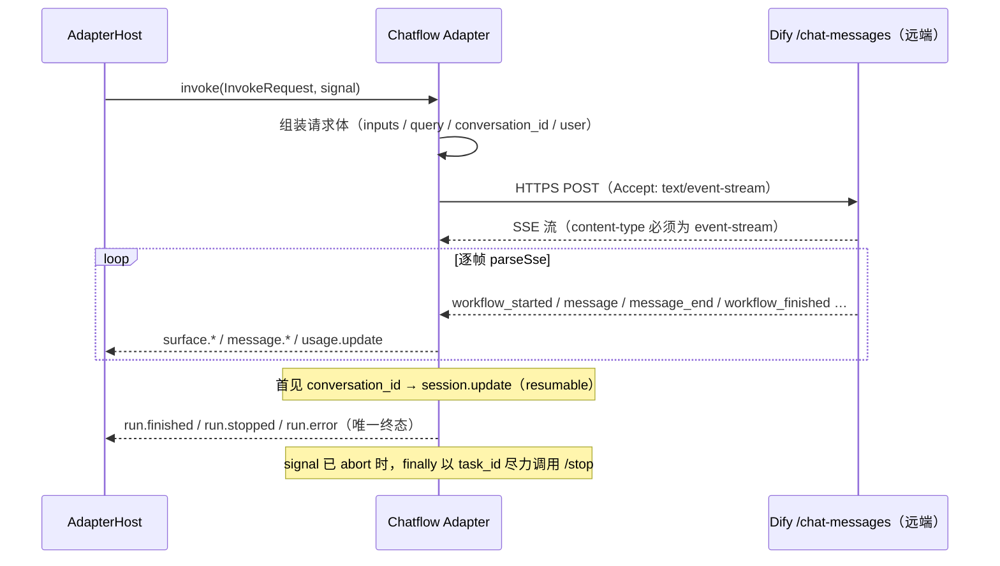

# @mininglamp-oss/octo-harness-adapter-dify-chatflow

Octo Harness 的 Dify Chatflow 适配器：在 adapter-host 进程内向远端 Dify 发起一次 HTTPS 请求并读回一条 SSE 流，将 Dify 的原生输出翻译为 Octo Harness 的统一事件，并依据 `conversation_id` 维持同一段对话的上下文连续性。

## 定位与职责

Dify 上的 Chatbot / Chatflow 应用运行于远端（Dify Cloud 或自建 Dify），无可启动的本地 CLI。将其接入 Octo Harness 需解决三个问题：

- **调用方式**：调用 `POST /chat-messages`，请求体为 JSON，响应为一条持续推送的 SSE（Server-Sent Events）流。
- **上下文维持**：Dify 以一个 opaque 的 `conversation_id` 标识一段对话。首轮由 Dify 分配，后续轮次携带该值即可续接同一段对话记忆。
- **终态判定**：在同一 endpoint 上，Chatbot 应用于 `message_end` 即结束，而 Chatflow 应用需等待 `workflow_finished`，两者终态判定不同。

适配器将 Dify 的原生 SSE 事件翻译为统一的 session / message / usage / surface / run 事件，使上层无需感知 Dify 的具体协议。

## 工作原理

关键区别在于不启动子进程：整条流均在 adapter-host 进程内完成——发起一次远程 POST，随后逐帧解析 SSE。



关键机制：

1. **远程依赖，非本地 CLI**。请求经由底层 `DifyClient`（HTTPS + SSE）发出，模型与执行均在 Dify 侧，本机不运行任何进程。
2. **依据 `conversation_id` 续接对话**。请求体 `conversation_id` 填入上一轮保存的 provider session（首轮为空字符串）；流中首次出现 `conversation_id` 时，适配器发出一个 `session.update`（标记 `resumable`、携带 `user`、`provider: "dify"`），Core 保存后于下一轮回填。因此适配器声明 `session.serialize`，并复用首轮的 Dify `user` 以满足会话与文件的用户隔离。
3. **终态判定取决于 `applicationMode`**：`chatbot` 于 `message_end` 结束；`chatflow` 将终态推迟至 `workflow_finished`；默认 `auto` 依据是否见过 workflow 事件自动判断。`workflow_finished.status` 决定 `run.finished`（succeeded）/ `run.stopped`（stopped）/ `run.error`（其余）。
4. **workflow 进度可选透传**。node / iteration / loop 生命周期默认以 `surface.*` 上报（可经 `exposeWorkflowEvents` 关闭）；`workflow_paused` 收敛为可恢复的 `run.stopped`（当前无一等 `run.paused` 状态）。
5. **取消尽力而为**。上层 abort 后，`finally` 以捕获到的 `task_id` 调用 `/chat-messages/{taskId}/stop`；即便失败，Host 侧取消仍照常上报。

## 使用

API key 仅置于环境变量，不写入 manifest / Agent config / prompt / 源码：

```bash
export DIFY_CHATFLOW_API_KEY='app-...'
```

仓库 `config/adapters.json` 已通过 factory 注册（默认 base URL 为 `https://api.dify.ai/v1`，自建 Dify 修改 `baseUrl`，非 localhost 必须 HTTPS）：

```json
{
  "type": "dify-chatflow",
  "module": "@mininglamp-oss/octo-harness-adapter-dify-chatflow",
  "export": "createDifyChatflowAdapter",
  "factory": true,
  "options": {
    "apiKeyEnv": "DIFY_CHATFLOW_API_KEY",
    "baseUrl": "https://api.dify.ai/v1",
    "applicationMode": "auto"
  }
}
```

启动 daemon 前导出变量（adapter-host 将继承），随后使用公共命令：

```bash
pnpm cli adapter probe dify-chatflow
pnpm cli agent create --name dify-assistant --adapter dify-chatflow --workdir "$PWD"
pnpm cli chat create --agent <agent-id> --title "Dify chat"
pnpm cli chat send <session-id> --prompt "你好，请介绍你自己"
pnpm cli run wait <run-id>
```

`inputs` 分层合并：`defaultInputs` < provider options 的 `inputs` < 本轮 `context.workflowInputs`；`query` 取当前 turn 的 `modelInput ?? prompt`。`/chat-messages` 无独立 system carrier，默认不将 `appendInstructions` 拼入 query；仅当 factory 显式设置 `instructionInput` 时，控制指令才写入该具名 input。

## 约束与注意事项

- **需配置 key 与 endpoint**：key 缺失将在解析时明确报错；`baseUrl` 默认强制 HTTPS，仅 `localhost` / `127.0.0.1` 允许明文（本地开发）。
- **SSE 具备护栏**：成功响应若 content-type 非 `text/event-stream`（例如返回 200 的 HTML 登录页或错误页），将抛出 `DifyProtocolError` 并附带截断预览；单帧超过 `maxFrameChars` 亦报错；流结束前未出现终态事件同样报 `DifyProtocolError`。
- **workdir 基本无意义**：执行在 Dify 侧，`--workdir` 不改变远端行为，仅作本地占位。
- **probe 仅做可达性 / 鉴权探测**：底层对 `/parameters` 发起一次 GET，2xx 即视为可用，不代表应用配置正确或有额度。
- **附件**：`context.attachments` 映射为 Dify 的 file 结构，需携带 `url`（remote_url）或 `uploadFileId`（local_file），`type` 属于 document/image/audio/video/custom；适配器不读取任意本机路径，也不将附件 base64 塞入 event。`message_file` 暂保留 provider 短期 URL，生产投递前应拉入 artifact store。

## 相关文档

- 底层传输 client：[dify-client](../octo-harness-dify-client/README.md)
- 无状态兄弟适配器：[dify-workflow](../octo-harness-adapter-dify-workflow/README.md)
- 事件契约：[Protocol](../octo-harness-protocol/README.md)
- 公共流程与对比：[Adapter Guide](../README.md)
- Dify 官方契约：[Chatflow API](https://docs.dify.ai/zh/api-reference/guides/chatflow)、[SSE 指南](https://docs.dify.ai/zh/api-reference/guides/streaming)
