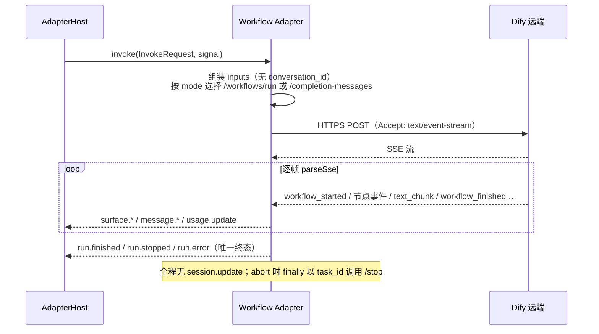

# @mininglamp-oss/octo-harness-adapter-dify-workflow

Octo Harness 的 Dify Workflow 适配器：与 Chatflow 适配器同样在 adapter-host 进程内发起远程 HTTPS + SSE 请求，但对接的是“填入固定参数、执行一次、返回结果”的无状态 Dify 应用——每次调用彼此独立，无对话记忆。

## 定位与职责

Dify 中除对话型应用外，还存在两类“输入固定参数、单次执行即出结果”的应用：

- **Workflow**：`POST /workflows/run`，核心输入为一份固定 schema 的 `inputs`。
- **Completion（文本生成）**：`POST /completion-messages`，由同一 factory 通过 `applicationMode: "completion"` 接入。

二者与 Chatflow 的本质区别在于无状态：既无 `conversation_id`，也无 provider 侧的对话记忆，每次调用皆为全新一次。因此即便上层入口为 Octo Harness Chat，本适配器也仅复用 Harness Session，不产生 `session.update`，也不声明 `session.serialize`——其 `capabilities` 为空，以免造成 Dify 侧记得上一轮的误解。

## 工作原理

同样不启动子进程：在 adapter-host 进程内发起一次远程 POST，逐帧解析 SSE，产出唯一终态。区别仅在于 endpoint 选择与“无 session”。



关键机制：

1. **无状态、无 session**。请求体不携带 `conversation_id`，适配器从不发出 `session.update`。
2. **endpoint 与终态由 `applicationMode` 决定**：`workflow` 请求 `/workflows/run`，终态在 `workflow_finished`；`completion` 请求 `/completion-messages`，终态在 `message_end`。默认 API key 环境变量亦随之不同（`DIFY_WORKFLOW_API_KEY` 与 `DIFY_COMPLETION_API_KEY`）。
3. **答案仅上报一次**。文本可能来自流式 `message` / `text_chunk` 增量，也可能来自非流式 workflow 从 `workflow_finished.outputs` 一次性给出；`textEmitted` 守卫确保不会既流式又从 outputs 重复输出。
4. **outputs 选取文本具备回退链**：若配置 `outputKey` 则据其取值（非字符串将 JSON 序列化）；未配置则依次尝试 `text` / `answer` / `result` / `output`，再退化为“仅有单一输出项时取之”。无法选出单一文本的多字段 outputs 归为 `surface.create(kind=structured_output)`。
5. **取消尽力而为**：`workflow` 调用 `/workflows/tasks/{taskId}/stop`，`completion` 调用 `/completion-messages/{taskId}/stop`。

## 使用

单输入场景最为简洁：配置 `promptInput` 将 Chat prompt 直接写入某个槽位：

```json
{
  "type": "dify-workflow",
  "module": "@mininglamp-oss/octo-harness-adapter-dify-workflow",
  "export": "createDifyWorkflowAdapter",
  "factory": true,
  "options": {
    "apiKeyEnv": "DIFY_WORKFLOW_API_KEY",
    "baseUrl": "https://api.dify.ai/v1",
    "promptInput": "query",
    "outputKey": "result",
    "defaultInputs": { "language": "zh-CN", "tone": "concise" }
  }
}
```

启动与运行：

```bash
export DIFY_WORKFLOW_API_KEY='app-...'
pnpm cli adapter probe dify-workflow
pnpm cli agent create --name report-workflow --adapter dify-workflow --workdir "$PWD"
pnpm cli chat create --agent <agent-id> --title "Report workflow"
pnpm cli chat send <session-id> --prompt "生成 8 月客户报告"
pnpm cli run wait <run-id>
```

`inputs` 合并顺序：`defaultInputs` < provider options 的 `inputs`，再写入 `promptInput`（当前 turn 的 `modelInput ?? prompt`）与 `instructionInput`（append-only 指令），最后由本轮 `context.workflowInputs` 覆盖全部。Completion 模式会额外将 prompt 作为兼容 `query` 一并发送。

多槽位场景不应在适配器内部再次调用模型——那将带来隐藏成本、无法审计 inputs 来源，且缺参数时应向用户澄清而非猜测取值执行有副作用的 workflow。正确做法是在适配器之前放置一个显式的 Input Resolver，将结果写入 `context.workflowInputs`。当前 CLI 尚无 `--input key=value`，多槽位需由 control plane 调用 Core。

## 约束与注意事项

- **需配置 key 与 endpoint**：key 缺失将明确报错；`baseUrl` 默认强制 HTTPS，仅 `localhost` / `127.0.0.1` 允许明文。
- **SSE 护栏同 dify-client**：content-type 非 `text/event-stream`、单帧超限、或流结束前无终态，均将抛出 `DifyProtocolError`。
- **未配置 `promptInput` 时，prompt 不会自动进入任何 input**，调用方必须显式提供 `context.workflowInputs`。
- **structured output 与大结果**：无法收敛为单文本的 outputs 将原样进入 canonical payload，需由部署方限制结果大小，后续再接 artifact store。
- **probe 仅做可达性 / 鉴权探测**（对 `/parameters` 发起一次 GET），不验证应用配置或额度。
- **不支持断线重连**：未实现基于 `workflow_run_id` 的恢复，因此不声明 `run.reattach`。

## 相关文档

- 底层传输 client：[dify-client](../octo-harness-dify-client/README.md)
- 有状态兄弟适配器：[dify-chatflow](../octo-harness-adapter-dify-chatflow/README.md)
- 事件契约：[Protocol](../octo-harness-protocol/README.md)
- 公共流程与对比：[Adapter Guide](../README.md)
- Dify 官方契约：[Workflow API](https://docs.dify.ai/zh/api-reference/guides/workflow)、[文本生成应用](https://docs.dify.ai/zh/api-reference/guides/completion)
