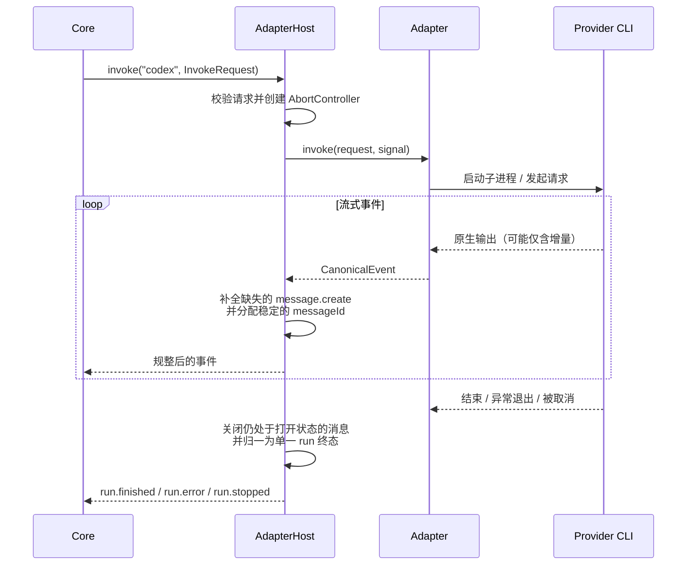

# @mininglamp-oss/octo-harness-adapter-host

Octo Harness 的适配器宿主（Adapter Host）：统一管理各 provider 适配器的注册与调用，并在调用边界上保证消息生命周期完整、事件合法、且每次运行只产生一个终态事件。

## 定位与职责

不同的 Agent provider（Codex、Claude Code、CodeBuddy、OpenCode 等）在事件格式、生命周期语义和取消方式上存在显著差异：部分只输出增量文本而不标记消息的开始与结束；部分在异常退出时不产生任何收尾事件；取消机制也各不相同。若由领域核心（`octo-harness-core`）直接对接这些差异，核心逻辑会被大量 provider 分支污染，且每接入一个新 provider 都需改动核心。

适配器宿主将这些差异收敛在单一边界上。它对上层仅暴露三个操作——列举（`list`）、调用（`invoke`）、取消（`cancel`）——并保证：无论底层适配器行为是否规范，上层始终得到格式统一、生命周期完整、且必然以单一终态结束的事件流。

宿主本身不涉及排队、调度、持久化或业务建模，这些职责属于 daemon 与 core。

## 工作原理

Core 传入统一的 `InvokeRequest`，宿主据此选择适配器执行，并对适配器产出的事件进行规整后再交回 Core。其核心工作体现为三点：补全消息生命周期、拦截非法事件、兜底终态事件。



规整过程遵循三条约束：

1. **消息生命周期完整**：即使适配器仅发送 `message.delta`，宿主也会补全起始的 `message.create` 与结束的 `message.update`，并确保同一条消息始终使用同一 `messageId`，使上层无需自行推断消息归属。
2. **终态唯一**：正常结束归一为 `run.finished`，错误归一为 `run.error`，取消或流中断归一为 `run.stopped`。适配器崩溃、缺失收尾、或在终态后继续发送事件的情况，均由宿主兜底或纠正为单一终态。
3. **取消经由 AbortSignal**：`cancel(invocationId)` 触发对应调用的 `AbortController`，由适配器负责将其传导至子进程或协议层；上层无需了解 provider 的进程模型。

适配器宿主作为 daemon 启动的独立子进程运行：宿主进程内的 `AdapterHostRpcServer` 依据 manifest 加载适配器并对外提供服务，daemon 通过 `spawnAdapterHost` 建立 `AdapterHostRpcClient`，两者以 stdio 上的 NDJSON JSON-RPC 2.0 通信。这条子进程边界是宿主的运行方式，Core 面向的始终是同一组 `invoke/list/cancel` 契约。

## 使用

宿主要加载的适配器由 manifest（`config/adapters.json`）声明。正常运行时由 daemon 负责拉起宿主子进程并与之通信，无需手工实例化；如需在自定义进程中直接驱动，使用 `spawnAdapterHost`：

```ts
import { spawnAdapterHost } from "@mininglamp-oss/octo-harness-adapter-host";
import type { InvokeRequest } from "@mininglamp-oss/octo-harness-protocol";

const host = await spawnAdapterHost({
  entrypoint: "apps/adapter-host/dist/index.js",
  manifest: "config/adapters.json"
});

const request: InvokeRequest = {
  invocationId: "invoke-1",
  sessionId: "session-1",
  runId: "run-1",
  prompt: "Inspect this repository",
  workdir: process.cwd(),
  appendInstructions: "",
  context: {},
  agentConfig: {}
};

for await (const event of host.client.invoke("codex", request)) {
  console.log(event.type, event.payload);
}

await host.close();
```

`spawnAdapterHost` 以首次 `list` 成功作为就绪握手：manifest 错误或可执行文件缺失会在此阶段即时暴露，而非延迟到首次调用。

## 约束与注意事项

- **独立进程并非安全沙箱**：同一宿主内的多个适配器仍共享同一 Node.js 进程与宿主账号。强隔离需依赖容器、独立系统用户或“一适配器一进程”。
- **同类型适配器不可重复注册**：`register` 对重复的 `metadata.type` 直接抛错。
- **`probe` 仅做能力探测**：未实现 `probe` 的适配器返回“未校验但可用”，不代表 provider 实际可运行。

## 相关文档

- 事件契约与三层事件模型：[Protocol](../octo-harness-protocol/README.md)
- 跨进程 RPC 时序与多节点设想：[Transport And Multi-node](../../docs/09-transport-and-multinode.md)
- 整体架构：[Architecture](../../docs/01-architecture.md)
