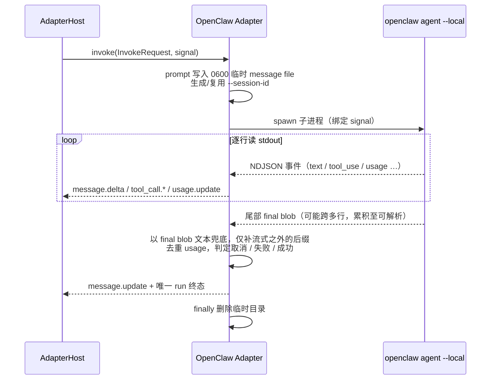

# @mininglamp-oss/octo-harness-adapter-openclaw

Octo Harness 的 OpenClaw 本地适配器：每次调用在 adapter-host 所在节点临时执行一次 `openclaw agent --local` 子进程，逐行消费其流式输出，并将尾部的最终结果 blob 与流式片段归并为统一的 session / message / tool / usage / run 事件流。

## 定位与职责

OpenClaw 的常规运行方式依赖一个常驻的 Gateway 负责任务收发，涉及安装、启动、设备认证与插件同步。对于“在本节点复用现有 OpenClaw agent 配置、由 Octo Harness 触发单次任务并取回结果”这一场景，接入 Gateway 的成本过高。

本适配器采用另一条路径：完全不接入 Gateway。每次调用在 adapter-host 所在的机器上临时执行

```text
openclaw agent --local --json ...
```

子进程执行结束后即退出。它需要处理的两个核心问题是：

- OpenClaw 的输出为流式产出——先是逐行的 JSON 事件（文本片段、工具调用、用量），最后追加一整块“最终结果” blob，且该 blob 可能跨多行。
- 同一段回复既出现在流式片段中，又完整出现在最终 blob 中，直接转发会导致重复。

适配器在本层完成上述归并与去重，向上层交付统一的 session / message / tool / usage / run 事件。

## 工作原理

适配器先将 prompt 写入权限为 `0600` 的临时文件（不经命令行参数传递，避免长文本与控制上下文暴露在 argv 中），生成或复用一个 provider session id，随后启动子进程，逐行读取 stdout，最终统一收尾。



关键机制：

1. **local-only，不连接 Gateway**。`--local` 表示 OpenClaw 内嵌 agent 在本节点运行；模型 provider 仍可能是云端 API，因此本机必须能读取到相应的 provider 凭证。适配器不执行 install / restart / device auth / plugin sync。
2. **最终 blob 为权威文本**。流式片段拼接得到的文本记为 `accumulatedText`，最终以 final blob 中的完整文本为准。若 blob 文本以已流出的部分开头，适配器仅补发多出的后缀，避免整段重复；用量同样仅上报一次，并与最后一条流式用量去重。
3. **终态唯一**。stdout 关闭后，适配器综合 abort signal、显式的 cancelled / failure 帧以及退出码进行判定：取消归一为 `run.stopped`，失败或非零退出归一为 `run.error`，正常结束归一为 `run.finished`。
4. **session 由 provider 拥有**。首轮生成 `octo-harness-<uuid>` 作为 `--session-id`，后续从 `providerSession.sessionId` 恢复；transcript 由 OpenClaw 自身在 state dir 持久化，Octo Harness 不将其复制进 workdir。

## 使用

启动 daemon 后，先 probe 再创建 Agent：

```bash
pnpm cli adapter probe openclaw

pnpm cli agent create \
  --name openclaw-local \
  --adapter openclaw \
  --provider-agent main \
  --thinking medium \
  --timeout-seconds 300
```

`--provider-agent main` 的取值是 OpenClaw 自身的 agent slug，而非 Octo Harness Agent UUID。此后使用公共 Chat / Task 命令即可：

```bash
pnpm cli chat create --agent <agent-id> --title "OpenClaw chat"
pnpm cli chat send <session-id> --prompt "Inspect the configured workspace"
pnpm cli run wait <run-id>
pnpm cli run events <run-id>
```

可配置项：`--provider-agent`（`--agent`）、`--model`、`--thinking`、`--timeout-seconds`（`--timeout`）。程序化创建时还可设置 `openclawConfigPath` / `openclawStateDir`，分别注入 `OPENCLAW_CONFIG_PATH` 与 `OPENCLAW_STATE_DIR`；这两项当前未由公共 CLI 暴露。

## 约束与注意事项

- **workspace 由 OpenClaw 配置拥有，而非 `--workdir`**：子进程 cwd 按 `OPENCLAW_STATE_DIR` → `dirname(OPENCLAW_CONFIG_PATH)` → `HOME` → adapter-host cwd 的顺序取第一个存在的目录。若需令其操作特定代码目录，应在 OpenClaw agent 配置中设置 workspace，Octo Harness 的 `--workdir` 不覆盖 state root。
- **无独立 system prompt 通道**：适配器将控制指令与用户请求分段写入同一 message file（`[Harness Instructions]` / `[User Request]`），这仅为兼容投影，不等价于 provider 原生 system role。
- **无 reasoning 事件**：`--thinking` 仅调整 provider 的思考档位，适配器既不伪造也不泄露隐藏思维链。
- **取消为直接子进程 abort**：收敛为 `run.stopped`，不调用 Gateway `sessions.abort`；生产节点应补充进程组 `SIGTERM/SIGKILL` 回收。
- **probe 仅验证 `openclaw` 可执行**：不代表已登录、模型可调用或有额度。契约测试使用 fake OpenClaw，不涉及真实模型调用。

## 相关文档

- 本地适配器设计详解：[OpenClaw Local Adapter](../../docs/06-openclaw-local-adapter.md)
- 事件契约与三层事件模型：[Protocol](../octo-harness-protocol/README.md)
- 各适配器对比与公共流程：[Adapter Guide](../README.md)
- provider 适配器总览：[Provider Adapters](../../docs/05-provider-adapters.md)
