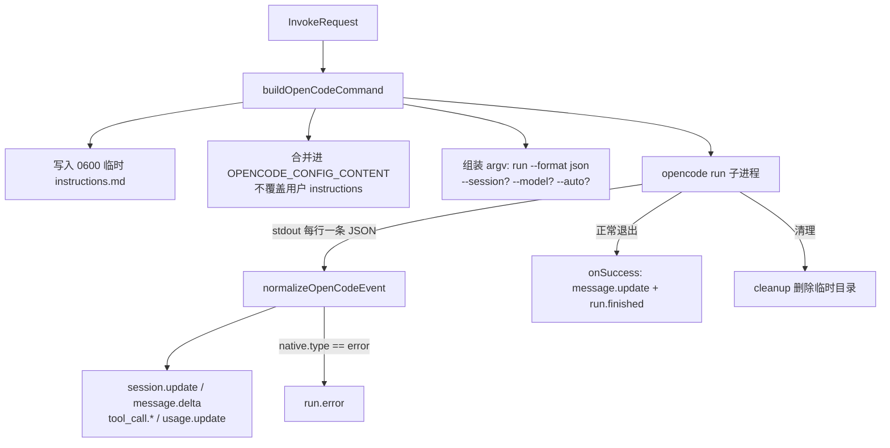

# @mininglamp-oss/octo-harness-adapter-opencode

Octo Harness 的 OpenCode 适配器：将本地 OpenCode CLI 接入统一的 Harness 调用模型，组装并执行单次 `opencode run --format json`，并将其逐行输出的 JSON 事件翻译为 Harness 的 canonical event。

Adapter type：`opencode`

## 定位与职责

OpenCode 是“单次执行后退出”的 CLI：将 prompt 作为命令行参数传入，以 `--format json` 模式在 stdout 上逐行输出 JSON 事件（模型输出、工具调用、token 用量等），执行完毕即退出。

将其接入 Harness 需解决以下具体问题：

- 如何注入 Harness 的上下文，同时不破坏用户既有的 OpenCode 配置；
- 其 JSON 事件采用 OpenCode 自有格式（`step_start`、`text` part、`tool` part 的 `state.status` 等），上层无法识别；
- 执行完毕即干净退出，不发出“结束”事件，需由适配器补全收尾；
- 危险的自动批准（`--auto`，使 provider 不再逐项询问即可修改文件）绝不能默认开启。

本适配器处理上述全部问题：以临时文件注入上下文、翻译 JSON 事件、在成功退出时合成收尾事件、仅在显式要求时附加 `--auto`。它不管理 OpenCode 的 provider 账号，也不会将 OpenCode 自身的 agent 概念自动映射为 Harness Agent。

需与 OpenClaw 区分：OpenCode 与 OpenClaw 是两个不同的适配器、两个不同的可执行文件、两套不同的 session 格式。

## 工作原理

`buildOpenCodeCommand` 先组装 argv 与环境变量，JSON CLI 助手启动子进程，`normalizeOpenCodeEvent` 将每行 JSON 翻译为 canonical event，进程正常退出时 `onSuccess` 补全收尾。



翻译规则（`normalizeOpenCodeEvent`）如下：

1. `step_start` 与 `session.created` 映射为 `session.update`（记录 OpenCode 的 session ID，供下次恢复）；
2. `text` part 映射为 `message.delta`；
3. `tool` part 的 `state.status === "running"` 映射为 `tool_call.create`；`completed` 与 `error` 映射为 `tool_call.update`；
4. `step_finish` 映射为 `usage.update`（含 tokens 与 cost）；
5. `error` 事件映射为 `run.error`（内联发出，这是唯一由 normalizer 直接产出的终态）；
6. 进程正常退出但 provider 未给出终态时，`onSuccess` 合成 `message.update` 与 `run.finished`。

## 使用

首先启动 daemon：

```bash
cd /absolute/path/to/octo-harness
pnpm daemon
```

在另一终端中探测可用性并创建 Agent：

```bash
pnpm cli adapter probe opencode

pnpm cli agent create \
  --name opencode-reviewer \
  --adapter opencode \
  --workdir /absolute/path/to/repository \
  --model provider/model
```

随后走统一的 Chat 流程：

```bash
pnpm cli chat create --agent <agent-id> --title "OpenCode review"
pnpm cli chat send <session-id> --prompt "Summarize the repository"
pnpm cli run wait <run-id>
pnpm cli run events <run-id>
```

## 配置

| `agent create` 参数 | `agentConfig` 字段 | 拼入命令行 |
|---|---|---|
| `--workdir DIR` | `workdir` | 子进程 cwd；本身不构成文件访问隔离 |
| `--model provider/model` | `model` | `--model provider/model` |
| `--auto-approve` | `autoApprove` | 危险的 `--auto` |

实际命令形态：首次 turn 为 `opencode run --format json [--model …] [--auto] <prompt>`；后续 turn 会附加 `--session <provider-session-id>` 以恢复会话。

## 约束与注意事项

- **`--auto` 具有危险性**：它使 provider 自动批准未被显式拒绝的权限（可直接修改文件）。仅应在受控 workdir 与外部隔离的节点上开启，默认关闭。
- **用户 prompt 出现在 argv 中**：同机的进程检查工具可能读取到它，不适合承载 secret。若需更强的隐私保障，应改用 OpenCode server/API 或引入 stdin carrier，而非假定 argv 已被隐藏。
- **上下文经临时文件注入**：`appendInstructions` 写入一个 `0600` 临时 Markdown，追加到 `OPENCODE_CONFIG_CONTENT` 中已有的 `instructions` 列表末尾，合并结果注入子进程环境，不覆盖用户原有配置。`OPENCODE_CONFIG_CONTENT` 必须为合法 JSON，非法值将在 spawn 前失败。
- **每次 invocation 均为一次性子进程**，无常驻 daemon。session ID 由 Core 保存，下次 Chat turn 或 Task 续跑时自动经 `--session` 恢复。
- **未暴露 OpenCode 的 `--fork` 与 `--agent` 等原生能力**。公共 CLI 的 `--provider-agent` 目前仅被 OpenClaw 适配器消费，不能用于配置 OpenCode agent。
- **`probe` 仅检查可执行文件是否存在**，不验证 provider 凭证、模型或网络。取消由 host 保证最终仅发出一个 `run.stopped`；当前通用 subprocess runtime 尚不具备完整的进程组回收保证。

## 相关文档

- 事件修整与终态兜底：[Adapter Host](../octo-harness-adapter-host/README.md)
- Provider adapter 总览：[Provider Adapters](../../docs/05-provider-adapters.md)
- Prompt 与 workdir 约定：[Prompt And Workdir](../../docs/04-prompt-and-workdir.md)
- Adapter 编写指南：[Adapter Authoring](../../docs/08-adapter-authoring.md)
