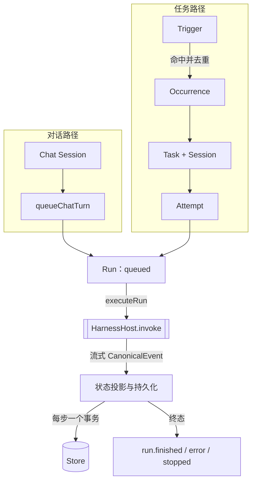

# @mininglamp-oss/octo-harness-core

Octo Harness 的领域模型与执行引擎。它定义 Agent、会话（Session）、任务（Task）、触发器（Trigger）、尝试（Attempt）与运行（Run）之间的关系与状态迁移，负责组装调用请求、驱动执行并持久化事件；但不启动任何 CLI，也不感知具体 provider。

## 定位与职责

一个 Agent 平台需要回答一组基础问题：一次“对话”与一次“任务执行”是什么关系、多轮如何延续；定时、事件、手动等多种触发方式如何避免重复执行；进程崩溃重启后哪些执行有效、哪些需要重来；各 provider 的会话恢复凭证（如 Codex thread、Claude UUID）如何存储并在下一轮回传。

本包将这些问题收敛为一套 **与 provider 无关** 的领域模型和状态机。更换持久层、控制面或新增 provider，均无需改动此处的执行语义。它刻意不承担的职责包括：网络服务、长期调度、进程隔离与多节点协调——这些由上层 app 与 daemon 负责。

## 核心概念

| 概念 | 含义 | 要点 |
|---|---|---|
| **Agent** | 一份配置：绑定某个 adapter 及其参数 | 不代表一次执行，也不保存对话历史 |
| **Session** | 长期会话容器，分 `chat` 与 `task` 两类 | 保存 provider 会话恢复凭证 |
| **Trigger** | 可重复触发的规则 | 分 manual / event / interval |
| **Occurrence** | 触发器命中一次外部事件的记录 | 以 `triggerId + externalEventId` 去重 |
| **Task** | 持久业务任务 | 拥有一个 Session，可多次延续 |
| **Attempt** | 对某个 Task 的一次尝试 | 记录来源与序号 |
| **Run** | 一次执行（排队 → 运行 → 终态） | Chat 与 Task 最终都收敛为 Run |

## 工作原理

对话（Chat）与触发器→任务（Trigger → Task）两条入口最终都收敛为同一种执行单元——**Run**。Run 是唯一“可执行、产生事件、可取消、可终态”的对象。



设计上遵循若干关键约束：

1. **Chat 与 Task 在 Run 层统一**：二者共用执行、事件、取消与 provider 会话；Task 额外具备 Trigger 与 Attempt。因此下层只需面向 Run。
2. **Core 不感知 provider**：新增 adapter 不应在 Core 中引入任何 `if (adapterType === …)` 分支，差异应止于 adapter。
3. **触发器幂等**：同一 `triggerId + externalEventId` 仅物化一个 occurrence/task，webhook 或调度重试不会重复执行。
4. **状态先于执行落盘**：Run 在调用 provider 之前即将 `running` 写入 Store，使崩溃恢复能够区分“尚未启动”与“已启动但失联”。
5. **provider 会话为旁路状态**：恢复凭证由 adapter 通过 `session.update` 上报，Core 仅负责存储与回传，不写入用户可见文本，也不解释其内容。

## 使用

```ts
import { HarnessEngine, MemoryStore } from "@mininglamp-oss/octo-harness-core";
import { AdapterHost } from "@mininglamp-oss/octo-harness-adapter-host";
import { codexAdapter } from "@mininglamp-oss/octo-harness-adapter-codex";

const host = new AdapterHost();
host.register(codexAdapter);

const store = new MemoryStore();               // 测试/示例；单机持久化使用 SqliteStore
const engine = new HarnessEngine({ store, host });

const agent = await engine.registerAgent({
  name: "demo",
  adapterType: "codex",
  config: { workdir: process.cwd(), sandbox: "read-only" }
});

const chat = await engine.createChatSession({ agentId: agent.id });
await engine.sendChat(chat.id, "Explain the current project");
```

## 约束与注意事项

- **两种 Store 参考实现**：`MemoryStore`（进程内、退出即失，适用于契约测试）与 `SqliteStore`（单机、WAL、掉电耐久，是 daemon 的本地事实源）。生产环境替换持久层即替换 `Store` 接口，无需改动执行语义。
- **`Task.status` 当前跟随 `RunStatus`**，是已知的简化：尚未区分“业务完成”与“执行完成”。扩展 Task 时不应默认二者等同。
- 本包不提供网络、调度、隔离与多节点 lease；生产部署需由独立 app 组装。

## 相关文档

- 领域关系与事件契约：[Architecture](../../docs/01-architecture.md)
- 事件三层模型：[Protocol](../octo-harness-protocol/README.md)
- 后台编排与恢复：[Daemon](../octo-harness-daemon/README.md)
