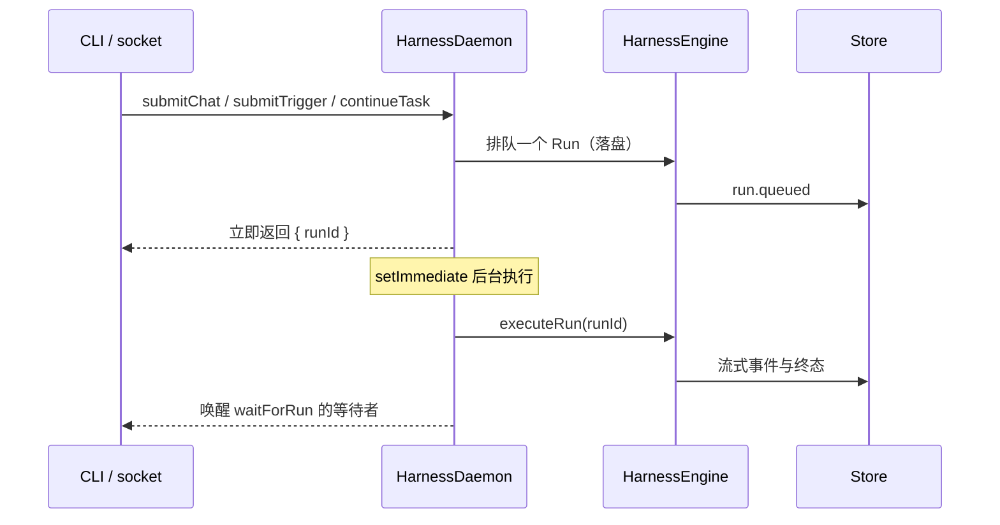

# @mininglamp-oss/octo-harness-daemon

Octo Harness 的后台编排运行时。`HarnessDaemon` 位于控制面（CLI / socket app）与 `HarnessEngine` 之间，负责快速受理请求、异步执行、触发器调度、崩溃恢复，以及运行的等待与取消。

## 定位与职责

`HarnessEngine` 会将一次执行从头驱动到终态，而 provider 调用可能持续数分钟。若每个控制请求都需等待其完成才返回，交互延迟与吞吐都将受损。

`HarnessDaemon` 处于控制面与 Core 之间，承担四项职责：

- **受理与执行分离**：请求进入后先落盘、排队并立即返回 `runId`，实际执行交由事件循环在后台进行。
- **触发器调度**：运行 interval 定时器、匹配 event 触发器，并复用 Core 的幂等语义。
- **崩溃恢复**：重启后重新调度处于 queued 的运行，并将“执行中途失联”的运行明确判定为失败。
- **等待与取消**：向调用方提供 `waitForRun` 与 `cancelRun`。

## 工作原理

核心动作为 `submit*`：先由 Core 完成落盘与排队，再通过 `setImmediate` 将执行推入后台，请求本身立即返回。



若干关键约定：

1. **受理与执行分离**：控制请求不会阻塞于长时间的 provider 调用。
2. **恢复须诚实**：当前尚无 `run.reattach`，因此重启后不会将已失联的 provider 进程伪装为“仍在运行”——此类 running 运行将被直接终态化为 `run.error`，仅 queued 运行会被重新调度。
3. **调度不复制领域规则**：Task/Run 的状态迁移仍由 Core 负责，daemon 仅决定“何时调度”。
4. **同一运行仅调度一次**：内部 pending 表防止单进程内重复启动。
5. **仅终态唤醒**：`waitForRun` 的等待者只在运行真正收敛后被唤醒；取消请求的 ACK 本身并非终态。

## 使用

在 app 装配层已创建 `HarnessEngine` 与同一 `Store` 之后：

```ts
import { HarnessDaemon } from "@mininglamp-oss/octo-harness-daemon";

const daemon = new HarnessDaemon({ engine, store });
await daemon.recover();                                   // 重启后先恢复

const accepted = await daemon.submitChat(sessionId, "Review this repository");
const terminal = await daemon.waitForRun(accepted.runId);
console.log(terminal);

daemon.stop();                                            // 停止本地定时器
```

## 约束与注意事项

- **它不是多节点任务队列**：不含数据库 lease、fencing、outbox，也无跨节点选主。其定位是本地 Unix socket daemon 或单节点轻量后台 worker。
- **`stop()` 仅停止本地定时器**，不会强制终止已启动的 provider 子进程。

### 后续演进方向（设计阶段，尚未落地）

当前 daemon 以 TypeScript 实现，编排逻辑与 provider 集成耦合在一起。规划中拟将**长驻、并发、网络与持久化**部分抽取为独立的 **Go / Rust 二进制**作为稳定性能内核，易变的 provider/adapter 集成层继续保留在 TypeScript，两层之间以跨语言协议（如 stdio JSON-RPC）交互，形成 **daemon(Go/Rust) → host(TS) → n×adapter(TS)** 的分层。其收益是稳定内核与快速迭代解耦，代价是引入一条跨语言序列化边界。详见 [Operations](../../docs/07-operations.md)。

## 相关文档

- 领域状态机：[Core](../octo-harness-core/README.md)
- 生产化方向：[Operations](../../docs/07-operations.md)
