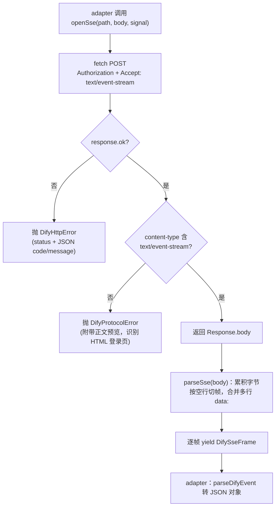

# @mininglamp-oss/octo-harness-dify-client

两个 Dify 适配器共用的传输层 client：负责拼装 URL、附加认证头、发起 HTTPS 请求，并将响应的 SSE 字节流切分为逐帧的结构化数据，不承载任何业务语义。

## 定位与职责

`dify-chatflow` 与 `dify-workflow` 两个适配器都需与远端 Dify 通信，而“与 Dify 通信”这一环节中存在大量与业务无关且重复的传输逻辑：

- 从环境变量读取 API key，拼装 `Authorization: Bearer ...` 头；
- 校验 base URL（必须 HTTPS，仅本地开发放行 localhost）；
- 发起 POST 打开 SSE 流，并当场拦截协议违规——例如服务端返回 200 却塞入一张 HTML 登录页而非事件流；
- 将 SSE 的原始字节（可能被网络任意切片）按空行正确切分为一帧帧 `event/data/id`；
- 统一 HTTP 错误、发送停止请求。

将上述逻辑收敛进一个薄 client 后，适配器只需关注“请求体形状、native 事件如何翻译为 canonical 事件”。该 client 完全不做事件映射，那是各适配器自身的职责。

## 工作原理

核心为两段：`DifyClient.openSse()` 负责“发出请求并把住协议门槛”，`parseSse()` 负责“将字节流切分为帧”。二者配合，适配器得到的是干净的 `DifySseFrame` 序列。



关键机制：

1. **API key 懒解析**。构造时不强制要求 key，`resolveApiKey()` 在真正发起请求时才从 option 或 `apiKeyEnv` 指向的环境变量取值；缺失即明确报错。如此 `probe` 无需预先备好 key。
2. **base URL 强制 HTTPS**。`normalizeBaseUrl` 去除尾部斜杠并校验协议，仅 `localhost` / `127.0.0.1` 允许明文 HTTP（本地开发）。
3. **协议门槛前置**。`openSse` 在返回流之前即判定两类问题：非 2xx 抛 `DifyHttpError`（尽量解析 JSON 中的 `code` / `message`，否则保留最多 4KiB 文本预览）；2xx 但 content-type 不符或无 body 抛 `DifyProtocolError`（附带最多 512 字符预览，用以识别伪装成 200 的错误页）。
4. **SSE 解析健壮**。`parseSse` 处理 UTF-8 网络分片、`\r\n\r\n` / `\n\n` / `\r\r` 三种帧边界、多行 `data:` 合并、注释心跳（`:` 开头行）；`maxFrameChars`（默认 1 MiB）为缓冲设定上限，防止服务端永不产出边界而耗尽内存；流尾的残帧亦会补发。`parseDifyEvent` 再将一帧 `data` 解析为 JSON 对象，`[DONE]` 与空帧跳过，坏 JSON 抛 `DifyProtocolError`。

## 使用

通常无需直接使用——经由两个 dify 适配器间接使用。若需自行驱动，构造 client、打开流、逐帧消费即可：

```ts
import {
  DifyClient,
  parseSse,
  parseDifyEvent
} from "@mininglamp-oss/octo-harness-dify-client";

const client = new DifyClient({
  baseUrl: "https://api.dify.ai/v1",
  apiKeyEnv: "DIFY_CHATFLOW_API_KEY" // key 从环境变量懒解析
});

// probe：对 /parameters 发起一次 GET，2xx 即视为可达
const health = await client.probe();
if (!health.available) throw new Error(health.reason);

// 打开 SSE：非 2xx 抛 DifyHttpError，content-type 不符抛 DifyProtocolError
const response = await client.openSse("/chat-messages", {
  inputs: {},
  query: "你好",
  response_mode: "streaming",
  conversation_id: "",
  user: "octo-harness:demo"
});

for await (const frame of parseSse(response.body!)) {
  const event = parseDifyEvent(frame); // null 表示心跳 / [DONE]，跳过
  if (event) console.log(event.event, event);
}
```

停止一个远端任务：`await client.stop("/chat-messages/<taskId>/stop", user)`（短超时，尽力而为）。

## 约束与注意事项

- **仅做传输，不承载业务**：不将 native 事件映射为 canonical 事件，也不处理请求体形状——那是各适配器的职责。
- **安全**：默认仅允许 HTTPS（localhost 例外）；API key 仅从指定环境变量读取，不写入 manifest / prompt / event / 日志；错误响应最多保留 4KiB 文本预览，且不记录请求头。
- **probe 仅验证可达性 / 鉴权**：GET `/parameters` 取得 2xx 即视为通过，body 直接丢弃；不代表应用配置正确或有额度。
- **两类错误需加区分**：`DifyHttpError` 表示“服务端明确返回非 2xx”（携带 `status`，可能携带 `code`）；`DifyProtocolError` 表示“HTTP 层看似正常，但 SSE 流违反协议”（错误 content-type、坏 JSON、超大帧，或未等到终态即断流）。

## 相关文档

- 上层业务用法：[dify-chatflow](../octo-harness-adapter-dify-chatflow/README.md) 与 [dify-workflow](../octo-harness-adapter-dify-workflow/README.md)
- 事件契约：[Protocol](../octo-harness-protocol/README.md)
- 各适配器对比与公共流程：[Adapter Guide](../README.md)
- Dify SSE 官方说明：[Streaming 指南](https://docs.dify.ai/zh/api-reference/guides/streaming)
