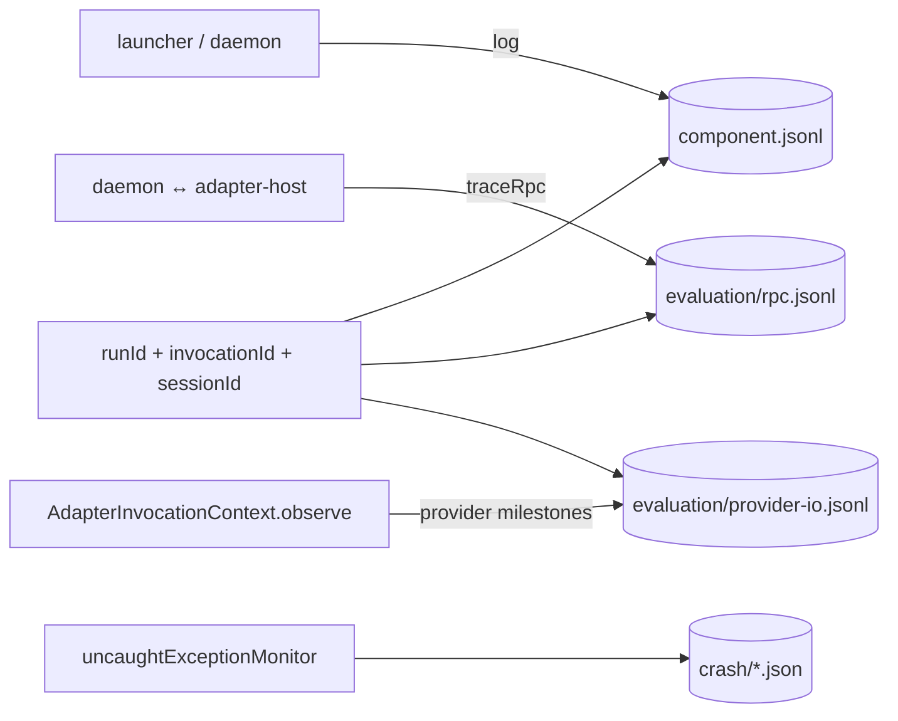
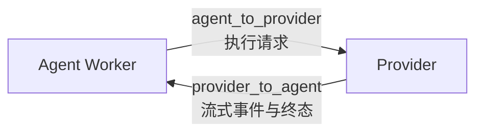
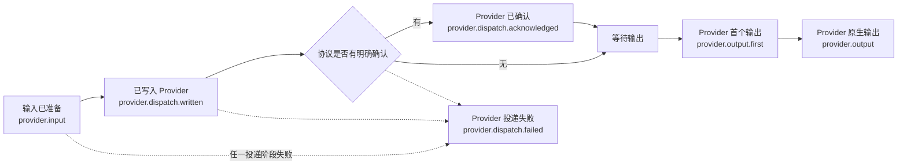

# @mininglamp-oss/octo-harness-observability

Octo Harness 的本地可观测性与评估证据包。它为 launcher、daemon 和 adapter-host 提供统一的结构化 JSONL writer、Run 关联、RPC/provider 边界采集、credential 脱敏、轮转保留、容量保护与最小 crash report。

## 定位与职责

Harness 的一次 Run 会经过控制入口、daemon、adapter-host、adapter 和本地 provider。只依赖各进程的 stderr，难以回答请求停在哪一层、输入是否真正写入 provider，以及某条响应属于哪次执行。

本包以 `runId` 作为业务级 Trace ID，将这些非权威诊断证据关联起来；更细的 `invocationId`、RPC ID 与 provider request/session ID 用于在 Run 内下钻。它刻意不承担以下职责：

- **不保存业务真值**：Run 状态与 canonical events 仍由 `state.db` / `Store` 持久化；日志写失败不得改写业务 Event seq。
- **不实现 Viewer 业务读模型**：日志查询原语由本包提供，`state.db` 与 JSONL 的合并、增量 tail 和页面展示位于 daemon/CLI app。
- **不上传外部遥测**：当前仅写本地文件，不包含 OpenTelemetry exporter、远端 sink 或 support bundle 上传。
- **不信任 adapter 提供关联身份**：adapter-host 从已校验的 `InvokeRequest` 注入 `runId/sessionId/invocationId/adapterType`，adapter 只报告 provider 边界事实。

## 数据分层与关联

| 数据 | daemon EventBus | 可选持久化 | 用途 | 权威性 |
|---|---|---|---|---|
| Operational log | 实时发布，受 `logLevel` 过滤 | 写入 component JSONL | 生命周期、连接、调度、耗时与错误 | 非权威诊断 |
| RPC trace | 实时发布，先脱 credential 和 private reasoning | `traceRpc=true` 时写入 `evaluation/rpc.jsonl` | daemon ↔ adapter-host 的协议帧 | Restricted evidence |
| Provider I/O | 实时发布安全 projection | 按 `captureProviderIo` 策略写入 `evaluation/provider-io.jsonl` | provider 可见输入、投递阶段与公开输出 | Restricted evidence |
| Crash report | 不进入 EventBus | file log 生效时写入 `crash/*.json` | 异常类型、错误码、有限 stack 与进程元数据 | 非权威诊断 |

daemon 始终创建进程内 `LiveEventBus`，并把它作为 `eventSink` 注入 `LocalObservability`。RPC 和 Provider I/O 的安全副本持续进入 EventBus，供 Inspect 实时查看；`traceRpc` 与 `captureProviderIo` 只控制 Restricted evidence 是否额外落盘，不控制 EventBus 事件是否产生。

EventBus 不查询数据库，也不执行默认磁盘写入。它是固定上限的进程内 ring buffer：默认最多保留 6 MiB、8192 个事件，单帧最多 256 KiB，同时最多 16 个订阅者；达到容量后淘汰旧事件，过大帧替换为诊断事件。因此常规流量下性能压力很小且内存可控，但并非零成本：每帧仍需做 JSON 解析、credential/private-reasoning 脱敏、序列化和 ring-buffer 写入。隐藏 Viewer 中的某个来源只改变展示，不会停止该来源的生产；若压测确认高频 delta 的多层副本造成可见 CPU 或分配压力，应在生产端增加采样或来源开关，而不是依赖页面过滤。

默认目录结构如下；`directory` 由装配层传入，本包不自行决定 `$OCTO_HARNESS_HOME`：

```text
<directory>/
  YYYY-MM-DD/
    launcher.jsonl
    daemon.jsonl
    adapter-host.jsonl
    evaluation/
      rpc.jsonl
      provider-io.jsonl
  crash/
    daemon-<timestamp>-<pid>.json
```

每条 record 都有 `schema_version`、UTC `ts`、`component`、`scope`、稳定 `event`、进程实例与进程内 `seq`。Run-scoped record 额外携带 `run_id`；同一 Session 可包含多个 Run，同一 Run 的具体 provider 调用由 `invocation_id` 标识。

## 工作原理



关键约定：

1. **结构化、追加写**：按本地日历日分目录，单文件达到上限后切换编号 shard。
2. **敏感证据物理分流**：RPC 与 provider I/O 只进入 `evaluation/`，查询时必须显式设置 `includeSensitive`。
3. **credential 在序列化前剔除**：结构化值会递归处理 header、argv、URL 及 JSON/YAML/TOML inline config；无法安全解析的 credential-shaped carrier 会被整体省略并标记 `complete=false`。`kind="bytes"` 是需要逐字复现的 opaque carrier，调用方必须在构造前剥离独立 credential carrier。
4. **private reasoning 永不保存正文**：只留下 hash、字节数等 receipt metadata。
5. **普通日志不阻塞业务**：writer 使用有界异步队列；压力下先丢弃 debug/trace 并通过 `status.droppedRecords` 暴露。
6. **strict capture fail closed**：启用 `requireProviderCapture` 后，`provider.input` 必须安全写入并 fsync 文件及目录，成功后才允许 adapter dispatch。

### Inspect 的 Event 与 Direction

Inspect 的主视图只回答两个问题：**发生了什么 Event**，以及它沿哪个 **Direction** 流动。这里的 direction 是 Viewer 从原始记录投影出的展示字段，不要求扩展底层事件维度；`source/stage` 继续保留在展开后的诊断元数据中，不作为默认分组、排序或中文标签。

| Direction | 界面名称 | 定义 | 典型 Event |
|---|---|---|---|
| `agent_to_provider` | 发往 Provider | Agent Worker 发起的执行请求，经 Runtime、Adapter Host 和 Adapter 送往 Provider | `runtime.command`、`invoke`、`provider.input`、`provider.dispatch.written` |
| `provider_to_agent` | 返回 Agent | Provider 的确认、流式输出、工具事件和终态，经 Adapter、Host、Runtime 返回 Agent Worker | `provider.output.first`、`message.delta`、`tool_call.create`、`run.completed` |



界面每行默认展示 `direction + event type + 中文名称 + 简短解释`：

| Direction | Event type | 中文名称 | 简短解释 |
|---|---|---|---|
| `agent_to_provider` | `provider.dispatch.written` | 已写入 Provider | 请求 bytes 已经写到 Provider 的本地协议边界 |
| `provider_to_agent` | `provider.output.first` | Provider 首个输出 | Provider 已经开始返回本次调用的内容 |
| `provider_to_agent` | `message.delta` | 消息增量 | 一段经过 Host 规整、可继续投递的流式文本 |
| `provider_to_agent` | `run.completed` | 执行成功完成 | Runtime 已把正常终态映射为 Agent Work 事件 |

同一业务事件可能同时出现在 `adapter-rpc`、`adapter-canonical` 和 `host-canonical` 诊断副本中。默认视图只选取一个语义副本：调用方向优先使用 `provider-native` 里程碑，返回方向优先使用 `host-canonical`；其他 source 仅在排查跨进程或 Host 修正问题时展开。

#### provider-native 类型与界面名称

`provider-native` 表示 Adapter 与 Provider CLI/app-server/ACP 之间的真实 I/O 边界。为了让界面快速表达“请求走到了哪里”，建议使用下面的短名称；详情中再展示 `rpc_method`、provider request/session ID 和安全 projection。

| Event type | Direction | 建议界面名称 | 解释 |
|---|---|---|---|
| `provider.input` | `agent_to_provider` | Provider 输入已准备 | Adapter 已构造 Provider 能理解的请求；在 strict capture 模式下，只有该输入持久化成功后才允许继续 dispatch |
| `provider.dispatch.written` | `agent_to_provider` | 已写入 Provider | 请求 bytes 已交给 Provider 子进程 stdin、socket 或 SDK 调用边界；不代表 Provider 已接受或开始执行 |
| `provider.dispatch.acknowledged` | `provider_to_agent` | Provider 已确认 | 收到与请求匹配的明确 ACK/response；只有具备确认语义的 Provider 协议才会产生 |
| `provider.output.first` | `provider_to_agent` | Provider 首个输出 | 收到本次调用的第一条 Provider 原生输出，可用于区分“已投递但无响应”和“已经开始返回” |
| `provider.output` | `provider_to_agent` | Provider 原生输出 | 捕获一条 Provider 原生输出的安全 projection；原生事件名或方法通常位于 `rpc_method` 或 projection 内 |
| `provider.dispatch.failed` | `agent_to_provider` | Provider 投递失败 | 请求在写入、调用或等待确认阶段失败；查看错误码与载荷元数据确定失败位置 |

推荐的界面时序可压缩为：



#### CanonicalEvent 类型中英文表

下面是 `adapter-canonical` 与 `host-canonical` 使用的完整稳定枚举。`adapter-rpc` 返回方向的 `invoke.event.params.event.type` 也使用同一枚举。

| Event type | Direction | 中文名称 | 解释 |
|---|---|---|---|
| `session.update` | `provider_to_agent` | Provider 会话更新 | 上报新建、续接或降级后的 Provider session/thread 信息，供下一次 Run 恢复；不是 Harness 业务 Session 的创建事件 |
| `usage.update` | `provider_to_agent` | 用量更新 | 上报 token、费用或 Provider 提供的其他用量数据，可在一个 Run 中出现多次 |
| `model_step.started` | `provider_to_agent` | 模型轮次开始 | 标记一次 Provider 模型推理轮次开始；使用 `stepId` 关联同轮的消息与工具调用 |
| `model_step.finished` | `provider_to_agent` | 模型轮次结束 | 标记一次模型轮次结束并携带状态、结束原因和可选时间；不等于整个 Run 结束 |
| `message.create` | `provider_to_agent` | 消息创建 | 开启一条 assistant 消息的生命周期，通常状态为 `streaming`，频道为 `analysis` 或 `final` |
| `message.delta` | `provider_to_agent` | 消息增量 | 追加一段流式文本；同一 `messageId` 的 delta 必须按到达顺序拼接 |
| `message.update` | `provider_to_agent` | 消息更新/结束 | 更新消息状态或关闭消息生命周期，例如 `completed`、`failed`、`stopped` |
| `tool_call.create` | `provider_to_agent` | 工具调用创建 | 开启一次工具调用，携带稳定 `id`、工具名和当前已知的结构化参数 `args` |
| `tool_call.delta` | `provider_to_agent` | 工具调用增量 | 追加按序到达的参数 JSON 片段或工具输出片段，不能把单个参数片段独立解析 |
| `tool_call.update` | `provider_to_agent` | 工具调用更新/结束 | 关闭工具调用并给出最终状态、输出、错误或退出码 |
| `surface.create` | `provider_to_agent` | 结构化界面创建 | 开启一个 Provider/Harness 结构化展示面；payload 为开放字典，具体字段由能力约定决定 |
| `surface.delta` | `provider_to_agent` | 结构化界面增量 | 向已创建的结构化展示面追加流式变化 |
| `surface.update` | `provider_to_agent` | 结构化界面更新/结束 | 更新或关闭结构化展示面的生命周期 |
| `run.queued` | `provider_to_agent` | 执行已排队 | Adapter/Provider 报告调用已经进入等待队列；Agent Work Runtime 当前不会把它写入 Worker Outbox |
| `run.running` | `provider_to_agent` | 执行中 | Adapter/Provider 报告调用已经开始运行；Agent Work Runtime 当前不会把它写入 Worker Outbox |
| `run.finished` | `provider_to_agent` | 执行正常完成 | Canonical Run 正常结束；三种终态之一，Host 保证每次调用恰好产生一个终态 |
| `run.error` | `provider_to_agent` | 执行失败 | Provider、Adapter 或 Host 处理失败；三种终态之一 |
| `run.stopped` | `provider_to_agent` | 执行已停止 | 主动取消、AbortSignal 或流异常中止；三种终态之一，不表示正常完成 |

#### Runtime → Worker 事件类型映射

Runtime 不会把所有 Host 事件原样发送给 Worker。它先写入本地 SQLite Outbox，再组成 `run.event_batch`；终态会切换到 Agent Work 的事件词汇。

| Host canonical type | Worker `events[].type` | Direction | 中文名称 | 解释 |
|---|---|---|---|---|
| 首个可投递事件到达 | `run.started` | `provider_to_agent` | 执行已开始 | Runtime 本地生成，并在该 Run 第一条可投递 canonical event 之前写入 Outbox |
| `run.finished` | `run.completed` | `provider_to_agent` | 执行成功完成 | 累积 final channel 文本后写入成功终态 |
| `run.error` | `run.failed` | `provider_to_agent` | 执行失败 | 映射为 Agent Work 失败终态，默认错误码为 `PROVIDER_ERROR` |
| `run.stopped` | `run.cancelled` | `provider_to_agent` | 执行已取消 | 映射为 Agent Work 取消终态 |
| `run.queued` / `run.running` | 不发送 | `provider_to_agent` | 仅本地过渡状态 | Runtime 主动跳过，不写入 Worker Outbox |
| 其他 CanonicalEvent | 保持原 type | `provider_to_agent` | 规范事件透传 | `session.update`、message、tool、surface、usage、model step 等保持名称，仅添加 Outbox 序号和租约字段 |

#### adapter-rpc 帧类型表

`adapter-rpc` 的 Inspect 顶层 event type 通常是 `rpc.frame`；下表是帧内 `method` 所表达的语义。

| RPC method / frame | 中文名称 | 方向 | 解释 |
|---|---|---|---|
| `list` | 列出适配器 | daemon → host | 查询 Host 已注册的 adapter 类型和能力，也用于启动就绪握手 |
| `probe` | 探测适配器 | daemon → host | 检查指定 adapter/provider 的本地可用性 |
| `invoke` | 发起适配器调用 | daemon → host | 携带 adapter 类型与 `InvokeRequest`；此时请求尚未经过 Host 的 `assertInvokeRequest` |
| `invoke` response | 调用已受理 | host → daemon | 使用同一 RPC `id` 返回 `invocationId`，只表示 Host 已接收调用，不表示 Provider 完成 |
| `invoke.event` | 调用流式事件 | host → daemon | `params.event` 是 Host 生命周期修正后的 CanonicalEvent，也是后续 `host-canonical` 的核心数据 |
| `invoke.done` | 调用事件流结束 | host → daemon | 关闭该 invocation 的异步事件队列；它是 RPC 流控制帧，不是 Run 业务终态 |
| `cancel` | 取消适配器调用 | daemon → host | 按 `invocationId` 触发 Host 的 AbortController，并向 Adapter 传播取消信号 |
| RPC error response | RPC 请求失败 | host → daemon | JSON-RPC `error` 响应，表示方法、参数或 Host 调用失败 |

`adapter-canonical` 和 `adapter-rpc` 因此不是同一种数据的两个名字。以下情况会出现明确差异：Adapter 只产出一个缺少 `message.create` 和 `messageId` 的 `message.delta` 时，`adapter-canonical` 只有原始的一条 delta；Host 会补出 `message.create`、为 delta 填入稳定 `messageId`，随后 `adapter-rpc` 的返回方向出现两个 `invoke.event` 帧。类似地，Adapter 未产出终态时，Host 兜底生成的 `run.stopped` 只会出现在返回 RPC 与 `host-canonical` 中。

反过来，在 Host 不需要修正某个事件时，`adapter-rpc` 返回帧中的 `params.event` 与 `host-canonical` 核心数据会完全相同。这种重复用于定位跨进程边界：有 RPC receive 而没有 `host-canonical`，说明故障位于 RPC 解包或 daemon 队列；有 `host-canonical` 而没有后续 runtime/worker 记录，说明故障位于事件映射、Outbox 或 Worker 投递。

Viewer 默认按 `direction + event type` 展示，并对重复业务事件只保留一个语义副本；`source/stage`、RPC 外壳和 Host 修正前事件按需展开。由于 provider/adapter observation 与 RPC 使用不同的子进程 pipe，跨来源的页面到达顺序不构成严格 happens-before；排障时应使用 `runId + invocationId` 关联，而不是只看显示顺序。

## 使用

### 写 operational log

```ts
import {
  DEFAULT_OBSERVABILITY_CONFIGURATION,
  LocalObservability
} from "@mininglamp-oss/octo-harness-observability";

const observability = new LocalObservability({
  ...DEFAULT_OBSERVABILITY_CONFIGURATION,
  directory: "/var/lib/octo-harness/logs",
  component: "daemon"
});

observability.log({
  level: "info",
  scope: "run.execution",
  event: "run.execution.started",
  message: "run execution started",
  runId: "run-42",
  sessionId: "session-7",
  data: { queue_depth: 0 }
});

await observability.close(); // 停止维护 timer，并等待已接收的写入完成
```

`log()` 是非阻塞调用。需要在测试或有序关闭前等待当前写入时使用 `flush()`；需要立即执行 retention/capacity 维护时使用 `cleanup()`。

### 记录 provider 边界

内置 adapter 通常不直接持有 logger，而是使用 adapter-host 注入的 `AdapterInvocationContext.observe()`。宿主会从可信 `InvokeRequest` 补齐关联身份，最终调用：

```ts
const receipt = await observability.observeProvider(
  {
    runId: "run-42",
    invocationId: "invoke-9",
    sessionId: "session-7",
    adapterType: "codex"
  },
  {
    event: "provider.input",
    rpcMethod: "turn/start",
    providerRequestId: "21",
    carrier: {
      kind: "json_params",
      content: { method: "turn/start", params: { prompt: "Inspect this repository" } }
    }
  }
);

console.log(receipt.state, receipt.sha256, receipt.byteLength);
```

`provider.input` 表示输入已准备；`provider.dispatch.written` 表示 bytes 已交给本地进程；只有协议返回明确响应时才记录 `provider.dispatch.acknowledged`。不能把这三个阶段合并成一个“已发送”。

### 记录 RPC 与查询

```ts
observability.traceRpc("send", JSON.stringify({
  jsonrpc: "2.0",
  id: 1,
  method: "invoke",
  params: { request: { runId: "run-42", invocationId: "invoke-9" } }
}));

const operational = await observability.query({ runId: "run-42" });
const withRestricted = await observability.query({
  runId: "run-42",
  invocationId: "invoke-9",
  includeSensitive: true,
  limit: 1000
});
```

`traceRpc()` 在 `traceRpc=true` 时额外持久化 RPC evidence，并会跨 request/response 与 `invoke.done` 维护 Run/invocation correlation。daemon 显式注入的进程内 `eventSink` 是独立的临时诊断面：它始终接收已脱 credential、已移除 private reasoning 的安全副本，供本机 `events`/`inspect` 使用；不写磁盘，也不属于普通 support output。correlation 索引最多各 4096 条、24 小时过期，并在 adapter-host 退出时清空。`query()` 默认不读取 `evaluation/`。

### 安装最小 crash reporter

```ts
import { installCrashReporter } from "@mininglamp-oss/octo-harness-observability";

const reporter = installCrashReporter({
  directory: "/var/lib/octo-harness/logs",
  component: "daemon"
});

process.once("exit", () => reporter.close());
```

Crash report 使用 `uncaughtExceptionMonitor`，不会吞掉或改变 Node 原有的 fatal-error 行为；报告不保存异常 message、argv、environment 或 provider 正文。

## 配置

| 字段 | 默认值 | adapter-host 环境变量 | 语义 |
|---|---:|---|---|
| `logLevel` | `info` | `OCTO_HARNESS_LOG_LEVEL` | operational 最低级别 |
| `fileLog` | `true` | `OCTO_HARNESS_FILE_LOG` | `0` 时不写文件日志，不影响 EventBus |
| `verbose` | `false` | `OCTO_HARNESS_VERBOSE` | 经配置 helper 展开为 debug + RPC + full provider I/O |
| `traceRpc` | `false` | `OCTO_HARNESS_TRACE_RPC` | 采集脱凭据完整 RPC frame |
| `captureProviderIo` | `off` | `OCTO_HARNESS_CAPTURE_PROVIDER_IO` | `off / input / full` |
| `requireProviderCapture` | `false` | `OCTO_HARNESS_REQUIRE_PROVIDER_CAPTURE` | provider 输入 dispatch 前必须 durable |
| `retentionDays` | `14` | `OCTO_HARNESS_LOG_RETENTION_DAYS` | operational 保留日数 |
| `traceRetentionDays` | `3` | `OCTO_HARNESS_TRACE_RETENTION_DAYS` | evaluation 保留日数 |
| `crashRetentionDays` | `30` | `OCTO_HARNESS_CRASH_RETENTION_DAYS` | crash report 保留日数 |
| `maxFileBytes` | `64 MiB` | `OCTO_HARNESS_LOG_MAX_FILE_BYTES` | 单 shard 大小上限 |
| `maxTotalBytes` | `1 GiB` | `OCTO_HARNESS_LOG_MAX_TOTAL_BYTES` | 日志目录总容量上限 |

`observabilityConfigurationFromEnv(env, fallbackDirectory)` 负责解析 adapter-host 环境；`observabilityEnvironment(configuration)` 用于 daemon 将同一份已验证策略传递给子进程。daemon 的 CLI 冲突校验与 `$OCTO_HARNESS_HOME` 路径解析位于 app 层，详见下方 Operations 文档。

## 安全与故障语义

- 日志目录强制为 owner-only `0700`，文件为 `0600`；写入拒绝 symlink、非普通文件、owner 不符及写入期间 inode 替换。
- 默认 retention 为 operational 14 天、evaluation 3 天、crash 30 天；启动、跨日、轮转和周期 timer 都会触发维护。
- 超过总容量时先删除旧 evaluation，再按证据时间删除其他旧文件；若仅当前日仍超限，则进入 `current_day_over_cap`，停止敏感正文并限速保留 info 以上 operational metadata。
- 普通模式下 sink 故障只设置 `status.degraded/degradedReason` 并向 stderr 输出低风险 metadata；不会回退输出 restricted 正文。
- strict capture 要求平台支持 `O_NOFOLLOW` 与目录 descriptor；能力不足、ENOSPC、EACCES、不完整 projection 或 writer queue 满都会在 provider dispatch 前失败。
- `redactCredentials*` 是纵深防御，不是允许调用者主动把 secret 塞进日志的理由。业务代码仍应只提交排障所需的最小字段。

## 公开 API

| API | 用途 |
|---|---|
| `LocalObservability` | operational、RPC、provider evidence 的 writer/query/lifecycle |
| `DEFAULT_OBSERVABILITY_CONFIGURATION` | 默认保留、级别和容量策略 |
| `observabilityConfigurationFromEnv` | 从 adapter-host 环境解析配置 |
| `observabilityEnvironment` | 将配置序列化为子进程环境变量 |
| `redactCredentials` | 返回脱凭据后的值 |
| `redactCredentialsWithMetadata` | 同时返回完整性与被剔除 JSON paths |
| `installCrashReporter` | 安装不改变退出语义的最小 crash 监听器 |
| `writeMinimalCrashReport` | 同步写入一份最小 crash report |

## 约束与注意事项

- `runId` 是当前业务级主关联轴，但不是 OpenTelemetry 的 `trace_id/span_id` 树；本包不表达并行 span 或跨节点父子关系。
- `precision="provider_cli_visible"` 只证明本地 Harness 向 CLI/app-server 提交的 carrier，不声称看到 provider 厂商内部 HTTP body。
- `CaptureReceipt.state="accepted"` 只表示写入任务已进入本地队列，最终结果由同一 `capture_id` 的 `capture.receipt` 记录说明；只有 strict input capture 返回的 `durable` 才是 dispatch barrier。
- `query()` 是有界的本地检索原语，不代替 Viewer 的 `state.db` join、cursor 和增量索引。

## 相关文档

- 本地运维、CLI 开关与 Trace Viewer：[Operations](../../docs/07-operations.md)
- Run、Session 与 canonical event：[Core](../octo-harness-core/README.md)
- Adapter observation 注入边界：[Adapter Host](../octo-harness-adapter-host/README.md)
- Adapter 采集 helper：[Adapter SDK](../octo-harness-adapter-sdk/README.md)
- 设计依据与完整安全合同：[Daemon Local Logging And Tracing Design](../../../docs/46-octo-harness-daemon-local-logging-and-tracing-design.html)
