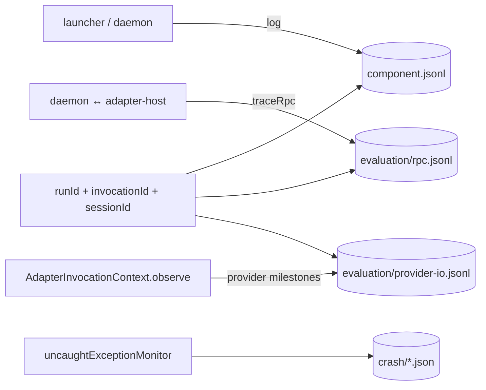

# @mininglamp-oss/octo-harness-observability

Octo Harness 的本地可观测性与评估证据包。它为 launcher、daemon 和 adapter-host 提供统一的结构化 JSONL writer、Run 关联、RPC/provider 边界采集、credential 脱敏、轮转保留、容量保护与最小 crash report。

## 定位与职责

Harness 的一次 Run 会经过控制入口、daemon、adapter-host、adapter 和本地 provider。只依赖各进程的 stderr，难以回答请求停在哪一层、输入是否真正写入 provider，以及某条响应属于哪次执行。

本包以 `runId` 作为业务级 Trace ID，将这些非权威诊断证据关联起来；更细的 `invocationId`、RPC ID 与 provider request/session ID 用于在 Run 内下钻。它刻意不承担以下职责：

- **不保存业务真值**：Run 状态与 canonical events 仍由 `state.db` / `Store` 持久化；日志写失败不得改写业务 Event seq。
- **不实现 Viewer 业务读模型**：日志查询原语由本包提供，`state.db` 与 JSONL 的合并、增量 tail 和页面展示位于 daemon/CLI app。
- **不上传外部遥测**：当前仅写本地文件，不包含 OpenTelemetry exporter、远端 sink 或 support bundle 上传。
- **不信任 adapter 提供关联身份**：adapter-host 从已校验的 `InvokeRequest` 注入 `runId/sessionId/invocationId/adapterType`，adapter 只报告 provider 边界事实。

## 数据分层与关联

| 数据 | 默认状态 | 用途 | 权威性 |
|---|---|---|---|
| Operational log | 开启，`info` 及以上 | 生命周期、连接、调度、耗时与错误 | 非权威诊断 |
| RPC trace | 关闭 | daemon ↔ adapter-host 的脱凭据协议帧 | Restricted evidence |
| Provider I/O | 关闭 | provider 可见输入、投递阶段与公开输出 | Restricted evidence |
| Crash report | file log 开启时安装 | 异常类型、错误码、有限 stack 与进程元数据 | 非权威诊断 |

默认目录结构如下；`directory` 由装配层传入，本包不自行决定 `$OCTO_HARNESS_HOME`：

```text
<directory>/
  YYYY-MM-DD/
    launcher.jsonl
    daemon.jsonl
    adapter-host.jsonl
    evaluation/
      rpc.jsonl
      provider-io.jsonl
  crash/
    daemon-<timestamp>-<pid>.json
```

每条 record 都有 `schema_version`、UTC `ts`、`component`、`scope`、稳定 `event`、进程实例与进程内 `seq`。Run-scoped record 额外携带 `run_id`；同一 Session 可包含多个 Run，同一 Run 的具体 provider 调用由 `invocation_id` 标识。

## 工作原理



关键约定：

1. **结构化、追加写**：按本地日历日分目录，单文件达到上限后切换编号 shard。
2. **敏感证据物理分流**：RPC 与 provider I/O 只进入 `evaluation/`，查询时必须显式设置 `includeSensitive`。
3. **credential 在序列化前剔除**：结构化值会递归处理 header、argv、URL 及 JSON/YAML/TOML inline config；无法安全解析的 credential-shaped carrier 会被整体省略并标记 `complete=false`。`kind="bytes"` 是需要逐字复现的 opaque carrier，调用方必须在构造前剥离独立 credential carrier。
4. **private reasoning 永不保存正文**：只留下 hash、字节数等 receipt metadata。
5. **普通日志不阻塞业务**：writer 使用有界异步队列；压力下先丢弃 debug/trace 并通过 `status.droppedRecords` 暴露。
6. **strict capture fail closed**：启用 `requireProviderCapture` 后，`provider.input` 必须安全写入并 fsync 文件及目录，成功后才允许 adapter dispatch。

## 使用

### 写 operational log

```ts
import {
  DEFAULT_OBSERVABILITY_CONFIGURATION,
  LocalObservability
} from "@mininglamp-oss/octo-harness-observability";

const observability = new LocalObservability({
  ...DEFAULT_OBSERVABILITY_CONFIGURATION,
  directory: "/var/lib/octo-harness/logs",
  component: "daemon"
});

observability.log({
  level: "info",
  scope: "run.execution",
  event: "run.execution.started",
  message: "run execution started",
  runId: "run-42",
  sessionId: "session-7",
  data: { queue_depth: 0 }
});

await observability.close(); // 停止维护 timer，并等待已接收的写入完成
```

`log()` 是非阻塞调用。需要在测试或有序关闭前等待当前写入时使用 `flush()`；需要立即执行 retention/capacity 维护时使用 `cleanup()`。

### 记录 provider 边界

内置 adapter 通常不直接持有 logger，而是使用 adapter-host 注入的 `AdapterInvocationContext.observe()`。宿主会从可信 `InvokeRequest` 补齐关联身份，最终调用：

```ts
const receipt = await observability.observeProvider(
  {
    runId: "run-42",
    invocationId: "invoke-9",
    sessionId: "session-7",
    adapterType: "codex"
  },
  {
    event: "provider.input",
    rpcMethod: "turn/start",
    providerRequestId: "21",
    carrier: {
      kind: "json_params",
      content: { method: "turn/start", params: { prompt: "Inspect this repository" } }
    }
  }
);

console.log(receipt.state, receipt.sha256, receipt.byteLength);
```

`provider.input` 表示输入已准备；`provider.dispatch.written` 表示 bytes 已交给本地进程；只有协议返回明确响应时才记录 `provider.dispatch.acknowledged`。不能把这三个阶段合并成一个“已发送”。

### 记录 RPC 与查询

```ts
observability.traceRpc("send", JSON.stringify({
  jsonrpc: "2.0",
  id: 1,
  method: "invoke",
  params: { request: { runId: "run-42", invocationId: "invoke-9" } }
}));

const operational = await observability.query({ runId: "run-42" });
const withRestricted = await observability.query({
  runId: "run-42",
  invocationId: "invoke-9",
  includeSensitive: true,
  limit: 1000
});
```

`traceRpc()` 的持久化仅在 `traceRpc=true` 时生效，并会跨 request/response 与 `invoke.done` 维护 Run/invocation correlation。daemon 显式注入的进程内 `eventSink` 是独立的临时诊断面：它可在持久化关闭时接收已脱 credential、已移除 private reasoning 的安全副本，供本机 `events`/`inspect` 使用；不写磁盘，也不属于普通 support output。correlation 索引最多各 4096 条、24 小时过期，并在 adapter-host 退出时清空。`query()` 默认不读取 `evaluation/`。

### 安装最小 crash reporter

```ts
import { installCrashReporter } from "@mininglamp-oss/octo-harness-observability";

const reporter = installCrashReporter({
  directory: "/var/lib/octo-harness/logs",
  component: "daemon"
});

process.once("exit", () => reporter.close());
```

Crash report 使用 `uncaughtExceptionMonitor`，不会吞掉或改变 Node 原有的 fatal-error 行为；报告不保存异常 message、argv、environment 或 provider 正文。

## 配置

| 字段 | 默认值 | adapter-host 环境变量 | 语义 |
|---|---:|---|---|
| `logLevel` | `info` | `OCTO_HARNESS_LOG_LEVEL` | operational 最低级别 |
| `fileLog` | `true` | `OCTO_HARNESS_FILE_LOG` | `0` 时关闭文件日志 |
| `verbose` | `false` | `OCTO_HARNESS_VERBOSE` | 经配置 helper 展开为 debug + RPC + full provider I/O |
| `traceRpc` | `false` | `OCTO_HARNESS_TRACE_RPC` | 采集脱凭据完整 RPC frame |
| `captureProviderIo` | `off` | `OCTO_HARNESS_CAPTURE_PROVIDER_IO` | `off / input / full` |
| `requireProviderCapture` | `false` | `OCTO_HARNESS_REQUIRE_PROVIDER_CAPTURE` | provider 输入 dispatch 前必须 durable |
| `retentionDays` | `14` | `OCTO_HARNESS_LOG_RETENTION_DAYS` | operational 保留日数 |
| `traceRetentionDays` | `3` | `OCTO_HARNESS_TRACE_RETENTION_DAYS` | evaluation 保留日数 |
| `crashRetentionDays` | `30` | `OCTO_HARNESS_CRASH_RETENTION_DAYS` | crash report 保留日数 |
| `maxFileBytes` | `64 MiB` | `OCTO_HARNESS_LOG_MAX_FILE_BYTES` | 单 shard 大小上限 |
| `maxTotalBytes` | `1 GiB` | `OCTO_HARNESS_LOG_MAX_TOTAL_BYTES` | 日志目录总容量上限 |

`observabilityConfigurationFromEnv(env, fallbackDirectory)` 负责解析 adapter-host 环境；`observabilityEnvironment(configuration)` 用于 daemon 将同一份已验证策略传递给子进程。daemon 的 CLI 冲突校验与 `$OCTO_HARNESS_HOME` 路径解析位于 app 层，详见下方 Operations 文档。

## 安全与故障语义

- 日志目录强制为 owner-only `0700`，文件为 `0600`；写入拒绝 symlink、非普通文件、owner 不符及写入期间 inode 替换。
- 默认 retention 为 operational 14 天、evaluation 3 天、crash 30 天；启动、跨日、轮转和周期 timer 都会触发维护。
- 超过总容量时先删除旧 evaluation，再按证据时间删除其他旧文件；若仅当前日仍超限，则进入 `current_day_over_cap`，停止敏感正文并限速保留 info 以上 operational metadata。
- 普通模式下 sink 故障只设置 `status.degraded/degradedReason` 并向 stderr 输出低风险 metadata；不会回退输出 restricted 正文。
- strict capture 要求平台支持 `O_NOFOLLOW` 与目录 descriptor；能力不足、ENOSPC、EACCES、不完整 projection 或 writer queue 满都会在 provider dispatch 前失败。
- `redactCredentials*` 是纵深防御，不是允许调用者主动把 secret 塞进日志的理由。业务代码仍应只提交排障所需的最小字段。

## 公开 API

| API | 用途 |
|---|---|
| `LocalObservability` | operational、RPC、provider evidence 的 writer/query/lifecycle |
| `DEFAULT_OBSERVABILITY_CONFIGURATION` | 默认保留、级别和容量策略 |
| `observabilityConfigurationFromEnv` | 从 adapter-host 环境解析配置 |
| `observabilityEnvironment` | 将配置序列化为子进程环境变量 |
| `redactCredentials` | 返回脱凭据后的值 |
| `redactCredentialsWithMetadata` | 同时返回完整性与被剔除 JSON paths |
| `installCrashReporter` | 安装不改变退出语义的最小 crash 监听器 |
| `writeMinimalCrashReport` | 同步写入一份最小 crash report |

## 约束与注意事项

- `runId` 是当前业务级主关联轴，但不是 OpenTelemetry 的 `trace_id/span_id` 树；本包不表达并行 span 或跨节点父子关系。
- `precision="provider_cli_visible"` 只证明本地 Harness 向 CLI/app-server 提交的 carrier，不声称看到 provider 厂商内部 HTTP body。
- `CaptureReceipt.state="accepted"` 只表示写入任务已进入本地队列，最终结果由同一 `capture_id` 的 `capture.receipt` 记录说明；只有 strict input capture 返回的 `durable` 才是 dispatch barrier。
- `query()` 是有界的本地检索原语，不代替 Viewer 的 `state.db` join、cursor 和增量索引。

## 相关文档

- 本地运维、CLI 开关与 Trace Viewer：[Operations](../../docs/07-operations.md)
- Run、Session 与 canonical event：[Core](../octo-harness-core/README.md)
- Adapter observation 注入边界：[Adapter Host](../octo-harness-adapter-host/README.md)
- Adapter 采集 helper：[Adapter SDK](../octo-harness-adapter-sdk/README.md)
- 设计依据与完整安全合同：[Daemon Local Logging And Tracing Design](../../../docs/46-octo-harness-daemon-local-logging-and-tracing-design.html)
