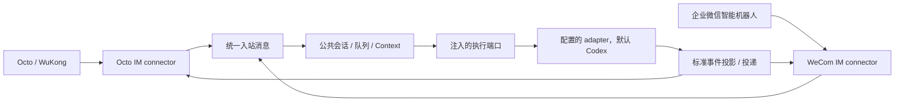

# 多平台 IM 接入与企业微信方案

日期：2026-10-14。实现范围：同一个 `octo-runtime-channel-im` 包支持 Octo 与企业微信；公共执行领域复用，平台专属协议和呈现归入各平台目录。

## 术语与边界

本文及代码中的 **connector 是 IM 平台连接器，不是 MCP 连接器**。它适配 IM 平台的鉴权、连接、心跳、入站消息、回复以及平台呈现能力。它不注册模型工具、不管理 MCP Server、不承担 MCP OAuth 或工具发现。执行 Context 中的 MCP 工具配置仍走既有执行协议，与这里的 IM connector 无关。

`type` 选择 IM 平台（`octo`、`wecom`）；`adapter.adapter_type` 选择执行引擎（缺省 `codex`）。两者独立。企业微信可以调用 Codex 或其他已安装引擎；同一种平台可以配置多个机器人。连接器不能自己启动、下载或安装执行引擎。

WorkApp、CLI 或其他宿主均显式装配配置和执行端口。IM 不读取 WorkApp 当前会话，不继承其模型、思考强度或工作目录，也不默认自动启用。WorkApp 仅是本次人工测试所使用的宿主。

## 公共领域与平台专属目录

保留现有公共领域目录，避免为了第二个平台重写已有会话、执行和投递代码。

```text
src/
  contracts.ts / ports.ts         公共消息、连接、执行、凭据和呈现端口
  lifecycle/                     配置校验、接入登记、启停、重试与代次
  application/im-channel.ts      去重、会话队列、控制命令与单轮编排
  execution/dispatcher.ts        Context → 既有执行计划 → InvokeRequest
  presentation/run-projector.ts  CanonicalEvent → 可公开的呈现状态
  presentation/typing.ts         可复用的有界 presence 生命周期
  delivery/                      投递回执、幂等、调度、未知结果
  connectors/
    registry.ts                  IM 平台类型的唯一装配点（非 MCP）
    octo/
      channel.ts                 Octo IM 平台端口实现
      wukong.ts                  二进制 WS、加密、ACK、心跳
      normalize.ts / contexts.ts Octo 地址、群规则、历史与 Context 构造
      card-session.ts            Octo 卡片身份、更新序号与终态收敛
      reasoning-frame.ts         Octo 卡片模板的展示映射
      cards.ts / connector.ts    Octo 模板 profile、发送/编辑、typing
      api/                       Octo REST API 与原生事件
    wecom/
      connection.ts              JSON WS、鉴权、心跳、回调与 stream 回复
      channel.ts                 企业微信消息 → 公共消息与回复接口
```



公共层只使用 `ImInboundMessage`：消息 ID、发送者、会话、文本、`buildContext()`、`reply()` 以及可选的 `beginPresentation()`。企业微信的 `req_id`、Octo 的 `channelType`、卡片模板与凭据保留在平台实现内部。公共 runtime 不根据平台类型拼装卡片，也不导入 Octo API。

Octo 卡片属于 Octo 专属呈现。公共层可以投影标准事件，但不要求企业微信实现 Octo profile、template-ref、GROUP.md 或 typing。企业微信目前使用文本流回复，后续卡片能力在其自身目录扩展。

## im.json

CLI 文件是顶层数组，与 SDK 的 `ImBotConfig` 使用相同字段。接入默认启用；`enabled: false` 停用。CLI 每次通过 `channel configure` 保存一项，重启 daemon 后生效。

```json
[
  {
    "type": "wecom",
    "bot_id": "<企业微信 Bot ID>",
    "app_secret_file": "credentials/wecom-secret",
    "adapter": { "adapter_type": "codex", "workdir": "/srv/wecom" }
  },
  {
    "type": "octo",
    "api_url": "https://im-test.deepminer.com.cn/api",
    "bot_id": "<Octo Bot ID>",
    "bf_token_file": "credentials/octo-token",
    "adapter": { "adapter_type": "codex", "workdir": "/srv/octo" }
  }
]
```

不接受旧 `bots` 包装、独立 `id`、`space_id` 或驼峰字段。`bot_id` 与服务地址共同标识接入，Octo 租户由 octo-auth 的 `verify-bot` 返回。文件最多 16 项；先校验整份列表，再原子保存。读配置不补写默认值、不创建工作目录。

`adapter` 的 `model`、`effort` 可选。OpenClaw 不带 workdir，使用 `adapter_type: "openclaw"` 和可选 `provider_agent_id`（默认 main）；CLI 在 daemon 启动时自动读取本机 `openclaw.json`。连接凭据与执行设置不进入模型正文。

`bf_token` 与 `bf_token_file` 二选一；企业微信使用 `app_secret` 或 `app_secret_file`。凭据文件相对路径按 CLI Home 解析。凭据文件以及含凭据的配置文件须为 POSIX 0600。SDK 可直接注入凭据来源，文件读取与连接初始化属于宿主组合层。

## 企业微信协议与最小能力

使用企业微信智能机器人 API 长连接。默认网关为 `wss://openws.work.weixin.qq.com`。

1. WebSocket 建立后发送 `aibot_subscribe`，携带 `bot_id` 和 `secret`。
2. 只有同一 `req_id` 的 `errcode=0` 回执才代表鉴权成功。
3. 每 30 秒发送 `ping`，记录匹配回执的数量和时间。默认等待回执 10 秒；心跳失败关闭失效连接，由公共生命周期决定后续动作。
4. 解析文本 `aibot_msg_callback`，区分单聊 userid 与群聊 chatid，校验 aibotid。平台可见范围和会话权限为默认准入，`allowedSenderIds` 只是宿主可选的进一步限制。
5. 公共层调用配置的 adapter，企业微信在 Run 开始时以原回调 `req_id` 发送一次 `<think></think>` / `finish=false` stream，触发原生思考气泡；不发送耗时或工具计数文字。同一请求串行等待 ACK。真实 Run 终态后，以同一 stream id 发送 `finish=true` 的最终回复。超过 20480 字节时按 Unicode 字符边界截断并明确标注。
6. 服务端 `disconnected_event` 表示连接被替换，旧实例停止自动重连，避免互相抢占。

连接诊断不输出 Secret、消息正文或服务端原始错误正文。身份、ACK、执行完成与消息投递是不同状态，不把 socket 打开或本地 send 成功当作鉴权/投递成功。

当前企微范围为文本单聊、群聊回调、原生思考气泡与最终文本回复。气泡触发方式参考 [Hermes WeCom streaming.py](https://github.com/NousResearch/hermes-agent/blob/main/plugins/platforms/wecom/streaming.py)；其 `send_typing()` 为空操作，实际动效由首次空 think stream 触发，并非独立 typing 指令。等待交互时展示指令，不外发私有 reasoning、工具参数或输出。图片、文件解密、企微模板卡片、主动通知和消息持久化未在本次实现。用户已确认本轮原生思考气泡与最终回复通过；长时执行、交互期间多次回复以及复杂群聊行为仍需专项验收。

## 验证与启动

包内脚本 `scripts/probe-wecom.mjs` 可仅验证连接：输入 0600 的 `{ "appBot": "...", "appSecret": "..." }` 文件，或使用 `WECOM_APP_BOT` / `WECOM_APP_SECRET`。它不会调用模型或回复聊天，收到两次自动心跳 ACK 后关闭连接。

```sh
pnpm --filter @mininglamp-oss/octo-runtime-channel-im build
node packages/octo-runtime-channel-im/scripts/probe-wecom.mjs /absolute/path/credentials.json
```

2026-10-14 北京时间 00:06:44 至 00:07:44，已使用用户提供的机器人完成真实鉴权与两次 30 秒心跳，服务端均返回成功回执。该记录只证明连接与保活，不代表用户侧已看到 Codex 回复。

消息链路自动化验证使用本地协议服务器及执行端口替身，覆盖请求关联、失败/超时、连接替换、入站去重、标准 Context、Codex 路由与最终回复。真实消息收发需由用户在企业微信发送测试消息，观察 Run 与平台投递回执。

协议依据：[企业微信接入说明](https://open.work.weixin.qq.com/help2/pc/cat?doc_id=21661)、[WeCom 官方 Node SDK](https://github.com/WecomTeam/aibot-node-sdk)。原始帮助页读取失败，wire 字段、心跳与 stream 格式已通过官方 SDK 1.0.7 源码及真实服务回执交叉验证。

### 先前的显式人工测试记录

当时使用旧文件格式，`Work Home/im.json` 中的 `wecom-test` 显式启用并补写了默认 adapter `codex`；当前文件格式以上文为准。凭据保存在该 Home 的独立 0600 文件，未写入仓库。通过包内 `scripts/activate.mjs <配置 home> <宿主 daemon socket>` 显式登记，WorkApp 不自动读取该文件；重启测试宿主后需要重新显式登记。

全仓构建、根 TypeScript 校验及企业微信定向 lint/测试用于验收。同一配置通过宿主执行端口调用真实 Codex，取得 `run.completed` 和固定答复 `IM_CODEX_READY`；该 smoke test 不伪造企业微信消息，也不向用户发送测试通知。2026-10-14 用户已确认企业微信客户端原生思考气泡与最终回复的人工收发测试通过。此结论不代替 Octo 卡片的客户端验收。
