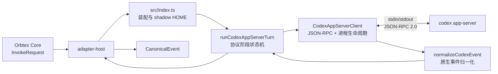
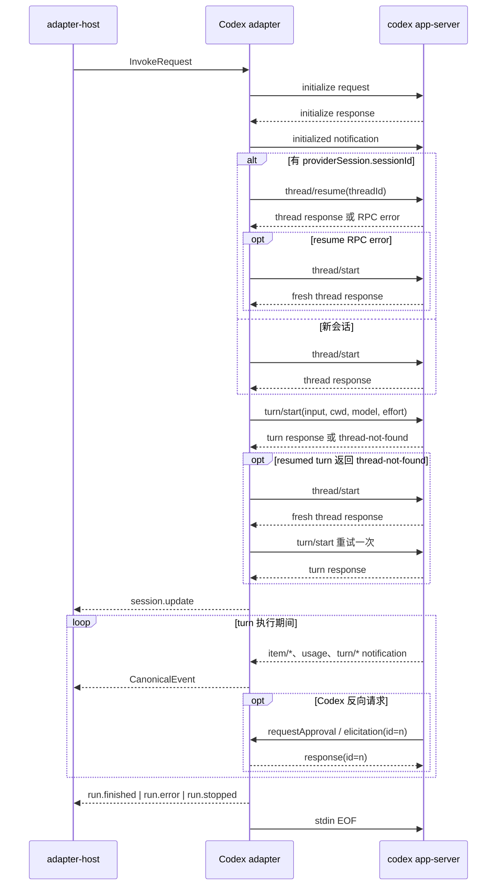

# @orbtex-ai/orbtex-adapter-codex

Codex 本地 provider adapter。Adapter type：`codex`。

本文既是使用说明，也是当前实现的设计文档。它描述代码已经实现的语义；与 Aily 0.1.54 的差距单独列在“能力边界”中，不把规划项写成现有能力。

## 一句话结论

该 adapter 不再执行 `codex exec --json` 并被动解析输出，而是为每个 Orbtex invocation 启动一个：

```text
codex app-server --listen stdio://
```

随后通过 stdin/stdout 上的逐行 JSON-RPC 2.0 主动控制 `initialize -> thread -> turn`，把 Codex notification 转换成 Orbtex `CanonicalEvent`，并在同一连接上响应 Codex 发起的 approval/elicitation server request。

它解决的是 provider 协议适配，不负责排队、Trigger、Chat/Task 持久化、跨机器调度或 UI 权限确认。

SDK 的通用 `createJsonCliAdapter` 面向“写入一次 input，然后单向读取 stdout NDJSON”的 CLI：它没有后续请求写入、pending ID map 或 server request response。强行扩展会把双向 JSON-RPC 生命周期塞进所有 provider 共用的简单 helper，因此 Codex 在本包内拥有独立 client。

## 设计目标

1. **使用 Codex 原生会话模型。** 用 `thread/start`、`thread/resume` 和 `turn/start` 表达新会话、续跑和一轮输入。
2. **不让 Codex 类型泄漏到 Core。** Adapter 对外只输出 `session/message/tool/usage/run` 统一事件。
3. **保证单终态。** 每次 invocation 最多出现一个 `run.finished`、`run.error` 或 `run.stopped`。
4. **把用户输入留在 stdin。** prompt 通过 `turn/start.input` 发送，不进入命令行参数和进程列表。
5. **覆盖 harness instructions。** 每轮构造 shadow `CODEX_HOME`，不修改用户真实 `config.toml`；这不是文件系统安全隔离。
6. **有界尝试回收。** 正常、失败和取消都关闭 pending RPC、readline、stdin 和临时 HOME，并按超时阶梯回收本 invocation 的直接子进程。
7. **允许协议演进。** 未识别的非关键 notification 可以忽略；未知 server request 必须返回 JSON-RPC `-32601`，不能让服务端永久等待。

## 非目标

- 不在 adapter 内建立任务队列、重试调度或数据库。
- 不把 `workdir` 当成安全沙箱；真正文件边界由 Codex sandbox 和外部执行环境决定。
- 不模拟 Codex CLI 的终端 UI。
- 不自动把 invocation 调度到其他 Runtime。
- 当前不提供 Aily 的 session fork、实时 message append、日志 reattach、SQLite state 镜像或 MCP control bridge。

## 术语

| 术语 | 本文含义 |
|---|---|
| invocation | Host 对 adapter 的一次调用，对应一个 `InvokeRequest`、一个 app-server 子进程和至多一个 run 终态 |
| Core | Orbtex 的领域与持久化层，保存 Chat/Task、session、run 和 canonical events |
| Host / adapter-host | 装载 adapter、转发请求、注入 AbortSignal 并校验事件生命周期的本地宿主 |
| `CanonicalEvent` | Orbtex 跨 provider 的统一事件：session、message、tool、usage 和 run |
| provider session side channel | `session.update.providerSession`；Core 保存但不解析的 provider 会话标识和恢复结果 |
| Aily 0.1.54 | 本仓库用于对比的本机 Aily Codex adapter 构建，详细证据见文末 HTML 文档 |

## 总体架构



一次 invocation 对应一个 app-server 子进程。Codex thread 可以跨 invocation 恢复，但承载 thread 的 JSON-RPC 连接不会复用。

| 层 | 代码 | 拥有的状态 | 不负责 |
|---|---|---|---|
| Adapter 装配 | `src/index.ts` | 临时 HOME、命令规格、metadata | JSON-RPC frame 解析 |
| 协议编排 | `runCodexAppServerTurn()` | initialize/thread/turn 阶段、resume 降级、是否已发终态 | stdin chunk 边界 |
| Wire client | `CodexAppServerClient` | 子进程、pending map、active thread/turn、stderr、AbortSignal | Core session 持久化 |
| 事件归一化 | `normalizeCodexEvent()` | 无，保持纯函数 | 跨帧去重和 transcript 补充 |
| Host | `@orbtex-ai/orbtex-adapter-host` | invocation registry、取消控制、最终 message 状态 | Codex 专用协议 |

## 核心不变量

维护代码时应优先守住以下约束：

| 不变量 | 原因 | 实现位置 |
|---|---|---|
| 权威 `session.update` 晚于 `turn/start` 成功 | 不能持久化一个“thread 存在但本轮不能执行”的 session；早到的同 ID `thread/started` 映射会在 runner 中过滤 | `runCodexAppServerTurn()` |
| 一个 invocation 至多一个 run 终态 | Host 在终态后拒绝继续接收事件；整轮无终态 timeout 仍由上层负责 | runner 的 `terminal` + client queue close |
| JSON-RPC response 必须按 ID 关联 | stdout 上 response、notification、server request 会交错 | `#pending`、`#handleLine()` |
| 终态后忽略后续 provider frame | 防止重复 terminal 或工具事件写入已完成 run | `#terminal` + `AsyncEventQueue.close()` |
| active thread 建立后过滤其他 thread | 避免全局/并发 notification 串入当前 run | `#acceptNotification()` |
| cleanup 始终由顶层 `finally` 触发 | 正常、RPC error、进程退出和取消必须走同一资源回收路径 | runner `finally` |

## 一次 invocation 的协议时序



### Phase 1：initialize

Adapter 首先发送：

```json
{
  "jsonrpc": "2.0",
  "id": 1,
  "method": "initialize",
  "params": {
    "clientInfo": {
      "name": "@orbtex-ai/orbtex-adapter-codex",
      "version": "0.1.0"
    },
    "capabilities": {
      "experimentalApi": true,
      "requestAttestation": false
    }
  }
}
```

收到 response 后再发送无 ID 的 `initialized` notification。初始化失败不会继续创建 thread。

### Phase 2：thread start / resume

如果 `InvokeRequest.providerSession.sessionId` 存在，先调用 `thread/resume`；否则直接 `thread/start`。

thread 公共参数包括：

- `cwd`：Agent workdir。
- `model`：可选的 provider model。
- `sandbox`：`read-only`、`workspace-write` 或 `danger-full-access`。
- `approvalPolicy: never`：当前按无人值守语义运行。
- `developerInstructions`：daemon/Core 传入的本轮控制指令。

resume RPC 抛错时会降级 fresh thread。若 resume response 成功却不含可识别 thread ID，当前会直接终止，而不是静默降级。若 resume RPC 成功、但随后 `turn/start` 返回 `thread not found`，会新建 thread 后重试一次 turn。

### Phase 3：turn start

用户 prompt 以结构化 input 发送：

```json
{
  "jsonrpc": "2.0",
  "id": 3,
  "method": "turn/start",
  "params": {
    "threadId": "provider-thread-id",
    "input": [
      { "type": "text", "text": "用户输入", "text_elements": [] }
    ],
    "cwd": "/absolute/workdir",
    "model": "optional-model",
    "effort": "low"
  }
}
```

Orbtex 的 `thinking: disabled` 不能直接传给 Codex app-server，因此兼容映射为最低有效等级 `low`。其他值按原值传递。

### Phase 4：stream

`turn/start` 成功后，adapter 先上报权威 `session.update`，再持续消费 notification。Codex 可能已经发送并排队同一 thread ID 的 `thread/started`；runner 会过滤这条重复 session 映射，因此 Core 只看到带完整 resume metadata 的权威更新。遇到 run 终态后立即关闭事件队列，不再接受后续 provider 事件。

## JSON-RPC client 设计

### 三类入站 frame

`CodexAppServerClient.#handleLine()` 按以下顺序判断：

1. **Response**：存在 `id`，并且存在 `result` 或 `error`。从 pending map 取出请求并完成 Promise。
2. **Server request**：同时存在 `id` 与 `method`。Adapter 必须返回 response。
3. **Notification**：存在 `method`、没有 `id`。经过 active thread 过滤后进入事件 parser。

顺序不能随意调整。Server request 和 notification 都有 `method`，但只有前者有 ID；response 可能完全没有 `method`。

### Pending request

每次 `request(method, params)`：

1. 分配递增 ID。
2. 在 `#pending` 登记 method、resolve、reject 和 timeout timer。
3. 将 JSON frame 写入 stdin。
4. response 到达后删除 pending 并清理 timer。
5. 超时、写入失败或进程退出时拒绝 Promise。

Pending 必须先登记再写 stdin，避免本地测试 server 极快回包时丢失 response。超时之后到达的 late response 因为没有 pending 项，会被安全忽略。

实现没有抽象一个公共 settle 函数，但所有竞争路径都以 map 所有权作为幂等门闩：response 和 write failure 先查找并删除条目、清 timer，再 settle；timeout 回调先删除条目再 reject（正在执行的 timer 无需再清）；process exit 和 close 遍历剩余条目、清 timer、reject，最后清空 map。只有成功取得 pending 条目的第一条路径能决定结果，后到的 response/write callback 会直接返回。

### Server request

当前处理：

| Codex 方法 | Adapter response | 语义 |
|---|---|---|
| `item/commandExecution/requestApproval` | `{ decision: "accept" }` | 接受命令执行 |
| `execCommandApproval` | `{ decision: "accept" }` | 兼容旧方法名 |
| `item/fileChange/requestApproval` | `{ decision: "accept" }` | 接受文件修改 |
| `applyPatchApproval` | `{ decision: "accept" }` | 兼容旧方法名 |
| `mcpServer/elicitation/request` | `{ action: "accept", content: null, _meta: null }` | 仅协议确认，不提供用户内容 |
| 未知方法 | JSON-RPC error `-32601` | 明确拒绝，避免服务端挂起 |

这里的 accept 不等于无限权限，也不构成独立安全边界。真实 capability surface 同时取决于 Codex 文件 sandbox、OS 用户/容器、网络策略、外部服务权限、继承环境和可用凭证。当前没有把 approval 转发给 Orbtex UI，因此不能把它描述成“人工审批”。

`approvalPolicy: never` 表达 Orbtex 的无人值守策略，但 adapter 仍保留 approval response 作为协议兼容和防御性处理：不同 Codex 版本、工具或 provider 仍可能发出显式 server request。这里不能依赖“never 意味着永远收不到 request”。

Elicitation 的现状也是无人值守兼容策略，不代表 Orbtex 替用户回答：`content: null` 不携带任何输入。如果 provider 要求必填内容，它仍可能拒绝该响应并使 turn 失败。需要真实用户内容的 elicitation 应在未来接入 UI 决策链；不能沿用当前空内容 accept。

## Session 设计

### Provider session 的含义

`providerSession.sessionId` 是 Codex thread ID。Core 只持久化 opaque 字符串，不解析其格式。

Adapter 上报的 session 信息可能包含：

```json
{
  "sessionId": "thread-id",
  "resumable": true,
  "resumeOutcome": "resumed"
}
```

首次 fresh thread 只包含 `sessionId` 和 `resumable`；正常 resume 额外包含 `resumeOutcome: "resumed"`；发生降级时包含 `resumeOutcome: "fresh_fallback"` 和 `resumeFallback`。

或降级：

```json
{
  "sessionId": "new-thread-id",
  "resumable": true,
  "resumeOutcome": "fresh_fallback",
  "resumeFallback": "resume_rejected"
}
```

低基数 fallback 值：

| 值 | 条件 |
|---|---|
| `resume_rejected` | `thread/resume` RPC 抛错，且错误文本未命中 rollout path |
| `rollout_path_missing` | provider error 明确指向 rollout path 缺失 |
| `turn_start_thread_not_found` | resume 成功，但 `turn/start` 找不到 thread |

当前分类依赖英文错误文本：`/rollout path/i` 和 `/thread not found/i`，没有绑定数值 error code。升级 Codex 后若错误文案变化，需要同步更新 fixture 和分类逻辑。

完整 provider error 不写进 session side channel，避免高基数路径或敏感信息进入持久化 session metadata。可恢复的 resume error 被消费后只留下低基数 fallback，不额外发 `run.error`；不可恢复的 initialize/thread/turn/process 错误才通过 `run.error` 与 stderr 尾部诊断。

### 为什么 session.update 要晚发

`thread/start` 返回 ID 只说明 thread 被创建，不保证当前 turn 可以执行。若此时就持久化 session，`turn/start` 失败后 Core 会保存一个坏 ID。当前实现先成功启动 turn，再发布 session。

## Shadow CODEX_HOME：配置覆盖，不是安全隔离

`createCodexInvocationHome()` 为每轮创建临时目录，目标是把 Orbtex 控制指令与用户真实配置分开。

```text
真实 CODEX_HOME                  shadow CODEX_HOME
├── config.toml      --复制-->   ├── config.toml
│                                  └── developer_instructions 被覆盖
├── auth.json        --链接-->   ├── auth.json
├── sessions/        --链接-->   ├── sessions/
├── skills/          --链接-->   ├── skills/
└── rules/           --链接-->   └── rules/
```

具体语义：

- `config.toml` 被解析后复制到临时目录，只覆盖本轮 `developer_instructions`。
- `auth.json`、`sessions`、`skills` 和 `rules` 在存在时使用 symlink 复用。
- 真实 `sessions/` 不存在时会先创建，这是 setup 函数自身对真实 HOME 的直接写入。
- shadow `config.toml` 权限为 `0600`。
- invocation 结束后递归删除 shadow HOME，symlink 指向的真实资源不会被删除。
- 子进程继承 adapter-host 的完整环境，只把 `CODEX_HOME` 替换为 shadow 路径。

symlink 是 live alias，不是只读快照。目录 symlink 下的文件写入会落到真实目录，因此新 thread/turn 的 rollout 可以直接修改真实 `sessions/`；`skills/` 和 `rules/` 也没有只读保护。对 `auth.json` 这类单文件 symlink，原地写会修改真实目标，临时文件加 atomic rename 则可能只替换 shadow 中的 symlink，具体取决于 Codex 的写入方式。因此这里隔离的是本轮 config 覆盖，不隔离凭证、会话文件、技能文件、网络或环境变量。

当前 Host/adapter 没有按 provider thread 做串行化，也没有声明 Codex rollout 的跨进程文件锁语义。同一个 thread ID 被两个 invocation 并发 resume 属于不支持场景，可能造成上下文竞争、更新覆盖或状态损坏；调用方应在 Core/调度层保证同一 session 同时只有一个 active run。

控制指令同时存在于 shadow config 和 thread `developerInstructions`。前者覆盖 Codex 启动时读取的配置，后者保证 start/resume 请求显式携带本轮指令。用户原有 developer instructions 当前不会自动合并。

## 事件归一化

`normalizeCodexEvent()` 是无跨帧状态的纯函数。生命周期控制由 client 和 host 完成。

本节的“Codex 协议”以本机 `codex-cli 0.151.0` 生成的 experimental app-server JSON Schema 为准：

```bash
codex app-server generate-json-schema --experimental --out <schema-dir>
```

Orbtex 目标协议以 [`@orbtex-ai/orbtex-protocol`](../orbtex-protocol/src/index.ts) 的 `CANONICAL_EVENT_TYPES` 为准。这里必须区分四种结果：**转换成 event**、**仅在 adapter 内部消费**、**返回 JSON-RPC response 但不产 event**、**明确忽略**。

### 协议覆盖快照

| 协议方向 | Codex 0.151.0 schema | 当前 adapter 行为 | 是否产生 Orbtex event |
|---|---:|---|---|
| Client request：Orbtex -> Codex | 154 种 | 只发送 `initialize`、`thread/start`、`thread/resume`、`turn/start`、`turn/interrupt` 5 种；其余 149 种不发送 | thread/turn response 只推进内部状态；turn 启动成功后由 runner 生成 `session.update` |
| Client notification：Orbtex -> Codex | 1 种 | 发送 `initialized` | 否 |
| Server request：Codex -> Orbtex | 11 种 | 5 种有明确 response，6 种返回 `-32601` | 否；当前没有 approval/user-input canonical event |
| Server notification：Codex -> Orbtex | 79 种 | 识别 12 个 method；其余 67 个 method 忽略 | 识别项映射到 session/message/tool/usage/run |
| `ThreadItem` union | 19 种 item | 12 种转换，7 种忽略 | 转换项映射到 message 或 tool lifecycle |
| Orbtex `CanonicalEvent` | 16 种 event | 本 adapter 可输出 11 种 | 不输出 `surface.*`、`run.queued`、`run.running` |

“不发送”不是收到后丢弃，而是当前 invocation contract 根本不会调用那些 client API；“忽略”表示 frame 已从 stdout 收到，但 parser 有意返回空数组。

表中的“识别 12 个 method”严格只统计 Codex 0.151.0 `ServerNotification` schema 内的名字。此外，代码还识别一个 schema 外的 args-delta 兼容 pattern：`item/functionCall/{argumentsDelta,argsDelta,inputDelta,parametersDelta}`，以及将 `functionCall` 分别替换为 `toolCall`、`mcpToolCall`、`dynamicToolCall` 的组合，共 16 个可能方法名；它们不计入 `12 + 67 = 79` 的 schema 覆盖统计。

### Client request 与 server request 汇总

| Codex 协议 | 方向 | Adapter 处理 | Orbtex event / 结果 |
|---|---|---|---|
| `initialize`、`initialized` | Adapter -> Codex | 建立协议能力后进入 thread 阶段 | 无 event |
| `thread/start`、`thread/resume` | Adapter -> Codex | 提取 opaque thread ID；resume error 可降级 fresh thread | response 先内部消费，`turn/start` 成功后生成 `session.update` |
| `turn/start` | Adapter -> Codex | 发送 prompt、cwd、model、effort | response 不直接产 event；随后开始消费 notification |
| `turn/interrupt` | Adapter -> Codex | Host abort 后 best-effort 发送 | client 取消路径独立生成 `run.stopped` |
| `item/commandExecution/requestApproval`、`item/fileChange/requestApproval` | Codex -> Adapter | 返回 `{ decision: "accept" }` | 无 event |
| `applyPatchApproval`、`execCommandApproval` | Codex -> Adapter | 兼容旧协议，同样返回 accept | 无 event |
| `mcpServer/elicitation/request` | Codex -> Adapter | 返回 `{ action: "accept", content: null, _meta: null }` | 无 event，也不代表用户提供了输入 |
| `item/tool/requestUserInput`、`item/permissions/requestApproval`、`item/tool/call` | Codex -> Adapter | 当前未接 UI/动态工具执行，返回 JSON-RPC `-32601` | 无 event；对应 turn 可能失败 |
| `account/chatgptAuthTokens/refresh`、`attestation/generate`、`currentTime/read` | Codex -> Adapter | 当前没有宿主实现，返回 JSON-RPC `-32601` | 无 event |
| 其余 149 个 client request | Adapter -> Codex | 当前 adapter 从不发送 | 不适用；不是 notification ignore |

### 已转换的 server notification

| Codex notification / 条件 | Orbtex `CanonicalEvent` | 关键 payload | 处理要点 |
|---|---|---|---|
| `thread/started` | `session.update` | `providerSession.sessionId`、`resumable=true` | runner 已在 turn 启动后生成权威 session update；同 thread ID 的这条 parser 输出会被过滤 |
| `item/started`，item=`agentMessage` | `message.create` | `role=assistant`、`channel=final`、`status=streaming`、`messageId` | 打开最终回答生命周期 |
| `item/agentMessage/delta` | `message.delta` | `text`、`channel=final`、`messageId` | 逐段输出最终回答 |
| `item/completed`，item=`agentMessage` | `message.update` | `status=completed`、`text`、`messageId` | 关闭最终回答生命周期 |
| `item/started`，item=`reasoning` 或 `plan` | `message.create` | `channel=analysis`、`status=streaming` | 推理与最终回答分频道 |
| `item/reasoning/summaryTextDelta`、`item/reasoning/textDelta`、`item/plan/delta` | `message.delta` | `text`、`channel=analysis`、`messageId` | 共 3 个 Codex method |
| `item/completed`，item=`reasoning` 或 `plan` | `message.update` | `status=completed`、`channel=analysis`、汇总文本 | 关闭 analysis lifecycle |
| `item/started`，item 为受支持工具 | `tool_call.create` | `id`、canonical `name`、结构化 `args` | 受支持 item 见下一表 |
| `item/commandExecution/outputDelta`、`item/fileChange/outputDelta` | `tool_call.delta` | `id`、`outputDelta` | 流式工具输出 |
| 兼容 method pattern：`item/functionCall/*Delta`、`item/toolCall/*Delta`、`item/mcpToolCall/*Delta`、`item/dynamicToolCall/*Delta` | `tool_call.delta` | `id`、`argsDelta` | 后缀支持 `argumentsDelta`、`argsDelta`、`inputDelta`、`parametersDelta`；0.151.0 schema 未枚举，代码为旧版/后续版本保留 |
| `item/completed`，item 为受支持工具 | `tool_call.update` | `id`、`status`、`output`、可选 `exitCode` | 关闭工具生命周期；`inProgress` 转为 `running` |
| `thread/tokenUsage/updated` | `usage.update` | last usage 展平，total 放在 `cumulative`，附 context window | 不把累计值误当本轮增量 |
| `turn/completed`，status=`completed` | `run.finished` | 空 payload | 成功终态；当前代码对其他非 failed/interrupted 值也回退为 finished |
| `turn/completed`，status=`failed` | `run.error` | `message` | provider 失败终态 |
| `turn/completed`，status=`interrupted` | `run.stopped` | `reason=interrupted` | provider 中断终态 |
| `error`，`willRetry=true` | 无 | 无 | Codex 自己重试，adapter 明确忽略，避免提前结束 run |
| `error`，`willRetry!=true` | `run.error` | `message` | 不可重试错误终态 |

### 转换示例

下表省略 JSON-RPC envelope 中不影响映射的字段，只展示决定转换结果的最小形状。

| 场景 | Codex app-server frame | Orbtex `CanonicalEvent` |
|---|---|---|
| 最终回答增量 | `{"method":"item/agentMessage/delta","params":{"itemId":"msg_1","delta":"done"}}` | `{"type":"message.delta","payload":{"text":"done","channel":"final","messageId":"msg_1"}}` |
| 推理增量 | `{"method":"item/reasoning/textDelta","params":{"itemId":"reason_1","delta":"checking"}}` | `{"type":"message.delta","payload":{"text":"checking","channel":"analysis","messageId":"reason_1"}}` |
| 命令开始 | `{"method":"item/started","params":{"item":{"type":"commandExecution","id":"tool_1","command":"pwd","cwd":"/repo","status":"inProgress"}}}` | `{"type":"tool_call.create","payload":{"id":"tool_1","name":"exec_command","args":{"command":"pwd","cwd":"/repo"}}}` |
| 命令输出 | `{"method":"item/commandExecution/outputDelta","params":{"itemId":"tool_1","delta":"/repo\n"}}` | `{"type":"tool_call.delta","payload":{"id":"tool_1","outputDelta":"/repo\n"}}` |
| 命令完成 | `{"method":"item/completed","params":{"item":{"type":"commandExecution","id":"tool_1","status":"completed","aggregatedOutput":"/repo\n","exitCode":0}}}` | `{"type":"tool_call.update","payload":{"id":"tool_1","status":"completed","output":"/repo\n","exitCode":0}}` |
| Token usage | `{"method":"thread/tokenUsage/updated","params":{"tokenUsage":{"last":{"inputTokens":12,"outputTokens":4},"total":{"inputTokens":30,"outputTokens":10},"modelContextWindow":200000}}}` | `{"type":"usage.update","payload":{"inputTokens":12,"outputTokens":4,"cumulative":{"inputTokens":30,"outputTokens":10},"modelContextWindow":200000}}` |
| Turn 成功 | `{"method":"turn/completed","params":{"turn":{"status":"completed"}}}` | `{"type":"run.finished","payload":{}}` |
| Provider 将重试 | `{"method":"error","params":{"willRetry":true,"error":{"message":"temporary"}}}` | 不输出 event |
| 未映射警告 | `{"method":"warning","params":{"message":"..."}}` | 不输出 event |

### 工具名映射

| Codex item type | Orbtex tool name |
|---|---|
| `commandExecution` | `exec_command` |
| `fileChange` | `apply_patch` |
| `mcpToolCall` | `mcp__<server>__<tool>` |
| `dynamicToolCall` | `<namespace>__<tool>` |
| `collabAgentToolCall` | provider tool 名或 `collab_agent` |
| `webSearch` | `web_search` |
| `imageView` | `view_image` |
| `imageGeneration` | `image_generation` |
| `sleep` | `sleep` |

### `ThreadItem` 转换与忽略

| Codex `ThreadItem.type` | Orbtex 映射 |
|---|---|
| `agentMessage` | `message.create` / `message.update`，文本 delta 由专用 notification 补充 |
| `reasoning`、`plan` | analysis channel 的 `message.create` / `message.update` |
| `commandExecution`、`fileChange`、`mcpToolCall`、`dynamicToolCall`、`collabAgentToolCall`、`webSearch`、`imageView`、`imageGeneration`、`sleep` | `tool_call.create` / `tool_call.update`，工具名按上一表规范化 |
| `userMessage`、`hookPrompt`、`functionCallOutput` | 忽略；Orbtex 当前不把 provider 回放的用户输入或独立 function output 投影成 assistant event |
| `subAgentActivity` | 忽略；尚未映射到 `surface.*` 或专门的协作事件 |
| `enteredReviewMode`、`exitedReviewMode` | 忽略；Orbtex protocol 暂无 review-mode event |
| `contextCompaction` | 忽略；当前不对外暴露 provider compaction lifecycle |
| 未知 item type | 忽略；不会伪装成通用工具 |

### 明确忽略的 server notification 汇总

以下 67 个 method 存在于 Codex 0.151.0 experimental schema，但当前 `normalizeCodexEvent()` 会返回空数组。它们按用途分组列出，便于升级 parser 时判断是否需要新增 Orbtex event。

| 类别 | 数量 | 当前忽略的 Codex method | 为什么不转换 |
|---|---:|---|---|
| Thread/session 元数据 | 15 | `thread/status/changed`、`thread/archived`、`thread/deleted`、`thread/unarchived`、`thread/closed`、`thread/reverted`、`thread/name/updated`、`thread/goal/updated`、`thread/goal/cleared`、`thread/queue/changed`、`thread/project/updated`、`thread/environment/connected`、`thread/environment/disconnected`、`thread/settings/updated`、`thread/compacted` | 当前 session side channel 只保存 thread ID 和 resume 结果 |
| Turn、hook 与 review | 9 | `turn/started`、`hook/started`、`hook/completed`、`turn/diff/updated`、`turn/plan/updated`、`item/autoApprovalReview/started`、`item/autoApprovalReview/completed`、`autoApprovalReview/strictReviewRequired`、`turn/moderationMetadata` | Adapter 不输出 `run.running`，也没有 hook/review canonical event；plan 文本只消费 `item/plan/delta` |
| 独立 command/process API | 3 | `command/exec/outputDelta`、`process/outputDelta`、`process/exited` | 当前 invocation 使用 turn item lifecycle，不调用独立 command/process client API |
| 工具细粒度进度 | 4 | `item/commandExecution/terminalInteraction`、`item/fileChange/patchUpdated`、`serverRequest/resolved`、`item/mcpToolCall/progress` | 当前只保留通用 create/delta/completed；尚未定义更细 canonical payload |
| MCP、账户、App、远控 | 7 | `mcpServer/oauthLogin/completed`、`mcpServer/startupStatus/updated`、`mcpServer/event/stream/notification`、`account/updated`、`account/rateLimits/updated`、`app/list/updated`、`remoteControl/status/changed` | 属于运行环境/控制面，不属于单 turn 业务事件；其中 startup status 和 remote status 已在 initialize 中请求 opt-out |
| Workspace 与导入状态 | 5 | `skills/changed`、`project/changed`、`externalAgentConfig/import/progress`、`externalAgentConfig/import/completed`、`fs/changed` | 当前 adapter 不承载 workspace 管理 UI |
| 推理辅助、模型与警告 | 8 | `item/reasoning/summaryPartAdded`、`model/rerouted`、`model/verification`、`model/safetyBuffering/updated`、`warning`、`guardianWarning`、`deprecationNotice`、`configWarning` | Orbtex 尚无 model reroute/warning event；推理文本仍由 text delta 映射 |
| Fuzzy file search | 2 | `fuzzyFileSearch/sessionUpdated`、`fuzzyFileSearch/sessionCompleted` | 当前不调用该 client API |
| Realtime/audio | 11 | `thread/realtime/started`、`thread/realtime/itemAdded`、`thread/realtime/item/started`、`thread/realtime/item/transcript/delta`、`thread/realtime/item/completed`、`thread/realtime/transcript/delta`、`thread/realtime/transcript/done`、`thread/realtime/outputAudio/delta`、`thread/realtime/sdp`、`thread/realtime/error`、`thread/realtime/closed` | Orbtex InvokeRequest 和 CanonicalEvent 尚未定义实时音频协议 |
| 平台状态 | 3 | `windows/worldWritableWarning`、`windowsSandbox/setupCompleted`、`account/login/completed` | 属于安装、登录或平台诊断，不进入单 turn event stream |

### 从 Orbtex event 反查 Codex 来源

| Orbtex event | 当前 Codex adapter 是否输出 | Codex 来源或说明 |
|---|---|---|
| `session.update` | 是 | thread RPC result；重复 `thread/started` 映射由 runner 过滤 |
| `usage.update` | 是 | `thread/tokenUsage/updated` |
| `message.create`、`message.delta`、`message.update` | 是 | agentMessage、reasoning、plan item lifecycle 和 delta |
| `tool_call.create`、`tool_call.delta`、`tool_call.update` | 是 | 受支持工具 item lifecycle、args/output delta |
| `surface.create`、`surface.delta`、`surface.update` | 否 | 当前未把 sub-agent、review、diff 或 realtime 投影为 Surface |
| `run.queued`、`run.running` | 否 | 由 Core/Host 业务生命周期负责；adapter 不转换 `turn/started` |
| `run.finished`、`run.error`、`run.stopped` | 是 | `turn/completed`、不可重试 `error`、AbortSignal/进程异常 |

未知 item 不会被伪装成工具事件。未知 notification 默认忽略，以便非关键协议扩展保持前向兼容。这里的“关键”指会影响 session 身份、message/tool lifecycle、usage 记账或 run 终态的 frame；新增这类 item 时必须同步补 parser fixture 和 canonical contract 测试。

## 取消与进程回收

Host 调用 cancel 后，`InvokeRequest.signal` 被 abort。Client 的处理顺序：

1. 如果尚无终态，立即向 event queue 推送 `run.stopped` 并关闭 queue，使本轮至多一个终态。
2. 如果 active thread ID 和 turn ID 已知，后台发送 `turn/interrupt`；该 request 使用显式 1 秒 timeout，不采用默认 30 秒。
3. Abort listener 同时设置 250ms 的 `SIGTERM` 兜底；正常消费到 stopped 后会很快进入 `close()`，此 timer 可能被清除。
4. runner 进入 `finally`，调用 `close()`。
5. `close()` 先结束 stdin；500ms 未退出则 `SIGTERM`；再等 1 秒仍未退出则 `SIGKILL`。
6. 删除 shadow HOME。

interrupt、Abort timer 和 `close()` 可能重叠，不应把各等待值简单相加成严格总时限。事件先收敛、provider interrupt 后执行，是为了让调用方取消不依赖 Codex 是否及时响应。代价是 UI 看到 stopped 时，底层进程可能仍处于短暂回收窗口。

这里保证的是“有界地尝试回收直接子进程”，不是操作系统级强保证：当前不 kill POSIX 进程组，也不在发送最终 `SIGKILL` 后再次等待确认 child 已退出。宿主崩溃和不可回收进程需要外部 supervisor 处理。

## 错误与可观测性

### 错误类型

| 类型 | 含义 | 输出 |
|---|---|---|
| `CodexAppServerRpcError` | JSON-RPC response 带 error | method、code、message、data |
| `CodexAppServerProcessError` | 子进程在无终态时退出 | exit code/signal + stderr tail |
| request timeout | 指定 RPC 超过 timeout | method + timeout 毫秒数 |
| parse miss | stdout 行不是 JSON object | 当前忽略，不终止 run |
| host abort | AbortSignal 在 provider 终态前赢得竞态 | `run.stopped`；若 completed/error 已先到则不改写 |

stderr 最多保留尾部 64 KiB，追加到 `run.error`，既能看到最近的认证/配置/崩溃信息，又不会让长进程无限占用内存。

默认单 RPC timeout 为 30 秒，可通过 `agentConfig.providerOptions.appServerRequestTimeoutMs` 覆盖，约束 initialize/thread/turn 请求。取消路径的 `turn/interrupt` 显式覆盖为 1 秒。`close()` 会批量 reject pending request 并清理各自 timer。

RPC timeout 不是整轮 run timeout：若 app-server 保持连接、`turn/start` 已响应但永远不发终态，adapter 自身不会结束，整轮预算应由上层 Host/Core 控制。

## 配置项

| `agent create` 参数 | `agentConfig` 字段 | 传递位置 | 默认值 |
|---|---|---|---|
| `--workdir DIR` | `workdir` | process/thread/turn cwd | 必填 |
| `--model MODEL` | `model` | thread + turn | Codex 配置决定 |
| thinking 配置 | `thinking` | turn effort | Codex 配置决定；disabled -> low |
| `--sandbox MODE` | `sandbox` | thread sandbox | `workspace-write` |
| `--dangerously-bypass-permissions` | `dangerouslyBypassPermissions` | 强制 thread sandbox 为 `danger-full-access` | `false` |
| provider option | `providerOptions.appServerRequestTimeoutMs` | client request timeout | `30000` |

支持的 sandbox：

- `read-only`：审阅和分析优先使用。
- `workspace-write`：允许按 Codex sandbox 规则修改工作区，默认值。
- `danger-full-access`：只应用于已有外部隔离的执行节点。

不支持的 sandbox 值会在创建 thread 前直接报错。

若 `dangerouslyBypassPermissions=true`，它优先于显式 `sandbox` 并固定选择 `danger-full-access`。

## 本地运行

环境要求：Node.js 20+、pnpm 11+、可从 adapter-host PATH 找到且已认证的 Codex CLI。

```bash
codex --version
codex login status
codex app-server --help
```

在 Orbtex 根目录启动 daemon：

```bash
pnpm install
pnpm daemon
```

另一个终端检查 adapter 并创建 Agent：

```bash
pnpm cli adapter probe codex

pnpm cli agent create \
  --name codex-reviewer \
  --adapter codex \
  --workdir /absolute/path/to/repository \
  --sandbox read-only
```

走统一 Chat 流程：

```bash
pnpm cli chat create --agent <agent-id> --title "Codex review"
pnpm cli chat send <session-id> --prompt "Review this repository without modifying files"
pnpm cli run wait <run-id>
pnpm cli run events <run-id>
```

## 测试设计

测试不 mock parser 函数后直接宣称协议可用，而是启动 `fixtures/fake-codex-app-server.mjs`，通过真实 stdin/stdout 交换 JSON-RPC frame。

当前回归测试覆盖：

- app-server 命令与 shadow HOME 构造。
- initialize capability 协商。
- thread/start、turn/start 和 canonical message/tool/usage/terminal 链路。
- resume RPC 失败后的 fresh fallback 与 session metadata。
- `thinking: disabled` 到 `effort: low` 的兼容映射。
- host cancel 和唯一 `run.stopped`；fixture 能处理 interrupt，但当前断言没有单独锁定该 wire frame。
- notification parser 的 session/message/usage/terminal 基础映射。

尚未被自动测试锁定的路径包括：server request 与未知方法 `-32601`、RPC timeout/write failure/late response、`turn_start_thread_not_found`、`rollout_path_missing`、stderr 截断、完整 kill escalation，以及动态/协作/图片工具映射。修改这些路径前应先补 fixture，不能用当前 29 项测试推断它们已获得同等回归保护。

运行：

```bash
pnpm lint
pnpm test
```

修改协议代码时至少应新增以下一种 fixture 场景：新的 response 外形、新 notification、新 server request、异常退出、timeout 或取消竞态。只写纯函数 parser 测试不足以覆盖 pending map 和进程生命周期。

## 扩展指南

### 新增 notification

1. 在 `normalizeCodexEvent()` 增加 method 分支。
2. 优先复用 `itemStartedEvents()`、`itemCompletedEvents()` 或 `toolDescriptor()`。
3. 明确它是否会生成 run 终态。
4. 在 fake app-server 中发送真实 JSON-RPC notification。
5. 断言完整 canonical event 顺序，而不只断言某一条存在。

### 新增 server request

1. 在 `#handleServerRequest()` 明确 response shape。
2. 判断是否允许自动处理；当前 command/file 自动 accept 和 elicitation 空内容 accept 是既有无人值守兼容策略，不是新 request 的默认模板。需要用户决策或真实输入的新请求不能默认 accept。
3. 为未知/拒绝路径保留有界 response，禁止悬挂请求。
4. 添加双向协议测试。

### 增加 session 能力

`session.fork`、append 或 reattach 不是在 metadata 中加一个字符串即可完成。还需要：

- adapter SDK 定义输入输出契约；
- host 暴露 RPC 与生命周期；
- Core 持久化 provider session side channel；
- daemon/UI 认识新动作和错误语义；
- 断线、并发和取消测试。

只有端到端链路完成后才能声明 capability。

## 与 Aily 0.1.54 的能力边界

| 能力 | Orbtex 当前实现 | Aily 0.1.54 参考实现 |
|---|---|---|
| app-server initialize/thread/turn | 已实现 | 已实现 |
| JSON-RPC response/notification/server request | 已实现基础路径 | 已实现 |
| thread resume + fresh fallback | 已实现 | 已实现，恢复诊断更完整 |
| canonical text/tool/usage/terminal | 已实现主要 item | Stream FSM 更完整 |
| Private HOME | config + auth/session/skills/rules 链接 | per-session state、SQLite、hooks、MCP、skill view |
| transcript supplement | 未实现 | 用于补齐部分 MCP lifecycle |
| session fork | 未实现 | `thread/fork` + 新 session continuation |
| message append | 未实现 | pending JSONL + hook drain，下一轮消费 |
| detach/reattach | 未实现 | pid/pgid/log tail 事件投影 |
| binary discovery | 仅 PATH executable probe | PATH/Codex.app/Windows/version/auth/provider env |
| environment scrub | 未实现，继承父进程环境 | provider env allowlist |
| config self-repair | 未实现 | 仅 private HOME 白名单单行修复 |

因此，当前 Orbtex 已完成 transport 主链，但不能把“采用 app-server”表述成“已经复制 Aily adapter 的全部长期运行能力”。

表中 Stream FSM 指跨帧维护 message/tool 生命周期、去重和终态的状态机；transcript supplement 指从 Codex session 日志补齐 app-server 未完整发送的工具细节；MCP control bridge 指承载 Submit/AskUser 等宿主控制工具的 MCP 服务；private annotation filter 指过滤不应进入用户事件流的 provider 私有标记。

## 当前已知限制

- Approval server request 自动 accept，尚无 UI 人工决策链。
- `thread/resume` 的多数 RPC error 都会降级 fresh thread，暂未区分认证、网络与暂时性服务错误。
- Shadow HOME 没有复制 Codex state SQLite；跨版本恢复仍可能受 Codex 本地状态布局影响。
- Parser 没有跨帧 Stream FSM、重复 lifecycle 去重、private annotation filter 或 transcript supplement。
- Probe 只检查可执行文件，不检查 app-server API 版本、认证、网络、模型额度和 workdir 权限。
- 子进程按直接 PID 回收，未做 POSIX 进程组级 kill，也未持久化 stdout/stderr 日志。
- stdin 上的 prompt 目前只支持 text part；图片等多模态输入尚未从 Orbtex request contract 接入。
- 逐行 stdout 中无法解析为 JSON object 的内容会被忽略；若未来 Codex 把关键错误写到 stdout，需要收紧策略。

## 文件索引

- [`src/index.ts`](src/index.ts)：adapter 装配、shadow HOME、metadata 和依赖注入。
- [`src/app-server.ts`](src/app-server.ts)：协议 runner、JSON-RPC client、进程管理和事件映射。
- [`../../fixtures/fake-codex-app-server.mjs`](../../fixtures/fake-codex-app-server.mjs)：端到端 stdin/stdout 协议 fixture。
- [`../../test/adapters.test.js`](../../test/adapters.test.js)：canonical contract、resume、reasoning 和 cancel 测试。
- [`../../../docs/23-aily-codex-adapter-implementation.html`](../../../docs/23-aily-codex-adapter-implementation.html)：Aily 0.1.54 参考实现、特性目标和 Orbtex 落地对照。

本机验证基线：`codex-cli 0.151.0`，2026-09-01。升级 Codex CLI 后，应先运行 fixture 测试，再用真实 app-server 检查 initialize、thread、turn 和 server request shape。
